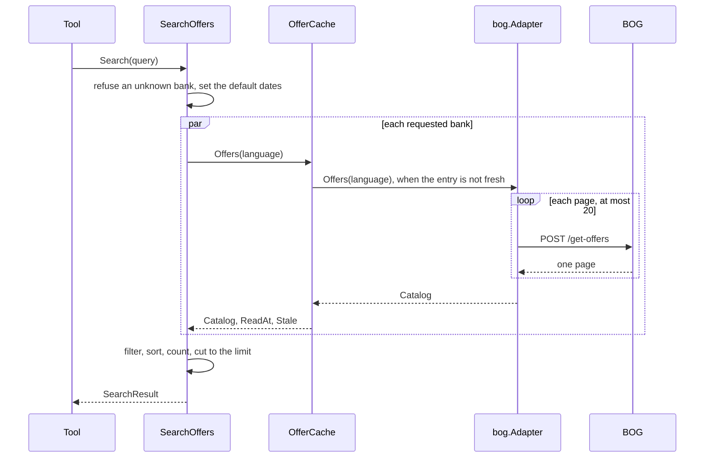

# Specification: The card offers of Bank of Georgia

## 1. Summary

This feature adds the context `offers`, the vendor client module `pkg/bogoffers`, and
the tools `offers_search_offers` and `offers_get_offer`. The tools answer for every bank
that the server can read. BOG is the first. The cache keeps the full list of a bank for
each language, and the use case filters it. `spec-scenarios.md` holds the scenarios.

## 2. Coverage

| Requirement        | Where this specification realizes it                      |
| ------------------ | --------------------------------------------------------- |
| `BOGOFFER-FR-001`  | 4.1 `adapter/bog`. 4.2 `Offer`. 4.3 tools                 |
| `BOGOFFER-FR-002`  | 4.2 `Offer.Benefit`. `BOGOFFER-DD-004`                    |
| `BOGOFFER-FR-003`  | 4.2 `Tier`. `BOGOFFER-DD-002`                             |
| `BOGOFFER-FR-004`  | 4.2 `Card`. `BOGOFFER-DD-002`                             |
| `BOGOFFER-FR-005`  | 4.2 `BenefitKind`. `BOGOFFER-DD-002`                      |
| `BOGOFFER-FR-006`  | 4.2 `Category`. `BOGOFFER-DD-002`                         |
| `BOGOFFER-FR-007`  | 4.2 `SearchOffers`, `GetOffer`                            |
| `BOGOFFER-FR-008`  | 4.2 `Period.Overlaps`, `SearchQuery`. 4.5                 |
| `BOGOFFER-FR-009`  | 4.2 `Period.Overlaps`                                     |
| `BOGOFFER-FR-010`  | 4.2 `SearchQuery`. 4.5                                    |
| `BOGOFFER-FR-011`  | 4.2 `SearchOffers`                                        |
| `BOGOFFER-FR-012`  | 4.2 `SearchQuery.Text`. 4.5                               |
| `BOGOFFER-FR-013`  | 4.2 `BankOffers.Total`. 4.3 tools                         |
| `BOGOFFER-FR-014`  | 4.2 `GetOffer`. 4.5. `BOGOFFER-DD-005`                    |
| `BOGOFFER-FR-015`  | 4.3 tools. `BOGOFFER-DD-003`                              |
| `BOGOFFER-FR-016`  | 4.2 `Catalog.ReadAt`                                      |
| `BOGOFFER-FR-017`  | 4.2 `SearchResult.Unavailable`. 4.4                       |
| `BOGOFFER-FR-018`  | 4.3 cache                                                 |
| `BOGOFFER-FR-019`  | 4.2 `UnknownBankError`. 4.5                               |
| `BOGOFFER-FR-020`  | 4.3 configuration. `BOGOFFER-DD-006`                      |
| `BOGOFFER-FR-021`  | 4.3 tools, the descriptions and the field `url`           |
| `BOGOFFER-FR-022`  | 4.2 `SearchQuery.Offset`, `BankOffers.NextOffset`. 4.3 tools. 4.5 |
| `BOGOFFER-NFR-001` | 4.3 cache. `BOGOFFER-SC-018`                              |
| `BOGOFFER-NFR-002` | 4.3 cache. `BOGOFFER-SC-019`                              |
| `BOGOFFER-NFR-003` | 4.3 cache. `BOGOFFER-SC-020`                              |
| `BOGOFFER-NFR-004` | 4.3 configuration. `BOGOFFER-SC-021`                      |
| `BOGOFFER-INV-001` | 4.2 `NewOffer`. `BOGOFFER-SC-022`                         |
| `BOGOFFER-INV-002` | `BOGOFFER-DD-004`                                         |
| `BOGOFFER-INV-003` | 4.2 `SearchOffers`, `GetOffer`                            |

## 3. Guideline compliance

| Rule                   | How this specification obeys it                                                     |
| ---------------------- | ----------------------------------------------------------------------------------- |
| `ARC-004`, `CLT-001`   | `pkg/bogoffers` is a module: `github.com/abgeo/georgia-mcp/pkg/bogoffers`. `ADR-0004`. |
| `ARC-008`              | `offers` imports no other context. The date and the language come from the kernel.  |
| `ARC-009`, `CFG-004`   | `bootstrap` builds the module of `offers` from `Config.Offers`.                     |
| `CLT-002`, `CLT-004`   | `pkg/bogoffers` uses `net/http`, `net/url`, and `encoding/json` only.               |
| `CLT-005`              | No `WithAPIKey`: the vendor needs no key.                                           |
| `CLT-009`, `CLT-011`   | The package comment and the README say that the API is unofficial. The module stays at `v0`. |
| `DOM-001`, `DOM-009`   | The port `OfferSource` names a capability. A bank is an adapter of it.              |
| `DOM-005`, `DOM-011`   | `adapter/bog` converts the vendor shape and wraps `kernel.ErrSourceUnavailable`.    |
| `DOM-007`              | The start date and the end date are `kernel.Date` values in Tbilisi.                |
| `DOM-010`              | Two use cases: `SearchOffers.Search` and `GetOffer.Get`.                            |
| `MCP-002` to `MCP-009` | 4.3 tools.                                                                          |
| `RSL-003` to `RSL-006` | `adapter/cache.OfferCache` on two `cache.Cache` stores.                             |
| `RSL-008`              | The configuration gives the limit of the calls.                                     |
| `CFG-003`, `CFG-005`   | Each variable has the prefix `GEOMCP_OFFERS_BOG_` and a default in its tag.         |

## 4. Design

### 4.1 Components

Every path is new unless the table says "change". `O` is `internal/app/georgia-mcp/offers`.

| Layer          | Path                       | Types and functions                                                   |
| -------------- | -------------------------- | --------------------------------------------------------------------- |
| Vendor client  | `pkg/bogoffers/`           | `Client`, `New`, `Option`, `Offers`, `OffersQuery`, `OffersPage`, `OffersResult`, `Offer`, `APIError`, `ErrUnexpectedStatus`. |
| Domain         | `O/domain/`                | `BankCode`, `Bank`, `Tier`, `Category`, `BenefitKind`, `CardCode`, `Card`, `Period`, `Offer`. 4.2. |
| Use case       | `O/app/`                   | `OfferSource`, `Catalog`, `Terms`, `SearchOffers`, `GetOffer`. 4.2.  |
| Driven adapter | `O/adapter/bog/`           | `Adapter`, `NewAdapter`, the tables of `BOGOFFER-DD-002`.             |
| Shared text    | `O/adapter/text/`          | `FromHTML`: the text of an HTML fragment. `BOGOFFER-DD-004`.          |
| Cache          | `O/adapter/cache/`         | `OfferCache`, `New`.                                                  |
| Tool           | `O/adapter/tool/`          | `Register`, the structs of 4.3.                                       |
| Module         | `O/module.go`, `O/config.go` | `Module`, `New`, `Config`, `Defaults`.            |
| Composition    | `internal/app/georgia-mcp/bootstrap/` (change) | `Config.Offers` with `envPrefix:"OFFERS_"`. `modules.go` builds `offers.New`. |
| Configuration  | `configs/.env.example` (change) | The variables of 4.3.                                            |
| Workspace      | `go.work` (change)         | `use ./pkg/bogoffers`.                                                |

**`pkg/bogoffers`.** It has the shape of `pkg/wissol`.

```go
const DefaultBaseURL = "https://bankofgeorgia.ge/api/bog-b/offers-hub"

var ErrUnexpectedStatus = errors.New("bogoffers: unexpected status")

func New(opts ...Option) *Client // the options of vendorhttp
func (c *Client) Offers(ctx context.Context, q OffersQuery) (OffersPage, error)

type OffersQuery struct {
    Language   string // "ka" or "en": the value of Accept-Language. Empty sends no header.
    PageNumber int    // from 0
    PageSize   int    // 1 to 100
}

type OffersPage struct {
    Code   int          `json:"code"` // 0 on a success
    Result OffersResult `json:"result"`
}

type OffersResult struct {
    TotalItemCount int     `json:"totalItemCount"`
    TotalPageCount int     `json:"totalPageCount"`
    Offers         []Offer `json:"offers"`
}

type Offer struct {
    CampaignID         int64       `json:"campaignId"`
    StartDate          *int64      `json:"startDate"` // milliseconds of the Unix epoch
    EndDate            *int64      `json:"endDate"`
    SoloCampaign       bool        `json:"soloCampaign"`
    ActivatingCampaign bool        `json:"activatingCampaign"`
    CategoryID         int         `json:"categoryId"`
    CategoryDesc       string      `json:"categoryDesc"`
    ProductCodes       string      `json:"productCodes"` // codes separated by ";"
    SegmentTypes       string      `json:"segmentTypes"` // codes separated by ";"
    BenefitName        string      `json:"benefitName"`
    BenefitValue       json.Number `json:"benefitValue"`
    BenefitBadge       string      `json:"benefitBadge"`
    CityNames          string      `json:"cityNames"`
    BrandNames         string      `json:"brandNames"`
    Title              string      `json:"title"`
    ShortDesc          string      `json:"shortDesc"`
    LongDesc           string      `json:"longDesc"` // HTML
}
```

`Offers` sends `POST /get-offers?pageInfo=true&pageNumber=N&pageSize=M` with the body
`{}`, `Content-Type: application/json`, and `Accept: application/json`. A status other
than 200 returns an `*APIError`. The body limit is 4 MiB. The default User-Agent is
`georgia-mcp/<version> (+https://github.com/abgeo/georgia-mcp)`.

**`adapter/bog`.** `Bank` returns `{Code: "bog", Name: "Bank of Georgia"}`. `Cards`
returns the cards of the table of `BOGOFFER-DD-002`. `Offers`
reads the pages with the size 100 from page 0, in order, until `totalPageCount`, and at
most 20 pages. A page with a `code` other than 0 fails the read. The mapping of an offer:

| Field of the vendor  | Domain value                                                           |
| -------------------- | ---------------------------------------------------------------------- |
| `campaignId`         | `ID`, as a decimal text.                                               |
| `title`              | `Title`, trimmed. Empty: the adapter leaves the offer out.             |
| `shortDesc`          | `Benefit`, trimmed.                                                    |
| `longDesc`           | `Terms`, through `text.FromHTML`.                                      |
| `startDate`, `endDate` | `Period`: the instant in Tbilisi, then its civil date. `null`: a zero date. |
| `segmentTypes`       | `Tiers`, with the table of `BOGOFFER-DD-002`.                          |
| `productCodes`       | `Cards`, with the table of `BOGOFFER-DD-002`.                          |
| `benefitName`        | `Kinds`, with the table of `BOGOFFER-DD-002`.                          |
| `categoryId`, `categoryDesc` | `Categories` with the table of `BOGOFFER-DD-002`, `BankCategories` with the name. |
| `campaignId`         | `URL`: `https://bankofgeorgia.ge/<ka or en>/offers-hub/details/<id>`.  |

The adapter leaves `Partner` empty: `brandNames` holds names of the system of BOG
("delivery 1"). An offer that `domain.NewOffer` refuses is left out, with a warning
that names the id and the cause. A failure of a page returns an error that wraps
`kernel.ErrSourceUnavailable`. `Terms` returns `offer.Terms` with the instant of the
call (`BOGOFFER-DD-005`).

**`module.go`.** `New(cfg Config, logger *slog.Logger) (*Module, error)` builds the source
of BOG when `cfg.BOG.Enabled` is true. Else it logs at info level `BOG is off` with
`variable=GEOMCP_OFFERS_BOG_ENABLED`. `Register` adds the two tools when one source or
more exists. `Close` closes each cache.

### 4.2 Domain model

```go
// domain
type BankCode string // lowercase letters, 2 to 16
func ParseBankCode(s string) (BankCode, error)

type Bank struct {
    Code BankCode
    Name string // "Bank of Georgia"
}

type Tier string // standard, premium, private, youth: requirements 5.1
func ParseTier(s string) (Tier, error)
func Tiers() []Tier

type Category string // the 14 values of requirements 5.2, in that order
func ParseCategory(s string) (Category, error)
func Categories() []Category

type BenefitKind string // discount, cashback, points, other: requirements 5.3
func ParseBenefitKind(s string) (BenefitKind, error)
func BenefitKinds() []BenefitKind

type CardCode string // lowercase letters, digits, and "_", 2 to 40
func ParseCardCode(s string) (CardCode, error)
func CardCodeOf(vendorCode string) CardCode // lowercase, each other character to "_"

type Card struct {
    Code CardCode
    Name string
}

type Period struct {
    Start kernel.Date // zero: the bank publishes none
    End   kernel.Date // zero: the bank publishes none
}
func NewPeriod(start, end kernel.Date) (Period, error) // refuses an end before the start
func (p Period) Overlaps(from, to kernel.Date) bool     // a zero start is open to the past, a zero end to the future
func (p Period) EndsBefore(day kernel.Date) bool        // false for a zero end

type Offer struct {
    Bank           BankCode
    ID             string        // the id of the bank
    Title          string
    Partner        string        // empty when the bank names none
    Benefit        string        // the benefit text
    Kinds          []BenefitKind // one or more, in the order of BenefitKinds
    Categories     []Category    // one or more, in the order of Categories
    BankCategories []string      // the names of the bank, in its order
    Tiers          []Tier        // one or more, in the order of Tiers
    Cards          []Card        // sorted by code; empty: every card of the tiers
    Period         Period
    URL            string        // an absolute https address
    Terms          string        // empty when the list of the bank holds no terms
}
func NewOffer(o Offer) (Offer, error)
```

`NewOffer` removes a duplicate value from each list and sorts each list. It refuses an
invalid bank code, an empty id, an empty title, no tier, no category, no kind, and an
address that is not absolute https. A list with `other` and a second kind drops `other`.
Errors in `domain/errors.go`: `ErrInvalidBankCode`, `ErrInvalidTier`,
`ErrInvalidCategory`, `ErrInvalidBenefitKind`, `ErrInvalidCardCode`, `ErrInvalidPeriod`,
`ErrInvalidOffer`.

```go
// app
type Catalog struct {
    Offers []domain.Offer // every offer of the bank that the bank lists now
    ReadAt time.Time
    Stale  bool
}

type Terms struct {
    Text   string
    ReadAt time.Time
    Stale  bool
}

type OfferSource interface {
    Bank() domain.Bank
    Cards() []domain.Card // the cards of the tables of the adapter, sorted by code
    Offers(ctx context.Context, language kernel.Language) (Catalog, error)
    Terms(ctx context.Context, offer domain.Offer, language kernel.Language) (Terms, error)
}

type SearchQuery struct {
    Banks      []domain.BankCode    // empty: every bank
    Tiers      []domain.Tier        // empty: every tier
    Categories []domain.Category    // empty: every category
    Kinds      []domain.BenefitKind // empty: every kind
    Cards      []domain.CardCode    // empty: every card
    From, To   kernel.Date          // zero From: today in Tbilisi. Zero To: From.
    Text       string               // empty: no text filter
    Language   kernel.Language
    Limit      int                  // 1 to 30, for each bank
    Offset     int                  // 0 or more: the count of matching offers to skip, for each bank
}

type BankOffers struct {
    Bank   domain.Bank
    Offers []domain.Offer // at most Limit, after Offset
    Total  int            // every matching offer
    NextOffset int        // Offset plus the count of Offers, when it is less than Total. Else 0.
    ReadAt time.Time
    Stale  bool
}

type SearchResult struct {
    Banks       []BankOffers  // sorted by bank code
    Unavailable []domain.Bank // the banks that failed, with no offers held
}

func NewSearchOffers(sources []OfferSource, now func() time.Time) *SearchOffers
func (u *SearchOffers) Search(ctx context.Context, q SearchQuery) (SearchResult, error)
func (u *SearchOffers) Banks() []domain.Bank
func (u *SearchOffers) Cards() map[domain.BankCode][]domain.Card

type OfferQuery struct {
    Bank     domain.BankCode
    ID       string
    Language kernel.Language
}

type OfferDetail struct {
    Bank   domain.Bank
    Offer  domain.Offer
    Terms  string
    ReadAt time.Time
    Stale  bool
}

func NewGetOffer(sources []OfferSource, now func() time.Time) *GetOffer
func (u *GetOffer) Get(ctx context.Context, q OfferQuery) (OfferDetail, error)
```

`Search` refuses a `To` before `From`, and more than 366 days from `From` to `To`. It
leaves out each offer whose period ends before today (`BOGOFFER-FR-007`). An offer
matches when:

- its period overlaps `From` to `To`,
- each non-empty list of the query shares one value with the offer,
- `Cards` is empty, or the offer has no card, or it has a requested card (`BOGOFFER-FR-011`),
- `Text` is empty, or the lowercase title, partner, benefit, or a bank category holds the lowercase text.

The offers of a bank sort by end date, the open ones last, then by title, then by id.
`Search` skips the first `Offset` of them, then keeps at most `Limit`. The id ends the
order, so two pages of one catalog share no offer.

`Get` finds the offer in the catalog of its bank. An offer that is absent, or that ends
before today, returns `ErrOfferNotFound`. When `Offer.Terms` is not empty, `Get` returns
it with the `ReadAt` and the `Stale` of the catalog. Else it calls `Terms` of the source.

Errors in `app/errors.go`: `ErrUnknownBank` with `*UnknownBankError{Code, Known}`,
`ErrOfferNotFound`, `ErrInvalidRange`.

### 4.3 Declarations

**MCP tool.**

| Tool                   | Input | Output | Errors (4.5) | Realizes |
| ---------------------- | ----- | ------ | ------------ | -------- |
| `offers_search_offers` | `banks`, `tiers`, `categories`, `kinds`, `cards`, `from`, `to`, `query`, `language`, `limit`, `offset` | `searchOutput` | each value, range, limit, offset, query, unknown bank, every bank unavailable | `BOGOFFER-FR-001` to `BOGOFFER-FR-013`, `BOGOFFER-FR-015` to `BOGOFFER-FR-019`, `BOGOFFER-FR-021`, `BOGOFFER-FR-022` |
| `offers_get_offer`     | `bank`, `id` (both required), `language` | `offerDetailOutput` | bank code, unknown bank, id, not found, bank unavailable | `BOGOFFER-FR-014` to `BOGOFFER-FR-019`, `BOGOFFER-FR-021` |

```go
type searchOffersInput struct {
    Banks      []string `json:"banks,omitempty"      jsonschema:"Bank codes. Empty asks every bank. The description lists the codes."`
    Tiers      []string `json:"tiers,omitempty"      jsonschema:"Customer tiers: standard, premium, private, youth. An offer matches when it has one of them."`
    Categories []string `json:"categories,omitempty" jsonschema:"Offer categories: dining, leisure, travel, health_beauty, auto, transport, shopping, electronics, home, education, kids, entertainment, real_estate, other."`
    Kinds      []string `json:"kinds,omitempty"      jsonschema:"Benefit kinds: discount, cashback, points, other."`
    Cards      []string `json:"cards,omitempty"      jsonschema:"Card codes of the banks. An offer that names no card matches every card. The description lists the codes of each bank."`
    From       string   `json:"from,omitempty"       jsonschema:"The first date of the period, YYYY-MM-DD. The default is today in Tbilisi."`
    To         string   `json:"to,omitempty"         jsonschema:"The last date of the period, YYYY-MM-DD, at most 366 days after from. The default is from."`
    Query      string   `json:"query,omitempty"      jsonschema:"A text to find in the title, the partner, the benefit, or the bank category, 1 to 100 characters."`
    Language   string   `json:"language,omitempty"   jsonschema:"The language of the texts: ka or en. The default is en."`
    Limit      int      `json:"limit,omitempty"      jsonschema:"The maximum count of offers for each bank, 1 to 30. The default is 10."`
    Offset     int      `json:"offset,omitempty"     jsonschema:"The count of matching offers of each bank to skip, 0 or more. Give the next_offset of a bank to read its next page. The default is 0."`
}

type searchOutput struct {
    Meaning     string             `json:"meaning"               jsonschema:"How to read the offers."`
    Banks       []bankOffersOutput `json:"banks"                 jsonschema:"The offers of each bank that answered, sorted by bank code."`
    Unavailable []bankOutput       `json:"unavailable,omitempty" jsonschema:"The banks that did not answer."`
}

type bankOffersOutput struct {
    Bank   string        `json:"bank"   jsonschema:"The bank code."`
    Source string        `json:"source" jsonschema:"The name of the bank."`
    AsOf   string        `json:"as_of"  jsonschema:"The instant at which the server read the offers, RFC 3339. The bank publishes no instant."`
    Stale  bool          `json:"stale"  jsonschema:"True when the bank did not answer and the server returns offers it read before."`
    Total  int           `json:"total"  jsonschema:"The count of every matching offer of the bank. offers holds at most limit of them."`
    NextOffset int       `json:"next_offset,omitempty" jsonschema:"The offset of the next page of the bank. Absent when offers holds the last matching offer."`
    Offers []offerOutput `json:"offers" jsonschema:"The matching offers, the soonest end first."`
}

type offerOutput struct {
    Bank           string       `json:"bank"                      jsonschema:"The bank code."`
    ID             string       `json:"id"                        jsonschema:"The offer id of the bank. offers_get_offer takes it."`
    Title          string       `json:"title"                     jsonschema:"The title of the offer."`
    Partner        string       `json:"partner,omitempty"         jsonschema:"The company that gives the benefit. Absent when the bank names none."`
    Benefit        string       `json:"benefit"                   jsonschema:"The text of the bank that states the benefit. Read the percent, the cap, and the conditions from it."`
    Kinds          []string     `json:"kinds"                     jsonschema:"The benefit kinds that the bank states in a field. other: the bank states none."`
    Categories     []string     `json:"categories"                jsonschema:"The offer categories, the same for every bank."`
    BankCategories []string     `json:"bank_categories,omitempty" jsonschema:"The names of the categories at the bank."`
    Tiers          []string     `json:"tiers"                     jsonschema:"The customer tiers that can use the offer."`
    Cards          []cardOutput `json:"cards,omitempty"           jsonschema:"The cards that the offer names. Absent: every card of the tiers."`
    StartDate      string       `json:"start_date,omitempty"      jsonschema:"The first date of the offer, YYYY-MM-DD. Absent when the bank publishes none."`
    EndDate        string       `json:"end_date,omitempty"        jsonschema:"The last date of the offer, YYYY-MM-DD. Absent when the bank publishes none."`
    URL            string       `json:"url"                       jsonschema:"The page of the offer at the bank. Give it to the person with each offer that you name."`
}

type cardOutput struct {
    Code string `json:"code" jsonschema:"The card code. cards of offers_search_offers takes it."`
    Name string `json:"name" jsonschema:"The name of the card at the bank."`
}

type bankOutput struct {
    Bank   string `json:"bank"   jsonschema:"The bank code."`
    Source string `json:"source" jsonschema:"The name of the bank."`
}

type getOfferInput struct {
    Bank     string `json:"bank"               jsonschema:"The bank code of the offer."`
    ID       string `json:"id"                 jsonschema:"The offer id from offers_search_offers."`
    Language string `json:"language,omitempty" jsonschema:"The language of the texts: ka or en. The default is en."`
}

type offerDetailOutput struct {
    Source string      `json:"source" jsonschema:"The name of the bank."`
    AsOf   string      `json:"as_of"  jsonschema:"The instant at which the server read the terms, RFC 3339."`
    Stale  bool        `json:"stale"  jsonschema:"True when the bank did not answer and the server returns terms it read before."`
    Offer  offerOutput `json:"offer"  jsonschema:"The offer."`
    Terms  string      `json:"terms"  jsonschema:"The full conditions of the offer, as the bank writes them."`
}
```

`meaning` is the constant `benefit is the text of the bank. The server reads no number
from it: read the percent, the cap, and the conditions from the text. kinds come from a
field of the bank, and other means that the bank states none. tiers: standard is every
customer, premium the premium package (SOLO at BOG), private the private banking (Wealth
Management at BOG), youth the pupils and the students.`

| Tool                   | Title                       | Description |
| ---------------------- | --------------------------- | ----------- |
| `offers_search_offers` | Card offers of Georgian banks | Finds the current offers that Georgian banks give to card holders at partners: discounts, cashback, and points. Filters by bank, customer tier, category, benefit kind, card, and period. For "this month", give the first and the last date of the month. When a bank has a next_offset, call again with that offset to read more. The benefit is the text of the bank. Compare the banks by reading it. Give the person the url of each offer that you name. Then `meaning`, the bank codes, and the card codes of each bank. |
| `offers_get_offer`     | Terms of a card offer       | Returns the full conditions of one offer of a Georgian bank. Use the bank and the id from offers_search_offers. Give the person the url of the offer with the conditions. |

`adapter/tool` builds the list of the card codes in the description from
`SearchOffers.Cards`.

**Vendor endpoint.**

| Client          | Method and path        | Key  | Official              | Realizes          |
| --------------- | ---------------------- | ---- | --------------------- | ----------------- |
| `pkg/bogoffers` | `POST /get-offers`     | None | No, an unofficial API | `BOGOFFER-FR-001` |

A real answer, recorded on 2026-10-20, cut to one offer and the fields of 4.1:

```
POST https://bankofgeorgia.ge/api/bog-b/offers-hub/get-offers?pageInfo=true&pageNumber=0&pageSize=100
Accept-Language: en
200 application/json
{"code":0,"result":{"totalItemCount":239,"totalPageCount":3,"currentItemCount":100,
 "offers":[{"campaignId":17409,"startDate":1780012800000,"endDate":1810944000000,
  "soloCampaign":false,"activatingCampaign":false,"categoryId":111,
  "categoryDesc":"Restaurants","productCodes":"STUDENTS","benefitName":"DISCOUNT",
  "benefitValue":20,"benefitBadge":"%","cityNames":"Tbilisi",
  "brandNames":"delivery 1;Delivery 2;Ronny's Pizza","title":"Ronny's Pizza",
  "shortDesc":"20% Discount, unlimited\n\n","longDesc":"<p>Until 22 May 2027 ...</p>",
  "segmentTypes":"RETAIL;SOLO;WM"}]}}
```

**Cache.** Two stores for each bank. The language is part of each key.

| Port method | Key              | Time to live | Maximum stale | Entries | Realizes |
| ----------- | ---------------- | ------------ | ------------- | ------- | -------- |
| `Offers`    | `<language>`     | 1 hour       | 24 hours      | 2       | `BOGOFFER-NFR-001` to `BOGOFFER-NFR-003`, `BOGOFFER-FR-018` |
| `Terms`     | `<id>/<language>` | 1 hour      | 24 hours      | 500     | `BOGOFFER-FR-018` |

`ReadAt` is the read instant that the source gave. `Stale` comes from the cache.

**Configuration.**

| Variable                        | Type     | Default                                          | Secret | Realizes           |
| ------------------------------- | -------- | ------------------------------------------------ | ------ | ------------------ |
| `GEOMCP_OFFERS_BOG_ENABLED`     | bool     | `true`                                           | No     | `BOGOFFER-FR-020`  |
| `GEOMCP_OFFERS_BOG_BASE_URL`    | URL      | `https://bankofgeorgia.ge/api/bog-b/offers-hub`  | No     | `BOGOFFER-FR-001`  |
| `GEOMCP_OFFERS_BOG_TIMEOUT`     | duration | `10s`                                            | No     | `BOGOFFER-NFR-004` |
| `GEOMCP_OFFERS_BOG_RATE`        | float    | `1`                                              | No     | `BOGOFFER-NFR-002` |
| `GEOMCP_OFFERS_BOG_BURST`       | int      | `1`                                              | No     | `BOGOFFER-NFR-002` |

`offers.Config` holds `BOG vendors.Config` with `envPrefix:"BOG_"`, as `fuel.Config` does. `offers.Defaults` gives the defaults of this table (`PLATFORM-DD-014`).

### 4.4 Flow



`Search` asks each requested bank at once and waits for all, as `GetPrices` of `fuel`
does. A bank that fails joins `Unavailable`. When every requested bank fails, `Search`
returns an error that wraps `kernel.ErrSourceUnavailable` and names the banks.

### 4.5 Errors

| Condition                                       | Sentinel                        | Tool message |
| ----------------------------------------------- | ------------------------------- | ------------ |
| A text that is not a bank code                  | `domain.ErrInvalidBankCode`     | `banks: "BOG" is not a bank code. Use one of: bog.` |
| A bank code that the server lacks               | `app.ErrUnknownBank`            | `banks: "basis" is not a bank of this server. Use one of: bog.` |
| A tier, a category, or a kind not in 5.1 to 5.3 | `domain.ErrInvalidTier`, `ErrInvalidCategory`, `ErrInvalidBenefitKind` | `tiers: "vip" is not a tier. Use one of: standard, premium, private, youth.` |
| A text that is not a card code                  | `domain.ErrInvalidCardCode`     | `cards: "Visa Gold" is not a card code. Use the lowercase codes of the description.` |
| A date that is not `YYYY-MM-DD`                 | `kernel.ErrInvalidDate`         | `from: "20.10.2026" is not a date. Use YYYY-MM-DD.` |
| `to` before `from`, or more than 366 days       | `app.ErrInvalidRange`           | `to: must be from 0 to 366 days after from.` |
| A limit outside 1 to 30                         | none, the tool checks it        | `limit: 50 is out of range. Use 1 to 30.` |
| A negative offset                               | none, the tool checks it        | `offset: -1 is out of range. Use 0 or more.` |
| A query that is empty after trim, or too long   | none, the tool checks it        | `query: use 1 to 100 characters.` |
| An empty id                                     | none, the tool checks it        | `id: give the offer id from offers_search_offers.` |
| An offer that the bank does not list now        | `app.ErrOfferNotFound`          | `id: Bank of Georgia lists no current offer "123". Use offers_search_offers.` |
| A language other than `ka` and `en`             | `kernel.ErrUnknownLanguage`     | `language: "ru" is not a language of this tool. Use ka or en.` |
| Every requested bank fails                      | `kernel.ErrSourceUnavailable`   | `Bank of Georgia did not answer. Try again in a few minutes.` |

A limit of 0 asks the default. When several banks fail, the message joins their names.

## 5. Design decisions

### `BOGOFFER-DD-001`

**Realizes:** `BOGOFFER-NFR-002`, `BOGOFFER-NFR-003`
**Decision:** The cache keeps the full list of a bank for each language. The use case
filters, sorts, and cuts the list after the cache.
**Rationale:** BOG has 239 offers in 3 calls. A filter in the vendor call costs a call for
each set of filters, and no bank offers every filter of the tool.
**Alternatives:** The filters of the bank in each call. Many calls, and three different
filter models.

### `BOGOFFER-DD-002`

**Realizes:** `BOGOFFER-FR-003` to `BOGOFFER-FR-006`
**Decision:** The adapter maps each code of BOG with a fixed table. A code that is not in
a table gives the value of the last column, and a warning one time for each code.

| `segmentTypes` | Tier       |
| -------------- | ---------- |
| `RETAIL`       | `standard` |
| `SOLO`         | `premium`  |
| `WM`           | `private`  |
| other          | none       |

| `benefitName`         | Kind       |
| --------------------- | ---------- |
| `DISCOUNT`            | `discount` |
| `CASHBACK`            | `cashback` |
| `PLUS`, `MR`          | `points`   |
| `SCOOLA`, `OTHER`, other | `other` |

| `categoryId` | Name (en)       | Category        |
| ------------ | --------------- | --------------- |
| 111          | Restaurants     | `dining`        |
| 108          | Leisure         | `leisure`       |
| 110          | Health and Care | `health_beauty` |
| 12           | Travel          | `travel`        |
| 113          | Cars            | `auto`          |
| 109          | Shopping        | `shopping`      |
| 5            | Electronics     | `electronics`   |
| 115          | Home            | `home`          |
| 114          | Education       | `education`     |
| 116          | sCool           | `kids`          |
| 112          | Entertainment   | `entertainment` |
| 16, other    | Others          | `other`         |

| `productCodes`           | Card code                | Name                    |
| ------------------------ | ------------------------ | ----------------------- |
| `SOLO`                   | `solo`                   | SOLO                    |
| `PLUS`                   | `plus`                   | PLUS                    |
| `SUPER_PLUS`             | `super_plus`             | Super PLUS              |
| `AMEX`                   | `amex`                   | Amex                    |
| `VISA_CARDS`             | `visa`                   | Visa                    |
| `VISA_CREDIT_INFINITE`   | `visa_infinite`          | Visa Infinite           |
| `VISA_CREDIT_PLATINUM`   | `visa_platinum`          | Visa Platinum           |
| `VISA_CREDIT_SIGNATURE`  | `visa_signature`         | Visa Signature          |
| `MASTERCARD`             | `mastercard`             | Mastercard              |
| `MASTERCARD_WORLD_ELITE` | `mastercard_world_elite` | Mastercard World Elite  |
| `STUDENTS`               | `student_card`           | Student Card            |
| `SCHOOL_CARD`            | `scool_card`             | sCool Card              |
| `TEACHER_CARD`           | `teacher_card`           | Teacher Card            |
| other                    | `CardCodeOf(code)`       | the code                |

**Rationale:** A code is stable. A name changes with the language. The warning tells the
operator to extend a table. The offer stays in the answer.
**Alternatives:** The filter lists of `get-categories`. One more call, and no shared category.

### `BOGOFFER-DD-003`

**Realizes:** `BOGOFFER-FR-015`
**Decision:** The adapter reads one list for each language. The language is part of the
cache key, and the cache reads a language only when a request asks for it.
**Rationale:** BOG answers one language in each call. A request in `ka` must not cost a
call when no person asks in `ka`.
**Alternatives:** Both languages in each read. Twice the calls for each refresh.

### `BOGOFFER-DD-004`

**Realizes:** `BOGOFFER-FR-002`, `BOGOFFER-INV-002`
**Decision:** `text.FromHTML` turns an HTML fragment into text with the standard library:
`<p>`, `<br>`, and `<li>` end a line, `<li>` starts with "- ", each other tag goes away,
`html.UnescapeString` decodes each entity. It joins runs of empty lines into one. The
adapter trims the benefit text and keeps every word.
**Rationale:** On 2026-10-20 `longDesc` held 8 tags: `p`, `br`, `strong`, `li`, `a`, `ul`, `em`, `span`. The server module has no HTML parser,
and `CLT-002` allows one only in a client of a web page.
**Alternatives:** `golang.org/x/net/html` in the server. A new dependency for 8 tags.

### `BOGOFFER-DD-005`

**Realizes:** `BOGOFFER-FR-014`
**Decision:** The list of BOG holds the terms. `GetOffer` returns `Offer.Terms` with the
read instant of the catalog, and sends no call. The port keeps `Terms` for the banks whose
list has no terms. `bog.Adapter.Terms` returns `offer.Terms`.
**Rationale:** One shape for every bank. No call for BOG.
**Alternatives:** A port with no `Terms`, and a second port for the banks that need it.

### `BOGOFFER-DD-006`

**Realizes:** `BOGOFFER-FR-020`
**Decision:** `GEOMCP_OFFERS_BOG_ENABLED` turns BOG off. With no source, the module adds
no tool.
**Rationale:** `WISFUEL-DD-007`.
**Alternatives:** A tool that answers "no bank configured".

## 6. Scenarios

`spec-scenarios.md` holds `BOGOFFER-SC-001` to `BOGOFFER-SC-023`.

## 7. Build plan

| #   | Step                                                                      | Realizes                                | Done |
| --- | ------------------------------------------------------------------------- | --------------------------------------- | ---- |
| 1   | Accept `ADR-0004`. Change `DOM-001` and `CLT-001`.                        | `BOGOFFER-FR-001`                       | [x]  |
| 2   | `pkg/bogoffers` module, recorded answers, README, example. `go.work`.     | `BOGOFFER-FR-001`                       | [x]  |
| 3   | `domain`: every type of 4.2.                                              | `BOGOFFER-FR-003` to `BOGOFFER-FR-009`, `BOGOFFER-INV-001` | [x]  |
| 4   | `app`: port, `SearchOffers`, `GetOffer`.                                  | `BOGOFFER-FR-007` to `BOGOFFER-FR-019`  | [x]  |
| 5   | `adapter/text`, `adapter/bog`.                                            | `BOGOFFER-FR-001` to `BOGOFFER-FR-006`, `BOGOFFER-INV-002` | [x]  |
| 6   | `adapter/cache`: `OfferCache`.                                            | `BOGOFFER-FR-018`, `BOGOFFER-NFR-001` to `BOGOFFER-NFR-003` | [x]  |
| 7   | `adapter/tool`: `Register`.                                               | `BOGOFFER-FR-013`, `BOGOFFER-FR-015`    | [x]  |
| 8   | `module.go`, `config.go`, `bootstrap`, `configs/.env.example`.            | `BOGOFFER-FR-020`                       | [x]  |
| 9   | Move the terms of requirements 5 to the glossary, in a section `Offers`.  | `DOM-002`                               | [x]  |
| 10  | `app` and `adapter/tool`: the offset and the next offset.                 | `BOGOFFER-FR-022`                       | [x]  |

## 8. Out of scope for this specification

Nothing that the requirements demand.

## Retired identifiers

This file has no retired identifier.
