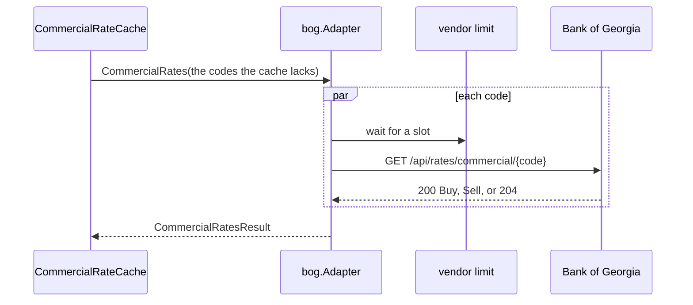

# Specification: The commercial exchange rates of Bank of Georgia

## 1. Summary

This feature adds the vendor client module `pkg/bog`, and Bank of Georgia as the second
source of `rates_get_commercial_rates`. The tool, the use case, the domain, and the cache
of `TBCRATE` do not change. Bank of Georgia answers one currency in each call, so the
adapter reads the requested codes at once.

## 2. Coverage

| Requirement       | Where this specification realizes it                      |
| ----------------- | --------------------------------------------------------- |
| `BOGRATE-FR-001`  | 4.1 `adapter/bog`. 4.3 vendor endpoint. `BOGRATE-DD-002`  |
| `BOGRATE-FR-002`  | `BOGRATE-DD-004`, `BOGRATE-DD-008`                        |
| `BOGRATE-FR-003`  | 4.3 configuration. `BOGRATE-DD-006`, `BOGRATE-DD-007`     |
| `BOGRATE-NFR-001` | 4.3 configuration. `BOGRATE-DD-003`                       |
| `BOGRATE-INV-001` | `BOGRATE-DD-005`                                          |

## 3. Guideline compliance

| Rule                   | How this specification obeys it                                              |
| ---------------------- | ---------------------------------------------------------------------------- |
| `ARC-004`, `CLT-001`   | `pkg/bog` is a module: `github.com/abgeo/georgia-mcp/pkg/bog`, `go 1.26.0`.  |
| `CLT-002`, `CLT-004`   | `pkg/bog` uses `net/http`, `net/url`, and `encoding/json` only.              |
| `CLT-005`              | No `WithAPIKey`: the vendor needs no key.                                    |
| `CLT-007`              | A status other than 200 and 204 is an `*APIError`.                           |
| `CLT-008`, `RSL-002`   | Neither the client nor the adapter retries a 429.                            |
| `DOM-005`, `DOM-011`   | `adapter/bog` converts the vendor shape and wraps `kernel.ErrSourceUnavailable`. |
| `DOM-009`              | Bank of Georgia is a second adapter of `CommercialRateSource`.               |
| `MCP-002`              | No new tool. The description lists `bog` through `GetCommercialRates.Banks`. |
| `RSL-003` to `RSL-006` | The bank sits behind `CommercialRateCache`, as TBC does.                     |
| `RSL-008`              | The configuration gives the limit of the calls. `BOGRATE-DD-003`.            |
| `CFG-003`, `CFG-005`   | Each variable has the prefix `GEOMCP_RATES_BOG_` and a default in its tag.   |

## 4. Design

### 4.1 Components

Every path is new unless the table says "change". `R` is `internal/app/georgia-mcp/rates`.

| Layer          | Path                                  | Types and functions                                          |
| -------------- | ------------------------------------- | ------------------------------------------------------------ |
| Vendor client  | `pkg/bog/`                            | `Client`, `New`, `Option`, `CommercialRate`, `APIError`, `ErrUnexpectedStatus`, `ErrNoRate`. |
| Driven adapter | `R/adapter/bog/`                      | `Adapter`, `NewAdapter`.                                     |
| Module         | `R/module.go`, `R/config.go` (change) | `Config.BOG`, `BOGConfig`, `BOGHTTPConfig`, the source of Bank of Georgia. |
| Configuration  | `configs/.env.example` (change)       | The variables of 4.3.                                        |
| Workspace      | `go.work` (change)                    | `use ./pkg/bog`.                                             |

**`pkg/bog`.** A minimal client: the commercial rate only (`BOGRATE-DD-001`). It has the
shape of `pkg/tbc` with no key.

```go
const DefaultBaseURL = "https://api.businessonline.ge"

var (
    ErrUnexpectedStatus = errors.New("bog: unexpected status")
    ErrNoRate           = errors.New("bog: no rate") // the answer 204
)

func New(opts ...Option) *Client // WithBaseURL, WithHTTPClient, WithUserAgent
func (c *Client) CommercialRate(ctx context.Context, currency string) (*CommercialRate, error)

type CommercialRate struct {
    Buy  json.Number `json:"Buy"`
    Sell json.Number `json:"Sell"`
}

type APIError struct {
    StatusCode int
    RetryAfter string // the header Retry-After, as the vendor writes it
    Body       string // the first 1 KiB
}
```

`CommercialRate` sends `GET /api/rates/commercial/{currency}`, with the code escaped by
`url.PathEscape`. A 204 returns `ErrNoRate`. Any status other than 200 and 204 returns an
`*APIError` that wraps `ErrUnexpectedStatus`. Its `Error` text holds the status, and the
value of `RetryAfter` when the header is present. The documentation comment gives the
limit of 60 calls in a minute. The body limit is 1 MiB.

**`adapter/bog`.** `Bank` returns `{Code: "bog", Name: "Bank of Georgia"}`.
`CommercialRates` reads each code with one call, all at once (`BOGRATE-DD-002`).
`ReadAt` is the instant after the last call.

**`module.go` (change).** `commercialSources` builds the source of Bank of Georgia when
`cfg.BOG.Enabled` is true, and the source of TBC when the key is not empty. Else it logs
at info level `Bank of Georgia is off` with the attribute
`variable=GEOMCP_RATES_BOG_ENABLED` (`BOGRATE-DD-007`). The use case sorts the banks by
code, so the order of the sources does not matter.

### 4.2 Domain model

No change. `TBCRATE` 4.2 holds `Bank`, `CommercialRate`, `CommercialRateSource`, and
`GetCommercialRates`.

### 4.3 Declarations

**Vendor endpoint.**

| Client    | Method and path                       | Key  | Official        | Realizes          |
| --------- | ------------------------------------- | ---- | --------------- | ----------------- |
| `pkg/bog` | `GET /api/rates/commercial/{currency}` | None | Yes, documented | `BOGRATE-FR-001`  |

A real answer, recorded on 2026-10-19:

```
GET https://api.businessonline.ge/api/rates/commercial/USD
200 application/json; charset=utf-8
{"Buy":2.56500000,"Sell":2.62900000}

GET https://api.businessonline.ge/api/rates/commercial/GEL
204, no body
```

**Configuration.**

| Variable                      | Type     | Default                         | Secret | Realizes          |
| ----------------------------- | -------- | ------------------------------- | ------ | ----------------- |
| `GEOMCP_RATES_BOG_ENABLED`    | bool     | `true`                          | No     | `BOGRATE-FR-003`  |
| `GEOMCP_RATES_BOG_BASE_URL`   | URL      | `https://api.businessonline.ge` | No     | `BOGRATE-FR-001`  |
| `GEOMCP_RATES_BOG_TIMEOUT`    | duration | `10s`                           | No     | `BOGRATE-FR-001`  |
| `GEOMCP_RATES_BOG_RATE`       | float    | `0.8`                           | No     | `BOGRATE-NFR-001` |
| `GEOMCP_RATES_BOG_BURST`      | int      | `10`                            | No     | `BOGRATE-NFR-001` |

`rates.Config` gains `BOG BOGConfig` with `envPrefix:"BOG_"`. `BOGConfig` holds
`Enabled bool`, `BaseURL url.URL`, and `HTTP BOGHTTPConfig`. `BOGHTTPConfig` has the
fields of `httpclient.Config` with the defaults of this table, as `TBCHTTPConfig` does.

The tool, its structs, its errors, and the cache are those of `TBCRATE` 4.3 and 4.5. The
cache of Bank of Georgia is a second `CommercialRateCache`: 5 minutes to live, 55 minutes
of maximum stale, 256 entries.

### 4.4 Flow



The adapter runs one goroutine for each code in an `errgroup` with a context. The first
failure cancels the other calls, and the adapter returns an error that wraps
`kernel.ErrSourceUnavailable`. `CommercialRateCache` then returns the stale codes as
`TBCRATE-DD-012` gives.

## 5. Design decisions

### `BOGRATE-DD-001`

**Realizes:** `BOGRATE-FR-001`, `CLT-001`
**Decision:** `pkg/bog` covers the commercial rate method only.
**Rationale:** The other rate methods give the rate of the digital channels, the cross
rates, and the official rate. The requirements leave them out. The other methods of the
API need a business account.
**Alternatives:** Every public rate method now. Five methods with no user in the server.

### `BOGRATE-DD-002`

**Realizes:** `BOGRATE-FR-001`, `BOGRATE-NFR-001`
**Decision:** The adapter reads the codes at once, one call for each code. A failure of
one call fails the bank.
**Rationale:** The owner chose it on 2026-10-19. A request of 10 codes that the cache
lacks answers in the time of about one call. `TBCRATE-DD-012` already demands every
requested code, so a partial answer has no use.
**Alternatives:** One call after another. With a limit of 1 call each second, 10 codes
take about 9 seconds, close to the timeout of 10 seconds.

### `BOGRATE-DD-003`

**Realizes:** `BOGRATE-NFR-001`
**Decision:** The vendor limit defaults to 0.8 calls each second with a burst of 10.
**Rationale:** A burst of 10 serves the 10 codes of one request at once. In any 60
seconds the limit allows at most `10 + 0.8 × 60 = 58` calls, under the 60 of the source.
**Alternatives:** 1 call each second with a burst of 1, as TBC: under the limit, and
slow for a request of many codes. 1 call each second with a burst of 10: 70 calls in
the first minute, over the limit.

### `BOGRATE-DD-004`

**Realizes:** `BOGRATE-FR-002`, `CLT-007`
**Decision:** The client returns `ErrNoRate` for a 204. The adapter puts the code in
`Missing`.
**Rationale:** A 204 is a success with no rate, so it is not an `*APIError`. A sentinel
lets the adapter tell it from a failure with `errors.Is`.
**Alternatives:** A nil rate and a nil error. A caller that forgets the check reads a
nil pointer.

### `BOGRATE-DD-005`

**Realizes:** `BOGRATE-INV-001`, `BOGRATE-FR-001`
**Decision:** The adapter parses the text of `Buy` and `Sell` with
`decimal.NewFromString`, and drops the trailing zeros: `2.56500000` gives `2.565`.
**Rationale:** The source pads each price to eight decimal places. The value stays
exact, and the requirement shows `2.565`. The tool writes `StringFixed(-Exponent())`,
so a padded value would show eight places as a false precision.
**Alternatives:** Keep the padding: `2.56500000` in the answer, next to `2.566` of TBC.

### `BOGRATE-DD-006`

**Realizes:** `BOGRATE-FR-003`, `CFG-005`
**Decision:** The switch is `Enabled bool` with `envDefault:"true"`.
**Rationale:** The default lives in the tag. A `Config` built in Go with no `BOG` field
reads no Bank of Georgia, so a test of TBC calls no real vendor.
**Alternatives:** `Disabled bool`. Its zero value turns the bank on in every `Config`
literal.

### `BOGRATE-DD-007`

**Realizes:** `BOGRATE-FR-003`, `LOG-004`
**Decision:** A switched-off Bank of Georgia logs at info level, not at warning level.
**Rationale:** The operator chose to turn it off. TBC with no key warns, because a
missing key is often a mistake.
**Alternatives:** A warning, as TBC. It alarms an operator who did what they meant to do.

### `BOGRATE-DD-008`

**Realizes:** `BOGRATE-FR-002`
**Decision:** A `Buy` or `Sell` that is absent, empty, or zero puts the code in
`Missing`. A price that is not a number, or is below zero, fails the bank.
**Rationale:** The requirement names no rate and a price of zero. A negative price or
text is a broken answer, not an absent quote.
**Alternatives:** Every bad price in `Missing`. A broken source would look like a bank
that quotes nothing.

## 6. Scenarios

`pkg/bog/testdata/` holds the answers that the tests serve:

| File                      | Content                                                   |
| ------------------------- | --------------------------------------------------------- |
| `commercial-usd.json`     | The real answer for `USD`, recorded on 2026-10-19.        |
| `commercial-jpy.json`     | The real answer for `JPY`, recorded on 2026-10-19.        |
| `commercial-idr.json`     | The real answer for `IDR`, recorded on 2026-10-19.        |

The 204 has no body, so it needs no file.

### `BOGRATE-SC-001`

**Verifies:** `BOGRATE-FR-001`, `BOGRATE-FR-003`
**Layer:** unit

**Given** an `httptest` server that records the request.
**When** `CommercialRate` runs with `USD`.
**Then** the path is `/api/rates/commercial/USD`, `Accept` is `application/json`, the
User-Agent starts with `georgia-mcp-bog/`, and the request carries no key header.

### `BOGRATE-SC-002`

**Verifies:** `BOGRATE-FR-001`
**Layer:** unit

**Given** the vendor serves `commercial-usd.json`.
**When** `CommercialRate` runs.
**Then** `Buy` is `2.56500000` and `Sell` is `2.62900000`.

### `BOGRATE-SC-003`

**Verifies:** `BOGRATE-FR-002`
**Layer:** unit

| Vendor answer                           | Client result                                                 |
| --------------------------------------- | ------------------------------------------------------------- |
| 204, no body                            | `ErrNoRate`                                                   |
| 429 with `Retry-After: 30`              | `*APIError` with 429 and `RetryAfter` `30`. `errors.Is(err, ErrUnexpectedStatus)` holds. |
| 500 with a body of 2 KiB                | `*APIError` with 500 and the first 1 KiB of the body          |

### `BOGRATE-SC-004`

**Verifies:** `BOGRATE-FR-001`
**Layer:** live

**Given** the real Bank of Georgia.
**When** `CommercialRate` runs with `USD`, then with `GEL`.
**Then** `USD` has a buy price and a sell price above zero, and `GEL` gives `ErrNoRate`.

### `BOGRATE-SC-005`

**Verifies:** `BOGRATE-INV-001`
**Layer:** unit

| Vendor answer           | Buy formats as | Sell formats as |
| ----------------------- | -------------- | --------------- |
| `commercial-usd.json`   | `2.565`        | `2.629`         |
| `commercial-jpy.json`   | `0.01577`      | `0.01713`       |
| `commercial-idr.json`   | `0.000126`     | `0.000163`      |

The format is `StringFixed(-Exponent())`, as the tool writes it.

### `BOGRATE-SC-006`

**Verifies:** `BOGRATE-FR-002`
**Layer:** unit

**Given** a vendor that serves `commercial-usd.json` for `USD`, and the answer of the table for `XXX`.
**When** the adapter asks for `USD` and `XXX`.
**Then** the result holds the rate of `USD`, and `Missing` is `[XXX]`.

| Answer for `XXX`               |
| ------------------------------ |
| 204, no body                   |
| `{"Buy":0,"Sell":2.629}`       |
| `{"Buy":2.565}`                |

### `BOGRATE-SC-007`

**Verifies:** `BOGRATE-FR-001`
**Layer:** unit

| Answer for `USD`                     | Adapter error                          |
| ------------------------------------ | -------------------------------------- |
| 429 with `Retry-After: 30`           | Wraps `kernel.ErrSourceUnavailable`    |
| 500                                  | Wraps `kernel.ErrSourceUnavailable`    |
| `{"Buy":"n/a","Sell":2.629}`         | Wraps `kernel.ErrSourceUnavailable`    |
| `{"Buy":-1,"Sell":2.629}`            | Wraps `kernel.ErrSourceUnavailable`    |

The vendor counts one call for each code: the adapter does not retry.

### `BOGRATE-SC-008`

**Verifies:** `BOGRATE-FR-001`
**Layer:** unit

**Given** a vendor that holds each call until 10 calls wait at once, then answers each.
**When** the adapter asks for 10 codes.
**Then** the result holds 10 rates. A reader one call at a time would block for good,
so the test fails after 5 seconds. `Bank()` is `{bog, Bank of Georgia}`.

### `BOGRATE-SC-009`

**Verifies:** `BOGRATE-FR-003`, `BOGRATE-NFR-001`
**Layer:** unit

**Given** an environment with no variable of Bank of Georgia.
**When** the configuration loads.
**Then** `BOG.Enabled` is true, `BOG.BaseURL` is `https://api.businessonline.ge`,
`BOG.HTTP.Rate` is 0.8, and `BOG.HTTP.Burst` is 10.

### `BOGRATE-SC-010`

**Verifies:** `BOGRATE-NFR-001`
**Layer:** unit

**Given** a `rate.Limiter` with the default `Rate` and `Burst` of `BOGHTTPConfig`.
**When** 100 calls wait on it at once.
**Then** at most 58 calls pass in the first 60 seconds. The test runs in `synctest`.

### `BOGRATE-SC-011`

**Verifies:** `BOGRATE-FR-001`, `BOGRATE-INV-001`
**Layer:** integration

**Given** Bank of Georgia on, TBC with no key, the vendor serves `commercial-usd.json`,
and a fixed clock.
**When** a client calls `rates_get_commercial_rates` with `USD`.
**Then** the bank `bog` has `source` `Bank of Georgia`, `as_of` is the instant of the
clock, `buy` is `2.565`, and `sell` is `2.629`.

### `BOGRATE-SC-012`

**Verifies:** `BOGRATE-FR-001`
**Layer:** integration

**Given** Bank of Georgia on, and TBC with a key. Both vendors serve a rate of `USD`.
**When** a client calls the tool with `USD` and no bank.
**Then** `banks` holds `bog`, then `tbc`.

### `BOGRATE-SC-013`

**Verifies:** `BOGRATE-FR-002`
**Layer:** integration

**Given** Bank of Georgia on. The vendor serves `commercial-usd.json` for `USD`, and 204 for `GEL`.
**When** a client calls the tool with `USD` and `GEL`.
**Then** the bank `bog` holds the rate of `USD`, and `missing` is `["GEL"]`.

### `BOGRATE-SC-014`

**Verifies:** `BOGRATE-FR-003`
**Layer:** integration

| Bank of Georgia | TBC key    | Tools of the server                                  | Log                                         |
| --------------- | ---------- | ---------------------------------------------------- | ------------------------------------------- |
| on              | empty      | The official tools and `rates_get_commercial_rates`. Its description lists `bog`. | One warning for TBC |
| off             | empty      | The official tools only                              | One info record that names `GEOMCP_RATES_BOG_ENABLED` |
| off             | `test-key` | The official tools and `rates_get_commercial_rates`. A call with the bank `bog` reads `banks: "bog" is not a bank of this server. Use one of: tbc.` | One info record |

## 7. Build plan

| #   | Step                                                                     | Realizes                                           | Done |
| --- | ------------------------------------------------------------------------ | -------------------------------------------------- | ---- |
| 1   | `pkg/bog` module, recorded answers, README, example. `go.work`.         | `BOGRATE-FR-001`, `BOGRATE-FR-002`                 | [x]  |
| 2   | `adapter/bog`.                                                           | `BOGRATE-FR-001`, `BOGRATE-FR-002`, `BOGRATE-INV-001` | [x]  |
| 3   | `config.go`: `BOGConfig`, `BOGHTTPConfig`. `configs/.env.example`.       | `BOGRATE-FR-003`, `BOGRATE-NFR-001`                | [x]  |
| 4   | `module.go`: the source of Bank of Georgia, and the info record.         | `BOGRATE-FR-001`, `BOGRATE-FR-003`                 | [x]  |

## 8. Out of scope for this specification

Nothing that the requirements demand.

## Retired identifiers

This file has no retired identifier.
