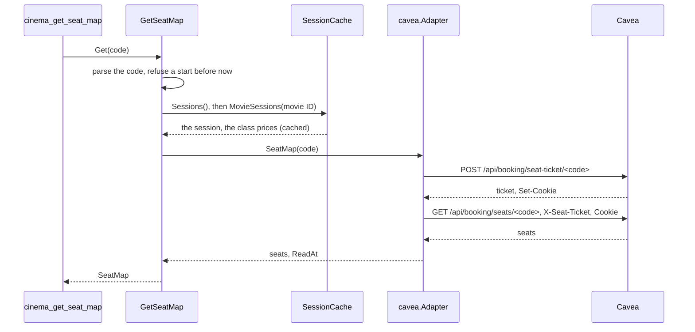

# Specification: The cinemas, movies, sessions, and seats of Cavea

## 1. Summary

This feature adds the vendor client `pkg/cavea` and the context `cinema` with five
tools. The client reads the unofficial API of `cavea.ge` and the data stream of two of
its pages. [spec-tools.md](./spec-tools.md) holds the tools.

## 2. Coverage

| Requirement        | Where this specification realizes it                           |
| ------------------ | -------------------------------------------------------------- |
| `CAVCINE-FR-001`   | 4.2 `ListCinemas`. `CAVCINE-DD-003`. Tools 1.1                 |
| `CAVCINE-FR-002`   | 4.2 `ListMovies`. `CAVCINE-DD-002`, `CAVCINE-DD-006`. Tools 1.2. `CAVCINE-SC-026` |
| `CAVCINE-FR-003`   | 4.2 `SearchMovies`. Tools 1.3. `CAVCINE-SC-026`                |
| `CAVCINE-FR-004`   | 4.2 `ListSessions`. `CAVCINE-DD-007`. Tools 1.4                |
| `CAVCINE-FR-005`   | 4.2 `Session`. `CAVCINE-DD-004`, `CAVCINE-DD-008`              |
| `CAVCINE-FR-006`   | `CAVCINE-DD-007`, `CAVCINE-DD-009`                             |
| `CAVCINE-FR-007`   | `CAVCINE-DD-010`                                               |
| `CAVCINE-FR-008`   | 4.2 `ListSessions`. Tools 1.4                                  |
| `CAVCINE-FR-009`   | 4.2 `GetSeatMap`. `CAVCINE-DD-005`, `CAVCINE-DD-011`. Tools 1.5 |
| `CAVCINE-FR-010`   | 4.2 errors. Tools 2. `CAVCINE-SC-027` |
| `CAVCINE-FR-011`   | 4.2 `Text`. `CAVCINE-DD-003`                                   |
| `CAVCINE-FR-012`   | 4.1 `adapter/cavea`. `CAVCINE-DD-012`. `CAVCINE-SC-027` |
| `CAVCINE-FR-013`   | 4.3 configuration                                              |
| `CAVCINE-FR-014`   | `CAVCINE-DD-012`. `CAVCINE-SC-014`                             |
| `CAVCINE-NFR-001`  | 4.3 cache. `CAVCINE-SC-020`                                    |
| `CAVCINE-NFR-002`  | 4.3 cache. `CAVCINE-SC-021`                                    |
| `CAVCINE-NFR-003`  | 4.3 cache, `SeatSource`. `CAVCINE-SC-022`                      |
| `CAVCINE-NFR-004`  | `CAVCINE-DD-011`. `CAVCINE-SC-023`                             |
| `CAVCINE-NFR-005`  | 4.3 configuration. `CAVCINE-DD-013`, `CAVCINE-SC-024`          |
| `CAVCINE-NFR-006`  | 4.1 `pkg/cavea`. `CAVCINE-SC-001`                              |
| `CAVCINE-INV-001`  | 4.2 `Price`. `CAVCINE-DD-009`                                  |
| `CAVCINE-INV-002`  | 4.2 `SessionCode`. `CAVCINE-DD-004`                            |
| `CAVCINE-INV-003`  | 4.2 `SeatMap`. `CAVCINE-SC-018`                                |

## 3. Guideline compliance

| Rule                   | How this specification obeys it                                                 |
| ---------------------- | ------------------------------------------------------------------------------- |
| `ARC-008`              | `cinema` imports no other context.                                              |
| `ARC-009`, `CFG-004`   | `bootstrap` builds the module of `cinema` from `Config.Cinema`.                 |
| `CLT-001`, `CLT-002`   | `pkg/cavea` is a package of the server module. It imports the standard library and `pkg/vendorhttp` only. |
| `CLT-003`, `CLT-004`   | The JSON types carry the field names of Cavea. The page methods follow `PORFUEL-DD-001`. |
| `CLT-007`              | A status that is not 200 is an `*APIError`.                                     |
| `CLT-008`              | No retry, no cache. The ticket and the cookies live inside one call of `SeatMap`. |
| `CLT-009`              | The package comment and the README say that the source is unofficial.           |
| `DOM-003`              | `CinemaCode`, `MovieCode`, `SessionCode`, `Price`, and the enumerations have constructors. |
| `DOM-005`, `DOM-011`   | `adapter/cavea` converts each shape and wraps `kernel.ErrSourceUnavailable`.    |
| `DOM-006`              | `Price` holds a `decimal.Decimal`. The page and the API send the price as text. |
| `DOM-007`              | `SessionCode` gives the start in `kernel.TbilisiZone()`.                        |
| `DOM-009`, `DOM-010`   | Four ports in `app/port.go`. Five use cases, one method each.                   |
| `MCP-002` to `MCP-009` | [spec-tools.md](./spec-tools.md).                                               |
| `RSL-001`, `RSL-008`   | `vendors.Config.ClientOptions` gives the timeout and the limit.                 |
| `RSL-003` to `RSL-006` | `adapter/cache`. 4.3 cache. `SeatSource` has no cache.                          |
| `CFG-003`, `CFG-008`   | Each variable has the prefix `GEOMCP_CINEMA_CAVEA_`. The switch is on by default. |
| `LOG-004`              | The logger of the module carries `context=cinema`.                              |
| `LOG-005`, `GO-013`    | `ListSessions` ends the error path of `Occupancy`. It logs the error at warn level and returns the sessions. |
| `TST-006`              | `pkg/cavea/testdata/` holds the answers of 2026-10-25. The ticket is `test-ticket`. |
| `TST-009`              | `ParseSessionCode`, `ParseCinemaCode`, and `ParseMovieCode` have fuzz tests.    |

## 4. Design

### 4.1 Components

Every path is new unless the table says "change". `C` is `internal/app/georgia-mcp/cinema`.

| Layer          | Path                          | Types and functions                                            |
| -------------- | ----------------------------- | -------------------------------------------------------------- |
| Vendor client  | `pkg/cavea/`                  | `Client`, `New`, `Option`, the types below, `APIError`, `ErrUnexpectedStatus`, `ErrNotSuccess`, `ErrNoData`, `ErrMalformedData`, `ErrNoTicket`, `ErrTooManySessions`. |
| Domain         | `C/domain/`                   | The types of 4.2.                                              |
| Use case       | `C/app/`                      | The ports, the use cases, and the errors of 4.2.               |
| Driven adapter | `C/adapter/cavea/`            | `Adapter`, `NewAdapter`.                                       |
| Cache          | `C/adapter/cache/`            | `CinemaCache`, `MovieCache`, `SessionCache`, and their constructors. |
| Tool           | `C/adapter/tool/`             | `Register`, `UseCases`, the structs of `spec-tools.md`.        |
| Module         | `C/module.go`, `C/config.go`  | `Module`, `New`, `Register`, `Close`, `Config`, `Defaults`.    |
| Composition    | `internal/app/georgia-mcp/bootstrap/` (change) | `Config.Cinema` with `envPrefix:"CINEMA_"`. `modules.go` builds `cinema.New` after `postal`. |
| Configuration  | `configs/.env.example` (change) | The variables of 4.3.                                        |
| Documentation  | `README.md` (change)          | The five tools in the list of tools.                           |

**`pkg/cavea`.**

```go
const (
    DefaultBaseURL = "https://cavea.ge"
    MaxAvailabilityIDs = 30 // the most session codes that Availability takes
)

func New(opts ...Option) *Client

func (c *Client) Theaters(ctx context.Context) ([]Theater, error)                 // GET /api/theaters
func (c *Client) HallMap(ctx context.Context) (map[string]string, error)           // GET /api/theaters/hall-map
func (c *Client) Movies(ctx context.Context, comingSoon bool) ([]Movie, error)     // GET /movies, the stream
func (c *Client) SearchMovies(ctx context.Context, text string) ([]FoundMovie, error) // GET /api/movies/search
func (c *Client) Sessions(ctx context.Context) ([]DateGroup, error)               // GET /sessions, the stream
func (c *Client) MovieSessions(ctx context.Context, movieID string) ([]MovieSession, error)
func (c *Client) Availability(ctx context.Context, sessionIDs []string) (map[string]string, error)
func (c *Client) SeatMap(ctx context.Context, sessionID string) ([]Seat, error)

type Theater struct {
    ID          string `json:"_id"`
    Name        string `json:"name"`
    NameEng     string `json:"name_eng"`
    City        string `json:"city"`
    Address     string `json:"address"`
    IsActive    *bool  `json:"is_active"` // absent on an open cinema
    TestingOnly bool   `json:"testing_only"`
    IsCinema    bool   `json:"is_cinema"`
}

type Movie struct { // the props of the movie grid of the page
    ID, Slug, Name, NameEnglish, MPAARating               string // json: id, slug, name, nameEnglish, mpaaRating
    Duration                                              int    // json: duration, minutes
    Genre, GenreEng, Description, DescriptionEng          string
    Directors, DirectorsEng, Actors, ActorsEng            string
    Premiere, PremiereEng                                 string // "22.10.2026", "2026", or ""
}

type FoundMovie struct {
    ID          string `json:"_id"`
    Slug        string `json:"website_slug"`
    Name        string `json:"name"`
    NameEnglish string `json:"name_english"`
    Duration    int    `json:"duration"`
    MPAARating  string `json:"mpaa_rating"`
    ComingSoon  bool   `json:"coming_soon"`
}

type DateGroup struct {
    Date   string `json:"date"` // "25-10-2026"
    Movies []struct {
        Movie    struct{ ID, Slug, Name string } `json:"movie"`
        Sessions []PageSession                   `json:"sessions"`
    } `json:"movies"`
}

type Formats struct { // embedded in PageSession and MovieSession
    Is3D             bool `json:"is_3d"`
    IsIMAX           bool `json:"is_imax"`
    IsAtmos          bool `json:"is_atmos"`
    IsScreenX        bool `json:"is_screenx"`
    IsInfinityVision bool `json:"is_infinity_vision"`
}

type PageSession struct {
    ID               string  `json:"_id"`    // "cav_5/25-10-2026/22:00"
    Cinema           string  `json:"cinema"` // the ID of a Theater
    SessionLanguage  string  `json:"session_language"`
    SubtitleLanguage *string `json:"subtitle_language"`
    Price            string  `json:"price"` // the class Standard
    Formats
}

type MovieSession struct {
    ID               string            `json:"_id"`
    Cinema           string            `json:"cinema"`
    SessionLanguage  string            `json:"session_language"`
    SubtitleLanguage *string           `json:"subtitle_language"`
    Prices           map[string]string `json:"-"` // decoded from the text of "prices"
    Formats
}

type Seat struct {
    ID           string `json:"_id"`
    Row          string `json:"row"`
    Seat         int    `json:"seat"`
    Class        string `json:"ttype"`
    SpecialNeeds bool   `json:"special_needs"`
    IsTaken      bool   `json:"isTaken"`
}
```

`New` sets `Accept: application/json`, `Origin: https://cavea.ge`, and
`X-Requested-With: cavea-web` (`CAVCINE-DD-001`). The two page methods set
`Accept: text/x-component` and `RSC: 1` on their request (`CAVCINE-DD-002`). The body
limit is 2 MiB: the largest answer of the probe, `/sessions`, is 168 KB. The client
returns `ErrNotSuccess` when the field `status` of an API answer is `error`. Cavea writes
`success` on most methods and `OK!` on `/api/booking/sessions/all`. The `data` of that
method is a JSON text that holds the array, and its `prices` is a JSON text that holds
the object. The client decodes both texts.

**`adapter/cavea`.** `NewAdapter(client *caveaclient.Client, now func() time.Time)`.
It implements the four ports of 4.2. `ReadAt` is `now()` in `kernel.TbilisiZone()` after
the last call. Each failure returns an error that wraps `kernel.ErrSourceUnavailable`.
`CAVCINE-DD-012` lists the values that fail an answer.

**`module.go`.** The shape of `postal/module.go`. When `cfg.Cavea.Enabled` is false, `New`
logs at info level `Cavea is off` with `variable=GEOMCP_CINEMA_CAVEA_ENABLED`, and
`Register` adds no tool.

### 4.2 Domain model

```go
// domain
type Text struct{ Georgian, English string }
func (t Text) In(language kernel.Language) string // English when Georgian is empty

type CinemaCode struct{ code string }   // ParseCinemaCode: 1 to 40 of [a-z0-9_]
type MovieCode struct{ code string }    // ParseMovieCode: 1 to 100 of [a-z0-9-]
type SessionCode struct {               // ParseSessionCode: "<hall key>/DD-MM-YYYY/HH:MM"
    code    string
    hallKey string                      // "cag_5"
    start   int64                       // Unix seconds, so that == ignores the zone
}
func (c SessionCode) Start() time.Time
func (c SessionCode) Date() kernel.Date
func (c SessionCode) HallKey() string

type Price struct{ amount decimal.Decimal } // NewPrice: from text, greater than zero

type MovieStatus string     // now_showing, coming_soon
type AudioLanguage string   // ka, en
type Format string          // 3d, imax, dolby_atmos, screenx, infinity_vision
type SeatClass string       // economy, standard, vip, status
type OccupancyLevel string  // many_seats, filling_up, almost_sold_out
// Each has Parse<Type>(text), which returns ErrUnknown<Type> for another text, and a
// function that lists the values in their order: MovieStatuses, AudioLanguages, Formats,
// SeatClasses.

type Cinema struct {
    ID      string // the identifier of Cavea, for the join of a session
    Code    CinemaCode
    Name    Text
    City    string
    Address string
}

type Movie struct {
    ID          string
    Code        MovieCode
    Status      MovieStatus
    Name        Text
    Genres      []Text
    Duration    time.Duration
    AgeRating   string
    Premiere    string // "2026-10-22", "2026", or ""
    Directors   []Text
    Actors      []Text
    Description Text
}

type Session struct {
    Code             SessionCode
    MovieID          string
    CinemaID         string
    Hall             string
    Audio            AudioLanguage
    Subtitles        *AudioLanguage
    Formats          []Format              // in the order of the type
    Prices           map[SeatClass]Price
}

type Seat struct {
    Row          string
    Number       int
    Class        SeatClass
    SpecialNeeds bool
    Taken        bool
}
```

```go
// app/port.go
type CinemaSource interface {
    Cinemas(ctx context.Context) (CinemaList, error)        // open cinemas only
}
type MovieSource interface {
    Movies(ctx context.Context, status domain.MovieStatus) (MovieList, error)
    Search(ctx context.Context, text string) (MovieList, error)
}
type SessionSource interface {
    Sessions(ctx context.Context) (SessionList, error)                  // every movie, Standard price
    MovieSessions(ctx context.Context, movieID string) (SessionList, error) // every class price
}
type SeatSource interface { // no cache
    Occupancy(ctx context.Context, codes []domain.SessionCode) (map[domain.SessionCode]domain.OccupancyLevel, time.Time, error)
    SeatMap(ctx context.Context, code domain.SessionCode) ([]domain.Seat, time.Time, error)
}
// CinemaList, MovieList, SessionList: the values, ReadAt, Stale.
```

| Use case       | Query                                                     | Result                                  |
| -------------- | --------------------------------------------------------- | --------------------------------------- |
| `ListCinemas`  | none                                                      | `CinemaList`                            |
| `ListMovies`   | `Status`, `Limit`                                         | the first movies, `Total`, `ReadAt`, `Stale` |
| `SearchMovies` | `Text`, `Limit`                                           | the same                                |
| `ListSessions` | `Movie *MovieCode`, `Date`, `Cinema *CinemaCode`, `Audio *AudioLanguage`, `Format *Format`, `Limit` | `Sessions` joined with cinema and movie, `Total`, `Occupancy`, `ReadAt`, `OccupancyAt`, `Stale` |
| `GetSeatMap`   | `Code SessionCode`                                        | `SeatMap`: the session, the seats, the class counts, the prices, `ReadAt` |

`app/errors.go`: `ErrInvalidQuery`, `ErrPastDate`, `ErrUnknownMovie`, `ErrUnknownCinema`,
`ErrUnknownSession`, `ErrSessionStarted`.

`ListSessions` reads the cinemas, the movies of both statuses, and the sessions through
the cached ports. It refuses an unknown movie or cinema, keeps the sessions of the date
that start after `now`, applies the filters, sorts them (`CAVCINE-FR-008`), cuts the list
to the limit, then asks `Occupancy` for the kept sessions (`CAVCINE-DD-010`). A session
whose cinema is not an open cinema, or whose movie is in neither list, stays out. `ReadAt`
is the read of the sessions. `Stale` is true when one of the three lists is stale.

`ListMovies` cuts the list to the limit. `SearchMovies` removes the spaces at the ends of
the text, refuses fewer than 2 or more than 100 runes with `ErrInvalidQuery` before a
call, and cuts the list to the limit. `Total` is the length of the full list.

`GetSeatMap` refuses a session whose start is not after `now`. It finds the session in
`Sessions`, then reads the prices with `MovieSessions` of its movie, then calls `SeatMap`.
It counts the seats and the free seats of each class from the seats.

### 4.3 Declarations

**Vendor endpoint.** Every row: `pkg/cavea`, no key, no.

| Method and path                               | Realizes                             |
| --------------------------------------------- | ------------------------------------ |
| `GET /api/theaters`                           | `CAVCINE-FR-001`                     |
| `GET /api/theaters/hall-map`                  | `CAVCINE-FR-005`                     |
| `GET /movies`, `GET /movies?filter=coming-soon` (stream) | `CAVCINE-FR-002`          |
| `GET /api/movies/search?q=<text>`             | `CAVCINE-FR-003`                     |
| `GET /sessions` (stream)                      | `CAVCINE-FR-004`, `CAVCINE-FR-006`   |
| `GET /api/booking/sessions/all/<movie ID>`    | `CAVCINE-FR-004`, `CAVCINE-FR-006`   |
| `GET /api/sessions/availability?ids=<codes>`  | `CAVCINE-FR-007`                     |
| `POST /api/booking/seat-ticket/<code>`        | `CAVCINE-FR-009`, `CAVCINE-NFR-004`  |
| `GET /api/booking/seats/<code>`               | `CAVCINE-FR-009`                     |

**Cache.** Each list has a time to live of 15 minutes and a maximum stale of 5 hours 45
minutes, so a stale list is at most 6 hours old.

| Port method                    | Key                | Entries | Realizes                              |
| ------------------------------ | ------------------ | ------- | ------------------------------------- |
| `CinemaSource.Cinemas`         | none               | 1       | `CAVCINE-NFR-001`, `CAVCINE-NFR-002`  |
| `MovieSource.Movies`           | the status         | 2       | the same                              |
| `MovieSource.Search`           | the trimmed text   | 1024    | the same                              |
| `SessionSource.Sessions`       | none               | 1       | the same                              |
| `SessionSource.MovieSessions`  | the movie ID       | 256     | the same                              |
| `SeatSource`                   | no cache           |         | `CAVCINE-NFR-003`                     |

The adapter reads the hall map inside `Sessions` and `MovieSessions`, so the cache of
the sessions covers it.

**Configuration.**

| Variable                         | Type     | Default            | Secret | Realizes          |
| -------------------------------- | -------- | ------------------ | ------ | ----------------- |
| `GEOMCP_CINEMA_CAVEA_ENABLED`    | bool     | `true`             | No     | `CAVCINE-FR-013`  |
| `GEOMCP_CINEMA_CAVEA_BASE_URL`   | URL      | `https://cavea.ge` | No     | `CAVCINE-FR-013`  |
| `GEOMCP_CINEMA_CAVEA_TIMEOUT`    | duration | `10s`              | No     | `RSL-001`         |
| `GEOMCP_CINEMA_CAVEA_RATE`       | float    | `2`                | No     | `CAVCINE-NFR-005` |
| `GEOMCP_CINEMA_CAVEA_BURST`      | int      | `2`                | No     | `CAVCINE-NFR-005` |

`cinema.Defaults` gives `vendors.Defaults("https://cavea.ge").WithLimit(2, 2)`.

### 4.4 Flow



## 5. Design decisions

### `CAVCINE-DD-001`

**Realizes:** `CAVCINE-FR-004`, `CAVCINE-FR-009`
**Decision:** Every call carries `Origin: https://cavea.ge` and `X-Requested-With:
cavea-web`, with any base address.
**Rationale:** `/api/booking/sessions/all` answers 403 with no `Origin`. The pages of
Cavea send `X-Requested-With: cavea-web` on each booking call. The two headers name the
production site, as `POSTCODE-DD-001` does for its `Referer`.
**Alternatives:** The headers on the booking calls only. A later change of Cavea can
demand them on every call.

### `CAVCINE-DD-002`

**Realizes:** `CAVCINE-FR-002`, `CAVCINE-FR-004`
**Decision:** `Movies` and `Sessions` read the data stream of the page, with `RSC: 1`.
`Movies` decodes the JSON value after the first `"movies":`. `Sessions` decodes the value
after the first `"dateGroups":`. No key returns `ErrNoData`. A value that does not decode
returns `ErrMalformedData`.
**Rationale:** `/api/` has no list of movies and no list of all sessions (requirements,
question 4). The stream holds the props as plain JSON, 83 KB for `/movies`, 168 KB for
`/sessions`. On 2026-10-25 each key occurred once, and gave 25 movies, 10 movies, and 327
sessions in 3 date groups.
**Alternatives:** The HTML of the page. It holds the same JSON inside script strings,
with a second level of escapes.

### `CAVCINE-DD-003`

**Realizes:** `CAVCINE-FR-001`, `CAVCINE-FR-011`
**Decision:** A cinema is open when `is_cinema` is true, `testing_only` is false, and
`is_active` is not false. Its code is `name_eng` with the word `Cavea` removed at the
start, in lowercase, each run of other characters as one `_`: `east_point`,
`city_mall_saburtalo`, `grand_mall`. Its name is `name` in Georgian and `name_eng` in
English. `City` and `Address` stay as Cavea writes them, in English.
**Rationale:** Galleria and City Mall have no `is_active` field and show sessions. The code
comes from the data, so a new cinema needs no change of the code. Cavea gives no Georgian
city or address.
**Alternatives:** A fixed table of the 5 codes. A new cinema then fails each answer.

### `CAVCINE-DD-004`

**Realizes:** `CAVCINE-FR-005`, `CAVCINE-INV-002`
**Decision:** `ParseSessionCode` reads the start from the code, as the time in Tbilisi.
The adapter does not read `start_time`.
**Rationale:** `start_time` holds the time in Tbilisi as if it were UTC:
`cag_5/27-10-2026/22:15` has `1793139300000`, that is 22:15 UTC. The code is in both
sources. The page source has no other start.
**Alternatives:** `start_time` minus 4 hours. Georgia has no daylight saving time today,
but the shift hides the defect of Cavea.

### `CAVCINE-DD-005`

**Realizes:** `CAVCINE-FR-009`, `CAVCINE-NFR-004`
**Decision:** `SeatMap` sends two calls, and keeps the ticket and the cookies in local
variables only:

1. `POST /api/booking/seat-ticket/<code>` with no body. The ticket is the field `ticket`
   of the answer: a text of 1 to 512 characters. The cookies are the name and the value
   of each `Set-Cookie` of the answer, read with `http.ParseSetCookie`.
2. `GET /api/booking/seats/<code>` with `X-Seat-Ticket: <ticket>` and
   `Cookie: <name>=<value>; ...` of step 1.

The code is one path segment, escaped with `url.PathEscape`: `cag_5%2F27-10-2026%2F22:15`. No ticket returns
`ErrNoTicket`.
**Rationale:** The page does the same two calls. On 2026-10-25, with the User-Agent of
the server, the GET with the ticket and `cavea_vid` answered 200. The GET with no cookie,
and the GET with the cookies and no ticket, answered 403. The client sends every cookie
back, so a new cookie of Cavea needs no change. A ticket for each map stays inside
`CLT-008`.
**Alternatives:** A ticket that the adapter keeps for 15 minutes. It saves one call of
two, and needs state and a retry on a 403.

### `CAVCINE-DD-006`

**Realizes:** `CAVCINE-FR-002`, `CAVCINE-FR-011`
**Decision:** The adapter splits `genre`, `directors`, and `actors` at `, `. It pairs the
Georgian and the English part by position. When the counts differ, the field is one item
with the full Georgian text and the full English text. When one language is empty, each
item has the other language only. The
premiere is `premiereEng`, else `premiere`: `DD.MM.YYYY` gives `YYYY-MM-DD`, `YYYY` stays,
another text gives none.
**Rationale:** `DC, საშინელებათა` pairs with `DC, Horror`. A movie coming soon has the
premiere `2026` only.
**Alternatives:** One text for each field. A model then cannot filter by genre.

### `CAVCINE-DD-007`

**Realizes:** `CAVCINE-FR-004`, `CAVCINE-FR-006`
**Decision:** `ListSessions` with a movie reads `MovieSessions` of its ID. With no movie,
it reads `Sessions`.
**Rationale:** The owner chose the page when the API does not give the data (question 4).
One call gives every session of every movie.
**Alternatives:** One `MovieSessions` for each movie: about 25 calls for one answer.

### `CAVCINE-DD-008`

**Realizes:** `CAVCINE-FR-005`
**Decision:** The hall is the value of the hall map for the hall key of the code:
`cep_1` gives `IMAX`. A key with no value gives the part after `_` in uppercase.
**Rationale:** The page and the API name a hall in different ways. The hall map gives
the number on the door of the hall, and the page uses it.
**Alternatives:** `hallNum` of the page and `hall_name` of the API. The API name is in
Georgian with a code of the cinema.

### `CAVCINE-DD-009`

**Realizes:** `CAVCINE-FR-006`, `CAVCINE-INV-001`
**Decision:** The adapter maps `eco`, `std`, `vip`, and `sta` to the four classes, and
parses each price with `decimal.NewFromString`. The page price is the class `standard`.
**Rationale:** On 2026-10-25 the page price equalled `std` for each of the 27 sessions
of Street Fighter in both sources.
**Alternatives:** None.

### `CAVCINE-DD-010`

**Realizes:** `CAVCINE-FR-007`, `CAVCINE-NFR-003`
**Decision:** `Occupancy` sends one call for each 30 codes. `green` gives `many_seats`,
`yellow` gives `filling_up`, another value gives `almost_sold_out`. A code that Cavea
leaves out, or gives an empty value, has no level. When `Occupancy` fails, `ListSessions` returns the sessions with
no level and `Occupancy` false. It writes one record at warn level, `Cavea did not give the
occupancy levels`, with the error and the count of sessions.
**Rationale:** The page shows the same three levels for the same values. A limit of 100
needs 4 calls at most.
**Alternatives:** The level of the first 30 sessions only. A model then reads no level for
the rest of a long list.

### `CAVCINE-DD-011`

**Realizes:** `CAVCINE-FR-009`, `CAVCINE-NFR-004`
**Decision:** `GetSeatMap` takes the class prices from the cached `MovieSessions`, and
the seats from `SeatMap`. A session that `Sessions` does not hold gives
`ErrUnknownSession`, and the server sends no call to the seat methods.
**Rationale:** The seat map of Cavea has no price. With the two lists in the cache, a map
sends the two calls of `CAVCINE-DD-005` only.
**Alternatives:** A seat map with no price. The owner asked for the price (question 3).

### `CAVCINE-DD-012`

**Realizes:** `CAVCINE-FR-012`
**Decision:** The adapter leaves out a session with an audio language or a subtitle
language other than `geo` and `eng` (`CAVCINE-FR-014`). These values fail the whole answer
with `kernel.ErrSourceUnavailable`: a session code that `ParseSessionCode` refuses, a
seat class other than the four,
a price that `NewPrice` refuses, a movie with no slug, and an empty list of open cinemas.
An empty list of movies or sessions is a valid answer.
**Rationale:** Each value means a change of Cavea. A list with a wrong row can hide the
session that the person asks for.
**Alternatives:** Leave out the bad row. The model then reads a list that looks complete.

### `CAVCINE-DD-013`

**Realizes:** `CAVCINE-NFR-005`
**Decision:** The limit is 2 calls each second with a burst of 2.
**Rationale:** `POSTCODE-DD-007`. A token bucket lets through at most 4 calls in one
second. A seat map then takes about 1 second.
**Alternatives:** 1 call each second. A cold list of sessions with a movie then takes 5
seconds.

## 6. Scenarios

`pkg/cavea/testdata/` holds the answers of 2026-10-25: `theaters.json`, `hall-map.json`,
`movies.rsc`, `movies-coming-soon.rsc`, `search-street.json`, `sessions.rsc`,
`sessions-all-street-fighter.json`, `availability.json`, `seat-ticket.json`, and
`seats-cag5.json`. The tests of `adapter/tool` call each tool through the in-memory MCP
transport with the real use cases and fake ports. The test of `module.go` serves the
files from `httptest`.

| ID               | Verifies | Layer | Given, when, then |
| ---------------- | -------- | ----- | ----------------- |
| `CAVCINE-SC-001` | `CAVCINE-NFR-006`, `CAVCINE-DD-001` | unit | Each method sends a User-Agent that starts with `georgia-mcp/` and holds the address of the repository, `Origin: https://cavea.ge`, and `X-Requested-With: cavea-web`. |
| `CAVCINE-SC-002` | `CAVCINE-FR-001` | unit | `Theaters` with `theaters.json` gives 8 theaters. Galleria has `IsActive` nil. |
| `CAVCINE-SC-003` | `CAVCINE-DD-002` | unit | `Movies(false)` sends `RSC: 1` to `/movies` and gives 25 movies. `Movies(true)` sends `filter=coming-soon` and gives 10. A stream with no key gives `ErrNoData`. A broken value gives `ErrMalformedData`. |
| `CAVCINE-SC-004` | `CAVCINE-FR-003` | unit | `SearchMovies(ctx, "street")` sends `q=street` and gives 2 movies. |
| `CAVCINE-SC-005` | `CAVCINE-DD-002` | unit | `Sessions` gives 3 date groups with 23, 152, and 152 sessions. |
| `CAVCINE-SC-006` | `CAVCINE-FR-006` | unit | `MovieSessions` with the recorded answer gives 31 sessions. `cag_5/27-10-2026/22:15` has the prices `eco 20`, `std 20`, `vip 29`, `sta 22`. An answer with `status` `error` gives `ErrNotSuccess`. |
| `CAVCINE-SC-007` | `CAVCINE-DD-010` | unit | `Availability` with 31 codes gives `ErrTooManySessions` and sends no call. With 1 code, it gives `{"cag_5/27-10-2026/22:15": "green"}`. |
| `CAVCINE-SC-008` | `CAVCINE-DD-005` | unit | `SeatMap` sends the POST, then the GET with `X-Seat-Ticket: test-ticket` and the cookies `cavea_vid` and `__Host-cavea_vproof`. It gives 91 seats. An answer of the POST with no ticket gives `ErrNoTicket` and sends no GET. |
| `CAVCINE-SC-009` | `CAVCINE-FR-012` | unit | A 403 on each method gives an `*APIError` with 403. `errors.Is(err, ErrUnexpectedStatus)` holds. |
| `CAVCINE-SC-010` | `CAVCINE-INV-002`, `CAVCINE-DD-004` | unit | `ParseSessionCode("cag_5/27-10-2026/22:15")` gives the start `2026-10-27T22:15:00+04:00` and the hall key `cag_5`. `cag_5/32-10-2026/22:15`, `cag_5/27-10-2026`, `xyz`, and the empty text give `ErrInvalidSessionCode`. A fuzz test holds that each valid start is in Tbilisi. A second fuzz test holds that `ParseCinemaCode` and `ParseMovieCode` accept only the characters of their form. |
| `CAVCINE-SC-011` | `CAVCINE-DD-003` | unit | The adapter with `theaters.json` gives 5 cinemas: `tbilisi_mall`, `east_point`, `galleria`, `city_mall_saburtalo`, `grand_mall`. |
| `CAVCINE-SC-012` | `CAVCINE-DD-006` | unit | `clayface-01` gives 4 genres. The second is `{საშინელებათა, Horror}`. The premiere is `2026-10-22`. A movie with the premiere `2026` keeps `2026`. |
| `CAVCINE-SC-013` | `CAVCINE-DD-008`, `CAVCINE-DD-009` | unit | The adapter gives `cep_1/...` the hall `IMAX` and `ccm_x/...` the hall `10`. With a hall map that lacks `ccm_x`, the hall is `X`. A page session has one price, of the class `standard`. |
| `CAVCINE-SC-014` | `CAVCINE-FR-012`, `CAVCINE-FR-014`, `CAVCINE-DD-012` | unit | `MovieSessions` with one of 31 sessions changed to the audio language `rus` gives 30 sessions and no error. A subtitle language `rus` gives the same. A seat with the class `gold`, and a price `0`, each give an error that wraps `kernel.ErrSourceUnavailable`. |
| `CAVCINE-SC-015` | `CAVCINE-FR-004`, `CAVCINE-FR-008` | unit | `ListSessions` at 2026-10-27 20:00 with `street-fighter` and `en` gives the sessions after 20:00 only, in the order of the start, then the cinema code. A date of 2026-10-26 gives `ErrPastDate`. |
| `CAVCINE-SC-016` | `CAVCINE-FR-010` | unit | `ListSessions` with `no-such-movie` gives `ErrUnknownMovie`, and with `no_such` gives `ErrUnknownCinema`. Neither reads the sessions. |
| `CAVCINE-SC-017` | `CAVCINE-FR-007`, `CAVCINE-DD-010` | unit | 70 kept sessions give 3 calls of `Occupancy`. A failure of `Occupancy` gives the sessions with no level, `Occupancy` false, and one record at warn level that holds the error. |
| `CAVCINE-SC-018` | `CAVCINE-FR-009`, `CAVCINE-INV-003` | unit | `GetSeatMap` with `seats-cag5.json` gives the free counts Standard 38 of 41, Status 25 of 34, VIP 0 of 16, and the prices of `DD-011`. A started session gives `ErrSessionStarted` and calls no `SeatSource`. |
| `CAVCINE-SC-019` | `CAVCINE-FR-011` | integration | Each tool with `ka` gives the Georgian names, and with no language the English names. `ru` gives the message of tools 2. |
| `CAVCINE-SC-020` | `CAVCINE-NFR-001` | unit | In `synctest`, two reads of each cached method within 14 minutes 59 seconds send one load. A read at 15 minutes sends a second. |
| `CAVCINE-SC-021` | `CAVCINE-NFR-002` | unit | In `synctest`, the source fails after one read. At 1 hour, the cache returns the list with `Stale` true. At 6 hours and 1 second, it returns the error. |
| `CAVCINE-SC-022` | `CAVCINE-NFR-003` | integration | Two calls of `cinema_get_seat_map` for one session send 2 seat calls each to the vendor. |
| `CAVCINE-SC-023` | `CAVCINE-NFR-004`, `CAVCINE-DD-011` | integration | After one `cinema_list_sessions` with no movie and one with `street-fighter`, one `cinema_get_seat_map` of a session of Street Fighter sends exactly 2 calls to the vendor: the POST and the GET of `CAVCINE-DD-005`. |
| `CAVCINE-SC-024` | `CAVCINE-NFR-005`, `CAVCINE-FR-013` | unit | In `bootstrap`, `LoadConfig` with no variable of cinema gives Cavea on, at `https://cavea.ge`, with a timeout of 10 seconds, the rate 2, and the burst 2. `cinema.New` with `Enabled` false registers no tool. |
| `CAVCINE-SC-026` | `CAVCINE-FR-002`, `CAVCINE-FR-003` | unit | `SearchMovies` with `a`, `  a  `, and 101 runes returns `ErrInvalidQuery` and calls no source. `" du "` calls the source with `du`. `ListMovies` with the limit 5 of 25 movies gives the first 5 and `Total` 25. |
| `CAVCINE-SC-027` | `CAVCINE-FR-010`, `CAVCINE-FR-012` | integration | Each condition of tools 2 gives its message, as a tool result with `IsError`. A failure of Cavea with no stale list gives `Cavea did not answer. Try again in a few minutes.` and no text of Cavea. |
| `CAVCINE-SC-025` | `CAVCINE-FR-001`, `CAVCINE-FR-009` | live | Against `cavea.ge`: `Theaters` holds East Point. `Sessions` holds a session. `SeatMap` of the first session of tomorrow gives one seat or more. |

## 7. Build plan

| #   | Step                                                                     | Realizes                                   | Done |
| --- | ------------------------------------------------------------------------ | ------------------------------------------ | ---- |
| 1   | `pkg/cavea`, recorded answers, README, example, live test.               | `CAVCINE-FR-012`, `CAVCINE-NFR-006`        | [x]  |
| 2   | `domain`: the types of 4.2, errors, fuzz test.                           | `CAVCINE-INV-001` to `CAVCINE-INV-003`     | [x]  |
| 3   | `app`: ports, the five use cases, errors.                                | `CAVCINE-FR-001` to `CAVCINE-FR-010`       | [x]  |
| 4   | `adapter/cavea`.                                                         | `CAVCINE-FR-005`, `CAVCINE-FR-011`, `CAVCINE-FR-012`, `CAVCINE-FR-014` | [x]  |
| 5   | `adapter/cache`.                                                         | `CAVCINE-NFR-001` to `CAVCINE-NFR-003`     | [x]  |
| 6   | `adapter/tool`.                                                          | `CAVCINE-FR-001` to `CAVCINE-FR-011`       | [x]  |
| 7   | `module.go`, `config.go`, `bootstrap`, `configs/.env.example`, `README.md`. | `CAVCINE-FR-013`, `CAVCINE-NFR-005`     | [x]  |
| 8   | Move the terms of section 5 of the requirements to the glossary, in a section Cinema. | `DOM-002`                     | [x]  |

## 8. Out of scope for this specification

The pages of the tools on the website and the list of tools of
`build/openai-plugin/plugin.json`. A change of `WEBSITE` adds them after the tools exist.

## Retired identifiers

This file has no retired identifier.
