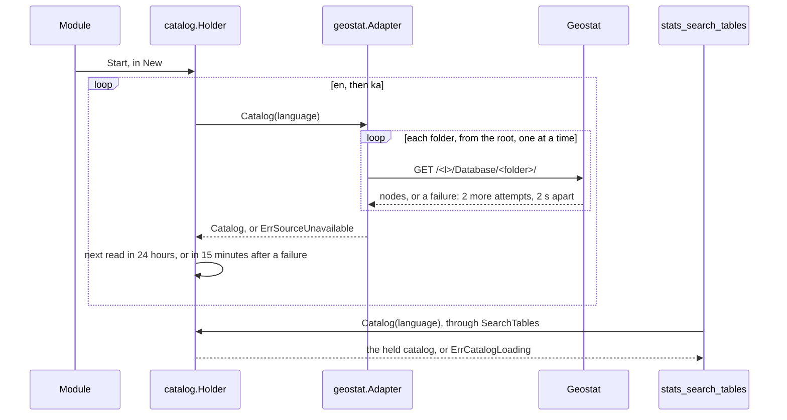

# Specification: The statistical tables and the inflation of Geostat

## 1. Summary

`spec-tools.md` holds the tools. `spec-scenarios.md` holds the scenarios.

This feature adds the vendor client `pkg/geostat` for the PxWeb API of Geostat, and the
context `stats` with four tools: `stats_search_tables`, `stats_get_table`,
`stats_get_cells`, and `stats_get_inflation`. A background job of the context reads the
catalog of `ka` and `en` at the start and each 24 hours.

## 2. Coverage

| Requirement        | Where this specification realizes it                           |
| ------------------ | -------------------------------------------------------------- |
| `GEOSTAT-FR-001`   | 4.2 `SearchTables`. 4.3 tool. `GEOSTAT-DD-005`                 |
| `GEOSTAT-FR-002`   | 4.2 `SearchTables`. `GEOSTAT-DD-005`                           |
| `GEOSTAT-FR-003`   | 4.3 tool, `limit`, `total`                                     |
| `GEOSTAT-FR-004`   | 4.3 tools, `language`. `GEOSTAT-DD-004`                        |
| `GEOSTAT-FR-005`   | 4.2 `DescribeTable`. 4.3 tool. `GEOSTAT-DD-006`                |
| `GEOSTAT-FR-006`   | 4.2 `GetCells`. 4.3 tool. `GEOSTAT-DD-007`                     |
| `GEOSTAT-FR-007`   | 4.2 `GetCells`, `Last`. `GEOSTAT-DD-007`                       |
| `GEOSTAT-FR-008`   | 4.2 `GetCells`, `ErrTooManyCells`. 4.5                         |
| `GEOSTAT-FR-009`   | 4.2 `Figure`. 4.3 `cellOutput`. `GEOSTAT-DD-008`               |
| `GEOSTAT-FR-010`   | 4.2 `SelectionError`. 4.5                                      |
| `GEOSTAT-FR-011`   | 4.2 `GetInflation`. `GEOSTAT-DD-009`, `GEOSTAT-DD-010`         |
| `GEOSTAT-FR-012`   | `GEOSTAT-DD-009`                                               |
| `GEOSTAT-FR-013`   | 4.2 `GetInflation`. `GEOSTAT-DD-011`                           |
| `GEOSTAT-FR-014`   | 4.2 `Inflation`. `GEOSTAT-DD-009`                              |
| `GEOSTAT-FR-015`   | 4.5. `GEOSTAT-DD-003`, `GEOSTAT-DD-008`                        |
| `GEOSTAT-FR-016`   | 4.3 configuration                                              |
| `GEOSTAT-FR-017`   | 4.2 `ErrCatalogLoading`. `GEOSTAT-DD-002`                      |
| `GEOSTAT-NFR-001`  | `GEOSTAT-DD-002`. `GEOSTAT-SC-019`                             |
| `GEOSTAT-NFR-002`  | `GEOSTAT-DD-002`. `GEOSTAT-SC-020`                             |
| `GEOSTAT-NFR-003`  | `GEOSTAT-SC-023`                                               |
| `GEOSTAT-NFR-004`  | 4.3 cache. `GEOSTAT-SC-022`                                    |
| `GEOSTAT-NFR-005`  | 4.3 configuration. `GEOSTAT-DD-012`, `GEOSTAT-SC-024`          |
| `GEOSTAT-NFR-006`  | 4.1 `pkg/geostat`. `GEOSTAT-SC-001`                            |
| `GEOSTAT-NFR-007`  | `GEOSTAT-DD-001`, `GEOSTAT-DD-002`. `GEOSTAT-SC-018`           |
| `GEOSTAT-NFR-008`  | `GEOSTAT-DD-001`. `GEOSTAT-SC-017`                             |
| `GEOSTAT-NFR-009`  | `GEOSTAT-DD-002`. `GEOSTAT-SC-021`                             |
| `GEOSTAT-INV-001`  | 4.2 `Figure`. `GEOSTAT-DD-008`                                 |
| `GEOSTAT-INV-002`  | 4.2 `Figure.Minus100`. `GEOSTAT-DD-008`                        |
| `GEOSTAT-INV-003`  | 4.3 outputs, `updated`, `tables`                               |

## 3. Guideline compliance

| Rule                   | How this specification obeys it                                                  |
| ---------------------- | -------------------------------------------------------------------------------- |
| `ARC-004`, `CLT-001`   | `pkg/geostat` is a package of the server module.                                 |
| `ARC-008`              | `stats` imports no other context.                                                |
| `ARC-009`, `CFG-004`   | `bootstrap` builds the module of `stats` from `Config.Stats`.                    |
| `CLT-002` to `CLT-005` | Standard library and `pkg/vendorhttp` only. `Accept: application/json`.          |
| `CLT-007`              | A status that is not 200 is an `*APIError`.                                      |
| `CLT-008`              | The client does not retry. The retry of `GEOSTAT-NFR-008` is in the driven adapter. |
| `DOM-003`, `TST-009`   | `ParseTableCode`, `ParseFigure`, `ParseMonth`, `ParseRegion`, `ParsePriceGroup` validate. Each has a fuzz test. |
| `DOM-005`, `DOM-011`   | `adapter/geostat` converts each shape and wraps `kernel.ErrSourceUnavailable`.   |
| `DOM-006`, `MCP-009`   | `Figure` holds a `decimal.Decimal`. A tool writes it as a string.                |
| `DOM-009`, `DOM-010`   | Three ports. Four use cases, one method each.                                    |
| `MCP-002` to `MCP-009` | `spec-tools.md`. `GEOSTAT-DD-013`.                                               |
| `RSL-001`, `RSL-008`   | `vendors.Config.ClientOptions` gives the timeout and the limit.                  |
| `RSL-002`              | The only retry is the folder list of the catalog (`GEOSTAT-NFR-008`).           |
| `RSL-003` to `RSL-006` | `adapter/cache` for the tables, the cells, and the price indices. The catalog has its own holder (`GEOSTAT-DD-002`). |
| `LIF-004`, `LIF-006`   | `Module.Close` stops the job and waits at most 10 seconds.                      |
| `LOG-004`              | The logger of the module carries `context=stats`.                               |
| `CFG-003`, `CFG-008`   | Each variable has the prefix `GEOMCP_STATS_GEOSTAT_`. The switch is on by default. |
| `TST-006`              | `pkg/geostat/testdata/` holds the answers of 2026-11-04.                         |

## 4. Design

### 4.1 Components

Every path is new unless the table says "change". `S` is `internal/app/georgia-mcp/stats`.

| Layer          | Path                       | Types and functions                                                     |
| -------------- | -------------------------- | ----------------------------------------------------------------------- |
| Vendor client  | `pkg/geostat/`             | `Client`, `New`, `Option`, `DefaultBaseURL`, `Node`, `TableMetadata`, `Variable`, `Selection`, `Dataset`, `Column`, `Datum`, `APIError`, `ErrUnexpectedStatus`. |
| Domain         | `S/domain/`                | `TableCode`, `Figure`, `Month`, `Region`, `PriceGroup`, `CatalogEntry`, `Table`, `Dimension`, `DimensionValue`, `Inflation`, the parsers, the errors. |
| Use case       | `S/app/`                   | The ports, `SearchTables`, `DescribeTable`, `GetCells`, `GetInflation`, the queries, `SelectionError`, the errors. |
| Driven adapter | `S/adapter/geostat/`       | `Adapter`, `NewAdapter`.                                                |
| Catalog job    | `S/adapter/catalog/`       | `Holder`, `NewHolder`, `Start`, `Close`.                                |
| Cache          | `S/adapter/cache/`         | `TableCache`, `PriceIndexCache`, their constructors.                    |
| Tool           | `S/adapter/tool/`          | `Register`, `UseCases`, the structs of `spec-tools.md`.                 |
| Module         | `S/module.go`, `S/config.go` | `Module`, `New`, `Register`, `Close`, `Config`, `Defaults`.           |
| Composition    | `internal/app/georgia-mcp/bootstrap/` (change) | `Config.Stats` with `envPrefix:"STATS_"`. `modules.go` builds `stats.New` after `cinema`. |
| End to end     | `test/e2e/serve_test.go` (change) | `GEOMCP_STATS_GEOSTAT_BASE_URL=http://127.0.0.1:1`, so the job sends no call to Geostat. |
| Configuration  | `configs/.env.example` (change) | The variables of 4.3.                                              |
| Documentation  | `README.md` (change)       | The four tools in the list of tools.                                    |

**`pkg/geostat`.** The shape of `pkg/nbg`. The client adds a `/` to the end of every path:
the server of Geostat answers 404 to a path whose last segment holds a dot.

```go
const DefaultBaseURL = "https://pc-axis.geostat.ge/PXWeb/api/v1"

var ErrUnexpectedStatus = errors.New("geostat: unexpected status")

type APIError = vendorhttp.StatusError

// Folder lists the folders and the tables of a folder. path is "" for the root.
func (c *Client) Folder(ctx context.Context, lang, path string) ([]Node, error)
// Table returns the dimensions of a table. path ends with the file name of the table.
func (c *Client) Table(ctx context.Context, lang, path string) (*TableMetadata, error)
// Query returns the cells of a table for a selection of value codes.
func (c *Client) Query(ctx context.Context, lang, path string, sel []Selection) (*Dataset, error)

type Node struct {
    ID      string `json:"id"`      // "CPI", "Wages_Region.px"
    Type    string `json:"type"`    // "l" for a folder, "t" for a table
    Text    string `json:"text"`
    Updated string `json:"updated"` // "2026-10-08T19:17:47", a table only
}

type TableMetadata struct {
    Title     string     `json:"title"`
    Variables []Variable `json:"variables"`
}

type Variable struct {
    Code       string   `json:"code"`
    Text       string   `json:"text"`
    Values     []string `json:"values"`
    ValueTexts []string `json:"valueTexts"`
}

type Selection struct {
    Code   string
    Values []string
}

type Dataset struct {
    Columns []Column `json:"columns"`
    Data    []Datum  `json:"data"`
}

type Column struct {
    Code string `json:"code"`
    Text string `json:"text"`
    Type string `json:"type"` // "d" for a dimension, "c" for the figure
}

type Datum struct {
    Key    []string `json:"key"`
    Values []string `json:"values"`
}
```

`Query` sends `POST` with the body
`{"query":[{"code":"<code>","selection":{"filter":"item","values":[...]}}],"response":{"format":"json"}}`.
The client removes a UTF-8 byte order mark before it decodes an answer. The body limit
is the default 1 MiB: the largest answer of the probe is 190 KB.

**`adapter/geostat`.** `NewAdapter(client *geostatclient.Client, now func() time.Time, pause func(context.Context, time.Duration) error)`.
It implements the three ports of 4.2. It converts each shape:

| Vendor shape               | Domain value                                                            |
| -------------------------- | ----------------------------------------------------------------------- |
| A `Node` of type `t`       | `CatalogEntry`. `Code` is the path of the IDs. `Folder` is the IDs of the folders, joined with ` / `: the same text in both languages, and in `Adapter.Table`. |
| `Node.Updated`             | `time.ParseInLocation("2006-01-02T15:04:05", …, kernel.TbilisiZone())`. |
| A `Variable`               | `Dimension`. `Values` and `ValueTexts` must have the same length.       |
| A string of `Datum.Values` | `domain.ParseFigure`.                                                   |

A text of Geostat can hold a line break: `"მშენებლობა\n"`. The adapter removes the spaces
at the ends of a title and a value text, and writes each inner run of white space as one
space. It keeps the leading spaces of a value text off: `"    Of which dairy cows"`.

### 4.2 Domain model

```go
// domain
type TableCode struct{ path string }
// ParseTableCode accepts 1 to 300 runes: segments split by "/", none empty, none "." or
// "..", and the last ends with ".px" in any case: 2 tables end with ".PX". Else
// ErrInvalidTableCode.
func ParseTableCode(text string) (TableCode, error)
func (c TableCode) String() string // "Social Statistics/Labour/Wages_Region.px"
func (c TableCode) Folder() string // "Social Statistics/Labour"

type Figure struct {
    value     decimal.Decimal
    text      string
    published bool
}
// ParseFigure: "..", "...", ".", "-", and "" are an unpublished figure. A decimal text
// keeps its text. Any other text gives ErrInvalidFigure.
func ParseFigure(text string) (Figure, error)
func (f Figure) Published() bool
func (f Figure) String() string     // "105.9", or "" when unpublished
func (f Figure) Minus100() Figure   // "105.9" gives "5.9"; keeps the count of decimals

type Month struct{ year, month int }
func ParseMonth(text string) (Month, error) // "2026-10"; else ErrInvalidMonth
func (m Month) Year() int
func (m Month) Number() int                 // 1 to 12
func (m Month) String() string              // "2026-10"

type Region string     // georgia, tbilisi, kutaisi, batumi, gori, telavi, zugdidi
func ParseRegion(code string) (Region, error)         // else ErrUnknownRegion
func (r Region) Name(language kernel.Language) string // "Tbilisi", "თბილისი"
func Regions() []Region

type PriceGroup string // 4.2.1 lists the 13 codes
func ParsePriceGroup(code string) (PriceGroup, error) // else ErrUnknownPriceGroup
func (g PriceGroup) Name(language kernel.Language) string
func PriceGroups() []PriceGroup

// Read models.
type CatalogEntry struct {
    Code    TableCode
    Title   string
    Folder  string    // "Social Statistics / Labour"
    Updated time.Time // in kernel.TbilisiZone()
}

type DimensionValue struct{ Code, Text string } // "1", "Tbilisi"

type Dimension struct {
    Code   string // "Region"
    Text   string // "Region", "ქალაქი"
    Values []DimensionValue
}

type Table struct {
    Entry      CatalogEntry
    Dimensions []Dimension
}

type Inflation struct {
    Month   Month
    Region  Region
    Group   PriceGroup
    Annual  Figure // index of the same month of the previous year, minus 100
    Monthly Figure // index of the previous month, minus 100
    Average Figure // index of the 12 month average, minus 100; group total only
    Core    Figure // published as a percent; region georgia and group total only
}

var (
    ErrInvalidTableCode  = errors.New("table code: invalid")
    ErrInvalidFigure     = errors.New("figure: invalid")
    ErrInvalidMonth      = errors.New("month: invalid")
    ErrUnknownRegion     = errors.New("region: unknown")
    ErrUnknownPriceGroup = errors.New("price group: unknown")
)
```

#### 4.2.1 The regions and the price groups

The adapter finds each value by its English text in the table. The domain holds the
names in `ka` and `en`, as Geostat writes them on 2026-11-04.

| Code              | English text of Geostat                                              |
| ----------------- | -------------------------------------------------------------------- |
| `georgia` to `zugdidi` | `Georgia`, `Tbilisi`, `Kutaisi`, `Batumi`, `Gori`, `Telavi`, `Zugdidi` |
| `total`           | `Total`                                                              |
| `food`            | `Food and non-alcoholic beverages`                                   |
| `alcohol_tobacco` | `Alcoholic beverages and tobacco`                                    |
| `clothing`        | `Clothing and footwear`                                              |
| `housing`         | `Housing, water, electricity, gas and other fuels`                   |
| `furnishings`     | `Furnishings, household equipment and routine maintenance of the house` |
| `health`          | `Health`                                                             |
| `transport`       | `Transport`                                                          |
| `communication`   | `Communication`                                                      |
| `recreation`      | `Recreation and culture`                                             |
| `education`       | `Education`                                                          |
| `restaurants`     | `Restaurants and hotels`                                             |
| `miscellaneous`   | `Miscellaneous goods and services`                                   |

#### 4.2.2 Ports and use cases

```go
// app/port.go
type Catalog struct {
    Entries []domain.CatalogEntry
    ReadAt  time.Time
    Stale   bool
}

type CatalogSource interface {
    Catalog(ctx context.Context, language kernel.Language) (Catalog, error)
}

type TableDescription struct {
    Table  domain.Table
    ReadAt time.Time
    Stale  bool
}

type CellSet struct {
    Figures map[string]domain.Figure // key: the value codes joined by "\x1f", in the order of the table
    ReadAt  time.Time
    Stale   bool
}

type TableSource interface {
    Table(ctx context.Context, code domain.TableCode, language kernel.Language) (TableDescription, error)
    Cells(ctx context.Context, code domain.TableCode, selection []DimensionSelection) (CellSet, error)
}

// PriceIndexYear holds the indices of one year. A month that Geostat did not publish
// holds unpublished figures. A year that the tables do not hold is empty, not an error.
type PriceIndexYear struct {
    Year    int
    Annual  map[IndexKey]domain.Figure
    Monthly map[IndexKey]domain.Figure
    Average map[IndexKey]domain.Figure // Group is always total
    Core    map[int]domain.Figure      // key: the month, 1 to 12
    Tables  []domain.CatalogEntry      // the four tables, with their update dates
    ReadAt  time.Time
    Stale   bool
}

type IndexKey struct {
    Region domain.Region
    Group  domain.PriceGroup
    Month  int
}

type PriceIndexSource interface {
    PriceIndices(ctx context.Context, year int) (PriceIndexYear, error)
}

// app/errors.go
var (
    ErrInvalidQuery      = errors.New("query: invalid")
    ErrCatalogLoading    = errors.New("catalog: loading")
    ErrUnknownTable      = errors.New("table: unknown")
    ErrInvalidSelection  = errors.New("selection: invalid")
    ErrTooManyCells      = errors.New("selection: too many cells")
    ErrMonthNotPublished = errors.New("month: not published")
)

// SelectionError names the dimension, the problem, and the accepted codes. It wraps
// ErrInvalidSelection or ErrTooManyCells.
type SelectionError struct {
    Dimension string
    Value     string
    Accepted  []string
    Cells     int
    err       error
}

// MonthError names the newest published month. It wraps ErrMonthNotPublished.
type MonthError struct {
    Month, Newest domain.Month
}
```

| Use case        | Method                                                                     | Rule |
| --------------- | -------------------------------------------------------------------------- | ---- |
| `SearchTables`  | `Search(ctx, TableQuery{Text, Language, Limit}) (TableMatches, error)`     | `GEOSTAT-DD-005` |
| `DescribeTable` | `Describe(ctx, TableRequest{Code, Language}) (TableDescription, error)`    | `GEOSTAT-DD-006` |
| `GetCells`      | `Get(ctx, CellQuery{Code, Selection, Language}) (Cells, error)`            | `GEOSTAT-DD-007` |
| `GetInflation`  | `Get(ctx, InflationQuery{Month *domain.Month, Region, Group, Language}) (InflationResult, error)` | `GEOSTAT-DD-011` |

```go
type TableMatches struct {
    Entries []domain.CatalogEntry
    Total   int
    ReadAt  time.Time
    Stale   bool
}

type DimensionSelection struct {
    Dimension string
    Values    []string // the value codes, or none
    Last      int      // the count of the last values, or 0
}

type CellRow struct {
    Values []string // the text of the value on each dimension, in the order of the table
    Figure domain.Figure
}

type Cells struct {
    Table      domain.Table // with the selected values only
    Rows       []CellRow    // in the order of the table, the last dimension the fastest
    ReadAt     time.Time
    Stale      bool
}

type InflationResult struct {
    Inflation domain.Inflation
    Tables    []domain.CatalogEntry
    ReadAt    time.Time
    Stale     bool
}
```

### 4.3 Declarations

**MCP tool.** `spec-tools.md` holds the table of the tools, their structs, and the
message of each error.

**Vendor endpoint.** Every row: `pkg/geostat`, no key, official. `<l>` is `ka` or `en`.

| Method and path                              | Realizes |
| -------------------------------------------- | -------- |
| `GET /<l>/Database/<folder path>/`           | `GEOSTAT-FR-001`, `GEOSTAT-FR-005`, `GEOSTAT-NFR-007` |
| `GET /<l>/Database/<table code>/`            | `GEOSTAT-FR-005` |
| `POST /<l>/Database/<table code>/`           | `GEOSTAT-FR-006`, `GEOSTAT-FR-011` |

Real answers, recorded on 2026-11-04, cut:

```
GET /en/Database/Social%20Statistics/Labour/
200 [{"id":"Wages_Region.px","type":"t","text":"Average Monthly Nominal Salary of Employees by Region,Years and Quarters","updated":"2026-10-08T19:17:47"}, ...]

GET /en/Database/Social%20Statistics/Labour/Wages_Region.px      (no slash)
404 text/html: the "404 - File or directory not found" page of IIS

GET /en/Database/Social%20Statistics/Labour/Wages_Region.px/
200 {"title":"Average Monthly Nominal Salary of Employees by Region,Years and Quarters",
     "variables":[{"code":"Region","text":"Region","values":["0",...,"11"],"valueTexts":["Total","Tbilisi",...]},
                  {"code":"Year",...,"valueTexts":["2010",...,"2026"]},
                  {"code":"Quarter",...,"valueTexts":["I","II","III","IV","Annual"]}]}

POST /en/Database/Price%20Statistics/CPI/National%20Consumer%20Price%20Index/CPI_in_Georgia_%28previous_month=100%29_orenovani2.px/
{"query":[{"code":"Region","selection":{"filter":"item","values":["0"]}},
          {"code":"Groups","selection":{"filter":"item","values":["0","1"]}},
          {"code":"Year","selection":{"filter":"item","values":["22"]}},
          {"code":"month","selection":{"filter":"item","values":["9"]}}],"response":{"format":"json"}}
200 {"columns":[{"code":"Region","text":"Region","type":"d"},...,{"code":"Consumer Price Index (Previous month=100)","type":"c"}],
     "comments":[],"data":[{"key":["0","0","22","9"],"values":["100.9"]},{"key":["0","1","22","9"],"values":["100.0"]}]}

POST ... with an unknown code or value
404 application/json {"error":"Parameter error"}
```

**Cache.**

| Port method                      | Key                                  | Time to live | Maximum stale | Entries | Realizes |
| -------------------------------- | ------------------------------------ | ------------ | ------------- | ------- | -------- |
| `CatalogSource.Catalog`          | the language                         | 24 hours     | 6 days        | 2       | `GEOSTAT-NFR-001`, `GEOSTAT-NFR-002`. `adapter/catalog.Holder`, not `cache.Cache`. |
| `TableSource.Table`              | the code and the language            | 1 hour       | 23 hours      | 1024    | `GEOSTAT-NFR-004` |
| `TableSource.Cells`              | the code and the sorted selection    | 1 hour       | 23 hours      | 256     | `GEOSTAT-NFR-004` |
| `PriceIndexSource.PriceIndices`  | the year                             | 1 hour       | 23 hours      | 32      | `GEOSTAT-NFR-004` |

The maximum stale counts after the time to live. 256 entries of 1,000 cells hold about
13 MB.

**Configuration.**

| Variable                           | Type     | Default                                       | Secret | Realizes          |
| ---------------------------------- | -------- | --------------------------------------------- | ------ | ----------------- |
| `GEOMCP_STATS_GEOSTAT_ENABLED`     | bool     | `true`                                        | No     | `GEOSTAT-FR-016`  |
| `GEOMCP_STATS_GEOSTAT_BASE_URL`    | URL      | `https://pc-axis.geostat.ge/PXWeb/api/v1`     | No     | `GEOSTAT-FR-001`  |
| `GEOMCP_STATS_GEOSTAT_TIMEOUT`     | duration | `10s`                                         | No     | `RSL-001`         |
| `GEOMCP_STATS_GEOSTAT_RATE`        | float    | `9`                                           | No     | `GEOSTAT-NFR-005` |
| `GEOMCP_STATS_GEOSTAT_BURST`       | int      | `1`                                           | No     | `GEOSTAT-NFR-005` |

`stats.Config` holds `Geostat vendors.Config` with `envPrefix:"GEOSTAT_"`. `stats.Defaults`
gives `vendors.Defaults(geostatclient.DefaultBaseURL).WithLimit(9, 1)`.

### 4.4 Flow



### 4.5 Errors

`spec-tools.md` maps each sentinel to the message of the tool.

## 5. Design decisions

### `GEOSTAT-DD-001`

**Realizes:** `GEOSTAT-NFR-007`, `GEOSTAT-NFR-008`
**Decision:** `Adapter.Catalog` walks the tree from the root, one folder at a time, in the
order of the answers. When a folder list fails, it waits 2 seconds with `pause`, then
sends it again, at most 3 times in total. A folder that fails 3 times fails the read with
`kernel.ErrSourceUnavailable`. A 404 of a folder that a list named is a failure too.
**Rationale:** On 2026-11-04, a folder that hung for 10 seconds answered in 0.1 seconds
at the next call. 4 callers did not finish sooner than 1. A catalog with a missing folder
hides its tables with no sign.
**Alternatives:** Leave out a failed folder. The search then misses tables and says nothing.

### `GEOSTAT-DD-002`

**Realizes:** `GEOSTAT-FR-017`, `GEOSTAT-NFR-001`, `GEOSTAT-NFR-002`, `GEOSTAT-NFR-007`, `GEOSTAT-NFR-009`
**Decision:** `catalog.Holder` implements `CatalogSource`. `Start` runs one goroutine. It
reads `en`, then `ka`, at once. After a read, it schedules the next read of that language
in 24 hours, or in 15 minutes after a failure. `Catalog` returns the held catalog. It sets
`Stale` when the catalog is 24 hours old or more. It returns `kernel.ErrSourceUnavailable`
when the catalog is 7 days old or more. With no catalog of the language, it returns
`app.ErrCatalogLoading` until the first read ends, and `kernel.ErrSourceUnavailable` while
the last read failed. A second `Start` does nothing. `Close` cancels the goroutine and
waits for it at most 10 seconds.
**Rationale:** A read takes minutes, so no request can wait for it. `cache.Cache` reads on
request. The holder reads on a clock. A failed read keeps the last catalog. A model that
reads "still reading" during an outage waits for nothing.
**Alternatives:** A catalog in the source code. It goes out of date when Geostat adds a table.

### `GEOSTAT-DD-003`

**Realizes:** `GEOSTAT-FR-015`
**Decision:** The adapter returns an error that wraps `kernel.ErrSourceUnavailable` for an
error of the client, an answer that does not decode, a dimension whose `values` and
`valueTexts` differ in length, a `Datum` whose key length differs from the count of
dimensions, a figure that `ParseFigure` refuses, and an update date that does not parse.
A `{"error":"Parameter error"}` answer to `Query` is a failure too: `GetCells` checks every
code against the table first.
**Rationale:** A changed answer must not give a wrong figure.
**Alternatives:** Leave out a bad cell. The model reads a table that looks complete.

### `GEOSTAT-DD-004`

**Realizes:** `GEOSTAT-FR-004`
**Decision:** `Table` and `Catalog` read the path `<l>` of the language. `Cells` and
`PriceIndices` always read `en`: the codes are the same in both languages, and the use
case takes each text from `Table`.
**Rationale:** One entry of the cells serves both languages.
**Alternatives:** Cells per language. It doubles the calls for the same figures.

### `GEOSTAT-DD-005`

**Realizes:** `GEOSTAT-FR-001`, `GEOSTAT-FR-002`
**Decision:** `Search` removes the spaces at the ends, and refuses an empty text or more
than 100 runes. It splits the text on white space and writes each word with
`strings.ToLower`. A table matches when each word is a substring of the lowered title, folder,
or code. The matches go from the newest `Updated` to the oldest, then by code.
**Rationale:** A Georgian letter has no case. `Region,Years` in a title holds no space
after the comma, so a match by substring finds `region`.
**Alternatives:** A ranked full text match. No requirement asks for a rank.

### `GEOSTAT-DD-006`

**Realizes:** `GEOSTAT-FR-005`, `GEOSTAT-INV-003`
**Decision:** `Adapter.Table` reads the folder of the code, then the table. The metadata
has no update date, so the entry of the folder gives the title and `Updated`. A folder
that answers 404, or that lists no entry with the file name, gives `app.ErrUnknownTable`.
A 404 of the table after the folder named it is a failure of Geostat.
**Rationale:** The folder list is the only source of the update date. It also tells an
unknown code from a failure.
**Alternatives:** The `updated` field of `json-stat`. It gives 2012 for a table of 2026.

### `GEOSTAT-DD-007`

**Realizes:** `GEOSTAT-FR-006` to `GEOSTAT-FR-010`
**Decision:** `GetCells.Get` reads `Table`, then checks the selection in this order: a
dimension that is unknown or appears twice, values and last together, a last below 1, an
unknown value code. It resolves `Last` to the last codes of the dimension, and an omitted
dimension to every code. It multiplies the counts. Above 1,000, it returns
`ErrTooManyCells` and calls no `Cells`. It then calls `Cells` with every dimension, and
builds the rows in the order of the table.
**Rationale:** The table names the accepted codes, and the count needs the length of each
dimension. Geostat gives a bare "Parameter error".
**Alternatives:** The filter `top` of Geostat. It returns the oldest values.

### `GEOSTAT-DD-008`

**Realizes:** `GEOSTAT-FR-009`, `GEOSTAT-INV-001`, `GEOSTAT-INV-002`
**Decision:** `Figure` keeps the text of Geostat. `String` returns it. `Minus100` subtracts
100 with `decimal` and writes the result with `StringFixed` at the count of decimals of the
text: `100.0` gives `0.0`. The tool writes an unpublished figure as `null`.
**Rationale:** `decimal.String` writes `0` for `0.0`, a figure that Geostat does not show.
**Alternatives:** The `json-stat` figures. They hold 4 decimals that Geostat does not publish.

### `GEOSTAT-DD-009`

**Realizes:** `GEOSTAT-FR-011`, `GEOSTAT-FR-012`, `GEOSTAT-FR-014`
**Decision:** `Adapter.PriceIndices` reads the folder `Price Statistics/CPI/National Consumer
Price Index`, then four tables of it:

| Figure    | File                                                            | Dimensions                      |
| --------- | --------------------------------------------------------------- | ------------------------------- |
| `Annual`  | `CPI_in_Georgia(same_month_of_the_previous_year=100_orenovani2.px` | Region, Groups, Year, month  |
| `Monthly` | `CPI_in_Georgia_(previous_month=100)_orenovani2.px`             | Region, Groups, Year, month     |
| `Average` | `CPI_in_Georgia_the_previous_12_month_average=100_orenovani2.px` | Region, Year, Month            |
| `Core`    | `Core_Inflation-(to_the-same-month-of-the-previous-year).px`    | Indicator, Year, Month          |

For each table, it reads the metadata and finds the dimensions by position, and each
value by its English text: a region and a group by 4.2.1, a year by `"2026"`, a month by
the roman numeral `I` to `XII`, the core indicator by `Core Inflation`. It queries every
region, every group, the year, and every month. A text that it cannot find fails the read.
A year that a table does not list gives an empty map for that table. `Annual`, `Monthly`,
and `Average` hold the index. The use case calls `Minus100`. `Core` holds the percent.
**Rationale:** Geostat names the month dimension `month` in one table and `Month` in
another. The position and the English text are the same in all four. The 7 regions, 13
groups, and 12 months give 1,092 cells, one call for each table and year.
**Alternatives:** Codes of values in the source code. A new region shifts every code.

### `GEOSTAT-DD-010`

**Realizes:** `GEOSTAT-FR-011`
**Decision:** The defaults are the region `georgia` and the group `total`.
**Rationale:** The question "what is the inflation" names neither.
**Alternatives:** Both required. The model then asks the person a question that has an obvious answer.

### `GEOSTAT-DD-011`

**Realizes:** `GEOSTAT-FR-013`
**Decision:** With no month, `GetInflation` reads the year of today in Tbilisi. The month is
the newest month whose `Annual` for `georgia` and `total` is published. With none, it reads
the year before. With a month, it reads its year. If `Annual` for `georgia` and `total` is
unpublished in that month, it returns a `MonthError` with the newest month, found the same way.
**Rationale:** In January, the newest month is December of the year before.
**Alternatives:** The newest month of the region and the group. A city with a late figure then
gives a month that differs from the country.

### `GEOSTAT-DD-012`

**Realizes:** `GEOSTAT-NFR-005`
**Decision:** The limit is 9 calls each second with a burst of 1.
**Rationale:** A token bucket lets through at most its burst plus its rate in one second: 10
calls. A full read of one catalog needs about 183 calls: 20 seconds or more.
**Alternatives:** 5 calls with a burst of 5. A read of one catalog then takes 37 seconds or more.

### `GEOSTAT-DD-013`

**Realizes:** `GEOSTAT-FR-001`, `GEOSTAT-FR-005`, `GEOSTAT-FR-006`, `GEOSTAT-FR-011`
**Decision:** The names are `stats_search_tables`, `stats_get_table`, `stats_get_cells`, and
`stats_get_inflation`.
**Rationale:** `MCP-002`: `search` for a list that a text filters, and `get` for one table or
one set with one key. `cells` names what the tool returns.
**Alternatives:** `stats_get_table` for the cells, as `candidates.md` names it. The description
of a table then needs a second name.

## 6. Scenarios

`spec-scenarios.md` holds `GEOSTAT-SC-001` to `GEOSTAT-SC-026`.

## 7. Build plan

| #   | Step                                                                       | Realizes                                   | Done |
| --- | -------------------------------------------------------------------------- | ------------------------------------------ | ---- |
| 1   | `pkg/geostat`, recorded answers, README, example, live test.               | `GEOSTAT-FR-015`, `GEOSTAT-NFR-006`        | [x]  |
| 2   | `domain`: the value objects, read models, errors, fuzz tests.              | `GEOSTAT-INV-001`, `GEOSTAT-INV-002`       | [x]  |
| 3   | `app`: ports, four use cases, errors.                                      | `GEOSTAT-FR-001` to `GEOSTAT-FR-014`       | [x]  |
| 4   | `adapter/geostat`.                                                         | `GEOSTAT-FR-015`, `GEOSTAT-NFR-008`        | [x]  |
| 5   | `adapter/catalog`.                                                         | `GEOSTAT-FR-017`, `GEOSTAT-NFR-001`, `GEOSTAT-NFR-002`, `GEOSTAT-NFR-007`, `GEOSTAT-NFR-009` | [x]  |
| 6   | `adapter/cache`.                                                           | `GEOSTAT-NFR-004`                          | [x]  |
| 7   | `adapter/tool`.                                                            | `GEOSTAT-FR-001` to `GEOSTAT-FR-014`       | [x]  |
| 8   | `module.go`, `config.go`, `bootstrap`, `test/e2e`, `configs/.env.example`, `README.md`. | `GEOSTAT-FR-016`, `GEOSTAT-NFR-005` | [x]  |
| 9   | Move the terms of section 5 of the requirements to the glossary, in a section Stats. | `DOM-002`                       | [x]  |

## 8. Out of scope for this specification

The pages of the tools on the website and the list of tools of
`build/openai-plugin/plugin.json`. A change of `WEBSITE` adds them after the tools exist.

## Retired identifiers

This file has no retired identifier.
