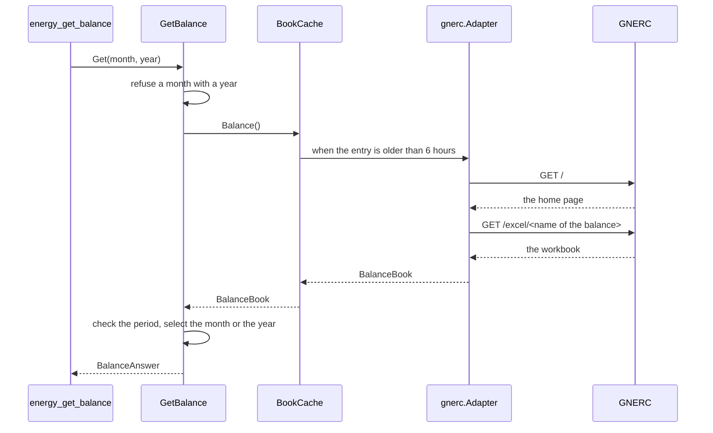

# Specification: The monthly electricity balance and prices of GNERC

## 1. Summary

This feature adds the vendor client `pkg/gnerc` for the workbooks of `data.gnerc.org`,
and two tools to the context `energy`: `energy_get_balance` returns the balance of a month
or a year from 2022, and `energy_list_prices` returns the three prices of each month of a
period from 2015.

`spec-client.md` holds the client, the mapping of the adapter, and the recorded answers.
`spec-tools.md` holds the descriptions and the structs of the tools.

## 2. Coverage

| Requirement         | Where this specification realizes it                           |
| ------------------- | -------------------------------------------------------------- |
| `GNERCMON-FR-001`   | 4.2 `GetBalance`. `spec-tools.md`, `month`                  |
| `GNERCMON-FR-002`   | 4.2 `GetBalance`, `YearBalance.Total`. `spec-tools.md`, `months`. `GNERCMON-DD-009` |
| `GNERCMON-FR-003`   | 4.2 `GetBalance`. `GNERCMON-DD-005`                            |
| `GNERCMON-FR-004`   | 4.2 `ErrMonthAndYear`, `PeriodError`. 4.5                      |
| `GNERCMON-FR-005`   | `spec-client.md` 2. 4.2 `Item`. `spec-tools.md`        |
| `GNERCMON-FR-006`   | 4.2 `Figures`. `GNERCMON-DD-004`                               |
| `GNERCMON-FR-007`   | 4.2 `ListPrices`, `MonthPrices`. `spec-tools.md`            |
| `GNERCMON-FR-008`   | 4.2 `ListPrices`                                               |
| `GNERCMON-FR-009`   | 4.2 `ListPrices`, `PeriodError`, `ErrPeriodTooLong`. 4.5       |
| `GNERCMON-FR-010`   | 4.2 `MonthPrices`. `spec-tools.md`                     |
| `GNERCMON-FR-011`   | 4.2 `BalanceBook.Modified`, `PriceBook.Modified`. `spec-tools.md`, `as_of`, `newest_month` |
| `GNERCMON-FR-012`   | `spec-client.md` 2. `GNERCMON-DD-004`                         |
| `GNERCMON-FR-013`   | 4.3 configuration. `GNERCMON-DD-002`                           |
| `GNERCMON-NFR-001`  | 4.3 cache. `GNERCMON-SC-018`                                   |
| `GNERCMON-NFR-002`  | 4.3 cache. `GNERCMON-SC-019`                                   |
| `GNERCMON-NFR-003`  | 4.3 configuration. `GNERCMON-DD-007`, `GNERCMON-SC-020`        |
| `GNERCMON-NFR-004`  | `spec-client.md` 1. `GNERCMON-SC-001`                             |
| `GNERCMON-INV-001`  | 4.2 `Round`. `GNERCMON-DD-009`                                 |
| `GNERCMON-INV-002`  | 4.2 `Month`. `spec-tools.md`                                   |
| `GNERCMON-INV-003`  | `spec-tools.md`, `source`                                      |

## 3. Guideline compliance

| Rule                   | How this specification obeys it                                                |
| ---------------------- | ------------------------------------------------------------------------------ |
| `ARC-004`, `CLT-001`   | `pkg/gnerc` is a package of the server module.                                 |
| `ARC-008`              | `energy` imports no other context.                                             |
| `PKG-003`              | GSE and GNERC serve different ports. `module.go` builds each with its own switch (`ADR-0007`). |
| `ARC-009`, `CFG-004`   | `bootstrap` builds the module of `energy` from `Config.Energy`, which gains `GNERC`. |
| `CLT-002`              | Standard library, `pkg/vendorhttp`, and `golang.org/x/net/html` for the home page: the client reads a web page. `archive/zip` and `encoding/xml` read a workbook. `embed` and `crypto/x509` hold the certificate. |
| `CLT-003`              | The client returns each link as the page gives it, and each cell as its text in the workbook. It picks no file and parses no number. |
| `CLT-004`              | `NewTransport` and the default client follow the shape of `pkg/matsne`. `GNERCMON-DD-002`. |
| `CLT-007`              | A status that is not 200 is an `*APIError`.                                    |
| `CLT-008`              | No retry and no cache in the client.                                           |
| `CLT-009`              | The package comment and the README say that GNERC documents no format.         |
| `DOM-003`, `TST-009`   | `ParseMonth` validates the text of the model. It has a fuzz test.              |
| `DOM-005`, `DOM-011`   | `adapter/gnerc` converts each shape and wraps `kernel.ErrSourceUnavailable`.   |
| `DOM-006`, `MCP-009`   | Each value is a `decimal.Decimal`. The tool writes it as a string with 3 decimals. |
| `DOM-007`              | `as_of` is in `kernel.TbilisiZone()`.                                          |
| `DOM-009`, `DOM-010`   | Two ports with one method each. Two use cases with one method each.            |
| `MCP-002` to `MCP-009` | 4.3 tools. `GNERCMON-DD-008`. No `language`: the output holds no text of GNERC. No `limit`: a balance is one record, and the prices take a period of at most 60 months (`MCP-008`, `ADR-0008`). |
| `RSL-001`, `RSL-008`   | `vendors.Config.ClientOptions` gives the timeout and the limit.                |
| `RSL-003` to `RSL-006` | `adapter/cache`. 4.3 cache.                                                    |
| `CFG-003`, `CFG-008`   | Each variable has the prefix `GEOMCP_ENERGY_GNERC_`. The switch is on by default. |
| `LOG-004`              | The logger of the module carries `context=energy` and `vendor=GNERC`.          |
| `TST-006`              | `pkg/gnerc/testdata/` holds the answers of 2026-11-17.                         |

## 4. Design

### 4.1 Components

Every path is new unless the table says "change". `E` is `internal/app/georgia-mcp/energy`.

| Layer          | Path                         | Types and functions                                        |
| -------------- | ---------------------------- | ---------------------------------------------------------- |
| Vendor client  | `pkg/gnerc/`                 | `Client`, `New`, `Option`, `NewTransport`, `DefaultBaseURL`, `Link`, `Workbook`, `Sheet`, `Row`, `Cell`, `APIError`, `ErrUnexpectedStatus`, `ErrNotWorkbook`. |
| Domain         | `E/domain/` (change)         | `Month`, `ParseMonth`, `Item`, `Items`, `Figures`, `MonthBalance`, `YearBalance`, `MonthPrices`, `Round`, the constants, `ErrInvalidMonth`. |
| Use case       | `E/app/` (change)            | `BalanceSource`, `BalanceBook`, `PriceSource`, `PriceBook`, `GetBalance`, `BalanceQuery`, `BalanceAnswer`, `ListPrices`, `PriceQuery`, `PriceAnswer`, `PeriodError`, the errors. |
| Driven adapter | `E/adapter/gnerc/`           | `Adapter`, `NewAdapter`.                                   |
| Cache          | `E/adapter/cache/` (change)  | `BookCache`, `NewBookCache`.                               |
| Tool           | `E/adapter/tool/` (change)   | `UseCases` gains `GetBalance`, `ListPrices`. The structs of 4.3. |
| Module         | `E/module.go`, `E/config.go` (change) | `Config.GNERC`. Each vendor has its own switch.   |
| Composition    | `internal/app/georgia-mcp/bootstrap/` (change) | The defaults of GNERC in `config_test.go`.  |
| Configuration  | `configs/.env.example` (change) | The variables of 4.3.                                   |
| Documentation  | `README.md` (change)         | The vendor and the two tools.                              |

`spec-client.md` 1 holds the client. `spec-client.md` 2 holds the adapter: the links, the table of labels, and the price sheets.

### 4.2 Domain model

```go
// domain
const (
    FirstBalanceYear   = 2022
    FirstPriceYear     = 2015
    MaxPriceMonths     = 60
    DefaultPriceMonths = 12
    Precision          = 3
)

// Month is a month of the calendar. The zero Month is no month.
type Month struct {
    Year  int
    Month time.Month
}

// ParseMonth takes "2026-03". Else ErrInvalidMonth.
func ParseMonth(text string) (Month, error)
func (m Month) String() string        // "2026-03"
func (m Month) AddMonths(n int) Month // 2026-01 plus -1 is 2025-12
func (m Month) Before(o Month) bool
func (m Month) Compare(o Month) int  // -1, 0, or +1, for slices.SortFunc
func (m Month) IsZero() bool
// MonthsFrom returns the count of months from from to m, both included: 2025-01 to 2025-12 is 12.
func (m Month) MonthsFrom(from Month) int

// Round rounds half away from zero to Precision decimals.
func Round(d decimal.Decimal) decimal.Decimal

type Item string // the 34 constants of spec-client.md 2

// Items returns every item, in the order of GNERCMON-FR-005.
func Items() []Item
// Required tells whether a sheet must hold the item: generation_total, import_total,
// supply, consumption_total, export_total.
func (i Item) Required() bool

// Figures holds the value of each item that GNERC gives, in million kWh. An item that
// GNERC does not give for the year has no key.
type Figures map[Item]decimal.Decimal

type MonthBalance struct {
    Month   Month
    Figures Figures
}

type YearBalance struct {
    Year   int
    Months []MonthBalance // the published months, in order
    Total  Figures        // the year total column of GNERC
}

type MonthPrices struct {
    Month       Month
    Balancing   *decimal.Decimal // tetri per kWh; nil when GNERC gives none
    CapacityFee *decimal.Decimal
    Deregulated *decimal.Decimal
}

var ErrInvalidMonth = errors.New("month: invalid")
```

```go
// app/port.go
type BalanceBook struct {
    Years    []domain.YearBalance // from FirstBalanceYear, in order; each holds a published month
    Modified time.Time            // when GNERC last changed the workbook; zero when GNERC does not say
    ReadAt   time.Time
    Stale    bool
}

type PriceBook struct {
    Months   []domain.MonthPrices // the published months from 2015-01, in order
    Modified time.Time
    ReadAt   time.Time
    Stale    bool
}

type BalanceSource interface {
    Balance(ctx context.Context) (BalanceBook, error)
}

type PriceSource interface {
    Prices(ctx context.Context) (PriceBook, error)
}

// app/balance.go
type BalanceQuery struct {
    Month domain.Month // zero for no month
    Year  int          // 0 for no year
}

type BalanceAnswer struct {
    Period   string // "2026-03" or "2026"
    Months   int    // the published months that the period holds
    Figures  domain.Figures
    Newest   domain.Month
    Modified time.Time
    ReadAt   time.Time
    Stale    bool
}

func NewGetBalance(source BalanceSource) *GetBalance
func (g *GetBalance) Get(ctx context.Context, query BalanceQuery) (BalanceAnswer, error)

// app/prices.go
type PriceQuery struct {
    From, To domain.Month // zero for no month
}

type PriceAnswer struct {
    Months   []domain.MonthPrices
    Newest   domain.Month
    Modified time.Time
    ReadAt   time.Time
    Stale    bool
}

func NewListPrices(source PriceSource) *ListPrices
func (l *ListPrices) List(ctx context.Context, query PriceQuery) (PriceAnswer, error)

// app/errors.go
var (
    ErrMonthAndYear     = errors.New("balance: month and year")
    ErrPeriodOutOfRange = errors.New("period: out of range")
    ErrReversedPeriod   = errors.New("period: reversed")
    ErrPeriodTooLong    = errors.New("period: too long")
)

// PeriodError wraps ErrPeriodOutOfRange. Field is "month", "year", "from", or "to".
type PeriodError struct {
    Field         string
    Value         string // "2021-12" or "2021"
    First, Newest domain.Month
}

// SpanError wraps ErrPeriodTooLong.
type SpanError struct{ Months int }
```

`Get` refuses a month with a year with `ErrMonthAndYear` and calls no source. Else it
reads `Balance`. The newest month is the last month of the last year. No month and no
year gives that month. A month before 2022-01 or after the newest month, or a month of
a year with no such published month, gives a `*PeriodError`. A year before 2022 or after
the year of the newest month gives a `*PeriodError`. A year gives its `Total`, and
`Months` is the count of its published months.

`List` reads `Prices`. A `To` that is zero or after the newest month becomes the newest
month. A `To` before 2015-01 with no `From` gives a `*PeriodError` of `to`. `From` defaults
to `To` minus 11 months, and to 2015-01 at the earliest. It refuses a `From` before
2015-01, or after the newest month, with a `*PeriodError`. It refuses a `To` before `From`
with `ErrReversedPeriod`, and more than 60 months from `From` to `To` with a `*SpanError`.
Then it returns each published month of the period.

### 4.3 Declarations

**MCP tools.** `spec-tools.md` holds the descriptions and the structs.

| Tool                 | Input            | Output          | Errors | Realizes |
| -------------------- | ---------------- | --------------- | ------ | -------- |
| `energy_get_balance` | `month`, `year`  | `balanceOutput` | 4.5    | `GNERCMON-FR-001` to `GNERCMON-FR-006`, `GNERCMON-FR-011`, `GNERCMON-FR-012` |
| `energy_list_prices` | `from`, `to`     | `pricesOutput`  | 4.5    | `GNERCMON-FR-007` to `GNERCMON-FR-012` |

**Vendor endpoint.** `spec-client.md` 3 holds the endpoints and the recorded answers.

**Cache.**

| Port method             | Key     | Time to live | Maximum stale | Entries | Realizes |
| ----------------------- | ------- | ------------ | ------------- | ------- | -------- |
| `BalanceSource.Balance` | one key | 6 hours      | 162 hours     | 1       | `GNERCMON-NFR-001`, `GNERCMON-NFR-002` |
| `PriceSource.Prices`    | one key | 6 hours      | 162 hours     | 1       | `GNERCMON-NFR-001`, `GNERCMON-NFR-002` |

The maximum stale counts after the time to live: stale data is less than 7 days old.

**Configuration.**

| Variable                         | Type     | Default                  | Secret | Realizes           |
| -------------------------------- | -------- | ------------------------ | ------ | ------------------ |
| `GEOMCP_ENERGY_GNERC_ENABLED`    | bool     | `true`                   | No     | `GNERCMON-FR-013`  |
| `GEOMCP_ENERGY_GNERC_BASE_URL`   | URL      | `https://data.gnerc.org` | No     | `GNERCMON-FR-001`  |
| `GEOMCP_ENERGY_GNERC_TIMEOUT`    | duration | `10s`                    | No     | `RSL-001`          |
| `GEOMCP_ENERGY_GNERC_RATE`       | float    | `2`                      | No     | `GNERCMON-NFR-003` |
| `GEOMCP_ENERGY_GNERC_BURST`      | int      | `1`                      | No     | `GNERCMON-NFR-003` |

`energy.Config` gains `GNERC vendors.Config` with `envPrefix:"GNERC_"`. `energy.Defaults`
gives `vendors.Defaults(gnercclient.DefaultBaseURL).WithLimit(2, 1)`. The module builds the
part of each vendor whose switch is on, and logs `GNERC is off` with the variable when it
is off. `tool.Register` adds each tool whose use case is not nil. `Close` stops each cache
it built. The module passes `gnercclient.NewTransport()` to `ClientOptions`.

### 4.4 Flow



`energy_list_prices` follows the same path with `ListPrices`, `Prices`, and three workbooks.

### 4.5 Errors

| Condition                                  | Sentinel                      | Tool message |
| ------------------------------------------ | ----------------------------- | ------------ |
| A month that does not parse                | `domain.ErrInvalidMonth`      | `month: "March" is not a month. Use YYYY-MM, for example 2026-03.` The same with `from` or `to`. |
| A month and a year                         | `app.ErrMonthAndYear`         | `month and year: give one of them, or neither for the newest published month.` |
| A month of the balance out of range        | `*app.PeriodError`            | `month: 2021-12 is outside the balance of GNERC. Give a month from 2022-01 to 2026-09.` |
| A year of the balance out of range         | `*app.PeriodError`            | `year: 2021 is outside the balance of GNERC. Give a year from 2022 to 2026.` |
| A `from` out of range                      | `*app.PeriodError`            | `from: 2014-12 is outside the prices of GNERC. Give a month from 2015-01 to 2026-09.` |
| A `to` out of range, with no `from`        | `*app.PeriodError`            | `to: 2014-12 is outside the prices of GNERC. Give a month from 2015-01 to 2026-09.` |
| A `to` before `from`                       | `app.ErrReversedPeriod`       | `to: 2025-01 is before from, 2025-06. Give a period that ends on or after its start.` |
| More than 60 months                        | `*app.SpanError`              | `from and to: the period holds 72 months. Give at most 60.` |
| GNERC fails, with no stale value           | `kernel.ErrSourceUnavailable` | `GNERC did not answer. Try again in a few minutes.` |
| Any other error                            | none                          | `The server failed to read the data of GNERC.` |

A year in a message is the year of `First` and of `Newest`.

## 5. Design decisions

### `GNERCMON-DD-001`

**Realizes:** `GNERCMON-FR-001`, `GNERCMON-FR-007`, `GNERCMON-FR-012`
**Decision:** The adapter reads the links of the home page on each load, and picks each
workbook by the fixed part of its file name (`spec-client.md` 2).
**Rationale:** Each name holds the range of years, `2015 - 2026`, and changes when GNERC
adds a year. One name holds two spaces. The page links the current name. The page costs
one call for each load of 6 hours.
**Alternatives:** Build the name from the year, and try the year before on a 404. A name
that GNERC changes in another way fails until a release. The owner chose the links on 2026-11-17.

### `GNERCMON-DD-002`

**Realizes:** `GNERCMON-FR-013`
**Decision:** `pkg/gnerc` embeds the certificate `Go Daddy Secure Certificate Authority -
G2` (SHA-256 `97:3A:41:27:...:04:1A:A6`, valid to 2031-05-03) as `godaddy-g2.pem`.
`NewTransport` trusts the roots of the system and that certificate, for GNERC only.
**Rationale:** GNERC sends no intermediate. The verifier of Go fetches none, so each Linux
host fails, the hosted server included. The roots of the system still verify a server that
sends its chain, so a fix at GNERC needs no release. The leaf expires on 2027-01-29. A new
leaf from another intermediate fails until a release adds that intermediate.
**Alternatives:** Skip the check of the certificate. A host between the server and GNERC
could then change the figures that the model reports. Add the certificate to the image of
the server. A server in stdio on Linux still fails, and every vendor trusts it.

### `GNERCMON-DD-003`

**Realizes:** `GNERCMON-FR-012`
**Decision:** `Workbook` reads the body with `archive/zip`, then decodes with `encoding/xml`:
`xl/workbook.xml` for the name and the relation of each sheet,
`xl/_rels/workbook.xml.rels` for the part of each relation, `xl/sharedStrings.xml` for the
strings (each `<t>` of an `<si>` joined), and each sheet part for its cells. The client reads
at most 16 MiB from each part. A body that is not a zip, or lacks one of these parts, gives
`ErrNotWorkbook`. A cell keeps `<v>` as text, or the shared string that it names.
**Rationale:** The standard library reads both formats. A cell keeps the decimal text, so a
value never passes through a float. The limit bounds a body that expands too far.
**Alternatives:** A library of spreadsheets. `CLT-002` admits it only when the standard
library cannot read the format.

### `GNERCMON-DD-004`

**Realizes:** `GNERCMON-FR-005`, `GNERCMON-FR-006`, `GNERCMON-FR-012`
**Decision:** The adapter maps a row by its label (`spec-client.md` 2), not by its code. A label that the
table does not hold is ignored. A row of the table that a sheet lacks gives no item. A sheet
that lacks a required item, or holds the label of an item twice, fails the read. An empty
cell in a row that exists is zero.
**Rationale:** The code of an item changes between years: hydro is `1.3` to 2024 and `1.4`
from 2025. Its label stayed the same from 2022 to 2026. GNERC leaves a cell empty when the
value is none: the export to Turkey in 2026-03. A missing total would mislead the model.
**Alternatives:** Map by the code of each year. Each new year needs a table.

### `GNERCMON-DD-005`

**Realizes:** `GNERCMON-FR-003`, `GNERCMON-FR-008`, `GNERCMON-FR-011`
**Decision:** A month of the balance is published when its total generation is above zero.
A month of the prices is published when it has a price. A year with no published month is
not in the book.
**Rationale:** GNERC fills the months to come with `0` from a formula, or leaves them
empty. Georgia never generates zero in a month.
**Alternatives:** Use the count `9 თვე` of the home page. It is a second source for one
number.

### `GNERCMON-DD-006`

**Realizes:** `GNERCMON-NFR-001`, `GNERCMON-NFR-002`
**Decision:** Each port returns the whole book, under one key. The use case selects the
month, the year, or the period, and checks it against the newest month of the book.
**Rationale:** A load reads the whole workbook in any case. One key gives every month a
stale value. A request out of range reads the cache, not GNERC.
**Alternatives:** A key for each month. Each key reads the same workbook again.

### `GNERCMON-DD-007`

**Realizes:** `GNERCMON-NFR-003`
**Decision:** The limit is 2 calls each second with a burst of 1.
**Rationale:** A token bucket lets through its burst plus its rate in one second: 3 calls.
A load of the prices sends 4 calls in about 1.5 seconds, once in 6 hours.
**Alternatives:** 3 calls each second with a burst of 3. It lets 6 calls through.

### `GNERCMON-DD-008`

**Realizes:** `GNERCMON-FR-001`, `GNERCMON-FR-002`, `GNERCMON-FR-007`
**Decision:** The tools are `energy_get_balance` with `month` or `year`, and
`energy_list_prices` with `from` and `to`. The three prices of a month share one object.
**Rationale:** `get` gives one record by its key. `list` gives a series over a period. The
owner chose one tool for each dataset, and all three prices for each month, on 2026-11-17.
**Alternatives:** One tool with a dataset input. Its schema holds both outputs.

### `GNERCMON-DD-009`

**Realizes:** `GNERCMON-FR-002`, `GNERCMON-INV-001`
**Decision:** The adapter rounds each cell with `Round` when it parses it. The total of a
year is the column `სულ` of GNERC, rounded, not a sum of the rounded months.
**Rationale:** `decimal.Round` rounds half away from zero. The column is the figure that
GNERC publishes. A sum of rounded months can differ from it by 0.001 for each month.
**Alternatives:** Sum the months. The answer then differs from the workbook.

## 6. Scenarios

`pkg/gnerc/testdata/` holds the answers that the tests serve.

| File                      | Content                                                                     |
| ------------------------- | --------------------------------------------------------------------------- |
| `home.html`               | The real home page.                                                         |
| `balance.xlsx`            | The real balance workbook.                                                  |
| `balancing.xlsx`, `capacity-fee.xlsx`, `deregulated.xlsx` | The real price workbooks.                   |
| `balance-no-import.xlsx`  | A copy of the balance with no row `ელექტროენერგიის ჯამური იმპორტი` in 2026. |
| `balance-bad-value.xlsx`  | A copy of the balance. The cell `C4` of 2026 holds the string `n/a`.        |
| `not-zip.xlsx`            | The bytes of `home.html`.                                                   |
| `balancing-empty-cell.xlsx` | A copy of `balancing.xlsx`. The cell of 2026-09 holds no value.          |

Values of the recorded workbooks, for the tests:

| Period   | Values                                                                             |
| -------- | ---------------------------------------------------------------------------------- |
| 2026-03  | generation total `1102.668`, solar `1.314`, hydro `759.389`; import `228.916`, from Russia `155.484`; supply and consumption `1306.646`; export to Turkey `0.000`; domestic `1326.633`; free market `1.727` |
| 2026     | 9 months; generation total `10308.382`, import `1186.498`, export to Turkey `169.008` |
| 2025-03  | solar `0.000`; free market `1.576`                                                  |
| 2024-03  | generation total `1130.057`; no solar; free market `0.609`                          |
| 2022-03  | generation total `1076.963`, hydro `570.784`; no solar; no free market              |
| Prices   | 2015-01: `13.365`, `0.592`, `7.397`. 2021-02 deregulated `12.304`. 2026-09: `16.068`, `1.607`, `11.655`. The newest month is 2026-09. |

The newest month of the balance is 2026-09. `Modified` is 2026-10-21T13:45:18+04:00.

| ID                 | Verifies | Layer | Given, when, then |
| ------------------ | -------- | ----- | ----------------- |
| `GNERCMON-SC-001`  | `GNERCMON-NFR-004` | unit | A server records each request. `Links` sends `GET /`. `Workbook("2015 - 2026 ფაქტიური ბალანსი.xlsx")` sends the escaped path `/excel/2015%20-%202026%20%E1%83%A4...`. Each call carries a User-Agent that starts with `georgia-mcp/` and holds `https://github.com/abgeo/georgia-mcp`. |
| `GNERCMON-SC-002`  | `GNERCMON-FR-001` | unit | `Links` on `home.html` gives the 7 links of `/excel/`, the balance first, with their text. |
| `GNERCMON-SC-003`  | `GNERCMON-FR-001`, `GNERCMON-FR-007` | unit | `Workbook` on `balance.xlsx` gives 12 sheets, `2015 GEO` to `2026 GEO`, `LastModified` as served, and in `2026 GEO` row 4 the cells `A` `1`, `B` the shared string `ელექტროენერგიის ჯამური გამომუშავება`, `C` `910.16262400000005`. `deregulated.xlsx` gives the text ` 12.304 ` for the year 2021 of February. |
| `GNERCMON-SC-004`  | `GNERCMON-FR-012` | unit | A 404 and a 500 give an `*APIError` with the status. `errors.Is(err, ErrUnexpectedStatus)` holds. `not-zip.xlsx` gives `ErrNotWorkbook`. |
| `GNERCMON-SC-005`  | `GNERCMON-FR-013` | unit | The embedded certificate parses with the subject `Go Daddy Secure Certificate Authority - G2` and the SHA-256 of `GNERCMON-DD-002`. The `RootCAs` of `NewTransport` holds it. |
| `GNERCMON-SC-006`  | `GNERCMON-FR-001`, `GNERCMON-INV-002` | unit | `ParseMonth`: `2026-03` gives March 2026. `2026-3`, `2026-13`, `March`, `2026-03-01`, and the empty text give `ErrInvalidMonth`. `String` gives `2026-03`. A fuzz test holds that a result parses back from its `String`. |
| `GNERCMON-SC-007`  | `GNERCMON-FR-009` | unit | `AddMonths`: 2026-01 plus -1 is 2025-12, plus 11 is 2026-12. `MonthsFrom`: 2025-01 to 2025-12 is 12, 2020-01 to 2025-12 is 72. `Before` orders by year, then month. `Compare` gives -1, 0, and +1. |
| `GNERCMON-SC-008`  | `GNERCMON-INV-001` | unit | `Round`: `388.95957600000003` gives `388.960`, `1.0005` gives `1.001`, `-1.0005` gives `-1.001`, `0` gives `0.000` with `StringFixed(3)`. |
| `GNERCMON-SC-009`  | `GNERCMON-FR-005`, `GNERCMON-FR-006`, `GNERCMON-FR-011` | unit | The adapter with the recorded links and workbooks gives the years 2022 to 2026, with 12, 12, 12, 12, and 9 months, and the values of the table above. 2022-03 has no key `generation_solar` and no key `consumption_free_market`. 2025-03 has `generation_solar` `0.000`. `Modified` is the time of `Last-Modified` in Tbilisi. |
| `GNERCMON-SC-010`  | `GNERCMON-FR-012` | unit | `balance-no-import.xlsx`, `balance-bad-value.xlsx`, `not-zip.xlsx`, a home page with no link of the balance, and a 500 for the workbook each give an error that wraps `kernel.ErrSourceUnavailable`. |
| `GNERCMON-SC-011`  | `GNERCMON-FR-007`, `GNERCMON-FR-010`, `GNERCMON-FR-011` | unit | The adapter with the three price workbooks gives the months 2015-01 to 2026-09 in order, with the prices of the table above. A server that serves an empty cell for the balancing price of 2026-09 gives that month with no balancing price and both other prices. |
| `GNERCMON-SC-012`  | `GNERCMON-FR-003` | unit | `Get` with no month and no year gives `Period` `2026-09`, `Months` 1, and `Newest` 2026-09. |
| `GNERCMON-SC-013`  | `GNERCMON-FR-001`, `GNERCMON-FR-002` | unit | `Get` with 2026-03 gives its figures. `Get` with the year 2026 gives the year total and `Months` 9. With 2025, `Months` 12. |
| `GNERCMON-SC-014`  | `GNERCMON-FR-004` | unit | A month with a year gives `ErrMonthAndYear` and calls no source. 2021-12, 2026-10, the year 2021, and the year 2027 each give a `*PeriodError` with `First` 2022-01 and `Newest` 2026-09. |
| `GNERCMON-SC-015`  | `GNERCMON-FR-008` | unit | `List` with no period gives 2025-10 to 2026-09: 12 months. |
| `GNERCMON-SC-016`  | `GNERCMON-FR-009` | unit | 2025-01 to 2025-12 gives 12 months. 2026-01 to 2026-12 gives 9 months, to 2026-09. Only `from` 2026-01 gives 2026-01 to 2026-09. Only `to` 2025-12 gives 2025-01 to 2025-12. Only `to` 2027-12 gives 2025-10 to 2026-09. Only `to` 2015-06 gives 2015-01 to 2015-06. |
| `GNERCMON-SC-017`  | `GNERCMON-FR-009` | unit | `from` 2014-12 and `from` 2026-10 each give a `*PeriodError` of `from`. Only `to` 2014-12 gives a `*PeriodError` of `to`. 2025-06 to 2025-01 gives `ErrReversedPeriod`. 2020-01 to 2025-12 gives a `*SpanError` with 72. Only `from` 2015-01 gives a `*SpanError` with 141. |
| `GNERCMON-SC-018`  | `GNERCMON-NFR-001` | unit | In `synctest`, `Balance`, then `Balance` after 5 hours 59 minutes, sends one load. After 6 hours, a second. `Prices` does the same. |
| `GNERCMON-SC-019`  | `GNERCMON-NFR-002` | unit | In `synctest`, the source fails with `kernel.ErrSourceUnavailable` after one load. At 6 days 23 hours 59 minutes, `Balance` and `Prices` return the book with `Stale` true. At 7 days and 1 minute, they return the error. |
| `GNERCMON-SC-020`  | `GNERCMON-NFR-003` | unit | In `bootstrap`, `LoadConfig` with no variable of energy gives GNERC on, at `https://data.gnerc.org`, with a timeout of 10 seconds, the rate 2, and the burst 1. |
| `GNERCMON-SC-021`  | `GNERCMON-FR-013` | unit | `energy.New` with GNERC off and GSE on registers `energy_get_grid` only. With GNERC on and GSE off, it registers `energy_get_balance` and `energy_list_prices` only. |
| `GNERCMON-SC-022`  | `GNERCMON-FR-001` to `GNERCMON-FR-006`, `GNERCMON-INV-001` to `GNERCMON-INV-003` | integration | `energy_get_balance` with `month` `2026-03`: `source` names GNERC, `as_of` is `2026-10-21T13:45:18+04:00`, `period` `2026-03`, `months` 1, `newest_month` `2026-09`, `unit` `million kWh`. `generation.total` `1102.668`, `generation.solar` `1.314`, `import.russia` `155.484`, `export.turkey` `0.000`, `domestic_consumption` `1326.633`. With `year` 2026: `months` 9, `generation.total` `10308.382`. With `month` `2022-03`: no `generation.solar`, no `consumption.suppliers.free_market`. |
| `GNERCMON-SC-023`  | `GNERCMON-FR-007` to `GNERCMON-FR-011` | integration | `energy_list_prices` with `from` `2026-07`, `to` `2026-12`: `unit` `tetri per kWh`, `newest_month` `2026-09`, 3 months, the last `2026-09` with `16.068`, `1.607`, `11.655`. |
| `GNERCMON-SC-024`  | `GNERCMON-FR-004`, `GNERCMON-FR-009` | integration | Each input of 4.5 returns `IsError` with its message: `March`, `month` with `year`, `2021-12`, `year` 2021, `from` `2014-12`, only `to` `2014-12`, `2025-06` to `2025-01`, and `2020-01` to `2025-12`. |
| `GNERCMON-SC-025`  | `GNERCMON-FR-012` | integration | The vendor answers 500, with an empty cache. Each tool returns `IsError` with `GNERC did not answer. Try again in a few minutes.` |
| `GNERCMON-SC-026`  | `GNERCMON-NFR-001` | integration | Two calls of `energy_get_balance` and two of `energy_list_prices` send 1 call of the home page and 1 of the workbook for the balance, and 1 of the home page and 3 of the workbooks for the prices. |
| `GNERCMON-SC-027`  | `GNERCMON-FR-001`, `GNERCMON-FR-013` | live | With the default client, `Links` against `data.gnerc.org` gives a link that holds `ფაქტიური ბალანსი`, and `Workbook` of its base name gives a sheet `<this year or the last> GEO`. |

## 7. Build plan

| #   | Step                                                                          | Realizes                                   | Done |
| --- | ----------------------------------------------------------------------------- | ------------------------------------------ | ---- |
| 1   | `pkg/gnerc`: client, transport, certificate, workbook reader, recorded answers, README, example, live test. | `GNERCMON-FR-012`, `GNERCMON-FR-013`, `GNERCMON-NFR-004` | [x]  |
| 2   | `domain`: `Month`, `ParseMonth`, `Round`, `Item`, the figures, the prices, fuzz test. | `GNERCMON-FR-005`, `GNERCMON-FR-006`, `GNERCMON-INV-001`, `GNERCMON-INV-002` | [x]  |
| 3   | `app`: the ports, `GetBalance`, `ListPrices`, the errors.                      | `GNERCMON-FR-001` to `GNERCMON-FR-004`, `GNERCMON-FR-007` to `GNERCMON-FR-009` | [x]  |
| 4   | `adapter/gnerc`: the links, the labels, the prices.                            | `GNERCMON-FR-005`, `GNERCMON-FR-006`, `GNERCMON-FR-010` to `GNERCMON-FR-012` | [x]  |
| 5   | `adapter/cache`: `BookCache`.                                                  | `GNERCMON-NFR-001`, `GNERCMON-NFR-002`     | [x]  |
| 6   | `adapter/tool`: the two tools.                                                 | `GNERCMON-FR-001` to `GNERCMON-FR-012`, `GNERCMON-INV-003` | [x]  |
| 7   | `module.go`, `config.go`, `bootstrap`, `configs/.env.example`, `README.md`.    | `GNERCMON-FR-013`, `GNERCMON-NFR-003`      | [x]  |

## 8. Out of scope for this specification

The pages of the tools on the website (`website/src/content/tools/`, `definitions.json`,
`recordings.json`) and the vendor GNERC in `contexts.yaml`. A change of `WEBSITE` adds
them after the tools exist.

## Retired identifiers

This file has no retired identifier.
