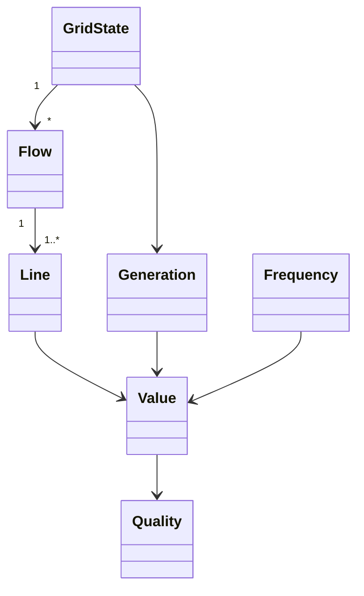
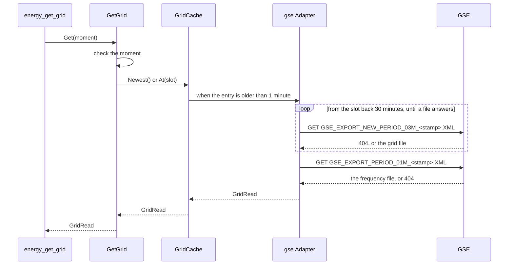

# Specification: The electricity grid of GSE

## 1. Summary

This feature adds the vendor client `pkg/gse` for the real time exports of GSE, and the
context `energy` with one tool: `energy_get_grid`. The tool returns the grid state and
the frequency of the newest grid slot, or of the slot of a moment in the last 31 days.

## 2. Coverage

| Requirement        | Where this specification realizes it                         |
| ------------------ | ------------------------------------------------------------ |
| `GSEGRID-FR-001`   | 4.2 `GetGrid`, `GridSource.Newest`                           |
| `GSEGRID-FR-002`   | 4.2 `SlotOf`, `GetGrid`, `MomentError`. 4.5                  |
| `GSEGRID-FR-003`   | 4.2 `ParseMoment`                                            |
| `GSEGRID-FR-004`   | 4.1 `adapter/gse`. 4.2 `SearchWindow`, `NoGridError`. `GSEGRID-DD-001` |
| `GSEGRID-FR-005`   | 4.3 `gridOutput.Time`, `AverageMinutes`                      |
| `GSEGRID-FR-006`   | 4.2 `Generation`. 4.3 `generationOutput`                     |
| `GSEGRID-FR-007`   | 4.2 `Flow`. 4.3 `flowOutput`. `GSEGRID-DD-002`               |
| `GSEGRID-FR-008`   | 4.2 `DirectionOf`. 4.3 `flowOutput`, `netOutput`             |
| `GSEGRID-FR-009`   | 4.2 `GridState.NetImport`. 4.3 `netOutput`                   |
| `GSEGRID-FR-010`   | 4.2 `Quality`. 4.3 `valueOutput`                             |
| `GSEGRID-FR-011`   | 4.2 `GridState.Measured`, `GridState.Values`                 |
| `GSEGRID-FR-012`   | 4.1 `adapter/gse`. 4.3 `frequencyOutput`. `GSEGRID-DD-004`   |
| `GSEGRID-FR-013`   | 4.1 `adapter/gse`. `GSEGRID-DD-003`                          |
| `GSEGRID-FR-014`   | 4.3 configuration                                            |
| `GSEGRID-NFR-001`  | 4.3 cache. `GSEGRID-SC-015`, `GSEGRID-SC-024`                |
| `GSEGRID-NFR-002`  | 4.3 cache. `GSEGRID-SC-016`                                  |
| `GSEGRID-NFR-003`  | 4.3 configuration. `GSEGRID-DD-005`, `GSEGRID-SC-017`        |
| `GSEGRID-NFR-004`  | 4.1 `pkg/gse`. `GSEGRID-SC-001`                              |
| `GSEGRID-INV-001`  | 4.2 `Value`. `GSEGRID-DD-006`                                |
| `GSEGRID-INV-002`  | 4.1 `adapter/gse`. 4.3 outputs                               |
| `GSEGRID-INV-003`  | 4.3 outputs, `source`                                        |

## 3. Guideline compliance

| Rule                   | How this specification obeys it                                                |
| ---------------------- | ------------------------------------------------------------------------------ |
| `ARC-004`, `CLT-001`   | `pkg/gse` is a package of the server module.                                   |
| `ARC-008`              | `energy` imports no other context.                                             |
| `ARC-009`, `CFG-004`   | `bootstrap` builds the module of `energy` from `Config.Energy`.                |
| `CLT-002`, `CLT-004`   | Standard library and `pkg/vendorhttp` only. `encoding/xml` decodes the body. The client converts ISO-8859-1 itself. |
| `CLT-003`              | The types mirror the file: each attribute as a string, each name as published, with its spaces. |
| `CLT-005`              | `Accept: text/xml, application/xml`, set at construction.                      |
| `CLT-007`              | A status that is not 200, 404 included, is an `*APIError`.                     |
| `CLT-008`, `RSL-002`   | No retry and no cache in the client. The search of `GSEGRID-DD-001` reads other files, not the same file again. |
| `CLT-009`              | The package comment and the README say that GSE documents no format.           |
| `DOM-003`, `TST-009`   | `ParseMoment` validates the text of the model. It has a fuzz test.             |
| `DOM-005`, `DOM-011`   | `adapter/gse` converts each shape and wraps `kernel.ErrSourceUnavailable`.     |
| `DOM-006`, `MCP-009`   | Each value is a `decimal.Decimal`. The tool writes it as a string.             |
| `DOM-007`              | `SlotOf` and the adapter work in `kernel.TbilisiZone()`.                       |
| `DOM-009`, `DOM-010`   | One port with two methods. One use case with one method.                       |
| `MCP-002` to `MCP-009` | 4.3 tool. `GSEGRID-DD-007`. No `language`: GSE writes each name in English. No `limit`: the output is one grid state. |
| `RSL-001`, `RSL-008`   | `vendors.Config.ClientOptions` gives the timeout and the limit.                |
| `RSL-003` to `RSL-006` | `adapter/cache`. 4.3 cache.                                                    |
| `CFG-003`, `CFG-008`   | Each variable has the prefix `GEOMCP_ENERGY_GSE_`. The switch is on by default. |
| `LOG-004`              | The logger of the module carries `context=energy`.                             |
| `TST-006`              | `pkg/gse/testdata/` holds the answers of 2026-11-17.                           |

## 4. Design

### 4.1 Components

Every path is new unless the table says "change". `E` is `internal/app/georgia-mcp/energy`.

| Layer          | Path                         | Types and functions                                        |
| -------------- | ---------------------------- | ---------------------------------------------------------- |
| Vendor client  | `pkg/gse/`                   | `Client`, `New`, `Option`, `DefaultBaseURL`, `Export`, `Header`, `Block`, `Entry`, `APIError`, `ErrUnexpectedStatus`. |
| Domain         | `E/domain/`                  | `SlotOf`, `ParseMoment`, `Quality`, `Value`, `Direction`, `DirectionOf`, `Line`, `Flow`, `Generation`, `GridState`, `Frequency`, the constants, the errors. |
| Use case       | `E/app/`                     | `GridSource`, `GridRead`, `GetGrid`, `GridQuery`, `MomentError`, `NoGridError`, the errors. |
| Driven adapter | `E/adapter/gse/`             | `Adapter`, `NewAdapter`.                                   |
| Cache          | `E/adapter/cache/`           | `GridCache`, `NewGridCache`.                               |
| Tool           | `E/adapter/tool/`            | `Register`, `UseCases`, the structs of 4.3.                |
| Module         | `E/doc.go`, `E/module.go`, `E/config.go` | `Module`, `New`, `Register`, `Close`, `Config`, `Defaults`. |
| Composition    | `internal/app/georgia-mcp/bootstrap/` (change) | `Config.Energy` with `envPrefix:"ENERGY_"`. `modules.go` builds `energy.New` after `parliament`. |
| Configuration  | `configs/.env.example` (change) | The variables of 4.3.                                   |
| Documentation  | `README.md` (change)         | The tool in the list of tools.                             |

**`pkg/gse`.** The shape of `pkg/nbg`, with XML.

```go
const DefaultBaseURL = "https://admin.gse.com.ge"

var ErrUnexpectedStatus = errors.New("gse: unexpected status")

type APIError = vendorhttp.StatusError

// Grid returns the export of the grid of the 3 minutes stamped at. The name of the file
// holds at as it is, in the location of at: GSE names its files in the time of Tbilisi.
func (c *Client) Grid(ctx context.Context, at time.Time) (Export, error)
// Frequency returns the export of the frequency of the minute stamped at.
func (c *Client) Frequency(ctx context.Context, at time.Time) (Export, error)

type Export struct {
    Header Header  `xml:"Export"`
    Blocks []Block `xml:"BLOCKS>BLOCK_AREA"`
}

type Header struct {
    Time   string `xml:"Time,attr"`   // "16.11.2026 12:00:00"
    Period string `xml:"Period,attr"` // "03M" or "01M"
    Type   string `xml:"Type,attr"`   // "Real Time Data"
}

type Block struct {
    Name    string  `xml:"Name,attr"` // "TOTAL RUSSIA TIE LINES" and spaces to 44 characters
    Entries []Entry `xml:"TA"`
}

type Entry struct {
    B1      string `xml:"B1,attr"`      // "AllGeorg"
    B2      string `xml:"B2,attr"`      // "IntchSum", "Intercha"
    B3      string `xml:"B3,attr"`      // "Salkhino"
    Element string `xml:"EL,attr"`      // "P", or "Area   V" for the frequency
    Kind    string `xml:"IN,attr"`      // "MvAvr03m", or "F" for the frequency
    Value   string `xml:"VALUE,attr"`   // "18.299999"
    Quality string `xml:"QUALITY,attr"` // "ACT"
}
```

`Grid` sends `GET /storage/uploads/fact/GSE_EXPORT_NEW_PERIOD_03M_<DDMMYYYY>_<HHMM>.XML`.
`Frequency` sends `GET /storage/uploads/fact/GSE_EXPORT_PERIOD_01M_<DDMMYYYY>_<HHMM>.XML`.
The client formats `at` with `02012006_1504`. It decodes the body with an `xml.Decoder`
whose `CharsetReader` maps each byte of ISO-8859-1 to its rune. `encoding/xml` skips the
stylesheet instruction and the `DOCTYPE`. The body limit is 64 KiB: a grid file has 2.3 KB.

**`adapter/gse`.** `NewAdapter(client *gseclient.Client, now func() time.Time)`. `Newest`
searches from `SlotOf(now())`. `At` searches from the slot it gets. The search
(`GSEGRID-DD-001`) reads `Grid` at the slot, then each earlier slot, down to the slot minus
`SearchWindow`: at most 11 files. A 404 moves to the slot before. The first file that
answers ends the search. Any other failure ends the search with `kernel.ErrSourceUnavailable`.
No file in the window gives `app.ErrNoGrid`. After a grid file, the adapter reads `Frequency`
at the same slot (`GSEGRID-DD-004`). `ReadAt` is `now()` in `kernel.TbilisiZone()` after the
grid file.

| Vendor field                                  | Domain value                                          |
| --------------------------------------------- | ----------------------------------------------------- |
| `Header.Time`                                 | `time.ParseInLocation("02.01.2006 15:04:05", _, kernel.TbilisiZone())`. It must equal the slot of the request. |
| `Header.Period`                               | `03M` for the grid, `01M` for the frequency.          |
| `Block.Name`, trimmed: `TOTAL HYDRO STATIONS` | `Generation.Hydro`                                    |
| `TOTAL TERMAL STATIONS`                       | `Generation.Thermal`                                  |
| `TOTAL WIND PLANTS`                           | `Generation.Wind`                                     |
| `TOTAL SUN PLANTS`                            | `Generation.Solar`                                    |
| `TOTAL GENERATION (HYDRO+TERMAL+WIND+SU`      | `Generation.Total`                                    |
| `TOTAL CONSUMPTION`                           | `GridState.Consumption`                               |
| `TOTAL <COUNTRY> TIE LINES`                   | One `Flow`. `Country` is `<COUNTRY>` with only the first letter in upper case. `GSEGRID-DD-002`. |
| `FREQUENCY`                                   | `Frequency.Value`                                     |
| `Entry.B3`, trimmed                           | `Line.Name`                                           |
| `Entry.Value`, trimmed                        | `decimal.NewFromString`. `GSEGRID-DD-006`.            |
| `Entry.Quality`, trimmed                      | `domain.Quality`                                      |

### 4.2 Domain model



```go
// domain
const (
    SlotLength   = 3 * time.Minute
    SearchWindow = 30 * time.Minute
    Retention    = 31 * 24 * time.Hour
)

// SlotOf returns the start of the grid slot that holds t, in kernel.TbilisiZone().
func SlotOf(t time.Time) time.Time

// ParseMoment takes RFC 3339 with an offset, or a time of Tbilisi with no offset:
// "2026-11-16T13:01", "2026-11-16 13:01", with or without seconds. Else ErrInvalidMoment.
func ParseMoment(text string) (time.Time, error)

type Quality string // the code as GSE gives it

const (
    QualityMeasured    Quality = "ACT"
    QualitySubstituted Quality = "SUB"
    QualityNotReceived Quality = "NRE"
    QualityBLS         Quality = "BLS"
)

func (q Quality) Meaning() string // the table of GSEGRID-FR-010; "unknown" for any other code
func (q Quality) Measured() bool  // ACT only

type Value struct {
    Number  decimal.Decimal // MW, or Hz for the frequency
    Quality Quality
}

type Direction string

const (
    DirectionImport Direction = "import"
    DirectionExport Direction = "export"
    DirectionNone   Direction = "none"
)

func DirectionOf(number decimal.Decimal) Direction // above zero: import

type Line struct {
    Name  string // "Salkhino"
    Value Value
}

type Flow struct {
    Country string // "Russia"
    Lines   []Line // one or more, in the order of the file
}

// Net returns the sum of the lines.
func (f Flow) Net() decimal.Decimal

type Generation struct{ Hydro, Thermal, Wind, Solar, Total Value }

type GridState struct {
    Slot        time.Time // in kernel.TbilisiZone()
    Generation  Generation
    Consumption Value
    Flows       []Flow // in the order of the file
}

// NetImport returns the sum of the net of each flow.
func (g GridState) NetImport() decimal.Decimal
// Values returns each value of the file: the generation, the consumption, each line.
func (g GridState) Values() []Value
// Measured returns the count of the values whose quality is measured.
func (g GridState) Measured() int

type Frequency struct {
    Minute time.Time
    Value  Value
}

var ErrInvalidMoment = errors.New("moment: invalid")
```

```go
// app/port.go
type GridRead struct {
    State     domain.GridState
    Frequency *domain.Frequency // nil when GSE has none for the minute of the slot
    ReadAt    time.Time
    Stale     bool
}

type GridSource interface {
    // Newest returns the newest grid state from the slot of the read back SearchWindow.
    // ErrNoGrid when GSE has none.
    Newest(ctx context.Context) (GridRead, error)
    // At returns the newest grid state from slot back SearchWindow. ErrNoGrid when GSE has none.
    At(ctx context.Context, slot time.Time) (GridRead, error)
}

// app/grid.go
type GridQuery struct {
    Moment *time.Time // nil for the newest grid state
}

func NewGetGrid(source GridSource, now func() time.Time) *GetGrid
func (g *GetGrid) Get(ctx context.Context, query GridQuery) (GridRead, error)

// app/errors.go
var (
    ErrNoGrid           = errors.New("grid: no data")
    ErrMomentOutOfRange = errors.New("moment: out of range")
)

// MomentError wraps ErrMomentOutOfRange. Earliest is the request instant minus Retention.
type MomentError struct {
    Moment, Earliest time.Time
    Future           bool
}

// NoGridError wraps ErrNoGrid and holds the slot where the search started.
type NoGridError struct{ Slot time.Time }
```

`Get` with no moment calls `Newest`. With a moment, it refuses a moment after `now` or
before `now` minus `Retention` with a `*MomentError`, and calls no source. Else it calls
`At(SlotOf(moment))`. It wraps `ErrNoGrid` in a `*NoGridError`, with `SlotOf(now)` for
`Newest`.

### 4.3 Declarations

**MCP tool.**

| Tool              | Input              | Output       | Errors | Realizes |
| ----------------- | ------------------ | ------------ | ------ | -------- |
| `energy_get_grid` | `moment`           | `gridOutput` | 4.5    | `GSEGRID-FR-001` to `GSEGRID-FR-013` |

`energy_get_grid`. Title: `Get the electricity grid of Georgia`. Description:

> Returns the state of the electricity grid of Georgia from Georgian State Electrosystem
> (GSE), the operator of the transmission grid: the generation of the hydro, thermal,
> wind, and solar power plants, the total generation, the consumption, and the flow on the
> lines to each neighbor country, in MW, with the frequency in Hz. Each value is the
> average of 3 minutes. A positive flow is an import, a negative flow an export. Each value
> carries the quality code of GSE: only ACT is a measurement. Give a moment to read the
> grid at a time in the last 31 days. The names are in English. Data from GSE.

```go
type getGridInput struct {
    Moment string `json:"moment,omitempty" jsonschema:"A moment in the last 31 days: 2026-11-16T13:00 for a time of Tbilisi, or RFC 3339 with an offset, for example 2026-11-16T09:00:00Z. Leave it empty for the newest grid state."`
}

type gridOutput struct {
    Source         string           `json:"source"          jsonschema:"The source of the data: Georgian State Electrosystem (GSE)."`
    AsOf           string           `json:"as_of"           jsonschema:"The instant at which the server read the grid state, RFC 3339."`
    Stale          bool             `json:"stale"           jsonschema:"True when GSE did not answer and the server returns a grid state it read before."`
    Time           string           `json:"time"            jsonschema:"The time of the grid slot as GSE stamps it, RFC 3339 with +04:00. It can be before the moment of the request when GSE published no newer slot."`
    AverageMinutes int              `json:"average_minutes" jsonschema:"The length of the average of each power value, in minutes: 3."`
    Generation     generationOutput `json:"generation"      jsonschema:"The generation by type of power plant, in MW."`
    Consumption    valueOutput      `json:"consumption"     jsonschema:"The consumption of Georgia, in MW."`
    Flows          []flowOutput     `json:"flows"           jsonschema:"The flow on the lines to each country, in MW. A positive flow is an import."`
    NetImport      netOutput        `json:"net_import"      jsonschema:"The sum of every flow, in MW. A negative net import is an export."`
    Measured       int              `json:"measured"        jsonschema:"The count of the values with the quality code ACT."`
    Values         int              `json:"values"          jsonschema:"The count of the values that GSE published for the slot."`
    Frequency      *frequencyOutput `json:"frequency,omitempty" jsonschema:"The frequency of the grid at the minute of the slot. Absent when GSE published none."`
}

type generationOutput struct {
    Hydro   valueOutput `json:"hydro"   jsonschema:"The hydro power plants."`
    Thermal valueOutput `json:"thermal" jsonschema:"The thermal power plants."`
    Wind    valueOutput `json:"wind"    jsonschema:"The wind power plants."`
    Solar   valueOutput `json:"solar"   jsonschema:"The solar power plants."`
    Total   valueOutput `json:"total"   jsonschema:"The total generation, as GSE publishes it."`
}

type valueOutput struct {
    Value   string `json:"value"   jsonschema:"The power in MW as a decimal string, as GSE publishes it."`
    Quality string `json:"quality" jsonschema:"The quality code of GSE: ACT, SUB, NRE, BLS, or another code."`
    Meaning string `json:"meaning" jsonschema:"The meaning of the code: measured, substituted by the operator, not received, not documented by GSE, or unknown."`
}

type flowOutput struct {
    Country   string       `json:"country"           jsonschema:"The country at the other end of the lines, as GSE names it."`
    Value     string       `json:"value"             jsonschema:"The flow in MW as a decimal string. The sum of the lines when the country has more than one."`
    Direction string       `json:"direction"         jsonschema:"import, export, or none."`
    Quality   string       `json:"quality,omitempty" jsonschema:"The quality code of a country with one line. Absent for a sum."`
    Meaning   string       `json:"meaning,omitempty" jsonschema:"The meaning of the quality code. Absent for a sum."`
    Lines     []lineOutput `json:"lines,omitempty"   jsonschema:"Each line of a country with more than one, as GSE names it."`
}

type lineOutput struct {
    Name      string `json:"name"      jsonschema:"The name of the line at GSE, for example Salkhino."`
    Value     string `json:"value"     jsonschema:"The flow in MW as a decimal string, as GSE publishes it."`
    Direction string `json:"direction" jsonschema:"import, export, or none."`
    Quality   string `json:"quality"   jsonschema:"The quality code of GSE."`
    Meaning   string `json:"meaning"   jsonschema:"The meaning of the quality code."`
}

type netOutput struct {
    Value     string `json:"value"     jsonschema:"The net import in MW as a decimal string."`
    Direction string `json:"direction" jsonschema:"import, export, or none."`
}

type frequencyOutput struct {
    Value   string `json:"value"   jsonschema:"The frequency in Hz as a decimal string, as GSE publishes it. The nominal value is 50."`
    Time    string `json:"time"    jsonschema:"The minute of the frequency, RFC 3339 with +04:00."`
    Quality string `json:"quality" jsonschema:"The quality code of GSE."`
    Meaning string `json:"meaning" jsonschema:"The meaning of the quality code."`
}
```

`source` is `Georgian State Electrosystem (GSE)`. `as_of` is `ReadAt`, and `time` is the
slot, each in `kernel.TbilisiZone()`, written with `time.RFC3339`. `average_minutes` is 3.

**Vendor endpoint.** Every row: `pkg/gse`, no key, no: the undocumented exports of the
site of an official company.

| Method and path                                                   | Realizes                                  |
| ----------------------------------------------------------------- | ----------------------------------------- |
| `GET /storage/uploads/fact/GSE_EXPORT_NEW_PERIOD_03M_<stamp>.XML` | `GSEGRID-FR-001` to `GSEGRID-FR-011`, `GSEGRID-FR-013` |
| `GET /storage/uploads/fact/GSE_EXPORT_PERIOD_01M_<stamp>.XML`     | `GSEGRID-FR-012`                          |

Real answers, recorded at 21:35 UTC on 2026-11-16, cut:

```
GET https://admin.gse.com.ge/storage/uploads/fact/GSE_EXPORT_NEW_PERIOD_03M_16112026_1200.XML
200 text/xml (2299 bytes), last-modified: Mon, 16 Nov 2026 08:02:17 GMT, cache-control: max-age=2592000
<?xml version='1.0' encoding='ISO-8859-1'?>
<?xml-stylesheet type='text/xsl' href='GSE_V1.XSL'?>
<!DOCTYPE GSE SYSTEM 'GSE_V1.DTD'>
<GSE DTD_Version='1'>
<Export Time='16.11.2026 12:00:00' Period='03M' Type='Real Time Data'/>
<BLOCKS>
<BLOCK_AREA Name='TOTAL HYDRO STATIONS                        '>
<TA B1='AllGeorg' B2='HydroPP' B3='AllHPP' EL='P' IN='MvAvr03m' VALUE='1331.362305' QUALITY='SUB'/>
</BLOCK_AREA>
...
<BLOCK_AREA Name='TOTAL RUSSIA TIE LINES                      '>
<TA B1='AllGeorg' B2='IntchSum' B3='Russia' EL='P' IN='MvAvr03m' VALUE='0.000000' QUALITY='ACT'/>
<TA B1='AllGeorg' B2='Intercha' B3='Salkhino' EL='P' IN='MvAvr03m' VALUE='-0.000000' QUALITY='ACT'/>
<TA B1='AllGeorg' B2='Intercha' B3='Java' EL='P' IN='MvAvr03m' VALUE='18.299999' QUALITY='BLS'/>
<TA B1='AllGeorg' B2='Intercha' B3='Nakaduli' EL='P' IN='MvAvr03m' VALUE='14.191387' QUALITY='ACT'/>
</BLOCK_AREA>
...
</BLOCKS>
</GSE>

GET .../GSE_EXPORT_PERIOD_01M_16112026_1200.XML
200 text/xml (413 bytes)
<Export Time='16.11.2026 12:00:00' Period='01M' Type='Real Time Data'/>
<BLOCK_AREA Name='FREQUENCY                                   '>
<TA B1='GSE' B2=' ' B3=' ' EL='Area   V' IN='F' VALUE='49.990002' QUALITY='ACT'/>

GET .../GSE_EXPORT_NEW_PERIOD_03M_16112026_1201.XML   404 text/html (162 bytes), nginx
GET .../GSE_EXPORT_NEW_PERIOD_03M_15102026_1200.XML   404 text/html (162 bytes), nginx
```

**Cache.**

| Port method          | Key           | Time to live | Maximum stale | Entries | Realizes |
| -------------------- | ------------- | ------------ | ------------- | ------- | -------- |
| `GridSource.Newest`  | one key       | 1 minute     | 29 minutes    | 1       | `GSEGRID-NFR-001`, `GSEGRID-NFR-002` |
| `GridSource.At`      | the slot      | 1 minute     | 29 minutes    | 1024    | `GSEGRID-NFR-001`, `GSEGRID-NFR-002` |

The maximum stale counts after the time to live: a stale grid state is less than 30
minutes old. `ErrNoGrid` passes through and the cache keeps nothing for it.

**Configuration.**

| Variable                       | Type     | Default                    | Secret | Realizes          |
| ------------------------------ | -------- | -------------------------- | ------ | ----------------- |
| `GEOMCP_ENERGY_GSE_ENABLED`    | bool     | `true`                     | No     | `GSEGRID-FR-014`  |
| `GEOMCP_ENERGY_GSE_BASE_URL`   | URL      | `https://admin.gse.com.ge` | No     | `GSEGRID-FR-001`  |
| `GEOMCP_ENERGY_GSE_TIMEOUT`    | duration | `10s`                      | No     | `RSL-001`         |
| `GEOMCP_ENERGY_GSE_RATE`       | float    | `3`                        | No     | `GSEGRID-NFR-003` |
| `GEOMCP_ENERGY_GSE_BURST`      | int      | `2`                        | No     | `GSEGRID-NFR-003` |

`energy.Config` holds `GSE vendors.Config` with `envPrefix:"GSE_"`. `energy.Defaults`
gives `vendors.Defaults(gseclient.DefaultBaseURL).WithLimit(3, 2)`.

### 4.4 Flow



### 4.5 Errors

| Condition                                  | Sentinel                      | Tool message |
| ------------------------------------------ | ----------------------------- | ------------ |
| A moment that does not parse               | `domain.ErrInvalidMoment`     | `moment: "yesterday" is not a moment. Use 2026-11-16T13:00 for a time of Tbilisi, or RFC 3339 with an offset.` |
| A moment in the future                     | `*app.MomentError`            | `moment: 2026-11-18T10:00:00+04:00 is in the future. Give a moment from 2026-10-17T01:35:00+04:00 to now.` |
| A moment more than 31 days ago             | `*app.MomentError`            | `moment: 2026-10-01T12:00:00+04:00 is more than 31 days ago. Give a moment from 2026-10-17T01:35:00+04:00 to now.` |
| No file in the window                      | `*app.NoGridError`            | `GSE published no grid state in the 30 minutes up to 2026-11-16T13:00:00+04:00. Try another moment.` |
| GSE fails, with no stale value             | `kernel.ErrSourceUnavailable` | `GSE did not answer. Try again in a few minutes.` |
| Any other error                            | none                          | `The server failed to read the data of GSE.` |

The earliest moment of a message is the request instant minus 31 days, in seconds.

## 5. Design decisions

### `GSEGRID-DD-001`

**Realizes:** `GSEGRID-FR-001`, `GSEGRID-FR-004`, `GSEGRID-NFR-002`
**Decision:** The driven adapter runs the search of `GSEGRID-FR-004`, with
`domain.SearchWindow`, behind two port methods. `Newest` has one cache key. `At` has the
slot as its key. The search reads the files one at a time, newest first. Only a 404 moves
the search on.
**Rationale:** The stale fallback needs a key that outlives a slot: the key of `Newest`
holds across each 3 minutes. A 404 is the only answer that tells "no file". A failure
that moves on would wait for the timeout up to 11 times. The newest slot is often absent,
so a search reads 2 files in the common case: 0.8 s from the hosted server.
**Alternatives:** A cache of each file, with the search in the use case. A file never
changes, but a new slot has no stale value, so `GSEGRID-NFR-002` fails each 3 minutes.

### `GSEGRID-DD-002`

**Realizes:** `GSEGRID-FR-007`, `GSEGRID-FR-010`
**Decision:** Each block `TOTAL <COUNTRY> TIE LINES` gives one flow with each of its
entries as a line. A flow with one line carries the value and the quality of that line,
and the tool lists no line. A flow with more lines is their sum with no quality, and the
tool lists each line.
**Rationale:** The site of GSE sums each entry of a block. The rule needs no table of
countries, so a new line or a new country enters the net import with no change.
**Alternatives:** A fixed table of four countries. A new line drops out of the net
import with no notice.

### `GSEGRID-DD-003`

**Realizes:** `GSEGRID-FR-013`
**Decision:** The adapter fails the grid read with `kernel.ErrSourceUnavailable` for a
body that does not decode, a `Time` other than the slot of the request, a `Period` other
than `03M`, a value that is not a decimal, a block of generation or consumption that is
absent or holds other than one entry, and a file with no flow. It leaves out a block
with another name.
**Rationale:** A broken field means a change of the source. A total of the generation
from a missing block would mislead the model. A new block is data outside the scope.
**Alternatives:** Return the values that parse. The model then reads a grid that looks
whole.

### `GSEGRID-DD-004`

**Realizes:** `GSEGRID-FR-012`
**Decision:** The adapter reads the frequency of the minute of the slot that the search
found. Any failure of that read, 404 included, gives no frequency. The cache keeps the
grid read with its frequency.
**Rationale:** The requirement keeps the grid state when the frequency is absent. A
second search for the frequency costs calls for one value.
**Alternatives:** Fail the whole answer. One missing value of a second file then hides
13 values.

### `GSEGRID-DD-005`

**Realizes:** `GSEGRID-NFR-003`
**Decision:** The limit is 3 calls each second with a burst of 2.
**Rationale:** A token bucket lets through at most its burst plus its rate in one second:
5 calls. A full search of 11 files then takes about 3 seconds.
**Alternatives:** 5 calls each second with a burst of 5. It lets 10 calls through.

### `GSEGRID-DD-006`

**Realizes:** `GSEGRID-INV-001`
**Decision:** The adapter parses each value with `decimal.NewFromString`. The tool writes
a value with `StringFixed(-Exponent())` when the exponent is below zero, else with
`String()`. A sum keeps the smallest exponent of its terms.
**Rationale:** `String()` cuts the trailing zeros: `0.000000` becomes `0`. Fixed places
keep the 6 decimals that GSE publishes. `-0.000000` becomes `0.000000`, the same decimal,
and its direction is `none`. The check of 2026-11-17 confirmed each output.
**Alternatives:** Keep the text of the file next to the decimal. A sum still needs the
decimal, and two fields for one value can disagree.

### `GSEGRID-DD-007`

**Realizes:** `GSEGRID-FR-001`, `GSEGRID-FR-002`
**Decision:** The tool name is `energy_get_grid`, with the one optional input `moment`.
**Rationale:** `get` gives one record with one key: the moment. A second tool for a past
moment would hold the same output.
**Alternatives:** `energy_get_grid_state`. The word `state` adds nothing for the model.

## 6. Scenarios

`pkg/gse/testdata/` holds the answers that the tests serve.

| File                        | Content                                                                    |
| --------------------------- | -------------------------------------------------------------------------- |
| `grid-16112026-1200.xml`    | The real grid file of 2026-11-16 12:00.                                    |
| `frequency-16112026-1200.xml` | The real frequency file of 2026-11-16 12:00.                             |
| `not-found.html`            | The real 404 body of nginx.                                                |
| `grid-bad-value.xml`        | A copy of the grid file. The value of the hydro block is `n/a`.            |
| `grid-no-consumption.xml`   | A copy of the grid file with no block `TOTAL CONSUMPTION`.                 |
| `grid-extra-block.xml`      | A copy of the grid file with a block `TOTAL IMPORT` of one entry.          |

The value of the recorded grid state, for the tests:

| Value | Number | Quality |
| ----- | ------ | ------- |
| Hydro, thermal, wind, solar | `1331.362305`, `170.777710`, `-0.036000`, `6.000000` | `SUB`, `SUB`, `NRE`, `SUB` |
| Total, consumption | `1511.088379`, `1843.806030` | `NRE`, `NRE` |
| Azerbaijan, Armenia, Turkey | `20.631090`, `0.000000`, `279.235687` | `ACT`, `SUB`, `ACT` |
| Russia: `Russia`, `Salkhino`, `Java`, `Nakaduli` | `0.000000`, `-0.000000`, `18.299999`, `14.191387` | `ACT`, `ACT`, `BLS`, `ACT` |

The flow of Russia is `32.491386`. The net import is `332.358163`, `import`. 5 of 13
values are measured. The frequency is `49.990002`, `ACT`.

The tests of the use case and the tool take `now` as 2026-11-16T12:01:30+04:00, unless the
scenario gives another.

| ID                | Verifies | Layer | Given, when, then |
| ----------------- | -------- | ----- | ----------------- |
| `GSEGRID-SC-001`  | `GSEGRID-NFR-004` | unit | A server records each request. `Grid` at 2026-11-16 12:00, Tbilisi time, sends `GET /storage/uploads/fact/GSE_EXPORT_NEW_PERIOD_03M_16112026_1200.XML`. `Frequency` sends `.../GSE_EXPORT_PERIOD_01M_16112026_1200.XML`. Each call carries a User-Agent that starts with `georgia-mcp/` and holds `https://github.com/abgeo/georgia-mcp`. |
| `GSEGRID-SC-002`  | `GSEGRID-FR-006` | unit | The grid file decodes to `Time` `16.11.2026 12:00:00`, `Period` `03M`, and 10 blocks. The Russia block has 4 entries and its name keeps its spaces. The frequency file gives one entry, `49.990002`. |
| `GSEGRID-SC-003`  | `GSEGRID-FR-013` | unit | A 404 and a 500 each give an `*APIError` with the status. `errors.Is(err, ErrUnexpectedStatus)` holds. A body that is not XML gives an error. |
| `GSEGRID-SC-004`  | `GSEGRID-FR-002`, `GSEGRID-FR-003` | unit | `ParseMoment`: `2026-11-16T13:01`, `2026-11-16 13:01`, and `2026-11-16T13:01:00` give 13:01 in Tbilisi. `2026-11-16T09:01:00Z` gives the same instant. `yesterday`, `2026-11-16`, `13:01`, and the empty text give `ErrInvalidMoment`. A fuzz test holds that a result parses back from its RFC 3339 text. |
| `GSEGRID-SC-005`  | `GSEGRID-FR-002` | unit | `SlotOf`: 13:01 gives 13:00, `09:01:00Z` gives 13:00+04:00, 13:00:00 gives 13:00, 12:59:59.999 gives 12:57. Each result is in `kernel.TbilisiZone()`. |
| `GSEGRID-SC-006`  | `GSEGRID-FR-010` | unit | `Meaning` gives the table of `GSEGRID-FR-010`. `XYZ` and the empty code give `unknown`. `Measured` holds for `ACT` only. |
| `GSEGRID-SC-007`  | `GSEGRID-FR-008` | unit | `DirectionOf`: `279.235687` import, `-23.05` export, `0.000000` and `-0.000000` none. |
| `GSEGRID-SC-008`  | `GSEGRID-FR-007`, `GSEGRID-FR-009`, `GSEGRID-FR-011`, `GSEGRID-INV-001` | unit | A `GridState` with the recorded values: the net of Russia is `32.491386` with the exponent -6. `NetImport` is `332.358163`. `Values` holds 13 values. `Measured` is 5. |
| `GSEGRID-SC-009`  | `GSEGRID-FR-006`, `GSEGRID-FR-007`, `GSEGRID-FR-013`, `GSEGRID-INV-002` | unit | The adapter with the grid file gives the recorded values, 4 flows in the order of the file, the countries `Azerbaijan`, `Armenia`, `Russia`, `Turkey`, and the slot in `kernel.TbilisiZone()`. `grid-extra-block.xml` gives the same state. `grid-bad-value.xml`, `grid-no-consumption.xml`, and the 12:00 file served for 12:03 each give an error that wraps `kernel.ErrSourceUnavailable`. |
| `GSEGRID-SC-010`  | `GSEGRID-FR-004` | unit | A server answers 404 for 12:03 and the file for 12:00. `At(12:03)` gives the slot 12:00 after 2 grid calls. A server with 404 only gives `app.ErrNoGrid` after 11 grid calls, the last for 11:33. A 500 for 12:03 gives `kernel.ErrSourceUnavailable` after 1 call. |
| `GSEGRID-SC-011`  | `GSEGRID-FR-012` | unit | After the grid of 12:00, the adapter reads the frequency of 12:00. A 404 or a 500 for the frequency gives the grid state with no frequency. |
| `GSEGRID-SC-012`  | `GSEGRID-FR-001` | unit | `Get` with no moment calls `Newest` and no `At`. |
| `GSEGRID-SC-013`  | `GSEGRID-FR-002`, `GSEGRID-FR-003` | unit | `Get` with 12:01 calls `At(12:00)`. 12:01:31 gives a `*MomentError` with `Future`. `now` minus 31 days and 1 second gives a `*MomentError`. `now` minus 31 days calls `At`. A refused moment calls no source. |
| `GSEGRID-SC-014`  | `GSEGRID-FR-004` | unit | A source that returns `ErrNoGrid` gives a `*NoGridError` with the slot 12:00 for no moment, and the slot of the moment for a moment. |
| `GSEGRID-SC-015`  | `GSEGRID-NFR-001` | unit | In `synctest`, `Newest`, then `Newest` after 59 seconds, sends one load. After 1 minute, it sends a second. `At` with one slot does the same. |
| `GSEGRID-SC-016`  | `GSEGRID-NFR-002` | unit | In `synctest`, the source fails with `kernel.ErrSourceUnavailable` after one read. At 29 minutes 59 seconds, `Newest` and `At` return the value with `Stale` true. At 30 minutes and 1 second, they return the error. A source that returns `ErrNoGrid` gets a load on each call. |
| `GSEGRID-SC-017`  | `GSEGRID-NFR-003` | unit | In `bootstrap`, `LoadConfig` with no variable of energy gives GSE on, at `https://admin.gse.com.ge`, with a timeout of 10 seconds, the rate 3, and the burst 2. |
| `GSEGRID-SC-018`  | `GSEGRID-FR-014` | unit | `energy.New` with `Enabled` false registers no tool. With `Enabled` true it registers `energy_get_grid`. |
| `GSEGRID-SC-019`  | `GSEGRID-FR-005` to `GSEGRID-FR-012`, `GSEGRID-INV-001` to `GSEGRID-INV-003` | integration | The tool with no moment: `source` is `Georgian State Electrosystem (GSE)`, `as_of` has `+04:00`, `time` is `2026-11-16T12:00:00+04:00`, `average_minutes` is 3. Hydro is `1331.362305`, `SUB`, `substituted by the operator`. Russia is `32.491386`, `import`, with no quality and 4 lines; `Java` is `18.299999`, `BLS`, `not documented by GSE`; `Salkhino` is `0.000000`, `none`. Turkey is `279.235687`, `ACT`, `measured`, with no lines. `net_import` is `332.358163`, `import`. `measured` is 5 and `values` is 13. The frequency is `49.990002` at `2026-11-16T12:00:00+04:00`. |
| `GSEGRID-SC-020`  | `GSEGRID-FR-004`, `GSEGRID-FR-005` | integration | `now` is 12:05. The vendor answers 404 for 12:03. The tool with `2026-11-16 12:04` gives `time` `2026-11-16T12:00:00+04:00`. |
| `GSEGRID-SC-021`  | `GSEGRID-FR-002`, `GSEGRID-FR-003` | integration | The tool with `2026-11-16T08:01:00Z` gives `time` `2026-11-16T12:00:00+04:00`. With the frequency at 404, the output has no `frequency`. |
| `GSEGRID-SC-022`  | `GSEGRID-FR-002`, `GSEGRID-FR-004` | integration | Each input of 4.5 returns `IsError` with its message: `yesterday`, a moment 1 hour ahead, a moment 40 days ago, and a moment with 404 for each slot of the window. |
| `GSEGRID-SC-023`  | `GSEGRID-FR-013` | integration | The vendor answers 500, with an empty cache. The tool returns `IsError` with `GSE did not answer. Try again in a few minutes.` |
| `GSEGRID-SC-024`  | `GSEGRID-NFR-001` | integration | Two calls of the tool with no moment, 30 seconds apart, send one grid call and one frequency call to the vendor in total. |
| `GSEGRID-SC-025`  | `GSEGRID-FR-001` | live | `Grid` for 12:00 of yesterday in Tbilisi against `admin.gse.com.ge` gives a block `TOTAL CONSUMPTION` with one entry. `Frequency` of the same minute gives a block `FREQUENCY`. |

## 7. Build plan

| #   | Step                                                                          | Realizes                                   | Done |
| --- | ----------------------------------------------------------------------------- | ------------------------------------------ | ---- |
| 1   | `pkg/gse`: client, types, recorded answers, README, example, live test.        | `GSEGRID-FR-013`, `GSEGRID-NFR-004`        | [ ]  |
| 2   | `domain`: `SlotOf`, `ParseMoment`, the value objects, the grid state, fuzz test. | `GSEGRID-FR-002`, `GSEGRID-FR-003`, `GSEGRID-FR-006` to `GSEGRID-FR-011`, `GSEGRID-INV-001` | [ ]  |
| 3   | `app`: the port, `GetGrid`, the errors.                                        | `GSEGRID-FR-001`, `GSEGRID-FR-002`, `GSEGRID-FR-004` | [ ]  |
| 4   | `adapter/gse`: the mapping, the search, the frequency.                         | `GSEGRID-FR-004`, `GSEGRID-FR-012`, `GSEGRID-FR-013`, `GSEGRID-INV-002` | [ ]  |
| 5   | `adapter/cache`.                                                               | `GSEGRID-NFR-001`, `GSEGRID-NFR-002`       | [ ]  |
| 6   | `adapter/tool`.                                                                | `GSEGRID-FR-001` to `GSEGRID-FR-013`, `GSEGRID-INV-003` | [ ]  |
| 7   | `module.go`, `config.go`, `bootstrap`, `configs/.env.example`, `README.md`.    | `GSEGRID-FR-014`, `GSEGRID-NFR-003`        | [ ]  |

## 8. Out of scope for this specification

The page of the tools on the website (`website/src/data/definitions.json`,
`recordings.json`) and the list of tools of `build/openai-plugin/plugin.json`. A change
of `WEBSITE` adds them after the tool exists.

## Retired identifiers

This file has no retired identifier.
