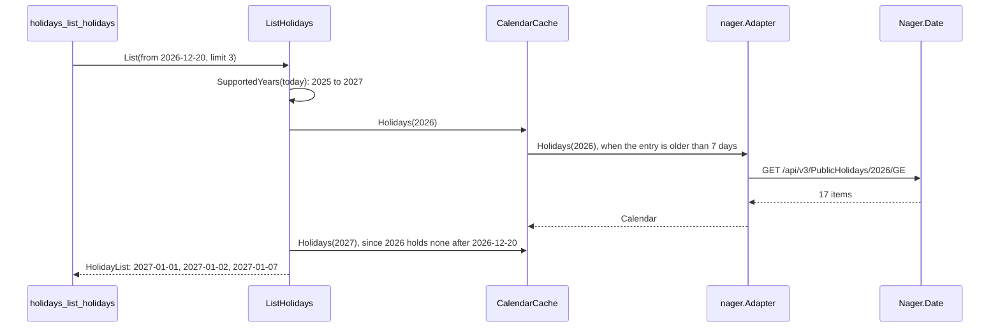

# Specification: The public holidays of Georgia

## 1. Summary

This feature adds the vendor client `pkg/nager` for the public holiday method of
Nager.Date, and the context `holidays` with two tools: `holidays_list_holidays` and
`holidays_get_day`. One vendor call for each year serves every question for 7 days.

## 2. Coverage

| Requirement        | Where this specification realizes it                        |
| ------------------ | ----------------------------------------------------------- |
| `HOLIDAY-FR-001`   | 4.2 `ListHolidays`. 4.3 tool, `year`                        |
| `HOLIDAY-FR-002`   | 4.2 `ListHolidays`. `HOLIDAY-DD-002`                        |
| `HOLIDAY-FR-003`   | 4.2 `SupportedYears`. `HOLIDAY-DD-002`                      |
| `HOLIDAY-FR-004`   | 4.2 `GetDay`. 4.3 tool `holidays_get_day`                   |
| `HOLIDAY-FR-005`   | 4.2 `GetDay`. `HOLIDAY-DD-002`                              |
| `HOLIDAY-FR-006`   | 4.2 `ListHolidays`. 4.3 tool, `from`. `HOLIDAY-DD-003`      |
| `HOLIDAY-FR-007`   | 4.3 tool, `limit`. `HOLIDAY-DD-003`                         |
| `HOLIDAY-FR-008`   | 4.2 `Holiday`. 4.3 `holidayOutput`. `HOLIDAY-DD-005`        |
| `HOLIDAY-FR-009`   | 4.2 `HolidayName.In`. 4.3 tools, `language`                 |
| `HOLIDAY-FR-010`   | 4.2 `YearError`. 4.5                                        |
| `HOLIDAY-FR-011`   | 4.1 `adapter/nager`. 4.5. `HOLIDAY-DD-004`                  |
| `HOLIDAY-FR-012`   | 4.3 configuration                                           |
| `HOLIDAY-FR-013`   | 4.3 tool descriptions. `HOLIDAY-DD-006`                     |
| `HOLIDAY-NFR-001`  | 4.3 cache. `HOLIDAY-SC-016`                                 |
| `HOLIDAY-NFR-002`  | 4.3 cache. `HOLIDAY-SC-017`                                 |
| `HOLIDAY-NFR-003`  | 4.3 configuration. `HOLIDAY-DD-007`, `HOLIDAY-SC-018`       |
| `HOLIDAY-NFR-004`  | 4.1 `pkg/nager`. `HOLIDAY-SC-001`                           |
| `HOLIDAY-INV-001`  | 4.3 outputs, `date`. `HOLIDAY-SC-013`                       |
| `HOLIDAY-INV-002`  | 4.3 outputs, `source`                                       |
| `HOLIDAY-INV-003`  | 4.1 `adapter/nager`. `HOLIDAY-DD-004`                       |

## 3. Guideline compliance

| Rule                   | How this specification obeys it                                              |
| ---------------------- | ---------------------------------------------------------------------------- |
| `ARC-004`, `CLT-001`   | `pkg/nager` is a package of the server module.                               |
| `ARC-008`              | `holidays` imports no other context.                                         |
| `ARC-009`, `CFG-004`   | `bootstrap` builds the module of `holidays` from `Config.Holidays`.          |
| `CLT-002` to `CLT-005` | Standard library and `pkg/vendorhttp` only. `Accept: application/json`.      |
| `CLT-007`              | A status that is not 200 is an `*APIError`.                                  |
| `CLT-008`, `RSL-002`   | No retry, no cache in the client or the adapter.                             |
| `CLT-009`              | The package comment and the README say that the project is not official.     |
| `DOM-003`, `TST-009`   | `NewHolidayName` validates. It has a fuzz test.                              |
| `DOM-005`, `DOM-011`   | `adapter/nager` converts each shape and wraps `kernel.ErrSourceUnavailable`. |
| `DOM-007`              | A date is a `kernel.Date`. The current date is `kernel.Today(now())`.        |
| `DOM-009`, `DOM-010`   | One port. Two use cases, one method each.                                    |
| `MCP-002` to `MCP-009` | 4.3 tools. `HOLIDAY-DD-001`.                                                 |
| `RSL-001`, `RSL-008`   | `vendors.Config.ClientOptions` gives the timeout and the limit.              |
| `RSL-003` to `RSL-006` | `adapter/cache`. 4.3 cache.                                                  |
| `CFG-003`, `CFG-008`   | Each variable has the prefix `GEOMCP_HOLIDAYS_NAGER_`. The switch is on by default. |
| `LOG-004`              | The logger of the module carries `context=holidays`.                         |
| `TST-006`              | `pkg/nager/testdata/` holds the answers of 2026-11-15.                       |

## 4. Design

### 4.1 Components

Every path is new unless the table says "change". `H` is `internal/app/georgia-mcp/holidays`.

| Layer          | Path                     | Types and functions                                        |
| -------------- | ------------------------ | ---------------------------------------------------------- |
| Vendor client  | `pkg/nager/`             | `Client`, `New`, `Option`, `DefaultBaseURL`, `PublicHoliday`, `APIError`, `ErrUnexpectedStatus`. |
| Domain         | `H/domain/`              | `HolidayName`, `NewHolidayName`, `Holiday`, `ErrInvalidHolidayName`. |
| Use case       | `H/app/`                 | `HolidaySource`, `Calendar`, `SupportedYears`, `ListHolidays`, `GetDay`, the queries, the results, `YearError`, the errors. |
| Driven adapter | `H/adapter/nager/`       | `Adapter`, `NewAdapter`.                                   |
| Cache          | `H/adapter/cache/`       | `CalendarCache`, `NewCalendarCache`.                       |
| Tool           | `H/adapter/tool/`        | `Register`, `UseCases`, the structs of 4.3.                |
| Module         | `H/doc.go`, `H/module.go`, `H/config.go` | `Module`, `New`, `Register`, `Close`, `Config`, `Defaults`. |
| Composition    | `internal/app/georgia-mcp/bootstrap/` (change) | `Config.Holidays` with `envPrefix:"HOLIDAYS_"`. `modules.go` builds `holidays.New` after `law`. |
| Configuration  | `configs/.env.example` (change) | The variables of 4.3.                               |
| Documentation  | `README.md` (change)     | The two tools in the list of tools.                        |

**`pkg/nager`.** The shape of `pkg/nea`.

```go
const DefaultBaseURL = "https://date.nager.at"

var ErrUnexpectedStatus = errors.New("nager: unexpected status")

type APIError = vendorhttp.StatusError

// PublicHolidays returns the public holidays of one country in one year, in the order of
// the answer. countryCode is ISO 3166-1 alpha-2: "GE".
func (c *Client) PublicHolidays(ctx context.Context, year int, countryCode string) ([]PublicHoliday, error)

type PublicHoliday struct {
    Date        string   `json:"date"`        // "2026-04-12"
    LocalName   string   `json:"localName"`   // "აღდგომის კვირა"
    Name        string   `json:"name"`        // "Easter Sunday"
    CountryCode string   `json:"countryCode"` // "GE"
    Fixed       bool     `json:"fixed"`
    Global      bool     `json:"global"`
    Counties    []string `json:"counties"`
    LaunchYear  *int     `json:"launchYear"`
    Types       []string `json:"types"`       // ["Public"]
}
```

`PublicHolidays` sends `GET /api/v3/PublicHolidays/{year}/{countryCode}`. The body limit
is the default 1 MiB: the answer for Georgia is 3646 bytes.

**`adapter/nager`.** `NewAdapter(client *nagerclient.Client, now func() time.Time)`.
It asks for the country `GE`.

| Vendor field             | Domain value                                               |
| ------------------------ | ---------------------------------------------------------- |
| `Date`                   | `kernel.ParseDate`. A date outside the asked year fails.   |
| `LocalName`, `Name`      | `domain.NewHolidayName(ka, en)`.                           |
| `Types`                  | The adapter keeps an item whose types hold `Public`.       |
| The other fields         | Not read.                                                  |

`ReadAt` is `now()` in `kernel.TbilisiZone()` after the answer. The holidays come
sorted by date. `HOLIDAY-DD-004` gives each failure.

### 4.2 Domain model

```go
// domain

var ErrInvalidHolidayName = errors.New("holiday name: invalid")

// HolidayName is the name of a public holiday in ka and in en.
type HolidayName struct{ georgian, english string }

// NewHolidayName trims both texts. It fails when both are empty.
func NewHolidayName(georgian, english string) (HolidayName, error)

// In returns the name in the language. An empty name falls back to the other language.
func (n HolidayName) In(language kernel.Language) string

// Holiday is one public holiday.
type Holiday struct {
    Date kernel.Date
    Name HolidayName
}

// Weekday returns the day of the week of the date.
func (h Holiday) Weekday() time.Weekday
```

```go
// app

// Calendar is the public holidays of one year, by date, and the instant of the read.
type Calendar struct {
    Year     int
    Holidays []domain.Holiday
    ReadAt   time.Time
    Stale    bool
}

// HolidaySource gives the public holidays of Georgia.
type HolidaySource interface {
    // Holidays returns the calendar of the year.
    Holidays(ctx context.Context, year int) (Calendar, error)
}

const FirstYear = 2025

// SupportedYears returns the first and the last supported year on the date.
func SupportedYears(today kernel.Date) (first, last int) // FirstYear, today.Year()+1

var (
    ErrUnsupportedYear = errors.New("year: unsupported")
    ErrBothFilters     = errors.New("filter: a year and a from date")
)

// YearError tells that a year or a date is outside the supported years. It wraps
// ErrUnsupportedYear.
type YearError struct {
    Year        int
    First, Last int
}

// ListQuery asks for the holidays of a year, or the next holidays from a date.
// Neither asks for the current year.
type ListQuery struct {
    Year  *int
    From  *kernel.Date
    Limit int // used with From only
}

type HolidayList struct {
    Holidays []domain.Holiday
    ReadAt   time.Time // the oldest read of the calendars used
    Stale    bool      // true when any calendar used is stale
}

type ListHolidays struct{ /* source, now */ }
func NewListHolidays(source HolidaySource, now func() time.Time) *ListHolidays
func (u *ListHolidays) List(ctx context.Context, query ListQuery) (HolidayList, error)

// DayQuery asks about one date. No date asks about the current date.
type DayQuery struct {
    Date *kernel.Date
}

type Day struct {
    Date    kernel.Date
    Holiday *domain.Holiday // nil when the date is not a public holiday
    ReadAt  time.Time
    Stale   bool
}

type GetDay struct{ /* source, now */ }
func NewGetDay(source HolidaySource, now func() time.Time) *GetDay
func (u *GetDay) Get(ctx context.Context, query DayQuery) (Day, error)
```

`List` refuses `Year` and `From` together with `ErrBothFilters`, and a year or a `From`
outside `SupportedYears` with a `*YearError`. It calls no source then. With `From`, it
reads the year of `From`, keeps the holidays on or after it, and reads the next year
while it holds fewer than `Limit` and the next year is supported. `Get` refuses a date
outside `SupportedYears` with a `*YearError`.

### 4.3 Declarations

**MCP tools.**

| Tool                     | Input                                  | Output       | Errors | Realizes |
| ------------------------ | -------------------------------------- | ------------ | ------ | -------- |
| `holidays_list_holidays` | `year`, `from`, `limit`, `language`    | `listOutput` | 4.5    | `HOLIDAY-FR-001` to `HOLIDAY-FR-003`, `HOLIDAY-FR-006` to `HOLIDAY-FR-010`, `HOLIDAY-FR-013` |
| `holidays_get_day`       | `date`, `language`                     | `dayOutput`  | 4.5    | `HOLIDAY-FR-003` to `HOLIDAY-FR-005`, `HOLIDAY-FR-008` to `HOLIDAY-FR-010`, `HOLIDAY-FR-013` |

`holidays_list_holidays`. Title: `List the public holidays of Georgia`. Description:

> Returns the public holidays of Georgia: every holiday of one year, or the next holidays
> on or after a date. Each holiday gives its date (YYYY-MM-DD), its weekday, and its name
> in Georgian or English. With no input, it returns every holiday of the current year in
> Georgia. It supports the years from 2025 to the next year. The list holds no one-off
> day off that the government declares by decree. Data from Nager.Date.

`holidays_get_day`. Title: `Check a date for a public holiday in Georgia`. Description:

> Tells whether one date is a public holiday in Georgia, with its weekday and the holiday
> name in Georgian or English. The default date is today in Georgia. It supports the
> years from 2025 to the next year. A one-off day off that the government declares by
> decree is not in the data: a false answer does not rule one out. Data from Nager.Date.

```go
type listHolidaysInput struct {
    Year     int    `json:"year,omitempty"     jsonschema:"The year, from 2025 to the next year. The default is the current year. Give a year or from, not both."`
    From     string `json:"from,omitempty"     jsonschema:"A date, YYYY-MM-DD. The tool returns the next holidays on or after it, up to limit."`
    Limit    int    `json:"limit,omitempty"    jsonschema:"The maximum count of holidays with from, 1 to 20. The default is 1. A year returns every holiday."`
    Language string `json:"language,omitempty" jsonschema:"The language of the holiday names: ka or en. The default is en."`
}

type getDayInput struct {
    Date     string `json:"date,omitempty"     jsonschema:"The date, YYYY-MM-DD. The default is today in Georgia."`
    Language string `json:"language,omitempty" jsonschema:"The language of the holiday name: ka or en. The default is en."`
}

type listOutput struct {
    Source   string          `json:"source"   jsonschema:"The source of the data: Nager.Date."`
    AsOf     string          `json:"as_of"    jsonschema:"The instant at which the server read the holidays, RFC 3339."`
    Stale    bool            `json:"stale"    jsonschema:"True when Nager.Date did not answer and the server returns holidays it read before."`
    Holidays []holidayOutput `json:"holidays" jsonschema:"The public holidays, in date order."`
}

type holidayOutput struct {
    Date    string `json:"date"    jsonschema:"The date of the holiday, YYYY-MM-DD."`
    Weekday string `json:"weekday" jsonschema:"The day of the week: monday to sunday."`
    Name    string `json:"name"    jsonschema:"The holiday name."`
}

type dayOutput struct {
    Source  string `json:"source"         jsonschema:"The source of the data: Nager.Date."`
    AsOf    string `json:"as_of"          jsonschema:"The instant at which the server read the holidays, RFC 3339."`
    Stale   bool   `json:"stale"          jsonschema:"True when Nager.Date did not answer and the server returns holidays it read before."`
    Date    string `json:"date"           jsonschema:"The date, YYYY-MM-DD."`
    Weekday string `json:"weekday"        jsonschema:"The day of the week: monday to sunday."`
    Holiday bool   `json:"holiday"        jsonschema:"True when the date is a public holiday."`
    Name    string `json:"name,omitempty" jsonschema:"The holiday name. Empty when the date is not a public holiday."`
}
```

`source` is `Nager.Date`. `as_of` is `ReadAt` in `kernel.TbilisiZone()`, written with
`time.RFC3339`. A `year` or a `limit` of 0 asks the default.

**Vendor endpoint.**

| Client      | Method and path                                  | Key | Official | Realizes |
| ----------- | ------------------------------------------------ | --- | -------- | -------- |
| `pkg/nager` | `GET /api/v3/PublicHolidays/{year}/{countryCode}` | No | No: an open source project | `HOLIDAY-FR-001` to `HOLIDAY-FR-011` |

Real answers, recorded on 2026-11-15, cut:

```
GET https://date.nager.at/api/v3/PublicHolidays/2026/GE
200 application/json; charset=utf-8 (3646 bytes, 17 items)
[{"date":"2026-01-01","localName":"ახალი წელი","name":"New Year's Day","countryCode":"GE",
  "fixed":false,"global":true,"counties":null,"launchYear":null,"types":["Public"]},
 {"date":"2026-01-02","localName":"ახალი წელი","name":"New Year's Day", ...},
 {"date":"2026-04-12","localName":"აღდგომის კვირა","name":"Easter Sunday", ...},
 {"date":"2026-11-23","localName":"გიორგობა","name":"Saint George's Day", ...}]

GET .../PublicHolidays/1974/GE   400 {"title":"One or more validation errors occurred.",
                                      "status":400,"errors":{"year":["The specified year '1974' is not supported."]}}
GET .../PublicHolidays/2026/XX   404 {"title":"Unknown country code","status":404,
                                      "detail":"The country code provided is invalid or not recognized."}
```

**Cache.**

| Port method              | Key      | Time to live | Maximum stale | Entries | Realizes |
| ------------------------ | -------- | ------------ | ------------- | ------- | -------- |
| `HolidaySource.Holidays` | the year | 7 days       | 23 days       | 4       | `HOLIDAY-NFR-001`, `HOLIDAY-NFR-002` |

The maximum stale counts after the time to live: a stale calendar is at most 30 days old.
Three years are supported at one time. The fourth entry covers the turn of the year.

**Configuration.**

| Variable                          | Type     | Default                 | Secret | Realizes          |
| --------------------------------- | -------- | ----------------------- | ------ | ----------------- |
| `GEOMCP_HOLIDAYS_NAGER_ENABLED`   | bool     | `true`                  | No     | `HOLIDAY-FR-012`  |
| `GEOMCP_HOLIDAYS_NAGER_BASE_URL`  | URL      | `https://date.nager.at` | No     | `HOLIDAY-FR-001`  |
| `GEOMCP_HOLIDAYS_NAGER_TIMEOUT`   | duration | `10s`                   | No     | `RSL-001`         |
| `GEOMCP_HOLIDAYS_NAGER_RATE`      | float    | `1`                     | No     | `HOLIDAY-NFR-003` |
| `GEOMCP_HOLIDAYS_NAGER_BURST`     | int      | `1`                     | No     | `HOLIDAY-NFR-003` |

`holidays.Config` holds `Nager vendors.Config` with `envPrefix:"NAGER_"`.
`holidays.Defaults` gives `vendors.Defaults(nagerclient.DefaultBaseURL).WithLimit(1, 1)`.

### 4.4 Flow



### 4.5 Errors

| Condition                                  | Sentinel                      | Tool message |
| ------------------------------------------ | ----------------------------- | ------------ |
| A language other than `ka` and `en`        | `kernel.ErrUnknownLanguage`   | `language: "ru" is not a language of this tool. Use ka or en.` |
| A limit out of range                       | none, the tool checks it      | `limit: 50 is out of range. Use 1 to 20.` |
| A date that does not parse                 | `kernel.ErrInvalidDate`       | `date: "2026-02-30" is not a date. Use YYYY-MM-DD.` |
| A year and a from date                     | `app.ErrBothFilters`          | `year, from: give a year or a from date, not both.` |
| A year outside the supported years         | `*app.YearError`              | `year: 2024 is not supported. Use 2025 to 2027.` |
| A date outside the supported years         | `*app.YearError`              | `date: 2028-01-01 is not in a supported year. Use a date from 2025-01-01 to 2027-12-31.` |
| Nager.Date fails, with no stale value      | `kernel.ErrSourceUnavailable` | `Nager.Date did not answer. Try again in a few minutes.` |
| Any other error                            | none                          | `The server failed to read the data of Nager.Date.` |

The field of a date message is the input that held it: `from` or `date`.

## 5. Design decisions

### `HOLIDAY-DD-001`

**Realizes:** `HOLIDAY-FR-001`, `HOLIDAY-FR-004`, `HOLIDAY-FR-006`
**Decision:** Two tools. `holidays_list_holidays` takes a year or a from date.
`holidays_get_day` takes one date. The owner chose it on 2026-11-15.
**Rationale:** A year and the next holidays share one output. A client shows one tool less.
**Alternatives:** Three tools, one for each question. Each input is simpler, but the list
of the client is longer.

### `HOLIDAY-DD-002`

**Realizes:** `HOLIDAY-FR-002`, `HOLIDAY-FR-003`, `HOLIDAY-FR-005`
**Decision:** Each use case takes `now func() time.Time`. The current date is
`kernel.Today(now())`. `SupportedYears` gives 2025 and the year of that date plus 1.
**Rationale:** The year turns at midnight in Tbilisi, not in UTC. A function of `now`
makes the turn testable.
**Alternatives:** A fixed last year in the configuration. It needs a change each year.

### `HOLIDAY-DD-003`

**Realizes:** `HOLIDAY-FR-006`, `HOLIDAY-FR-007`
**Decision:** `limit` cuts the list only with `from`. The default is 1 and the maximum is
20. With a year, or with no input, the tool returns every holiday of the year and does
not read `limit`. With `from`, the list stops at the end of the last supported year.
**Rationale:** `HOLIDAY-FR-001` asks for every holiday of a year. A year holds 17, so a
second limit gives nothing. 20 is less than two years, so `List` reads two calendars
at most.
**Alternatives:** A `limit` for a year too. It lets a model cut a list that it asked in full.

### `HOLIDAY-DD-004`

**Realizes:** `HOLIDAY-FR-011`, `HOLIDAY-INV-003`
**Decision:** The adapter fails the whole answer with `kernel.ErrSourceUnavailable` for
a client error, a body that does not decode, a date that does not parse, a date outside
the asked year, a name that `NewHolidayName` refuses, and an answer with no holiday of
the type `Public`. It leaves out an item with no `Public` type. It keeps every other
item, with its names as published.
**Rationale:** Georgia has holidays each year, so an empty answer is an outage. A broken
field means a change of the source. Every item of Georgia has the type `Public` today. A
type such as `Observance` is not a day off.
**Alternatives:** Leave out a broken item. The model then reads a list that looks complete.

### `HOLIDAY-DD-005`

**Realizes:** `HOLIDAY-FR-008`
**Decision:** The weekday is the English name of `Holiday.Weekday()` in lowercase:
`monday` to `sunday`, in each language. The owner chose it on 2026-11-15.
**Rationale:** A fixed code is stable for the model. The model translates it.
**Alternatives:** The weekday in the language of the request. It adds a table of names to
the server.

### `HOLIDAY-DD-006`

**Realizes:** `HOLIDAY-FR-013`
**Decision:** The description of each tool says that a one-off day off by government
decree is missing. No output field repeats it.
**Rationale:** The model reads the description before each call. A field repeats the same
text in each answer.
**Alternatives:** A `note` field in each output. It costs tokens in each answer.

### `HOLIDAY-DD-007`

**Realizes:** `HOLIDAY-NFR-003`
**Decision:** The limit is 1 call each second with a burst of 1.
**Rationale:** A token bucket lets through at most its burst plus its rate in one second:
2 calls. `NEAAIR-DD-009` uses the same figures.
**Alternatives:** 2 calls each second with a burst of 2. It lets 4 calls through.

## 6. Scenarios

`pkg/nager/testdata/` holds the answers that the tests serve.

| File                  | Content                                                            |
| --------------------- | ------------------------------------------------------------------ |
| `ge-2025.json`        | The real answer for 2025: 17 items.                                |
| `ge-2026.json`        | The real answer for 2026: 17 items.                                |
| `ge-2027.json`        | The real answer for 2027.                                          |
| `ge-empty.json`       | `[]`.                                                              |
| `ge-bad-date.json`    | A copy of `ge-2026.json`. The first date is `2026-1-1`.            |
| `ge-other-year.json`  | A copy of `ge-2026.json`. The first date is `2025-12-31`.          |
| `ge-observance.json`  | A copy of `ge-2026.json`. One more item with the type `Observance`. |
| `year-400.json`       | The real answer for 1974: the status 400.                          |

The tests of the use cases and the tools take `now` as 2026-11-15T12:00:00+04:00.

| ID                | Verifies | Layer | Given, when, then |
| ----------------- | -------- | ----- | ----------------- |
| `HOLIDAY-SC-001`  | `HOLIDAY-NFR-004` | unit | A server records each request. `PublicHolidays(2026, "GE")` sends `GET /api/v3/PublicHolidays/2026/GE` with `Accept: application/json`, and a User-Agent that starts with `georgia-mcp/` and holds `https://github.com/abgeo/georgia-mcp`. |
| `HOLIDAY-SC-002`  | `HOLIDAY-FR-001` | unit | `ge-2026.json` gives 17 items. The first has the date `2026-01-01`, the local name `ახალი წელი`, and the types `["Public"]`. |
| `HOLIDAY-SC-003`  | `HOLIDAY-FR-011` | unit | The status 400 with `year-400.json` gives an `*APIError` with 400. `errors.Is(err, ErrUnexpectedStatus)` holds. A body that is not JSON gives an error. |
| `HOLIDAY-SC-004`  | `HOLIDAY-FR-009` | unit | `NewHolidayName(" ახალი წელი ", "New Year's Day")` trims. `In(ka)` gives `ახალი წელი`. A name with an empty `ka` gives the `en` name for `ka`. Two empty texts give `ErrInvalidHolidayName`. A fuzz test holds that `In` never gives an empty text for a valid name. |
| `HOLIDAY-SC-005`  | `HOLIDAY-FR-008` | unit | `Holiday.Weekday()` of 2026-05-26 is Tuesday. Of 2026-04-12 it is Sunday. |
| `HOLIDAY-SC-006`  | `HOLIDAY-FR-011`, `HOLIDAY-INV-003` | unit | The adapter with `ge-2026.json` gives 17 holidays in date order, `ReadAt` in `kernel.TbilisiZone()`. `ge-observance.json` gives the same 17. `ge-empty.json`, `ge-bad-date.json`, `ge-other-year.json`, and a client error each give an error that wraps `kernel.ErrSourceUnavailable`. |
| `HOLIDAY-SC-007`  | `HOLIDAY-FR-003` | unit | `SupportedYears` on 2026-11-15 gives 2025 and 2027. On 2026-12-31 it gives 2027. On 2027-01-01 it gives 2028. `kernel.Today` of 2026-12-31T21:00:00Z is 2027-01-01. |
| `HOLIDAY-SC-008`  | `HOLIDAY-FR-001`, `HOLIDAY-FR-002` | unit | `List` with the year 2026 gives 17 holidays from 2026-01-01 to 2026-11-23. `List` with no input gives the same and reads 2026. |
| `HOLIDAY-SC-009`  | `HOLIDAY-FR-003`, `HOLIDAY-FR-010` | unit | `List` with 2024 and with 2028 each give a `*YearError` with 2025 and 2027, and call no source. `List` with a year and a `From` gives `ErrBothFilters`. `Get` with 2028-01-01 gives a `*YearError`. |
| `HOLIDAY-SC-010`  | `HOLIDAY-FR-006`, `HOLIDAY-FR-007` | unit | `List` from 2026-11-15 with the limit 1 gives Saint George's Day on 2026-11-23 and reads 2026 only. From 2026-11-23 it gives the same. From 2026-12-31 it gives 2027-01-01 and reads 2027. |
| `HOLIDAY-SC-011`  | `HOLIDAY-FR-006`, `HOLIDAY-FR-003` | unit | `List` from 2027-11-15 with the limit 20 gives the holidays from 2027-11-15 to 2027-12-31 only, and reads no 2028. From 2026-11-15 with the limit 3 gives 2026-11-23, 2027-01-01, 2027-01-02. `ReadAt` is the older of the two reads. `Stale` is true when one calendar is stale. |
| `HOLIDAY-SC-012`  | `HOLIDAY-FR-004`, `HOLIDAY-FR-005` | unit | `Get` with 2026-05-26 gives a holiday, Independence Day. 2026-01-02 gives New Year's Day. 2026-05-27 gives no holiday. No date gives 2026-11-15, no holiday. |
| `HOLIDAY-SC-013`  | `HOLIDAY-FR-008`, `HOLIDAY-FR-009`, `HOLIDAY-INV-001`, `HOLIDAY-INV-002` | integration | `holidays_list_holidays` with no input: `source` is `Nager.Date`, `as_of` has `+04:00`, 17 holidays. The item of 2026-05-26 has `weekday` `tuesday` and `name` `Independence Day`. With `ka`, its name is `დამოუკიდებლობის დღე` and `weekday` is still `tuesday`. `holidays_get_day` with `2026-05-26` gives `holiday` true. |
| `HOLIDAY-SC-014`  | `HOLIDAY-FR-010` | integration | Each input of 4.5 returns `IsError` with its message: `ru`, `limit` 50, `2026-02-30`, a year and a from date, the year 2024, and the date 2028-01-01. |
| `HOLIDAY-SC-015`  | `HOLIDAY-FR-011` | integration | The vendor answers 500, with an empty cache. Each tool returns `IsError` with `Nager.Date did not answer. Try again in a few minutes.` |
| `HOLIDAY-SC-016`  | `HOLIDAY-NFR-001` | unit | In `synctest`, `Holidays(2026)`, then again after 6 days 23 hours 59 minutes, sends one load. After 7 days, it sends a second. |
| `HOLIDAY-SC-017`  | `HOLIDAY-NFR-002` | unit | In `synctest`, the source fails with `kernel.ErrSourceUnavailable` after one read. At 29 days, `Holidays(2026)` returns the calendar with `Stale` true. At 30 days and 1 second, it returns the error. |
| `HOLIDAY-SC-018`  | `HOLIDAY-NFR-003` | unit | In `bootstrap`, `LoadConfig` with no variable of holidays gives Nager.Date on, at `https://date.nager.at`, with a timeout of 10 seconds, the rate 1, and the burst 1. |
| `HOLIDAY-SC-019`  | `HOLIDAY-FR-012` | unit | `holidays.New` with `Enabled` false registers no tool. With `Enabled` true it registers `holidays_list_holidays` and `holidays_get_day`. |
| `HOLIDAY-SC-020`  | `HOLIDAY-FR-013` | integration | The description of each tool, as `tools/list` gives it, holds `decree`. |
| `HOLIDAY-SC-021`  | `HOLIDAY-NFR-001` | integration | Calls of `holidays_list_holidays` with no input, `holidays_get_day` with `2026-05-26`, and both in `ka`, send one vendor call in total. |
| `HOLIDAY-SC-022`  | `HOLIDAY-FR-001` | live | `PublicHolidays` for the current year and `GE` against `date.nager.at` gives at least 15 items, each with the type `Public`. |

## 7. Build plan

| #   | Step                                                                        | Realizes                                     | Done |
| --- | --------------------------------------------------------------------------- | -------------------------------------------- | ---- |
| 1   | `pkg/nager`: client, types, recorded answers, README, example, live test.    | `HOLIDAY-FR-011`, `HOLIDAY-NFR-004`          | [ ]  |
| 2   | `domain`: `HolidayName`, `Holiday`, the fuzz test.                           | `HOLIDAY-FR-008`, `HOLIDAY-FR-009`           | [ ]  |
| 3   | `app`: the port, `SupportedYears`, `ListHolidays`, `GetDay`, the errors.     | `HOLIDAY-FR-001` to `HOLIDAY-FR-007`, `HOLIDAY-FR-010` | [ ]  |
| 4   | `adapter/nager`.                                                             | `HOLIDAY-FR-011`, `HOLIDAY-INV-003`          | [ ]  |
| 5   | `adapter/cache`.                                                             | `HOLIDAY-NFR-001`, `HOLIDAY-NFR-002`         | [ ]  |
| 6   | `adapter/tool`.                                                              | `HOLIDAY-FR-001` to `HOLIDAY-FR-010`, `HOLIDAY-FR-013` | [ ]  |
| 7   | `module.go`, `config.go`, `bootstrap`, `configs/.env.example`, `README.md`.  | `HOLIDAY-FR-012`, `HOLIDAY-NFR-003`          | [ ]  |

## 8. Out of scope for this specification

The page of the tools on the website (`website/src/content/`, `definitions.json`,
`recordings.json`, a hue and an icon of `BRD`) and the list of tools of
`build/openai-plugin/plugin.json`. A change of `WEBSITE` adds them after the tools exist.

## Retired identifiers

This file has no retired identifier.
