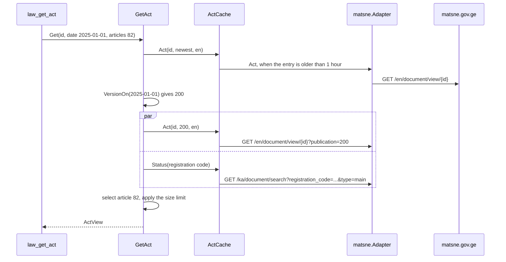

# Specification: The legal acts of the Legislative Herald

## 1. Summary

This feature adds the vendor client `pkg/matsne` for the pages of `matsne.gov.ge`, with a
browser handshake, and the context `law` with two tools: `law_search_acts` and
`law_get_act`. A search reads one page of results. An act reads one page of 3 MB, which
the cache keeps, and the tool returns the table of contents or a few articles of it.
`spec-client.md` holds the client and the adapter. `spec-tools.md` holds the tools and their errors. `spec-scenarios.md` holds the scenarios.

## 2. Coverage

| Requirement       | Where this specification realizes it                         |
| ----------------- | ------------------------------------------------------------ |
| `MATSNE-FR-001`   | 4.2 `SearchActs`. `spec-tools.md`, `law_search_acts`         |
| `MATSNE-FR-002`   | `spec-tools.md`, `target`. `MATSNE-DD-004`                     |
| `MATSNE-FR-003`   | 4.2 `SearchQuery`. `spec-tools.md`. `MATSNE-DD-004`    |
| `MATSNE-FR-004`   | 4.2 `SearchActs`. `MATSNE-DD-005`                            |
| `MATSNE-FR-005`   | 4.2 `Order`. `MATSNE-DD-004`                                 |
| `MATSNE-FR-006`   | `spec-tools.md`, `page`, `limit`, `total`                     |
| `MATSNE-FR-007`   | 4.2 `GetAct`, `ActSource.Status`. `MATSNE-DD-007`, `MATSNE-DD-017`, `MATSNE-DD-018` |
| `MATSNE-FR-008`   | 4.2 `Body.Contents`. `MATSNE-DD-002`, `MATSNE-DD-003`        |
| `MATSNE-FR-009`   | 4.2 `ArticleNumber`, `GetAct`. `MATSNE-DD-006`               |
| `MATSNE-FR-010`   | 4.2 `Body.Text`, `GetAct`. `MATSNE-DD-008`                   |
| `MATSNE-FR-011`   | 4.2 `GetAct`. `MATSNE-DD-009`                                |
| `MATSNE-FR-012`   | `spec-tools.md`, `language`. `MATSNE-DD-003`                  |
| `MATSNE-FR-013`   | 4.2 `ErrNoTranslation`. `MATSNE-DD-010`                      |
| `MATSNE-FR-014`   | `spec-tools.md`, `official`, `notice`                         |
| `MATSNE-FR-015`   | 4.2 the parsers. `spec-tools.md`, errors                      |
| `MATSNE-FR-016`   | `spec-client.md`, `ErrBlocked`. `MATSNE-DD-001`, `MATSNE-DD-011`, `MATSNE-DD-015` |
| `MATSNE-FR-017`   | 4.3 configuration                                            |
| `MATSNE-FR-018`   | 4.2 `ActView.Newest`. `MATSNE-DD-016`                        |
| `MATSNE-NFR-001`  | 4.2 `GetAct`. `MATSNE-DD-008`                                |
| `MATSNE-NFR-002`  | 4.3 cache                                                    |
| `MATSNE-NFR-003`  | 4.3 configuration. `MATSNE-DD-012`                           |
| `MATSNE-NFR-004`  | `MATSNE-DD-013`                                              |
| `MATSNE-NFR-005`  | `spec-client.md`. `vendorhttp` sets the User-Agent            |
| `MATSNE-INV-001`  | `MATSNE-DD-002`, `MATSNE-DD-008`                             |
| `MATSNE-INV-002`  | `spec-tools.md`, `actOutput`                                  |

## 3. Guideline compliance

| Rule                   | How this specification obeys it                                                  |
| ---------------------- | -------------------------------------------------------------------------------- |
| `ARC-004`, `CLT-001`   | `pkg/matsne` is a package of the server module.                                  |
| `ARC-008`              | `law` imports no other context.                                                  |
| `CLT-002`, `CLT-004`   | `pkg/vendorhttp`, `x/net/html`, and `utls`. `NewTransport` gives the browser handshake. |
| `CLT-003`              | The client returns the text of the page. It maps no status and parses no date.   |
| `CLT-007`              | A status that is not 200 is an `*APIError`.                                      |
| `CLT-008`, `RSL-002`   | No retry. No cache in the client or the adapter.                                 |
| `CLT-009`              | The package comment and the README say that the site is a web page with no API.  |
| `DOM-003`, `TST-009`   | `ParseActID`, `ParseArticleNumber`, `ParseDocumentType`, `ParseActStatus` validate. Each has a fuzz test. |
| `DOM-005`, `DOM-011`   | `adapter/matsne` converts each shape and wraps `kernel.ErrSourceUnavailable`.    |
| `DOM-007`              | A date of the source is a `kernel.Date`.                                         |
| `DOM-009`, `DOM-010`   | One port. Two use cases, one method each.                                        |
| `MCP-002` to `MCP-009` | 4.3 tools.                                                                       |
| `RSL-001`, `RSL-008`   | `vendors.Config.ClientOptions` gives the timeout and the limit.                  |
| `RSL-003` to `RSL-007` | `adapter/cache`. 4.3 cache.                                                      |
| `CFG-003`, `CFG-008`   | Each variable has the prefix `GEOMCP_LAW_MATSNE_`. The switch is on by default.  |
| `LOG-004`              | The logger of the module carries `context=law`.                                  |
| `LOG-013`              | A read that the answer leaves out writes `source unavailable` at `warn`.         |
| `TST-006`              | `pkg/matsne/testdata/` holds the pages of 4.3, recorded in stage 3.              |

## 4. Design

### 4.1 Components

Every path is new unless the table says "change". `A` is `internal/app/georgia-mcp/law`.

| Layer          | Path                  | Types and functions                                          |
| -------------- | --------------------- | ------------------------------------------------------------ |
| Vendor client  | `pkg/matsne/`         | `Client`, `New`, `Option`, `NewTransport`, `DefaultBaseURL`, `SearchQuery`, `SearchPage`, `SearchItem`, `Suggestion`, `Document`, `MetaRow`, `Publication`, `Paragraph`, `APIError`, the errors. |
| Domain         | `A/domain/`           | `ActID`, `ArticleNumber`, `DocumentType`, `ActStatus`, `Order`, `SearchQuery`, `ActSummary`, `Version`, `Heading`, `Article`, `Body`, `Act`, the parsers, the errors. |
| Use case       | `A/app/`              | `ActSource`, `SearchPage`, `TitleList`, `ActText`, `StatusResult`, `SearchActs`, `GetAct`, the queries and views, the errors. |
| Driven adapter | `A/adapter/matsne/`   | `Adapter`, `NewAdapter`.                                     |
| Cache          | `A/adapter/cache/`    | `ActCache`, `NewActCache`.                                   |
| Tool           | `A/adapter/tool/`     | `Register`, `UseCases`, the structs of 4.3.                  |
| Module         | `A/doc.go`, `A/module.go`, `A/config.go` | `Module`, `New`, `Register`, `Close`, `Config`, `Defaults`. |
| Composition    | `internal/app/georgia-mcp/bootstrap/` (change) | `Config.Law` with `envPrefix:"LAW_"`. `modules.go` builds `law.New` after `air`. |
| Configuration  | `configs/.env.example` (change) | The variables of 4.3.                             |
| Documentation  | `README.md` (change)  | The two tools in the list of tools.                          |

`spec-client.md` holds the API of `pkg/matsne`, the map of the adapter, and the real answers.

### 4.2 Domain model

```go
// domain
type ActID struct{ id string }

// ParseActID takes 1 to 10 ASCII digits with no leading zero. Else ErrInvalidActID.
func ParseActID(text string) (ActID, error)
func (a ActID) String() string

type ArticleNumber struct{ base, insert int }

// ParseArticleNumber takes "82", "133^3", or "133³", with 1 to 4 digits in each part
// and no leading zero. Else ErrInvalidArticleNumber.
func ParseArticleNumber(text string) (ArticleNumber, error)
func (n ArticleNumber) String() string // "82", "133^3"

type DocumentType string            // the 16 codes of the requirements, 5.1
func ParseDocumentType(text string) (DocumentType, error) // else ErrUnknownDocumentType
func DocumentTypes() []DocumentType // in the order of the requirements, 5.1

type ActStatus string // "" is unknown
const (
    StatusActive  ActStatus = "active"
    StatusExpired ActStatus = "expired"
    StatusPending ActStatus = "pending"
)
func ParseActStatus(text string) (ActStatus, error) // else ErrUnknownActStatus

type Order int
const (
    NewestFirst Order = iota
    OldestFirst
)

type SearchQuery struct {
    Text      string // 1 to 128 runes after the trim
    InText    bool   // search the text, not the title
    Type      *DocumentType
    Status    *ActStatus
    Issuer    string
    Number    string
    From, To  *kernel.Date // the signing date, both ends included
    Order     Order
    Page      int // from 1
    Language  kernel.Language
}

// HasFilter tells whether the query has a type, a status, an issuer, a number, or a date.
func (q SearchQuery) HasFilter() bool

type ActSummary struct {
    ID     ActID
    Title  string
    Type   string // the text of the source: "Organic Law of Georgia"
    Issuer string
    Number string
    Signed kernel.Date // the zero date when the source gives none
    Status ActStatus
}

type Version struct {
    Number int
    Date   kernel.Date
}

type PartKind string
const (
    KindSection PartKind = "section"
    KindChapter PartKind = "chapter"
    KindArticle PartKind = "article"
)

type Heading struct {
    Kind   PartKind
    Number string // "I", "XII", "133^3"
    Title  string
}

type Article struct {
    Number     ArticleNumber
    Title      string
    Paragraphs []string
}

// Body holds the parts of an act, or its text when the page marks no part.
type Body struct {
    Contents []Heading // every heading, in the order of the act
    Articles []Article // in the order of the act
    Text     string    // set only when Articles is empty
}

type Act struct {
    ID               ActID
    Title            string
    Type, Issuer     string
    Number           string
    Signed           kernel.Date
    RegistrationCode string
    Language         kernel.Language
    Version          Version   // the version of this text
    Versions         []Version // newest first
    Body             Body
}

// VersionOn returns the newest version whose date is on or before the date, the higher
// number on a tie. Else false.
func (a Act) VersionOn(date kernel.Date) (Version, bool)

var (
    ErrInvalidActID         = errors.New("act identifier: invalid")
    ErrInvalidArticleNumber = errors.New("article number: invalid")
    ErrUnknownDocumentType  = errors.New("document type: unknown")
    ErrUnknownActStatus     = errors.New("act status: unknown")
)
```

```go
// app/port.go
type SearchPage struct {
    Acts   []domain.ActSummary
    Total  int
    ReadAt time.Time
    Stale  bool
}

type TitleList struct {
    Titles []domain.ActSummary // ID, Title, and Status only
    ReadAt time.Time
    Stale  bool
}

type ActText struct {
    Act    domain.Act
    ReadAt time.Time
    Stale  bool
}

type StatusResult struct {
    Status domain.ActStatus // "" when no act has the code
    ReadAt time.Time
    Stale  bool
}

type ActSource interface {
    Search(ctx context.Context, query domain.SearchQuery) (SearchPage, error)
    // Titles returns the titles of Suggest for a Georgian text.
    Titles(ctx context.Context, text string) (TitleList, error)
    // Act returns one version of an act; nil asks the newest. An unknown identifier gives
    // ErrUnknownAct. An act in en with no translation gives ErrNoTranslation.
    Act(ctx context.Context, id domain.ActID, version *int, language kernel.Language) (ActText, error)
    // Status returns the status of the act with the registration code, from a search.
    Status(ctx context.Context, registrationCode string) (StatusResult, error)
}

// app/errors.go
var (
    ErrUnknownAct      = errors.New("act: unknown")
    ErrNoTranslation   = errors.New("act: no English translation")
    ErrUnknownVersion  = errors.New("version: unknown")
    ErrTooManyArticles = errors.New("articles: more than 10")
    ErrBothVersions    = errors.New("version: a number and a date")
    ErrUnknownArticle  = errors.New("article: unknown")
    ErrUnknownPiece    = errors.New("piece: unknown")
)

// ArticleError wraps ErrUnknownArticle and names the first and the last article.
type ArticleError struct{ Number, First, Last domain.ArticleNumber }
// VersionError wraps ErrUnknownVersion and names version 0 and the newest version.
type VersionError struct{ First, Newest domain.Version }
// PieceError wraps ErrUnknownPiece and holds the count of pieces.
type PieceError struct{ Piece, Pieces int }
```

```go
// app/search.go
type SearchResult struct {
    Acts   []domain.ActSummary
    Total  int
    ReadAt time.Time
    Stale  bool
}
func NewSearchActs(source ActSource, logger *slog.Logger) *SearchActs
func (s *SearchActs) Search(ctx context.Context, query domain.SearchQuery, limit int) (SearchResult, error)

// app/act.go
type ActQuery struct {
    ID       domain.ActID
    Version  *int
    Date     *kernel.Date
    Articles []domain.ArticleNumber // 0 to 10
    Piece    int                    // from 1; 0 asks 1
    Language kernel.Language
}

type ActView struct {
    Act       domain.Act         // Body empty; Versions empty unless the overview
    Status    domain.ActStatus
    Contents  []domain.Heading   // the overview only
    Articles  []domain.Article
    Next      *domain.ArticleNumber // the first requested article that the size left out
    Truncated bool               // the one article passed the size and lost paragraphs
    Newest    *domain.Version    // the newest version, when a read with no version trails it
    VersionCount int             // every version; Act.Versions holds the newest MaxVersions
    Text      string
    Piece     int
    Pieces    int
    ReadAt    time.Time
    Stale     bool
}
func NewGetAct(source ActSource, logger *slog.Logger) *GetAct
func (g *GetAct) Get(ctx context.Context, query ActQuery) (ActView, error)
```

`Get` refuses a version and a date (`ErrBothVersions`) and more than 10 articles before a
call. It always reads the act with no version first. A version number that the list of
versions lacks gives a `*VersionError`. A date takes `VersionOn`. It then reads the selected
version, unless it is the version of the text it holds (`MATSNE-DD-009`). `Newest` is the
first of `Versions` when a query with no version and no date reads an older text
(`MATSNE-DD-016`). It reads `Status` with the registration code of the act, in parallel with
the second read. A failed `Status` leaves the status empty. A failed read of the titles or
of an exact match leaves it out of the search. Each writes the record `source unavailable`
at `warn` with the error (`LOG-013`). With no article it returns the overview: the newest 20 versions
(`MaxVersions`) with the count of every version, the contents, or the piece of the text. With articles it returns them in the order of the act.

### 4.3 Declarations

**MCP tools.** `spec-tools.md` holds the table, the descriptions, the structs, and the errors.

**Vendor endpoint.** Every row: `pkg/matsne`, no key, no: the web pages of an official
publisher.

| Method and path                         | Realizes                                                   |
| --------------------------------------- | ---------------------------------------------------------- |
| `GET /{ka,en}/document/search`          | `MATSNE-FR-001` to `MATSNE-FR-006`, `MATSNE-FR-007` (status) |
| `POST /document/suggest`                | `MATSNE-FR-004`                                            |
| `GET /{ka,en}/document/view/{id}`       | `MATSNE-FR-007` to `MATSNE-FR-014`                         |

**Cache.**

| Port method                 | Key                                       | Time to live | Maximum stale | Entries | Realizes |
| --------------------------- | ----------------------------------------- | ------------ | ------------- | ------- | -------- |
| `ActSource.Search`          | every field of the query, normalized      | 1 hour       | 6 days 23 hours | 256   | `MATSNE-NFR-002` |
| `ActSource.Titles`          | the text after the trim                   | 1 hour       | 6 days 23 hours | 256   | `MATSNE-NFR-002` |
| `ActSource.Act`, no version | the identifier and the language           | 1 hour       | 6 days 23 hours | 16    | `MATSNE-NFR-002` |
| `ActSource.Act`, a version  | the identifier, the version, the language | 24 hours     | 6 days          | 16    | `MATSNE-NFR-002` |
| `ActSource.Status`          | the registration code                     | 1 hour       | 6 days 23 hours | 256   | `MATSNE-NFR-002` |

The maximum stale counts after the time to live. The cache keeps no error. `ErrNoTranslation`
passes through. The error of `MATSNE-DD-015` wraps `kernel.ErrSourceUnavailable`, so a stale
act comes back in its place. 32 acts of 3 MB of page give at most about 50 MB
of text in memory.

**Configuration.**

| Variable                       | Type     | Default                  | Secret | Realizes          |
| ------------------------------ | -------- | ------------------------ | ------ | ----------------- |
| `GEOMCP_LAW_MATSNE_ENABLED`    | bool     | `true`                   | No     | `MATSNE-FR-017`   |
| `GEOMCP_LAW_MATSNE_BASE_URL`   | URL      | `https://matsne.gov.ge`  | No     | `MATSNE-FR-001`   |
| `GEOMCP_LAW_MATSNE_TIMEOUT`    | duration | `10s`                    | No     | `RSL-001`         |
| `GEOMCP_LAW_MATSNE_RATE`       | float    | `5`                      | No     | `MATSNE-NFR-003`  |
| `GEOMCP_LAW_MATSNE_BURST`      | int      | `5`                      | No     | `MATSNE-NFR-003`  |

`law.Config` holds `Matsne vendors.Config` with `envPrefix:"MATSNE_"`. `law.Defaults` gives
`vendors.Defaults(matsneclient.DefaultBaseURL).WithLimit(5, 5)`. `New` passes
`matsneclient.NewTransport()` to `ClientOptions`.

### 4.4 Flow



### 4.5 Errors

`spec-tools.md` holds the map of each error to its tool message.

## 5. Design decisions

### `MATSNE-DD-001`

**Realizes:** `MATSNE-FR-016`
**Decision:** The client dials with the handshake of Chrome 131 over HTTP/1.1, as `pkg/gulf`
does. It reads the `<title>` of each answer and returns `ErrBlocked` for `Access Denied`. The
adapter wraps `ErrBlocked`, `ErrMalformedPage`, a status error, and a transport error with
`kernel.ErrSourceUnavailable`.
**Rationale:** The filter answers 200, so the status alone hides a refusal. A browser gets
every page. A stale value is better than a page of the filter.
**Alternatives:** A browser User-Agent with the handshake of Go. `MATSNE-NFR-005` forbids
the false User-Agent, and stage 3 checks whether the handshake alone passes.

### `MATSNE-DD-002`

**Realizes:** `MATSNE-FR-008`, `MATSNE-FR-009`, `MATSNE-INV-001`
**Decision:** For `ka`, the adapter walks the paragraphs by class. `karixml` opens a section
and `karisataurixml` gives its title. `tavixml` and `tavisataurixml` do the same for a
chapter. `muxlixml` opens an article: "მუხლი {number}. {title}". Each later paragraph of another
class (`abzacixml`, `MyPetit`, `MsoNormal`), up to the next part, is a paragraph of the
article, with its text unchanged. A paragraph before the first article is not part of an
article. A title paragraph with no heading above it that reads "თავი X. {title}" or
"კარი X. {title}" opens the part itself: the page leaves `tavixml` of chapter X empty. The
adapter removes the characters that show nothing (U+200B to U+200D, U+2060, U+FEFF,
U+00AD): the heading of article 288^3 holds a zero width space.
**Rationale:** The page marks each part with one class (section 3 of the requirements).
The notes of an amendment sit in `abzacixml`, `MyPetit`, and `MsoNormal`, and
`MATSNE-INV-001` keeps them. The live page of 2026-11-15 gave 367 articles, 45 chapters,
and 15 sections only with the empty heading and the invisible characters handled.
**Alternatives:** Separate the amendment notes. No class marks them all.

### `MATSNE-DD-003`

**Realizes:** `MATSNE-FR-008`, `MATSNE-FR-009`, `MATSNE-FR-012`
**Decision:** For `en`, the adapter reads `MsoNormal` paragraphs. A paragraph `SECTION {roman}`
opens a section, and the next paragraph gives its title. `SECTION X – (Deleted)` holds its
title on the same line. `Chapter {roman} – {title}` opens a
chapter. A bold paragraph that starts with `Article {number} – ` opens an article. Each
other paragraph belongs to the open article. A page with no part class and no article
heading gives a `Body` with `Text`: the paragraphs joined with a new line.
**Rationale:** The English page is Word markup with no part class. Bold separates a heading
from a citation such as "under Article 281 of this Code".
**Alternatives:** Read the Georgian structure and align it. The counts differ: 367 and 366.

### `MATSNE-DD-004`

**Realizes:** `MATSNE-FR-002`, `MATSNE-FR-003`, `MATSNE-FR-005`
**Decision:** The adapter always sends `type=main`. It sends `query_target=title` or `text`,
`group` from the table of `spec-client.md`, `status`, `issuer`, `number`, `signing_date_fr[date]` and
`signing_date_to[date]` as `dd/mm/yyyy`, and `sort=signingDate_desc` or `signingDate_asc`.
**Rationale:** `type=main` returns the consolidated act, not each amendment.
**Alternatives:** Expose `type=all`. It fills a page with amendments of one act.

### `MATSNE-DD-005`

**Realizes:** `MATSNE-FR-004`
**Decision:** The exact title rule runs when the target is the title, the page is 1, the
query holds a Georgian letter, and `HasFilter` is false. `SearchActs` calls `Search` and
`Titles` in parallel. A title matches when both texts are equal after the trim, the removal
of `„“”"«»`, and the fold of each run of spaces to one. For at most 3 active matches, it
reads `Act` with no version in the language of the request, or in `ka` on
`ErrNoTranslation`, and builds the summary from the metadata with the status `active`. The
matches come first. The page loses each of their identifiers. A failure of `Titles` or of
`Act` leaves the page of the source with no error. `Total` stays the total of the source.
**Rationale:** The owner chose the full metadata (question of 2026-11-15). The act enters
the cache, so the next `law_get_act` reads no page. A filter already narrows the search.
**Alternatives:** The fields of Suggest only. The type, the issuer, and the date stay empty.

### `MATSNE-DD-006`

**Realizes:** `MATSNE-FR-009`, `MATSNE-FR-015`
**Decision:** An article number is a base and an insert. The page gives "133" and a `sup` "3";
the client writes `133^3`. The parser accepts `133^3` and `133³`, and writes `133^3`.
**Rationale:** A model cannot type a superscript reliably. The English page flattens it to
"1333", which collides with a real article 1333.
**Alternatives:** `133.3`. It reads as a paragraph of article 133.

### `MATSNE-DD-007`

**Realizes:** `MATSNE-FR-007`
**Decision:** The status of an act comes from `Status`: a search with the registration code
and `type=main`, in `ka`. No registration code, or no result, gives no status.
**Rationale:** The page of an act shows no status (checked on 32842, expired, and 1043717,
active). The class of a search result gives it.
**Alternatives:** Suggest with the title. It needs the Georgian title, and the title of an
English page is English.

### `MATSNE-DD-008`

**Realizes:** `MATSNE-FR-010`, `MATSNE-NFR-001`, `MATSNE-INV-001`
**Decision:** The size counts runes of every title and paragraph. `GetAct` adds the requested
articles in the order of the act while the sum stays at 60,000 or less. `Next` is the first
article left out. When the first article alone passes 60,000, it keeps its paragraphs while
they fit and sets `Truncated`. A `Text` divides into pieces of 50,000 runes or less, each cut
after the last new line before the limit, or at the limit when the piece holds none.
**Rationale:** A rune is a character of the requirement. A paragraph stays whole.
**Alternatives:** Bytes. A Georgian letter is 3 bytes, so the limit would cut a third.

### `MATSNE-DD-009`

**Realizes:** `MATSNE-FR-011`
**Decision:** Every read of an act reads the act with no version first. A date takes
`VersionOn`. A version number must be in the list of versions. When the selected version is
the version of that text, the use case uses it with no second read.
**Rationale:** Only a page of the act lists its versions. The newest page sits in the cache
for 1 hour. An unknown version gives the page of the filter (`MATSNE-DD-015`), so the use
case never asks for one.
**Alternatives:** Keep a list of versions apart. It is a second cache of the same page.

### `MATSNE-DD-010`

**Realizes:** `MATSNE-FR-013`
**Decision:** The adapter returns `ErrNoTranslation` when the language is `en` and the title
of the metadata table holds a letter of the Georgian block U+10D0 to U+10FF. It returns it
too when the language is `en` and `#maindoc` holds no paragraph: a version whose
translation is underway.
**Rationale:** The source answers 200 with the Georgian text. The title of a translation is
English: "TAX CODE OF GEORGIA".
**Alternatives:** Compare with the `ka` page. It costs a second page of 3 MB.

### `MATSNE-DD-011`

**Realizes:** `MATSNE-FR-001`, `MATSNE-FR-016`
**Decision:** The adapter reads the fields of a search item by position. Four fields are the
type, the issuer, the number, and the date. Three fields lack the number. A date that does
not parse, a total that is not a number, or an identifier that `ParseActID` refuses fails
the answer with `kernel.ErrSourceUnavailable`. On the page of an act, a signing date that
does not parse leaves `Signed` empty, since that page is the only source of the text.
**Rationale:** The fields carry no label. A broken field means a change of the page.
**Alternatives:** Leave out a broken item. The model then reads a total that does not match.

### `MATSNE-DD-012`

**Realizes:** `MATSNE-NFR-003`
**Decision:** The limit is 5 calls each second with a burst of 5.
**Rationale:** A token bucket lets through at most its burst plus its rate in one second: 10.
One tool call sends at most 4 calls, so a single request never waits.
**Alternatives:** 10 and 10. It lets 20 through in one second.

### `MATSNE-DD-013`

**Realizes:** `MATSNE-NFR-004`
**Decision:** A tool call sends at most 3 calls in sequence. `SearchActs` runs `Search` beside
`Titles`, then `Act`, then `Status`. `GetAct` reads the newest version, then the version and
`Status` in parallel.
**Rationale:** 3 calls of less than 5 seconds stay under 15 seconds.
**Alternatives:** Every call in sequence. The exact title path then takes 4 calls.

### `MATSNE-DD-014`

**Realizes:** `MATSNE-FR-001`, `MATSNE-FR-007`
**Decision:** The tool names are `law_search_acts` and `law_get_act`. One tool returns the
overview and the articles.
**Rationale:** `search` filters with a text. `get` returns one act by its key. The model reads
the contents, then asks the same tool for articles.
**Alternatives:** A third tool `law_get_articles`. Two tools with one key and one source.

### `MATSNE-DD-015`

**Realizes:** `MATSNE-FR-007`, `MATSNE-FR-016`
**Decision:** For `Act`, the adapter turns `ErrBlocked` into one error that wraps
`app.ErrUnknownAct` and `kernel.ErrSourceUnavailable`. The tool gives it the message of an
unknown act or a refusal (`spec-tools.md`). `Search`, `Titles`, and `Status` turn
`ErrBlocked` into `kernel.ErrSourceUnavailable` alone.
**Rationale:** On 2026-11-15 the site answered an unknown identifier (999999999) and an
unknown version (publication 999 of 1043717) with the page of the filter, to a browser that
got every other page. The client cannot tell the two apart. A stale act exists, so the cache
returns it. The use case checks a version number against the list before a read.
**Alternatives:** A second call to a known act, to test the filter. It costs a page of 3 MB.

### `MATSNE-DD-016`

**Realizes:** `MATSNE-FR-013`, `MATSNE-FR-018`
**Decision:** `Act` with no version sends no `publication`. The version of the text is the
selected option of the page, and `Versions` holds every option. In `en`, the selected
option can be older than the first option. `GetAct` then sets `Newest`, and the tool names
it in `newest_version` and in `notice`. A query with a version or a date asks an older text
on purpose, so it sets no `Newest`.
**Rationale:** On 2026-11-15 the page `/en/document/view/1043717` held version 247, and the
page of version 248 in `en` held no text (requirements, section 3). The owner chose the
newest translation with the newest version named (question 8).
**Alternatives:** Read `?publication=` of the first option. It gives no English text after
each amendment.

### `MATSNE-DD-017`

**Realizes:** `MATSNE-FR-007`, `MATSNE-FR-008`
**Decision:** A page with no `#publication-switcher` holds an act with one version. The
adapter gives it version 0, dated by the last date of the row `გამოქვეყნების წყარო,
თარიღი` or `Source and date of publishing`. A row with no date gives the zero date.
**Rationale:** On 2026-11-15 the page of act 6811279, an order of 12/03/2026, had no list of
versions, and `?publication=0` returned the same text. The owner chose the publication date
(review of 2026-11-15).
**Alternatives:** Leave the date empty. The model then reads a version with no date.

### `MATSNE-DD-018`

**Realizes:** `MATSNE-FR-007`
**Decision:** The overview holds the newest 20 versions, newest first, and `version_count`
holds the count of every version. The selected version stays in `version`, and a
`*VersionError` names the full range.
**Rationale:** On 2026-11-15 the overview of the Tax Code held 249 versions, in an output of
about 60 KB. A model reads an older version by its number or a date. The owner
chose 20 (review of 2026-11-15).
**Alternatives:** The versions near a requested date. It needs a second rule for the
overview with no date.

## 6. Scenarios

`spec-scenarios.md` holds the recorded pages and every `MATSNE-SC-###`.

## 7. Build plan

| #   | Step                                                                                  | Realizes                                       | Done |
| --- | ------------------------------------------------------------------------------------- | ---------------------------------------------- | ---- |
| 1   | `pkg/matsne`: transport, client, parse, recorded pages, README, example, live test.   | `MATSNE-FR-016`, `MATSNE-NFR-005`              | [x]  |
| 2   | `domain`: the value objects, `Act.VersionOn`, fuzz tests.                             | `MATSNE-FR-009`, `MATSNE-FR-011`, `MATSNE-FR-015` | [x]  |
| 3   | `app`: the port, `SearchActs`, `GetAct`, the errors.                                  | `MATSNE-FR-001` to `MATSNE-FR-011`, `MATSNE-NFR-001` | [x]  |
| 4   | `adapter/matsne`: the maps, the parse of `ka` and `en`, the translation check.        | `MATSNE-FR-008`, `MATSNE-FR-012`, `MATSNE-FR-013`, `MATSNE-FR-016` | [x]  |
| 5   | `adapter/cache`.                                                                      | `MATSNE-NFR-002`                               | [x]  |
| 6   | `adapter/tool`.                                                                       | `MATSNE-FR-001` to `MATSNE-FR-015`             | [x]  |
| 7   | `module.go`, `config.go`, `bootstrap`, `configs/.env.example`, `README.md`.           | `MATSNE-FR-017`, `MATSNE-NFR-003`              | [x]  |

Step 1 records the pages with the client and its browser handshake. When the filter refuses
the handshake, stop and report to the owner before step 2.

## 8. Out of scope for this specification

The page of the tools on the website (`website/src/data/definitions.json`,
`recordings.json`) and the list of tools of `build/openai-plugin/plugin.json`. A change
of `WEBSITE` adds them after the tools exist.

## Retired identifiers

This file has no retired identifier.
