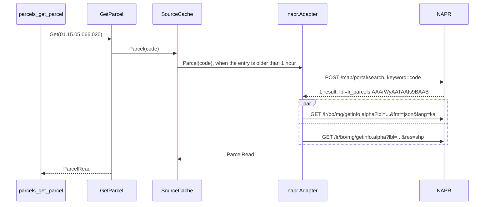

# Specification: The land parcels of the NAPR cadastral map

## 1. Summary

This feature adds the vendor client `pkg/napr` for four methods of `maps.gov.ge`, the
context `parcels`, and three tools: `parcels_get_parcel`, `parcels_list_nearby_parcels`,
and `parcels_search_addresses`. It adds the field `RawQuery` to `vendorhttp.Request`.
`spec-client.md` holds the client and the recorded answers. `spec-tools.md` holds the
structs of the tools.

## 2. Coverage

| Requirement        | Where this specification realizes it                         |
| ------------------ | ------------------------------------------------------------ |
| `NAPRPARC-FR-001`  | 4.2 `GetParcel`. 4.3 `parcels_get_parcel`. `NAPRPARC-DD-002` |
| `NAPRPARC-FR-002`  | 4.2 `ParseCadastralCode`, `UnitCodeError`. 4.5              |
| `NAPRPARC-FR-003`  | 4.2 `ListNearby`. 4.3 `parcels_list_nearby_parcels`          |
| `NAPRPARC-FR-004`  | 4.2 `NewPoint`. 4.5                                          |
| `NAPRPARC-FR-005`  | 4.2 `SearchAddresses`. 4.3 `parcels_search_addresses`. `NAPRPARC-DD-003` |
| `NAPRPARC-FR-006`  | 4.2 `SearchAddresses`, `municipality`                        |
| `NAPRPARC-FR-007`  | 4.2 `LandType`, `OwnershipType`, `DocumentKind`. `NAPRPARC-DD-005` |
| `NAPRPARC-FR-008`  | `spec-tools.md`, descriptions and `language`. `NAPRPARC-DD-005` |
| `NAPRPARC-FR-009`  | 4.2 `Area`. 4.1 `adapter/napr`                               |
| `NAPRPARC-FR-010`  | 4.2 `SortDocuments`                                          |
| `NAPRPARC-FR-011`  | 4.1 `adapter/napr`. `NAPRPARC-SC-010`                        |
| `NAPRPARC-FR-012`  | `spec-client.md`, `ParcelsAt`. `NAPRPARC-DD-004`             |
| `NAPRPARC-FR-013`  | 4.1 `adapter/napr`. `NAPRPARC-DD-006`                        |
| `NAPRPARC-FR-014`  | 4.3 configuration                                            |
| `NAPRPARC-NFR-001` | 4.3 cache. `NAPRPARC-SC-020`, `NAPRPARC-SC-021`              |
| `NAPRPARC-NFR-002` | 4.4. `NAPRPARC-SC-022`                                       |
| `NAPRPARC-NFR-003` | 4.3 configuration. `NAPRPARC-DD-007`, `NAPRPARC-SC-023`      |
| `NAPRPARC-NFR-004` | 4.4, concurrent reads. `NAPRPARC-SC-024`                     |
| `NAPRPARC-NFR-005` | `spec-client.md`. `NAPRPARC-SC-001`                          |
| `NAPRPARC-INV-001` | 4.1 `adapter/napr`. `NAPRPARC-SC-009`                        |
| `NAPRPARC-INV-002` | `spec-tools.md`, `parcelOutput`, `code` and `map_url`        |

## 3. Guideline compliance

| Rule                   | How this specification obeys it                                             |
| ---------------------- | --------------------------------------------------------------------------- |
| `ARC-004`, `CLT-001`   | `pkg/napr` is a package of the server module.                               |
| `ARC-008`, `DOM-008`   | `parcels` imports no other context. It has its own `Point`. `NAPRPARC-DD-001` |
| `ARC-009`, `CFG-004`   | `bootstrap` builds the module of `parcels` from `Config.Parcels`.           |
| `CLT-002` to `CLT-005` | Standard library and `pkg/vendorhttp` only.                                 |
| `CLT-007`              | A status that is not 200 is an `*APIError`.                                 |
| `CLT-008`, `RSL-002`   | No retry, no cache in the client or the adapter.                            |
| `CLT-009`              | The package comment and the README say that the methods have no documentation. |
| `DOM-003`, `TST-009`   | `ParseCadastralCode`, `NewPoint`, and the WKT reader have fuzz tests.       |
| `DOM-005`, `DOM-011`   | `adapter/napr` converts each shape and wraps `kernel.ErrSourceUnavailable`. |
| `DOM-009`, `DOM-010`   | One port. Three use cases, one method each.                                 |
| `MCP-002` to `MCP-009` | 4.3 tools.                                                                  |
| `RSL-001`, `RSL-008`   | `vendors.Config.ClientOptions` gives the timeout and the limit.             |
| `RSL-003` to `RSL-006` | `adapter/cache`. 4.3 cache.                                                 |
| `CFG-003`, `CFG-008`   | Each variable has the prefix `GEOMCP_PARCELS_NAPR_`. The switch is on by default. |
| `LOG-004`              | The logger of the module carries `context=parcels`.                         |
| `TST-006`              | `pkg/napr/testdata/` holds the answers of 2026-11-15. Each private owner is `სახელი გვარი`. |

## 4. Design

### 4.1 Components

Every path is new unless the table says "change". `P` is `internal/app/georgia-mcp/parcels`.

| Layer          | Path                     | Types and functions                                         |
| -------------- | ------------------------ | ----------------------------------------------------------- |
| Vendor HTTP    | `pkg/vendorhttp/` (change) | `Request.RawQuery`. `NAPRPARC-DD-008`                     |
| Vendor client  | `pkg/napr/`              | `spec-client.md`.                                           |
| Domain         | `P/domain/`              | The types of 4.2, `domain`.                                 |
| Use case       | `P/app/`                 | The types of 4.2, `app`.                                    |
| Driven adapter | `P/adapter/napr/`        | `Adapter`, `NewAdapter`, the WKT reader.                    |
| Cache          | `P/adapter/cache/`       | `SourceCache`, `NewSourceCache`.                            |
| Tool           | `P/adapter/tool/`        | `Register`, `UseCases`, the structs of 4.3.                 |
| Module         | `P/doc.go`, `P/module.go`, `P/config.go` | `Module`, `New`, `Register`, `Close`, `Config`, `Defaults`. |
| Composition    | `internal/app/georgia-mcp/bootstrap/` (change) | `Config.Parcels` with `envPrefix:"PARCELS_"`. `modules.go` builds `parcels.New` after `holidays`. |
| Configuration  | `configs/.env.example` (change) | The variables of 4.3.                                |
| Documentation  | `README.md` (change)     | The three tools in the list of tools.                       |

**`adapter/napr`.** `NewAdapter(client *naprclient.Client, now func() time.Time)`.

`Parcel(code)`:

1. `client.Search(code)`. Keep the result whose `Name` equals the code and whose
   `Details.InfoLink` holds `lr_parcels:`. None gives `app.ErrParcelNotFound`.
2. `naprclient.Label(InfoLink)` gives the label. Then `client.Parcel(label)` and
   `client.ParcelShape(label)`, concurrently.
3. Convert:

| Vendor field                     | Domain value                                                       |
| -------------------------------- | ------------------------------------------------------------------ |
| `Detail.CadCode`                 | `domain.ParseCadastralCode`. It must equal the asked code.         |
| `Detail.Address`                 | Trimmed, inner runs of spaces as one space. Words unchanged.      |
| `Detail.AreaMeasured`, `Detail.Unit` | `domain.NewArea`. `კვ.მ.` gives `m2`. Another unit stays as published. |
| `Detail.LandType`                | `domain.ParseLandType`.                                            |
| `Detail.OwnTypeName`             | `domain.ParseOwnershipType`.                                       |
| `Owners[].Person`                | Trimmed. An empty name is left out.                                |
| `Docs[].DocName`, `List[]`       | One `domain.RegistryDocument` for each item. `DocDate` `dd.mm.yyyy`, or no date when empty. |
| `Shape.Shape`                    | The WKT reader gives the centre point. `NAPRPARC-DD-002`           |

`ParcelsNear(point)`: `client.ParcelsAt(lat, lon)`. `Distance` parses as a float and
rounds to whole metres. `Name` goes through `ParseCadastralCode`. The order of the source stays.

`MatchAddresses(text)`: `client.Search(text)`. Keep each result whose `Details.InfoLink`
starts with `/ar/mg/getinfo`. `Details.Type` is `address` for a parcel too. `Name` is the address, `Descript` the municipality, both trimmed.
`naprclient.Label(InfoLink)` is the `app.AddressRef`.

`AddressCentre(ref)`: `client.AddressShape(ref)`, then the WKT reader.

`MapURL` is `https://maps.gov.ge/map/portal/#search/result/getinfo?lbl=<label>`.
`ReadAt` is `now()` in `kernel.TbilisiZone()` after the last call. `NAPRPARC-DD-006`
gives each failure.

**WKT reader.** `centre(wkt string) (domain.Point, error)` reads `POLYGON` and
`MULTIPOLYGON` in `lon lat` order. The centre is the area centroid of the outer rings,
weighted by area. A ring with zero area gives the mean of its vertices.

### 4.2 Domain model

```go
// domain

var (
    ErrInvalidCadastralCode = errors.New("cadastral code: invalid")
    ErrPointOutsideGeorgia  = errors.New("point: outside Georgia")
    ErrInvalidArea          = errors.New("area: invalid")
)

// CadastralCode is the code of a parcel: 4 or 5 groups of 1 to 4 digits, with dots.
type CadastralCode struct{ value string }

// ParseCadastralCode trims the text. 6 or more groups of digits give a *UnitCodeError.
func ParseCadastralCode(text string) (CadastralCode, error)
func (c CadastralCode) String() string

// UnitCodeError tells that a code names a unit under a parcel. It wraps
// ErrInvalidCadastralCode.
type UnitCodeError struct{ Parcel CadastralCode } // the first 5 groups

// Point is a place in Georgia, in degrees: latitude 41.0 to 43.6, longitude 40.0 to 46.8.
type Point struct{ Lat, Lon float64 }
func NewPoint(lat, lon float64) (Point, error)

type LandType string      // "agricultural", "non_agricultural", "other"
type OwnershipType string // "ownership", "co_ownership", "other"
type DocumentKind string  // "registry_extract", "cadastral_plan", "other"

// Classified is a code with the text of the source.
type Classified[T ~string] struct {
    Code T
    Text string // as NAPR publishes it
}

func ParseLandType(text string) Classified[LandType]
func ParseOwnershipType(text string) Classified[OwnershipType]
func ParseDocumentKind(text string) Classified[DocumentKind]

// Area is the area of a parcel: a decimal text, and "m2" or the unit of the source.
type Area struct{ Value, Unit string }
func NewArea(value, unit string) (Area, error)

// RegistryDocument is one document of the registry about a parcel.
type RegistryDocument struct {
    Kind               Classified[DocumentKind]
    RegistrationNumber string
    Date               *kernel.Date
    Link               string
}

// SortDocuments orders by kind (registry_extract, cadastral_plan, other), then by date,
// newest first, with no date last. It keeps the first of two documents with one link.
func SortDocuments(documents []RegistryDocument) []RegistryDocument

type Parcel struct {
    Code      CadastralCode
    Address   string
    Area      Area
    LandType  Classified[LandType]
    Ownership Classified[OwnershipType]
    Owners    []string
    Documents []RegistryDocument // sorted
    Centre    Point
}

type NearbyParcel struct {
    Code      CadastralCode
    Address   string
    DistanceM int
}

type Address struct {
    Text, Municipality string
    Centre             Point
}
```

The texts of `ParseLandType`: `სასოფლო-სამეურნეო` and `არასასოფლო სამეურნეო`. Of
`ParseOwnershipType`: `საკუთრება` and `თანასაკუთრება`. Of `ParseDocumentKind`:
`ამონაწერი საჯარო რეესტრიდან` and `საკადასტრო გეგმა`. The match trims and joins runs
of spaces. Any other text gives `other`.

```go
// app

var ErrParcelNotFound = errors.New("parcel: not found")

// AddressRef is the reference of NAPR to one address. Only the adapter reads it.
type AddressRef string

type AddressMatch struct {
    Text, Municipality string
    Ref                AddressRef
}

type ParcelRead struct { Parcel domain.Parcel; MapURL string; ReadAt time.Time; Stale bool }
type NearbyRead struct { Parcels []domain.NearbyParcel; ReadAt time.Time; Stale bool }
type MatchRead  struct { Matches []AddressMatch; ReadAt time.Time; Stale bool }
type CentreRead struct { Centre domain.Point; ReadAt time.Time; Stale bool }

// ParcelSource gives the parcels and the addresses of the cadastre.
type ParcelSource interface {
    Parcel(ctx context.Context, code domain.CadastralCode) (ParcelRead, error)
    ParcelsNear(ctx context.Context, point domain.Point) (NearbyRead, error)
    MatchAddresses(ctx context.Context, text string) (MatchRead, error)
    AddressCentre(ctx context.Context, ref AddressRef) (CentreRead, error)
}

type GetParcel struct{ /* source */ }
func NewGetParcel(source ParcelSource) *GetParcel
func (u *GetParcel) Get(ctx context.Context, code domain.CadastralCode) (ParcelRead, error)

type NearbyQuery struct { Point domain.Point; Limit int }
type ListNearby struct{ /* source */ }
func NewListNearby(source ParcelSource) *ListNearby
func (u *ListNearby) List(ctx context.Context, query NearbyQuery) (NearbyRead, error)

type AddressQuery struct { Text, Municipality string; Limit int }
type AddressList struct { Addresses []domain.Address; ReadAt time.Time; Stale bool }
type SearchAddresses struct{ /* source */ }
func NewSearchAddresses(source ParcelSource) *SearchAddresses
func (u *SearchAddresses) Search(ctx context.Context, query AddressQuery) (AddressList, error)
```

`List` returns the first `Limit` parcels. `Search` keeps each match whose municipality
holds `Municipality` after trim, when it is not empty. It takes the first `Limit`, then
reads the centre of each concurrently. A failed centre fails the search. `ReadAt` is the
oldest read used. `Stale` is true when any read used is stale.

### 4.3 Declarations

**MCP tools.**

| Tool                          | Input                                   | Output         | Errors | Realizes |
| ----------------------------- | --------------------------------------- | -------------- | ------ | -------- |
| `parcels_get_parcel`          | `code`, `language`                      | `parcelOutput` | 4.5    | `NAPRPARC-FR-001`, `NAPRPARC-FR-002`, `NAPRPARC-FR-007` to `NAPRPARC-FR-011`, `NAPRPARC-INV-002` |
| `parcels_list_nearby_parcels` | `lat`, `lon`, `limit`, `language`       | `nearbyOutput` | 4.5    | `NAPRPARC-FR-003`, `NAPRPARC-FR-004`, `NAPRPARC-FR-008`, `NAPRPARC-FR-012` |
| `parcels_search_addresses`    | `query`, `municipality`, `limit`, `language` | `addressesOutput` | 4.5 | `NAPRPARC-FR-005`, `NAPRPARC-FR-006`, `NAPRPARC-FR-008` |

`spec-tools.md` holds the titles, the descriptions, the structs, and the names of the codes.

**Vendor endpoint.** `spec-client.md` holds the methods and the recorded answers.

| Client     | Method and path                         | Key | Official | Realizes |
| ---------- | --------------------------------------- | --- | -------- | -------- |
| `pkg/napr` | `POST /map/portal/search`               | No  | Yes, with no documentation | `NAPRPARC-FR-001`, `NAPRPARC-FR-005` |
| `pkg/napr` | `GET /lr/bo/mg/getinfo2`                | No  | Yes, with no documentation | `NAPRPARC-FR-003`, `NAPRPARC-FR-012` |
| `pkg/napr` | `GET /lr/bo/mg/getinfo.alpha`           | No  | Yes, with no documentation | `NAPRPARC-FR-001` |
| `pkg/napr` | `GET /ar/mg/getinfo`                    | No  | Yes, with no documentation | `NAPRPARC-FR-005` |

**Cache.**

| Port method                   | Key                       | Time to live | Maximum stale | Entries | Realizes |
| ----------------------------- | ------------------------- | ------------ | ------------- | ------- | -------- |
| `ParcelSource.Parcel`         | the code                  | 1 hour       | 7 days less 1 hour | 1000 | `NAPRPARC-NFR-001` |
| `ParcelSource.ParcelsNear`    | the point, 5 decimals     | 24 hours     | 0             | 500     | `NAPRPARC-NFR-001` |
| `ParcelSource.MatchAddresses` | the text, trimmed, runs of spaces as one | 7 days | 0  | 500     | `NAPRPARC-NFR-001` |
| `ParcelSource.AddressCentre`  | the reference             | 7 days       | 0             | 2000    | `NAPRPARC-NFR-001` |

`ErrParcelNotFound` is not kept. 5 decimals of a degree are about 1 metre.

**Configuration.**

| Variable                         | Type     | Default               | Secret | Realizes           |
| -------------------------------- | -------- | --------------------- | ------ | ------------------ |
| `GEOMCP_PARCELS_NAPR_ENABLED`    | bool     | `true`                | No     | `NAPRPARC-FR-014`  |
| `GEOMCP_PARCELS_NAPR_BASE_URL`   | URL      | `https://maps.gov.ge` | No     | `NAPRPARC-FR-001`  |
| `GEOMCP_PARCELS_NAPR_TIMEOUT`    | duration | `10s`                 | No     | `RSL-001`          |
| `GEOMCP_PARCELS_NAPR_RATE`       | float    | `5`                   | No     | `NAPRPARC-NFR-003` |
| `GEOMCP_PARCELS_NAPR_BURST`      | int      | `5`                   | No     | `NAPRPARC-NFR-003` |

`parcels.Config` holds `NAPR vendors.Config` with `envPrefix:"NAPR_"`.
`parcels.Defaults` gives `vendors.Defaults(naprclient.DefaultBaseURL).WithLimit(5, 5)`.

### 4.4 Flow



An address search sends 1 search and 1 shape call for each address in the answer. The
shape calls run concurrently. A point sends 1 call.

### 4.5 Errors

| Condition                                 | Sentinel                        | Tool message |
| ----------------------------------------- | ------------------------------- | ------------ |
| A language other than `ka` and `en`       | `kernel.ErrUnknownLanguage`     | `language: "ru" is not a language of this tool. Use ka or en.` |
| A limit out of range                      | none, the tool checks it        | `limit: 50 is out of range. Use 1 to 20.` |
| A code that is not a cadastral code       | `domain.ErrInvalidCadastralCode` | `code: "01.15.05" is not a cadastral code. Use 4 or 5 groups of digits with dots, as 01.15.05.066.020.` |
| A code of a unit                          | `*domain.UnitCodeError`         | `code: "01.14.11.005.029.01.501" names a unit. This tool covers parcels only. Use the parcel 01.14.11.005.029.` |
| A point outside Georgia                   | `domain.ErrPointOutsideGeorgia` | `lat, lon: 44.8015, 41.6934 is outside Georgia. Give the latitude (41.0 to 43.6), then the longitude (40.0 to 46.8).` |
| An empty query                            | none, the tool checks it        | `query: empty. Give a street and a number.` |
| An unknown code                           | `app.ErrParcelNotFound`         | `code: NAPR has no parcel 99.99.99.999.999. Find the code with parcels_list_nearby_parcels or parcels_search_addresses.` |
| NAPR fails, with no stale value           | `kernel.ErrSourceUnavailable`   | `NAPR did not answer. Try again in a few minutes.` |
| Any other error                           | none                            | `The server failed to read the data of NAPR.` |

## 5. Design decisions

### `NAPRPARC-DD-001`

**Realizes:** `NAPRPARC-FR-004`
**Decision:** `parcels/domain` has its own `Point`, with the box of Georgia. The owner chose it on 2026-11-15.
**Rationale:** The rules differ: transit checks the box of Tbilisi. A copy of 10 lines
costs less than an ADR and a change to `transit`.
**Alternatives:** Move a point to the shared kernel. It changes two contexts.

### `NAPRPARC-DD-002`

**Realizes:** `NAPRPARC-FR-001`, `NAPRPARC-NFR-002`
**Decision:** The centre is the area centroid of the shape that `res=shp` gives. The detail
and the shape calls run concurrently. The owner allowed 3 calls on 2026-11-15.
**Rationale:** The detail holds no geometry. A centroid of a concave parcel can fall
outside it, but a point search from it still gives the parcel among the nearest.
**Alternatives:** The mean of the vertices. A curved edge with many vertices pulls it.

### `NAPRPARC-DD-003`

**Realizes:** `NAPRPARC-FR-005`, `NAPRPARC-FR-006`
**Decision:** The port has `MatchAddresses` and `AddressCentre`. The use case filters and
cuts the matches, then reads a centre for each address it keeps.
**Rationale:** The filter is a rule of the context, so it sits in `app`. Each centre has
its own cache entry, so a second search with a new limit reads only the new centres.
**Alternatives:** One port method with the whole query. The filter then sits in the adapter.

### `NAPRPARC-DD-004`

**Realizes:** `NAPRPARC-FR-012`
**Decision:** `ParcelsAt` repairs the answer before it decodes it. `spec-client.md` gives the repair.
**Rationale:** The source writes each value on its own line, and only the text values
carry a quotation mark that it does not escape.
**Alternatives:** A hand parser of the whole answer. More code for the same result.

### `NAPRPARC-DD-005`

**Realizes:** `NAPRPARC-FR-007`, `NAPRPARC-FR-008`
**Decision:** Each tool takes `language` (`MCP-007`). It names the codes. Every text of
NAPR stays Georgian in each language.
**Rationale:** NAPR answers in Georgian for `lang=en` too. The names of 6 codes are a
small table. A model reads a code, a name, and the text of NAPR.
**Alternatives:** No `language`. It breaks `MCP-007`.

### `NAPRPARC-DD-006`

**Realizes:** `NAPRPARC-FR-011`, `NAPRPARC-FR-013`
**Decision:** The adapter fails with `kernel.ErrSourceUnavailable` for a client error, a
body that does not decode, a detail with no item after a search found the code, a detail
with another code, an area that `NewArea` refuses, and a shape that does not read. An
empty owner list or document list is valid. A document with no date is valid.
**Rationale:** An empty detail after a found code is a failure of NAPR, not a missing
parcel. A broken field means a change of the source.
**Alternatives:** Return the parcel with the broken field empty. The model then reads a
parcel that looks complete.

### `NAPRPARC-DD-007`

**Realizes:** `NAPRPARC-NFR-003`
**Decision:** The limit is 5 calls each second with a burst of 5, as `MATSNE-DD-012`.
**Rationale:** A token bucket lets through at most its burst plus its rate in one second: 10.
**Alternatives:** 10 and 10. It lets 20 calls through in one second.

### `NAPRPARC-DD-008`

**Realizes:** `NAPRPARC-FR-001`
**Decision:** `vendorhttp.Request` gets `RawQuery string`. `Do` appends it after `Query`,
with `&` when both are set, and does not encode it. The owner chose it on 2026-11-15.
**Rationale:** NAPR gives an empty detail when the label is encoded: `lr_parcels%3A...`
and `...%2F11AAI` both fail. The change adds a field and changes no other client.
**Alternatives:** A request that `pkg/napr` builds by itself. It breaks `CLT-004`.

## 6. Scenarios

The recorded answers of `spec-client.md` serve the tests. The tests of the adapter take
`now` as 2026-11-15T12:00:00+04:00.

| ID                 | Verifies | Layer | Given, when, then |
| ------------------ | -------- | ----- | ----------------- |
| `NAPRPARC-SC-001`  | `NAPRPARC-NFR-005` | unit | A server records each request. Each method sends a User-Agent that starts with `georgia-mcp/` and holds `https://github.com/abgeo/georgia-mcp`. `Parcel("lr_parcels:AAArWyAAKAAH/11AAI")` sends the query `lbl=lr_parcels:AAArWyAAKAAH/11AAI&fmt=json&lang=ka`, with no `%`. |
| `NAPRPARC-SC-002`  | `NAPRPARC-FR-001` | unit | `vendorhttp`: `Query` `a=1` and `RawQuery` `b=x:y/z` give `?a=1&b=x:y/z`. `RawQuery` alone gives `?b=x:y/z`. |
| `NAPRPARC-SC-003`  | `NAPRPARC-FR-001`, `NAPRPARC-FR-005` | unit | `search-code.json` gives 1 result with the name `01.15.05.066.020` and the type `address`. `search-address.json` gives 10 results. `search-empty.json` gives none. A status 500 gives an `*APIError`. |
| `NAPRPARC-SC-004`  | `NAPRPARC-FR-012` | unit | `ParcelsAt` with `near-freedom.json` gives 15 parcels. The fourth has the code `01.15.04.028.003` and an address that holds `"ცეკავშირის"`. |
| `NAPRPARC-SC-005`  | `NAPRPARC-FR-002` | unit | `ParseCadastralCode`: `01.15.05.066.020`, `53.20.41.012`, and `05.31.07.1000` parse. `01.15.05`, `01.15.05.066.02a`, and `` give `ErrInvalidCadastralCode`. `01.14.11.005.029.01.501` gives a `*UnitCodeError` with `01.14.11.005.029`. A fuzz test holds that a valid code gives itself from `String`. |
| `NAPRPARC-SC-006`  | `NAPRPARC-FR-004` | unit | `NewPoint(41.6934, 44.8015)` succeeds. `NewPoint(44.8015, 41.6934)`, `NewPoint(48.85, 2.35)`, and NaN give `ErrPointOutsideGeorgia`. A fuzz test holds that a point never panics. |
| `NAPRPARC-SC-007`  | `NAPRPARC-FR-007`, `NAPRPARC-FR-009` | unit | `ParseLandType("სასოფლო-სამეურნეო")` gives `agricultural`. `ParseOwnershipType(" თანასაკუთრება ")` gives `co_ownership`. `ParseLandType("ტყე")` gives `other` with `ტყე`. `NewArea("618", "კვ.მ.")` gives `618 m2`. `NewArea("1.5", "ჰა")` gives `1.5 ჰა`. `NewArea("abc", "კვ.მ.")` gives `ErrInvalidArea`. |
| `NAPRPARC-SC-008`  | `NAPRPARC-FR-010` | unit | `SortDocuments` with the 13 documents of `info-coowned.json` gives 11 registry extracts first, 2026-03-25 first and the 3 with no date last, then 2 cadastral plans, 2012-05-04 first. The two extracts of 2026-03-25 have two links and stay two. A copy of the first item gives one document. |
| `NAPRPARC-SC-009`  | `NAPRPARC-FR-001`, `NAPRPARC-INV-001` | unit | The adapter with `search-code.json`, `info-freedom.json`, and `shape-freedom.json` gives `01.15.05.066.020`, 618 `m2`, `non_agricultural`, `ownership`, the owner `ქალაქ თბილისის თვითმმართველი ერთეული`, 2 documents, and a centre within 2 metres of 41.69340, 44.80151. |
| `NAPRPARC-SC-010`  | `NAPRPARC-FR-011` | unit | The adapter with `info-no-owner.json` gives `co_ownership` and no owner, with no error. |
| `NAPRPARC-SC-011`  | `NAPRPARC-FR-013` | unit | `search-code.json` and `info-empty.json` give an error that wraps `kernel.ErrSourceUnavailable`. So do a body that is not JSON, a shape that is not WKT, and a detail of another code. `search-empty.json` gives `app.ErrParcelNotFound`. |
| `NAPRPARC-SC-012`  | `NAPRPARC-FR-003` | unit | `List` of `near-freedom.json` with the limit 5 gives 5 parcels, `01.15.05.066.020` first at 0 m, `01.15.05.066.015` second at 92 m. With the limit 20 it gives 15. |
| `NAPRPARC-SC-013`  | `NAPRPARC-FR-005`, `NAPRPARC-FR-006` | unit | `Search` of `ჭავჭავაძის გამზირი 44` with `თბილისი` and the limit 5 keeps the 5 matches of `ქალაქი თბილისი` and reads 5 centres. With no municipality it keeps 5, Gori first. `zzqxv` gives none and reads no centre. |
| `NAPRPARC-SC-014`  | `NAPRPARC-FR-005` | unit | The WKT reader with `shape-address.json` gives a centre within the box of the multipolygon. A `POLYGON` square of 0 to 1 gives 0.5, 0.5. `POINT (1 2)` and an empty text give an error. A fuzz test holds that it never panics. |
| `NAPRPARC-SC-015`  | `NAPRPARC-FR-001`, `NAPRPARC-FR-007`, `NAPRPARC-FR-008`, `NAPRPARC-INV-002` | integration | `parcels_get_parcel` with `01.15.05.066.020`: `source` `NAPR`, `as_of` with `+04:00`, `map_url` that holds `lbl=lr_parcels:AAArWyAATAAIs9BAAB`, `land_type` `non_agricultural` named `Non-agricultural`. With `ka` it is named `არასასოფლო-სამეურნეო`, and `address` is the same text. |
| `NAPRPARC-SC-016`  | `NAPRPARC-FR-003` | integration | `parcels_list_nearby_parcels` at 41.6934, 44.8015 gives 5 parcels with `distance_m`. |
| `NAPRPARC-SC-017`  | `NAPRPARC-FR-005` | integration | `parcels_search_addresses` with `ჭავჭავაძის გამზირი 44` and `თბილისი` gives addresses with `municipality` `ქალაქი თბილისი` and a `centre`. |
| `NAPRPARC-SC-018`  | `NAPRPARC-FR-002`, `NAPRPARC-FR-004` | integration | Each input of 4.5 returns `IsError` with its message: `ru`, `limit` 50, `01.15.05`, `01.14.11.005.029.01.501`, the point 44.8015, 41.6934, an empty query, and `99.99.99.999.999`. |
| `NAPRPARC-SC-019`  | `NAPRPARC-FR-013` | integration | The vendor answers 500, with an empty cache. Each tool returns `IsError` with `NAPR did not answer. Try again in a few minutes.` |
| `NAPRPARC-SC-020`  | `NAPRPARC-NFR-001` | unit | In `synctest`, `Parcel` again after 59 minutes sends no load. After 1 hour it sends one. `ParcelsNear` after 23 hours 59 minutes sends none, after 24 hours one. `MatchAddresses` and `AddressCentre` after 7 days send one each. |
| `NAPRPARC-SC-021`  | `NAPRPARC-NFR-001` | unit | In `synctest`, the source fails with `kernel.ErrSourceUnavailable` after one read. At 6 days 23 hours, `Parcel` gives the parcel with `Stale` true. At 7 days and 1 second, it gives the error. `ParcelsNear` after 24 hours gives the error. |
| `NAPRPARC-SC-022`  | `NAPRPARC-NFR-002` | integration | A server counts the calls. `parcels_get_parcel` sends 3. `parcels_list_nearby_parcels` sends 1. `parcels_search_addresses` with the limit 3 sends 4. The same calls again send none. |
| `NAPRPARC-SC-023`  | `NAPRPARC-NFR-003` | unit | In `bootstrap`, `LoadConfig` with no variable of parcels gives NAPR on, at `https://maps.gov.ge`, with a timeout of 10 seconds, the rate 5, and the burst 5. |
| `NAPRPARC-SC-024`  | `NAPRPARC-NFR-004` | integration | A server delays each answer by 500 ms. `parcels_search_addresses` with the limit 20 answers in less than 10 seconds, and `parcels_get_parcel` in less than 2 seconds. |
| `NAPRPARC-SC-025`  | `NAPRPARC-INV-002` | manual | The owner opens the `map_url` of `01.15.05.066.020` in a browser. The map shows the parcel. |
| `NAPRPARC-SC-026`  | `NAPRPARC-FR-014` | unit | `parcels.New` with `Enabled` false registers no tool. With `Enabled` true it registers the three tools. |
| `NAPRPARC-SC-027`  | `NAPRPARC-FR-001`, `NAPRPARC-FR-003` | live | `Search("01.15.05.066.020")`, then `Parcel` and `ParcelShape` of its label, give the parcel with 618 and a shape. `ParcelsAt(41.6934, 44.8015)` gives at least 5 parcels. |

## 7. Build plan

| #   | Step                                                                          | Realizes                                     | Done |
| --- | ----------------------------------------------------------------------------- | -------------------------------------------- | ---- |
| 1   | `pkg/vendorhttp`: `RawQuery`.                                                  | `NAPRPARC-FR-001`                            | [x]  |
| 2   | `pkg/napr`: client, types, repair, recorded answers, README, example, live test. | `NAPRPARC-FR-012`, `NAPRPARC-NFR-005`     | [x]  |
| 3   | `domain`: the types of 4.2, the fuzz tests.                                    | `NAPRPARC-FR-002`, `NAPRPARC-FR-004`, `NAPRPARC-FR-007`, `NAPRPARC-FR-009`, `NAPRPARC-FR-010` | [x]  |
| 4   | `app`: the port, the three use cases, the errors.                              | `NAPRPARC-FR-003`, `NAPRPARC-FR-005`, `NAPRPARC-FR-006` | [x]  |
| 5   | `adapter/napr`, the WKT reader.                                                | `NAPRPARC-FR-001`, `NAPRPARC-FR-011`, `NAPRPARC-FR-013`, `NAPRPARC-INV-001` | [x]  |
| 6   | `adapter/cache`.                                                               | `NAPRPARC-NFR-001`                           | [x]  |
| 7   | `adapter/tool`.                                                                | `NAPRPARC-FR-001` to `NAPRPARC-FR-008`, `NAPRPARC-INV-002` | [x]  |
| 8   | `module.go`, `config.go`, `bootstrap`, `configs/.env.example`, `README.md`.    | `NAPRPARC-FR-014`, `NAPRPARC-NFR-003`        | [x]  |

## 8. Out of scope for this specification

The page of the tools on the website and the list of tools of
`build/openai-plugin/plugin.json`. A change of `WEBSITE` adds them after the tools exist.

## Retired identifiers

This file has no retired identifier.
