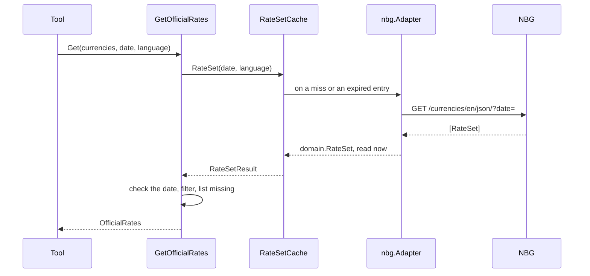

# Specification: The official exchange rates of the NBG

## 1. Summary

This feature opens the `rates` context with its first source. It adds the vendor client
module `pkg/nbg`, the context `internal/app/georgia-mcp/rates`, and two tools:
`rates_get_official_rates` and `rates_list_official_history`. `spec-scenarios.md` holds
the scenarios.

## 2. Coverage

| Requirement       | Where this specification realizes it                          |
| ----------------- | ------------------------------------------------------------- |
| `NBGRATE-FR-001`  | 4.2 `CurrencyCode`. 4.3 tool. `NBGRATE-DD-001`                |
| `NBGRATE-FR-002`  | 4.3 tool. `NBGRATE-DD-001`                                    |
| `NBGRATE-FR-003`  | 4.2 `Today`. 4.4                                              |
| `NBGRATE-FR-004`  | 4.2 `RateSet`. 4.4                                            |
| `NBGRATE-FR-005`  | 4.4. `NBGRATE-DD-003`                                         |
| `NBGRATE-FR-006`  | 4.2 `ParseDate`. 4.5                                          |
| `NBGRATE-FR-007`  | 4.2 `OfficialRates.Missing`. 4.3 tool                         |
| `NBGRATE-FR-008`  | 4.2 `OfficialRate.RatePerUnit`. `NBGRATE-DD-007`              |
| `NBGRATE-FR-009`  | 4.2 `OfficialRate.Change`. `NBGRATE-DD-007`                   |
| `NBGRATE-FR-010`  | 4.3 tool, `language`. `MCP-007`                               |
| `NBGRATE-FR-011`  | 4.2 `RateSet.PublishedAt`. `NBGRATE-DD-009`                   |
| `NBGRATE-FR-012`  | 4.3 tool. `NBGRATE-DD-005`, `NBGRATE-DD-006`                  |
| `NBGRATE-FR-013`  | 4.3 cache. `NBGRATE-DD-004`                                   |
| `NBGRATE-FR-014`  | 4.5                                                           |
| `NBGRATE-NFR-001` | 4.3 cache. `NBGRATE-SC-024`                                   |
| `NBGRATE-NFR-002` | 4.3 cache. `NBGRATE-DD-004`, `NBGRATE-SC-025`                 |
| `NBGRATE-NFR-003` | `NBGRATE-DD-006`, `NBGRATE-SC-026`                            |
| `NBGRATE-INV-001` | 4.3 tool, `valid_from` of each rate                           |
| `NBGRATE-INV-002` | 4.4. `NBGRATE-DD-003`                                         |
| `NBGRATE-INV-003` | `NBGRATE-DD-007`                                              |

## 3. Guideline compliance

| Rule                   | How this specification obeys it                                                   |
| ---------------------- | --------------------------------------------------------------------------------- |
| `ARC-004`, `CLT-001`   | `pkg/nbg` is a module: `github.com/abgeo/georgia-mcp/pkg/nbg`, `go 1.26.0`.       |
| `ARC-007`, `DOM-005`   | `adapter/nbg` converts the vendor shape. `domain` and `app` import no client.     |
| `DOM-003`, `TST-009`   | `ParseCurrencyCode` and `ParseDate` validate, and each has a fuzz test.           |
| `DOM-006`, `MCP-009`   | Every rate is a `decimal.Decimal`, and a string in the output.                    |
| `DOM-007`              | `kernel.Date` is a civil date in Tbilisi. `NBGRATE-DD-008`, `ADR-0002`.           |
| `DOM-009`, `DOM-011`   | `app.OfficialRateSource` is the port. The adapter wraps `kernel.ErrSourceUnavailable`. |
| `MCP-002` to `MCP-009` | 4.3 tools.                                                                        |
| `CLT-002` to `CLT-011` | 4.1 `pkg/nbg`.                                                                    |
| `RSL-001`, `RSL-008`   | `httpclient.New` with the configuration of 4.3.                                   |
| `RSL-003` to `RSL-007` | `adapter/cache` on `cache.Cache[domain.RateSet]`.                                 |
| `LIF-003`, `LIF-006`   | `bootstrap.App.Close` closes each module that has `Close`. `NBGRATE-DD-012`.      |

This feature changes these rules, in the same review, with no ADR, as the owner decided:

| Rule      | Change                                                                                       |
| --------- | -------------------------------------------------------------------------------------------- |
| `ARC-007` | `domain` and `app` may import a third-party library that does no I/O and knows no protocol and no vendor. |
| `DOM-006` | The exact decimal type is `decimal.Decimal` of `github.com/shopspring/decimal`.              |
| `BLD-003` | `task release-check` runs the build with the workspace off. `task build` does not.           |
| `BLD-005` | The build stage copies the whole repository and uses cache mounts. `NBGRATE-DD-010`.         |

The rows of `Taskfile.yml` and `build/package/Dockerfile` in `PLATFORM` section 4.1 change with them.

## 4. Design

### 4.1 Components

Every path is new unless the table says "change". `R` is `internal/app/georgia-mcp/rates`.

| Layer          | Path                          | Types and functions                                                    |
| -------------- | ----------------------------- | ---------------------------------------------------------------------- |
| Vendor client  | `pkg/nbg/`                    | `Client`, `New`, `Option`, `Language`, `RateSetsQuery`, `RateSet`, `Currency`, `RSS`, `RSSChannel`, `RSSItem`, `Code`, `APIError`, `ErrUnexpectedStatus`. |
| Domain         | `R/domain/`                   | `CurrencyCode`, `OfficialRate`, `RateSet`. 4.2. `Date` is in `internal/pkg/kernel` (`ADR-0002`). |
| Use case       | `R/app/`                      | `OfficialRateSource`, `GetOfficialRates`, `ListOfficialHistory`. 4.2.  |
| Driven adapter | `R/adapter/nbg/`              | `Adapter`, `NewAdapter`.                                               |
| Cache          | `R/adapter/cache/`            | `RateSetCache`, `New`.                                                 |
| Tool           | `R/adapter/tool/`             | `Register`, the input and output structs of 4.3, `toolError`.          |
| Module         | `R/module.go`, `R/config.go`  | `Module`, `New`, `Register`, `Close`, `Config`.                        |
| Wiring         | `bootstrap/` (change)         | `Config.Rates`, `modules` adds `rates.New`, `App.Close`.               |
| Commands       | `cli/root.go` (change)        | `RunE` calls `App.Close` after the run.                                |
| Workspace      | `go.work`, `go.mod` (change)  | `use ./pkg/nbg`. The server requires `shopspring/decimal v1.5.0`. The workspace gives `pkg/nbg` until its first tag (`BLD-003`). |

**`pkg/nbg`.**

```go
const DefaultBaseURL = "https://nbg.gov.ge/gw/api/ct/monetarypolicy"

type Language string // LanguageEnglish "en", LanguageGeorgian "ka"

func New(opts ...Option) *Client // the options of vendorhttp

type RateSetsQuery struct {
    Date       time.Time // zero: the newest set
    Currencies []string  // empty: every currency. Sent as the NBG takes it: USD,GBP
}

func (c *Client) RateSets(ctx context.Context, language Language, query RateSetsQuery) ([]RateSet, error)
func (c *Client) RSS(ctx context.Context, language Language, query RateSetsQuery) (*RSS, error)
func (c *Client) Codes(ctx context.Context) ([]Code, error)

type Code struct {
    Code string `json:"code"`
    Name string `json:"name"` // in Georgian: the NBG ignores a language here
}

type RateSet struct {
    Date       string     `json:"date"`
    Currencies []Currency `json:"currencies"`
}

type Currency struct {
    Code          string      `json:"code"`
    Quantity      int         `json:"quantity"`
    RateFormated  string      `json:"rateFormated"`
    DiffFormated  string      `json:"diffFormated"`
    Rate          json.Number `json:"rate"`
    Name          string      `json:"name"`
    Diff          json.Number `json:"diff"`
    Date          string      `json:"date"`
    ValidFromDate string      `json:"validFromDate"`
}
```

The client covers every address of the API (`NBGRATE-DD-013`):

| Method     | Request                                                        | Answer                    |
| ---------- | -------------------------------------------------------------- | ------------------------- |
| `RateSets` | `GET /currencies/{language}/json/?date=YYYY-MM-DD&currencies=…` | `[]RateSet`               |
| `RSS`      | `GET /currencies/{language}/rss/?date=YYYY-MM-DD&currencies=…`  | `RSS`, decoded from XML   |
| `Codes`    | `GET /currencies/codes`                                        | `[]Code`                  |

A zero date sends no `date`. An empty list sends no `currencies`. The client sends a list
joined with commas, as the NBG takes it, and changes nothing. The README warns that the
NBG answers most lists of two or more codes with an empty list. `RSSItem.Description`
holds the HTML table of the NBG as a string: the client does not parse it (`CLT-003`).
The field names keep the spelling of the vendor. The README says that the API is not
documented.

The adapter of the server calls `RateSets` with a date and no currencies (`NBGRATE-DD-001`).

### 4.2 Domain model

```go
// kernel (ADR-0002)
type Date struct{ /* year, month, day: a civil date in Tbilisi */ }
func ParseDate(s string) (Date, error)       // YYYY-MM-DD, a real calendar date
func Today(now time.Time) Date               // the Tbilisi date of now
func (d Date) AddDays(n int) Date
func (d Date) Before(o Date) bool
func (d Date) After(o Date) bool
func (d Date) String() string                // YYYY-MM-DD
func DaysBetween(from, to Date) int          // to minus from, in days

// domain
type CurrencyCode string
func ParseCurrencyCode(s string) (CurrencyCode, error) // three letters, any case, stored upper case

type OfficialRate struct {
    Currency CurrencyCode
    Name     string
    Quantity int64           // a power of ten, 1 or more
    Rate     decimal.Decimal // for Quantity units
    Change   decimal.Decimal // signed
}
func NewOfficialRate(code CurrencyCode, name string, quantity int64, rate, change decimal.Decimal) (OfficialRate, error)
func (r OfficialRate) RatePerUnit() decimal.Decimal // Rate.Shift(-log10(Quantity))

type RateSet struct {
    ValidFrom   kernel.Date
    PublishedAt time.Time      // in Tbilisi
    Rates       []OfficialRate // sorted by Currency
}
func (s RateSet) Empty() bool
func (s RateSet) Find(code CurrencyCode) (OfficialRate, bool)
```

Errors in `domain/errors.go`: `ErrInvalidCurrencyCode`, `ErrInvalidQuantity`. `ErrInvalidDate` is in `kernel/errors.go`.

```go
// app
type RateSetResult struct {
    Set    domain.RateSet
    ReadAt time.Time // the instant the server read the set from the vendor
    Stale  bool
}

type OfficialRateSource interface {
    RateSet(ctx context.Context, date kernel.Date, language kernel.Language) (RateSetResult, error)
}

type OfficialRatesQuery struct {
    Currencies []domain.CurrencyCode // empty: every currency
    Date       *kernel.Date          // nil: today in Tbilisi
    Language   kernel.Language
}

type OfficialRates struct {
    RateSetResult                    // Set holds the requested rates only
    Missing []domain.CurrencyCode
}

type OfficialHistoryQuery struct {
    Currency domain.CurrencyCode
    From, To kernel.Date
    Language kernel.Language
}

type OfficialHistory struct {
    Currency domain.CurrencyCode
    Points   []HistoryPoint // ascending by ValidFrom
    ReadAt   time.Time      // the oldest read time of the points
    Stale    bool           // true when one point is stale
}

type HistoryPoint struct {
    ValidFrom   kernel.Date
    PublishedAt time.Time
    Rate        domain.OfficialRate
}

func NewGetOfficialRates(source OfficialRateSource, now func() time.Time) *GetOfficialRates
func (u *GetOfficialRates) Get(ctx context.Context, q OfficialRatesQuery) (OfficialRates, error)
func NewListOfficialHistory(source OfficialRateSource, now func() time.Time) *ListOfficialHistory
func (u *ListOfficialHistory) List(ctx context.Context, q OfficialHistoryQuery) (OfficialHistory, error)
```

Errors in `app/errors.go`: `ErrNotPublished` (a type `*NotPublishedError` with `Requested`
and `Newest`, that wraps the sentinel), `ErrPeriodTooLong`, `ErrPeriodReversed`.
`MaxHistoryDays = 31`.

### 4.3 Declarations

**MCP tools.**

| Tool                          | Input                                    | Output                     | Errors (4.5)                          | Realizes |
| ----------------------------- | ---------------------------------------- | -------------------------- | ------------------------------------- | -------- |
| `rates_get_official_rates`    | `currencies`, `date`, `language`         | `officialRatesOutput`      | code, date, language, not published, unavailable | `NBGRATE-FR-001` to `NBGRATE-FR-011` |
| `rates_list_official_history` | `currency`, `from`, `to`, `language`     | `officialHistoryOutput`    | code, date, language, period, not published, unavailable | `NBGRATE-FR-012` |

```go
type getOfficialRatesInput struct {
    Currencies []string `json:"currencies,omitempty" jsonschema:"ISO 4217 codes, for example USD and EUR. Empty returns every currency. At most 50."`
    Date       string   `json:"date,omitempty"       jsonschema:"The date in YYYY-MM-DD, in Tbilisi. Empty means today. At most the valid date of the newest set: tomorrow after about 17:00."`
    Language   string   `json:"language,omitempty"   jsonschema:"The language of the currency names: en or ka. Empty means en."`
}

type listOfficialHistoryInput struct {
    Currency string `json:"currency"           jsonschema:"One ISO 4217 code, for example USD."`
    From     string `json:"from"               jsonschema:"The first date of the period, YYYY-MM-DD."`
    To       string `json:"to"                 jsonschema:"The last date of the period, YYYY-MM-DD. At most 31 days after from, counted with both ends."`
    Language string `json:"language,omitempty" jsonschema:"The language of the currency name: en or ka. Empty means en."`
}

type officialRatesOutput struct {
    Source      string               `json:"source"       jsonschema:"National Bank of Georgia."`
    AsOf        string               `json:"as_of"        jsonschema:"The publication instant of the set, RFC 3339. The read instant when the set is empty."`
    ValidFrom   string               `json:"valid_from,omitempty" jsonschema:"The date from which the set is in force, YYYY-MM-DD."`
    ReadAt      string               `json:"read_at"      jsonschema:"The instant the server read the set from the NBG, RFC 3339."`
    Stale       bool                 `json:"stale"        jsonschema:"True when the NBG did not answer and the server returns a set it read before."`
    Rates       []officialRateOutput `json:"rates"        jsonschema:"The official rates, sorted by currency."`
    Missing     []string             `json:"missing,omitempty" jsonschema:"The requested codes with no official rate on the date."`
}

type officialRateOutput struct {
    Currency    string `json:"currency"      jsonschema:"The ISO 4217 code."`
    Name        string `json:"name"          jsonschema:"The name of the currency in the requested language."`
    Quantity    int64  `json:"quantity"      jsonschema:"The count of units that rate prices."`
    Rate        string `json:"rate"          jsonschema:"The price in GEL of quantity units, as a decimal string."`
    RatePerUnit string `json:"rate_per_unit" jsonschema:"The price in GEL of one unit, as a decimal string."`
    Change      string `json:"change"        jsonschema:"The change of rate from the previous set, signed, as a decimal string."`
    ValidFrom   string `json:"valid_from"    jsonschema:"The date from which this rate is in force, YYYY-MM-DD."`
}

type officialHistoryOutput struct {
    Source   string              `json:"source"   jsonschema:"National Bank of Georgia."`
    AsOf     string              `json:"as_of"    jsonschema:"The publication instant of the newest point, RFC 3339."`
    ReadAt   string              `json:"read_at"  jsonschema:"The oldest instant at which the server read a point from the NBG, RFC 3339."`
    Stale    bool                `json:"stale"    jsonschema:"True when one point comes from a set read before an outage of the NBG."`
    Currency string              `json:"currency" jsonschema:"The ISO 4217 code."`
    Name     string              `json:"name"     jsonschema:"The name of the currency in the requested language."`
    Points   []officialRateOutput `json:"points"  jsonschema:"One official rate for each set in force in the period, ascending by valid_from."`
}
```

Tool titles: "Official exchange rates of the NBG" and "Official exchange rate history of
the NBG". Each description states the source, the unit (GEL for `quantity` units), the
publication at about 17:00 Tbilisi time, and that the rate is indicative.

**Vendor endpoint.**

| Client    | Method and path                                    | Key  | Official                 | Realizes                   |
| --------- | -------------------------------------------------- | ---- | ------------------------ | -------------------------- |
| `pkg/nbg` | `GET /currencies/{en,ka}/json/?date=YYYY-MM-DD`    | None | Yes, linked, undocumented | `NBGRATE-FR-001` to `NBGRATE-FR-012` |
| `pkg/nbg` | `GET /currencies/{en,ka}/rss/?date=YYYY-MM-DD`     | None | Yes, linked, undocumented | None in the server. `NBGRATE-DD-013` |
| `pkg/nbg` | `GET /currencies/codes`                            | None | No link, undocumented    | None in the server. `NBGRATE-DD-013` |

**Cache.** One store for each row. The key is `<date>/<language>`.

| Port method                     | Time to live | Maximum stale | Realizes                              |
| ------------------------------- | ------------ | ------------- | ------------------------------------- |
| `RateSet`, date today or later  | 15 minutes   | 7 days        | `NBGRATE-NFR-001`, `NBGRATE-FR-013`   |
| `RateSet`, date before today    | 30 days      | 7 days        | `NBGRATE-NFR-002`, `NBGRATE-FR-013`   |

**Configuration.**

| Variable                           | Type     | Default                                        | Secret | Realizes          |
| ---------------------------------- | -------- | ---------------------------------------------- | ------ | ----------------- |
| `GEOMCP_RATES_NBG_BASE_URL`        | URL      | `https://nbg.gov.ge/gw/api/ct/monetarypolicy`  | No     | `NBGRATE-FR-001`  |
| `GEOMCP_RATES_NBG_TIMEOUT`         | duration | `10s`                                          | No     | `NBGRATE-FR-014`  |
| `GEOMCP_RATES_NBG_RATE`            | float    | `5`                                            | No     | `NBGRATE-NFR-003` |
| `GEOMCP_RATES_NBG_BURST`           | int      | `5`                                            | No     | `NBGRATE-NFR-003` |
| `GEOMCP_RATES_NBG_CACHE_ENTRIES`   | int, 1 or more | `512`                                    | No     | `NBGRATE-NFR-002` |

`rates.Config` holds `NBG nbgConfig` with `envPrefix:"NBG_"`. `nbgConfig` embeds
`httpclient.Config` and adds `BaseURL url.URL` and `CacheEntries int`.

### 4.4 Flow



`GetOfficialRates.Get`:

1. `date` is the query date, or `Today(now)`.
2. Call the source. An error returns as it is.
3. If `date` is after `Today(now)` and `Set.ValidFrom` is before `date`, return
   `NotPublishedError{Requested: date, Newest: Set.ValidFrom}`.
4. If the set is not empty and `Set.ValidFrom` is after `date`, return an error that wraps
   `kernel.ErrSourceUnavailable`: the vendor answer breaks `NBGRATE-INV-002`.
5. Keep the requested rates. Put each requested code with no rate in `Missing`.

`ListOfficialHistory.List` validates the period, then reads each day from `From` to the
lesser of `To` and `Today(now)+1`, at most 4 days at a time. It applies step 3 to `To`,
keeps one point for each distinct `ValidFrom`, and drops a set without the currency.

### 4.5 Errors

| Condition                                  | Sentinel                        | Tool message                                                                 |
| ------------------------------------------ | ------------------------------- | ---------------------------------------------------------------------------- |
| A code that is not three letters           | `domain.ErrInvalidCurrencyCode` | `currencies: "US" is not a currency code. Use three letters, for example USD.` |
| More than 50 codes                         | none, in the tool               | `currencies: 51 codes. Ask for 50 or fewer, or for none to get every currency.` |
| A date that is not `YYYY-MM-DD`            | `kernel.ErrInvalidDate`         | `date: "2026-13-45" is not a date. Use YYYY-MM-DD.`                          |
| A language other than `en` and `ka`        | `kernel.ErrUnknownLanguage`     | `language: "de" is not a language of the NBG. Use en or ka.`                 |
| A date after the newest set                | `app.ErrNotPublished`           | `The NBG has not published rates for 2026-10-25. The newest set is valid from 2026-10-17.` |
| A period longer than 31 days               | `app.ErrPeriodTooLong`          | `to: the period has 40 days. The longest period is 31 days.`                 |
| `to` before `from`                         | `app.ErrPeriodReversed`         | `to: 2026-10-01 is before from 2026-10-10.`                                  |
| The NBG fails and no set is held           | `kernel.ErrSourceUnavailable`   | `The NBG did not answer. Try again in a few minutes.`                        |

The message for a field names the input field of the tool: `currency` in the history tool.

## 5. Design decisions

### `NBGRATE-DD-001`

**Realizes:** `NBGRATE-FR-001`, `NBGRATE-FR-002`, `NBGRATE-NFR-002`
**Decision:** The adapter reads the whole set of a date and a language. The use case filters it.
**Rationale:** The `currencies` filter of the source returns an empty list for most
combinations. One set is 42 entries. One cache entry then serves every combination.
**Alternatives:** One call for each currency. Up to 42 calls for one answer.

### `NBGRATE-DD-002`

**Realizes:** `NBGRATE-FR-013`, `MCP-005`
**Decision:** The port returns `RateSetResult`: the set, the read instant, and the stale flag.
**Rationale:** The cache decorator knows the read instant and the age. The tool must give
both. The domain set stays free of a fact about the server.
**Alternatives:** A read instant in `domain.RateSet`. It is not a fact of the NBG.

### `NBGRATE-DD-003`

**Realizes:** `NBGRATE-FR-005`, `NBGRATE-INV-002`
**Decision:** A requested date after today with an older `ValidFrom` is "not published".
A requested date of today or earlier accepts any older `ValidFrom` as the set in force.
**Rationale:** The source answers a future date with the newest set and no warning. A set
for tomorrow exists only after about 17:00, so the check needs the answer, not the clock.
**Alternatives:** Refuse every date after today. It refuses tomorrow after 17:00.

### `NBGRATE-DD-004`

**Realizes:** `NBGRATE-NFR-001`, `NBGRATE-NFR-002`, `NBGRATE-FR-013`
**Decision:** Two stores of `cache.Cache[domain.RateSet]`: 15 minutes for today and later,
30 days for a past date. Each keeps a stale value for 7 days.
**Rationale:** A set of today or tomorrow appears or changes at about 17:00. A past set
never changes. One store for both would hold a past set for 15 minutes only.
**Alternatives:** One time to live of 15 minutes. A history of 31 days sends 31 calls
each 15 minutes.

### `NBGRATE-DD-005`

**Realizes:** `NBGRATE-FR-012`
**Decision:** The history holds each set in force on a day of the period, the set in
force on `From` included, once for each `ValidFrom`.
**Rationale:** A period that starts on a Sunday has no own set on that day. The rate in
force on it is still part of the answer.
**Alternatives:** Only sets with `ValidFrom` inside the period. The rate of the first
days is lost.

### `NBGRATE-DD-006`

**Realizes:** `NBGRATE-NFR-003`
**Decision:** `errgroup` with a limit of 4 reads the days. The vendor limit of 5 calls
each second paces them.
**Rationale:** 31 calls at 5 each second take about 6 seconds, inside the 10 of the requirement.
**Alternatives:** One day at a time. 31 round trips of about 300 ms take about 9 seconds,
with no margin.

### `NBGRATE-DD-007`

**Realizes:** `NBGRATE-FR-008`, `NBGRATE-FR-009`, `NBGRATE-INV-003`
**Decision:** The adapter parses `rateFormated` for the rate. The change takes the digits
of `diffFormated` and the sign of `diff`. Output formats a decimal with
`StringFixed(-Exponent())`. The rate per unit is `Rate.Shift(-n)` for a quantity of 10ⁿ.
**Rationale:** `rateFormated` holds the four decimals that the NBG publishes. `diffFormated`
has no sign. `String` drops trailing zeros. A shift by a power of ten is exact.
**Alternatives:** The JSON number `rate`. It drops a trailing zero: `2.6` for `2.6000`.

### `NBGRATE-DD-008`

**Realizes:** `NBGRATE-FR-003`, `DOM-007`
**Decision:** The Tbilisi zone is `time.FixedZone("Asia/Tbilisi", 4*60*60)`.
**Rationale:** Georgia keeps UTC+4 with no daylight saving time since 2005. The distroless
image holds no zone database. A fixed zone needs no embedded data.
**Alternatives:** `time.LoadLocation` with `time/tzdata` embedded. About 450 KB for one
offset that does not change.

### `NBGRATE-DD-009`

**Realizes:** `NBGRATE-FR-011`
**Decision:** The adapter reads the `date` of a currency as Tbilisi wall time, and drops
the `Z`.
**Rationale:** Open question 1 of the requirements. Article 3.1 of the rules sets
publication no later than 17:00 Tbilisi time.
**Alternatives:** Read it as UTC. It gives 21:01, four hours after the limit.

### `NBGRATE-DD-010`

**Realizes:** `PLATFORM-FR-022`, `BLD-003`
**Decision:** The Dockerfile copies the repository, then builds with cache mounts for the
module cache and the build cache. `task release-check` holds the build with `GOWORK=off`.
**Rationale:** The server imports `pkg/nbg` before a tag of it exists. Only the workspace
resolves it. A layer of `go mod download` from `go.mod` alone cannot. A build with the
workspace off passes only after the tag, so it belongs to the release.
**Alternatives:** A `replace` in `go.mod`. `go install …@latest` refuses a module with one.

### `NBGRATE-DD-012`

**Realizes:** `LIF-003`, `RSL-007`
**Decision:** `rates.Module` has `Close`, which closes its two stores. `bootstrap.App.Close`
calls `Close` on each module that has it, and joins the errors.
**Rationale:** The store of the cache runs a goroutine (`PLATFORM` section 4.1).
**Alternatives:** A `Close` in `mcpserver.Module`. Every context must then write one.

### `NBGRATE-DD-013`

**Realizes:** `CLT-001`, `CLT-003`
**Decision:** `pkg/nbg` covers every address of the API: the JSON rates, the RSS feed, and
the codes, with `date` and `currencies`. It sends `currencies` as the NBG takes it.
**Rationale:** `pkg/nbg` is a client for other projects, so it offers what the API offers.
A client that mirrors the vendor does not correct it. The README names the defect of the
NBG, and the server avoids it (`NBGRATE-DD-001`). The language stays a parameter of the method,
not a field of `RateSetsQuery`: it is a path segment that the API requires, so the
compiler enforces it, and it changes the names, not the rates that the query selects.
**Alternatives:** One call for the full set, filtered in the client, for a list of two or
more codes. It hides the behavior of the vendor from the caller.

## 6. Scenarios

`spec-scenarios.md` holds `NBGRATE-SC-001` to `NBGRATE-SC-037`.

## 7. Build plan

| #   | Step                                                                                 | Realizes                                     | Done |
| --- | ------------------------------------------------------------------------------------ | -------------------------------------------- | ---- |
| 1   | Correct `ARC-007`, `DOM-006`, `BLD-003`, `BLD-005`, and `PLATFORM` 4.1, as section 3 gives. | `NBGRATE-DD-010`                      | [x]  |
| 2   | `pkg/nbg` module, recorded answers in `testdata/`, README, example. `go.work`.       | `NBGRATE-FR-001`, `NBGRATE-FR-014`           | [x]  |
| 3   | `domain`: `CurrencyCode`, `Date`, `OfficialRate`, `RateSet`, with fuzz tests.        | `NBGRATE-FR-006`, `NBGRATE-FR-008`, `NBGRATE-INV-003` | [x]  |
| 4   | `app`: port, `GetOfficialRates`, `ListOfficialHistory`.                               | `NBGRATE-FR-002` to `NBGRATE-FR-007`, `NBGRATE-FR-012` | [x]  |
| 5   | `adapter/nbg`.                                                                       | `NBGRATE-FR-009`, `NBGRATE-FR-011`           | [x]  |
| 6   | `adapter/cache`.                                                                     | `NBGRATE-FR-013`, `NBGRATE-NFR-001`, `NBGRATE-NFR-002` | [x]  |
| 7   | `adapter/tool`.                                                                      | `NBGRATE-FR-010`, `NBGRATE-FR-014`, `NBGRATE-INV-001` | [x]  |
| 8   | `module.go`, `config.go`, `bootstrap`, `cli`, `configs/.env.example`.                | `NBGRATE-NFR-003`                            | [x]  |
| 9   | Dockerfile, Taskfile.                                                                | `NBGRATE-DD-010`                             | [x]  |

## 8. Out of scope for this specification

Nothing that the requirements demand.

## Retired identifiers

| ID               | Retired    | Reason                                                         |
| ---------------- | ---------- | -------------------------------------------------------------- |
| `NBGRATE-DD-011` | 2026-10-18 | The client covers the whole API. `NBGRATE-DD-013` replaces it. |
