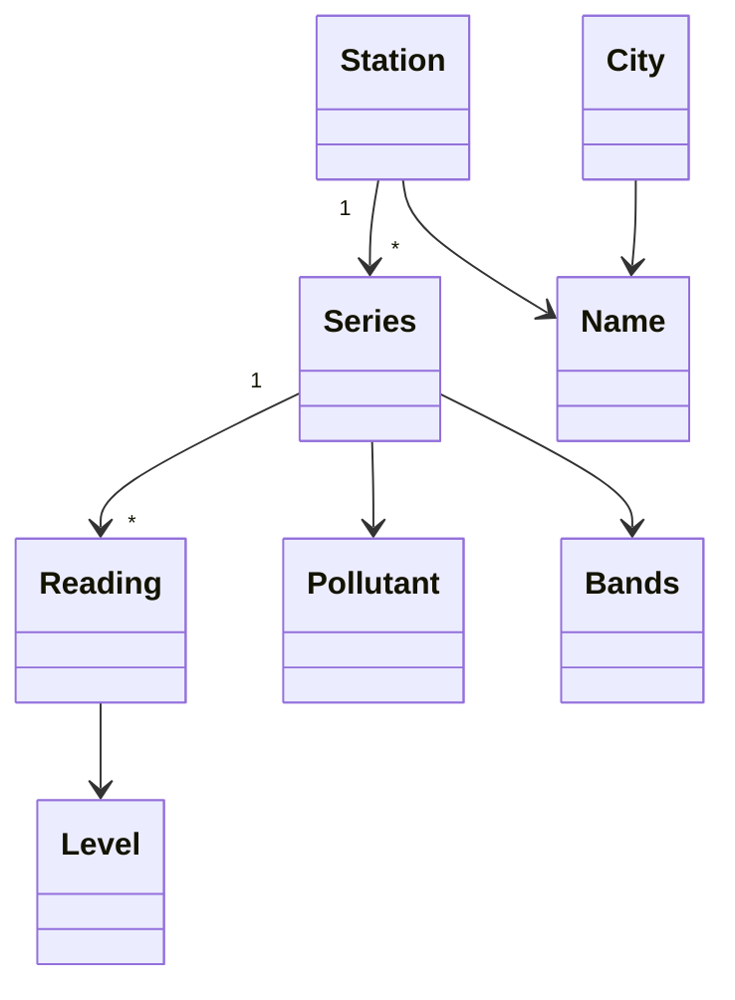
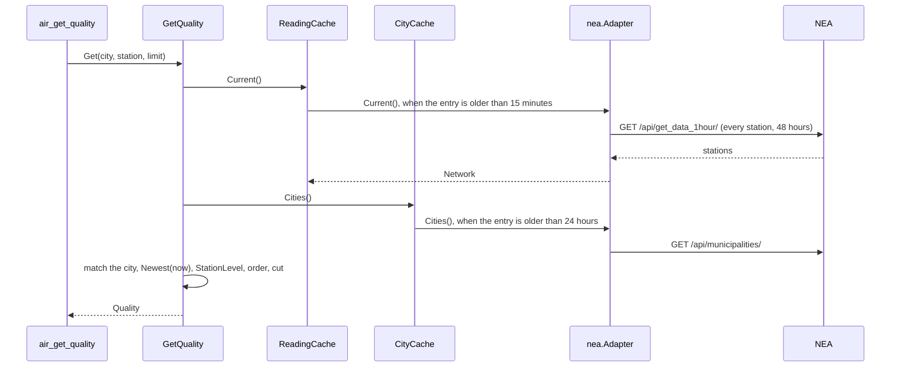

# Specification: The air quality of the National Environmental Agency

## 1. Summary

This feature adds the vendor client `pkg/nea` for the data methods of the map at
`air.gov.ge`, and the context `air` with two tools: `air_get_quality` and
`air_list_history`. One vendor call each 15 minutes serves every question about the
current air. A history reads one station.

## 2. Coverage

| Requirement        | Where this specification realizes it                      |
| ------------------ | --------------------------------------------------------- |
| `NEAAIR-FR-001`    | 4.2 `GetQuality`, `ErrUnknownCity`. `NEAAIR-DD-004`       |
| `NEAAIR-FR-002`    | 4.2 `GetQuality`, `ErrUnknownStation`                     |
| `NEAAIR-FR-003`    | 4.2 `GetQuality`. 4.3 tool, `limit`. `NEAAIR-DD-001`      |
| `NEAAIR-FR-004`    | 4.3 `stationOutput`                                       |
| `NEAAIR-FR-005`    | 4.3 `readingOutput`. `NEAAIR-DD-006`                      |
| `NEAAIR-FR-006`    | 4.2 `Bands.Level`. `NEAAIR-DD-005`                        |
| `NEAAIR-FR-007`    | 4.2 `StationLevel`                                        |
| `NEAAIR-FR-008`    | 4.2 `Station.Newest`. `NEAAIR-DD-003`                     |
| `NEAAIR-FR-009`    | 4.2 `GetQuality`. `NEAAIR-DD-007`                         |
| `NEAAIR-FR-010`    | 4.2 `ListHistory`. 4.3 tool                               |
| `NEAAIR-FR-011`    | 4.2 `ListHistory`. `NEAAIR-DD-002`, `NEAAIR-DD-003`       |
| `NEAAIR-FR-012`    | 4.2 `ListHistory`, `ErrInvalidPeriod`. 4.5                |
| `NEAAIR-FR-013`    | 4.2 `ParsePollutant`, `ListHistory`                       |
| `NEAAIR-FR-014`    | 4.2 `ListHistory`. 4.3 tool, `limit`                      |
| `NEAAIR-FR-015`    | 4.2 `Name`. 4.3 tools, `language`. `NEAAIR-DD-004`        |
| `NEAAIR-FR-016`    | 4.1 `adapter/nea`. 4.5. `NEAAIR-DD-008`                   |
| `NEAAIR-FR-017`    | 4.3 configuration                                         |
| `NEAAIR-NFR-001`   | 4.3 cache. `NEAAIR-SC-020`                                |
| `NEAAIR-NFR-002`   | 4.3 cache. `NEAAIR-SC-021`                                |
| `NEAAIR-NFR-003`   | 4.3 cache. `NEAAIR-SC-022`                                |
| `NEAAIR-NFR-004`   | 4.3 configuration. `NEAAIR-DD-009`, `NEAAIR-SC-023`       |
| `NEAAIR-NFR-005`   | 4.1 `pkg/nea`. `NEAAIR-SC-001`                            |
| `NEAAIR-INV-001`   | 4.2 `Reading.Value`. `NEAAIR-DD-006`                      |
| `NEAAIR-INV-002`   | 4.1 `adapter/nea`. `NEAAIR-DD-006`                        |
| `NEAAIR-INV-003`   | 4.3 outputs, `source`                                     |

## 3. Guideline compliance

| Rule                   | How this specification obeys it                                                |
| ---------------------- | ------------------------------------------------------------------------------ |
| `ARC-004`, `CLT-001`   | `pkg/nea` is a package of the server module.                                   |
| `ARC-008`              | `air` imports no other context.                                                |
| `ARC-009`, `CFG-004`   | `bootstrap` builds the module of `air` from `Config.Air`.                      |
| `CLT-002` to `CLT-005` | Standard library and `pkg/vendorhttp` only. `Accept: application/json`.        |
| `CLT-007`              | A status that is not 200 is an `*APIError`.                                    |
| `CLT-008`, `RSL-002`   | No retry, no cache in the client or the adapter.                               |
| `CLT-009`              | The package comment and the README say that the methods are not documented.    |
| `DOM-003`, `TST-009`   | `ParsePollutant`, `ParseStationCode`, and `NewBands` validate. Each has a fuzz test. |
| `DOM-005`, `DOM-011`   | `adapter/nea` converts each shape and wraps `kernel.ErrSourceUnavailable`.     |
| `DOM-006`, `MCP-009`   | A value is a `decimal.Decimal`. A tool writes it as a string.                  |
| `DOM-007`              | The adapter reads each time in `kernel.TbilisiZone()`.                         |
| `DOM-009`, `DOM-010`   | Two ports. Two use cases, one method each.                                     |
| `MCP-002` to `MCP-009` | 4.3 tools. `NEAAIR-DD-010`.                                                    |
| `RSL-001`, `RSL-008`   | `vendors.Config.ClientOptions` gives the timeout and the limit.                |
| `RSL-003` to `RSL-006` | `adapter/cache`. 4.3 cache.                                                    |
| `CFG-003`, `CFG-008`   | Each variable has the prefix `GEOMCP_AIR_NEA_`. The switch is on by default.   |
| `LOG-004`              | The logger of the module carries `context=air`.                                |
| `TST-006`              | `pkg/nea/testdata/` holds the answers of 2026-11-05.                           |

## 4. Design

### 4.1 Components

Every path is new unless the table says "change". `A` is `internal/app/georgia-mcp/air`.

| Layer          | Path                         | Types and functions                                        |
| -------------- | ---------------------------- | ---------------------------------------------------------- |
| Vendor client  | `pkg/nea/`                   | `Client`, `New`, `Option`, `DefaultBaseURL`, `HourlyQuery`, `Station`, `Equipment`, `Substance`, `IndexLevel`, `HourlyValue`, `Municipality`, `APIError`, `ErrUnexpectedStatus`. |
| Domain         | `A/domain/`                  | `Pollutant`, `StationCode`, `Level`, `Bands`, `Name`, `Reading`, `Series`, `Station`, `City`, `StationLevel`, the parsers, the errors. |
| Use case       | `A/app/`                     | `ReadingSource`, `CitySource`, `Network`, `CityList`, `GetQuality`, `ListHistory`, the queries, `CityError`, the errors. |
| Driven adapter | `A/adapter/nea/`             | `Adapter`, `NewAdapter`.                                   |
| Cache          | `A/adapter/cache/`           | `ReadingCache`, `CityCache`, their constructors.           |
| Tool           | `A/adapter/tool/`            | `Register`, `UseCases`, the structs of 4.3.                |
| Module         | `A/doc.go`, `A/module.go`, `A/config.go` | `Module`, `New`, `Register`, `Close`, `Config`, `Defaults`. |
| Composition    | `internal/app/georgia-mcp/bootstrap/` (change) | `Config.Air` with `envPrefix:"AIR_"`. `modules.go` builds `air.New` after `stats`. |
| Configuration  | `configs/.env.example` (change) | The variables of 4.3.                                   |
| Documentation  | `README.md` (change)         | The two tools in the list of tools.                        |

**`pkg/nea`.** The shape of `pkg/geostat`. Each path ends with `/`: the source answers
301 to a path without it.

```go
const DefaultBaseURL = "https://air.gov.ge"

var ErrUnexpectedStatus = errors.New("nea: unexpected status")

type APIError = vendorhttp.StatusError

// Hourly returns the stations that match the query, each with the hourly values of its
// pollutants between From and To. An unknown station code gives an empty list.
func (c *Client) Hourly(ctx context.Context, query HourlyQuery) ([]Station, error)
// Municipalities returns every municipality of Georgia that the map knows.
func (c *Client) Municipalities(ctx context.Context) ([]Municipality, error)

// HourlyQuery selects the hourly values. An empty field asks "all".
type HourlyQuery struct {
    From, To     string // "2026-11-04T00:00:00", a local time
    Station      string // "TSRT"
    Municipality string // "51"
    Substance    string // "PM10"
}

type Station struct {
    Code           string      `json:"code"`
    MunicipalityID int         `json:"municipality_id"`
    AddressGE      string      `json:"st_full_address_ge"`
    AddressEN      string      `json:"st_full_address_en"`
    Lat            float64     `json:"lat"`
    Long           float64     `json:"long"`
    Equipment      []Equipment `json:"stationequipment_set"`
}

type Equipment struct {
    Substance Substance     `json:"substance"`
    Values    []HourlyValue `json:"data1hour_set"`
}

type Substance struct {
    Name   string       `json:"name"`                     // "PM2.5"
    Levels []IndexLevel `json:"airqualityindexlevel_set"` // one item
}

type IndexLevel struct {
    GoodTo     json.Number `json:"good_to"`
    FairTo     json.Number `json:"fair_to"`
    ModerateTo json.Number `json:"moderate_to"`
    PoorTo     json.Number `json:"poor_to"`
}

type HourlyValue struct {
    Value    json.Number `json:"value"`     // empty for null
    DateTime string      `json:"date_time"` // "2026-11-04T23:00:00"
}

type Municipality struct {
    ID         int    `json:"id"`
    DistrictGE string `json:"district_ge"`
    DistrictEN string `json:"district_en"`
}
```

`Hourly` sends `GET /api/get_data_1hour/` with the query `from_date_time`, `to_date_time`,
`station_code`, `municipality_id`, `substance`, `last_data=false`, `chart=false`, and
`format=json`. `Municipalities` sends `GET /api/municipalities/`. The body limit is the
default 1 MiB: the answer for every station and 48 hours is about 400 KB.

**`adapter/nea`.** `NewAdapter(client *neaclient.Client, now func() time.Time)`.

| Vendor field                     | Domain value                                          |
| -------------------------------- | ----------------------------------------------------- |
| `Station.Code`                   | `domain.ParseStationCode`.                            |
| `MunicipalityID`                 | `Station.CityID`.                                     |
| `AddressGE`, `AddressEN`         | `Station.Address`. `NEAAIR-DD-004`.                   |
| `Substance.Name`                 | `domain.ParsePollutant`. `NEAAIR-DD-008`.             |
| `Levels[0]`                      | `domain.NewBands`. `NEAAIR-DD-005`.                   |
| `HourlyValue.Value`              | `decimal.NewFromString`. An empty value is no reading. |
| `HourlyValue.DateTime`           | `time.ParseInLocation("2006-01-02T15:04:05", _, kernel.TbilisiZone())`. |
| `DistrictGE`, `DistrictEN`       | `City.Name`.                                          |

`ReadAt` is `now()` in `kernel.TbilisiZone()` after the answer.

### 4.2 Domain model



```go
// domain
type Pollutant string

const (
    PM10 Pollutant = "PM10"
    PM25 Pollutant = "PM2.5"
    NO2  Pollutant = "NO2"
    O3   Pollutant = "O3"
    SO2  Pollutant = "SO2"
    CO   Pollutant = "CO"
)

// ParsePollutant ignores the case of the letters. Else ErrUnknownPollutant.
func ParsePollutant(text string) (Pollutant, error)
func Pollutants() []Pollutant            // in the order above
func (p Pollutant) Unit() string         // "mg/m³" for CO, "µg/m³" for the others

type StationCode struct{ code string }

// ParseStationCode takes 2 to 8 ASCII letters and digits, in upper case after the parse.
func ParseStationCode(text string) (StationCode, error) // else ErrInvalidStationCode
func (c StationCode) String() string

type Level int // 0 is no level

const (
    LevelGood Level = iota + 1
    LevelFair
    LevelModerate
    LevelPoor
    LevelVeryPoor
)

func (l Level) String() string // "good" to "very_poor", "" for no level

// Bands holds the upper limits of good, fair, moderate, and poor.
type Bands struct{ upper [4]decimal.Decimal }

// NewBands needs four limits above zero, each above the one before. Else ErrInvalidBands.
func NewBands(good, fair, moderate, poor decimal.Decimal) (Bands, error)
// Level gives no level for a negative value, and for the zero Bands.
func (b Bands) Level(value decimal.Decimal) Level

type Name struct{ Georgian, English string }

// In returns the text of the language, or the Georgian text when the English one is empty.
func (n Name) In(language kernel.Language) string

type Reading struct {
    Value decimal.Decimal
    Time  time.Time // in kernel.TbilisiZone()
    Level Level
}

type Series struct {
    Pollutant Pollutant
    Readings  []Reading // oldest first; the adapter sorts them
}

type Station struct {
    Code     StationCode
    CityID   int
    Address  Name
    Lat, Lon float64
    Series   []Series // in the order of Pollutants()
}

// Newest returns the last reading of each series that is less than 24 hours older
// than now, with its pollutant. A reading with a time after now counts. NEAAIR-DD-003.
func (s Station) Newest(now time.Time) []PollutantReading

type PollutantReading struct {
    Pollutant Pollutant
    Reading   Reading
}

// StationLevel returns the worst level of the readings, or 0.
func StationLevel(readings []PollutantReading) Level

type City struct {
    ID   int
    Name Name
}

var (
    ErrUnknownPollutant   = errors.New("pollutant: unknown")
    ErrInvalidStationCode = errors.New("station code: invalid")
    ErrInvalidBands       = errors.New("bands: invalid")
)
```

```go
// app/port.go
type Network struct {
    Stations []domain.Station
    ReadAt   time.Time
    Stale    bool
}

type CityList struct {
    Cities []domain.City
    ReadAt time.Time
    Stale  bool
}

type ReadingSource interface {
    // Current returns every station with its readings from 24 hours before the read to
    // 24 hours after it. NEAAIR-DD-002.
    Current(ctx context.Context) (Network, error)
    // Recent returns one station with its readings from 24 hours before the read to 24
    // hours after it. An unknown code gives an empty network. NEAAIR-DD-002.
    Recent(ctx context.Context, code domain.StationCode) (Network, error)
    // History returns one station with its readings between the two hours, both included.
    // An unknown code gives an empty network.
    History(ctx context.Context, code domain.StationCode, from, to time.Time) (Network, error)
}

type CitySource interface {
    Cities(ctx context.Context) (CityList, error)
}

// app/quality.go
type QualityQuery struct {
    City    string              // "" for every city
    Station *domain.StationCode // nil for every station
    Limit   int                 // 1 to 100; the tool gives the default
}

type StationQuality struct {
    Station  domain.Station
    City     domain.City // the zero City when the list has no such ID
    Readings []domain.PollutantReading
    Level    domain.Level
}

type Quality struct {
    Stations []StationQuality // the first Limit, worst first
    Total    int
    ReadAt   time.Time        // of the readings
    Stale    bool             // the readings or the cities are stale
}

func NewGetQuality(readings ReadingSource, cities CitySource, now func() time.Time) *GetQuality
func (g *GetQuality) Get(ctx context.Context, query QualityQuery) (Quality, error)

// app/history.go
type HistoryQuery struct {
    Station   domain.StationCode
    From, To  *kernel.Date      // both nil, or both set
    Pollutant *domain.Pollutant // nil for every pollutant
    Limit     int               // readings for each pollutant, 1 to 100
}

type History struct {
    Station  domain.Station // each series cut to Limit, newest first
    City     domain.City
    From, To time.Time
    Total    map[domain.Pollutant]int // the readings of each pollutant before the cut
    ReadAt   time.Time
    Stale    bool
}

func NewListHistory(readings ReadingSource, cities CitySource, now func() time.Time) *ListHistory
func (l *ListHistory) List(ctx context.Context, query HistoryQuery) (History, error)

// app/errors.go
var (
    ErrUnknownCity    = errors.New("city: unknown")
    ErrUnknownStation = errors.New("station: unknown")
    ErrInvalidPeriod  = errors.New("period: invalid")
    ErrBothFilters    = errors.New("filter: a city and a station")
)

// CityError wraps ErrUnknownCity and holds each city with a station, by English name.
type CityError struct{ Accepted []domain.City }

// PeriodError wraps ErrInvalidPeriod and holds the message of 4.5.
type PeriodError struct{ Message string }
```

`Get` returns `ErrBothFilters` for a city and a station. It reads `Current`, then
`Cities`. A station code with no station returns `ErrUnknownStation`. A city matches
`NEAAIR-DD-004`, or returns a `*CityError`.

`List` checks the period before a call (`NEAAIR-DD-002`). It reads `Recent` with no
dates, or `History` with dates, then `Cities`. An empty network returns `ErrUnknownStation`. It keeps the readings with a
time from `From` to `To`, the named pollutant only, then the last `Limit` of each series,
newest first.

### 4.3 Declarations

**MCP tools.**

| Tool               | Input                                                   | Output          | Errors | Realizes |
| ------------------ | ------------------------------------------------------- | --------------- | ------ | -------- |
| `air_get_quality`  | `city`, `station`, `language`, `limit`                  | `qualityOutput` | 4.5    | `NEAAIR-FR-001` to `NEAAIR-FR-009`, `NEAAIR-FR-015` |
| `air_list_history` | `station` (required), `from`, `to`, `pollutant`, `language`, `limit` | `historyOutput` | 4.5 | `NEAAIR-FR-010` to `NEAAIR-FR-015` |

`air_get_quality`. Title: `Get the air quality in Georgia`. Description:

> Returns the newest air quality readings of the automatic stations of the National
> Environmental Agency of Georgia (NEA), for a city, one station, or every station. Each
> reading gives PM10, PM2.5, NO2, O3, SO2, or CO, its concentration (µg/m³, CO in mg/m³),
> its hour, and its level: good, fair, moderate, poor, or very_poor. A station level is
> its worst reading. Stations come worst first. A reading older than 24 hours is left out.
> The NEA stamps some readings a few hours ahead of the clock: the time is as published.
> Data from the NEA.

`air_list_history`. Title: `List the air quality history of a station`. Description:

> Returns the hourly readings of one station of the National Environmental Agency of
> Georgia (NEA) over at most 7 days of the last 7, newest first, with the level of each
> reading. The default is the last 24 hours. Call air_get_quality first to find the
> station code. The NEA stamps some readings a few hours ahead of the clock: the time is
> as published. Data from the NEA.

```go
type getQualityInput struct {
    City     string `json:"city,omitempty"     jsonschema:"A city of Georgia in English or Georgian, for example Tbilisi or რუსთავი. Leave city and station empty for every station."`
    Station  string `json:"station,omitempty"  jsonschema:"A station code of the NEA, for example TSRT. Give a city or a station, not both."`
    Language string `json:"language,omitempty" jsonschema:"The language of the addresses and the cities: ka or en. The default is en."`
    Limit    int    `json:"limit,omitempty"    jsonschema:"The maximum count of stations, 1 to 100. The default is 25."`
}

type listHistoryInput struct {
    Station   string `json:"station"             jsonschema:"A station code of the NEA, for example TSRT."`
    From      string `json:"from,omitempty"      jsonschema:"The first date of the period, YYYY-MM-DD, at most 7 days ago. Give from and to, or neither for the last 24 hours."`
    To        string `json:"to,omitempty"        jsonschema:"The last date of the period, YYYY-MM-DD. At most 7 days with from, counted with both ends."`
    Pollutant string `json:"pollutant,omitempty" jsonschema:"One pollutant: PM10, PM2.5, NO2, O3, SO2, or CO. The default is every pollutant of the station."`
    Language  string `json:"language,omitempty"  jsonschema:"The language of the address and the city: ka or en. The default is en."`
    Limit     int    `json:"limit,omitempty"     jsonschema:"The maximum count of readings of each pollutant, newest first, 1 to 100. The default is 24."`
}

type qualityOutput struct {
    Source   string          `json:"source"   jsonschema:"The source of the data: National Environmental Agency."`
    AsOf     string          `json:"as_of"    jsonschema:"The instant at which the server read the readings, RFC 3339."`
    Stale    bool            `json:"stale"    jsonschema:"True when the NEA did not answer and the server returns readings it read before."`
    Total    int             `json:"total"    jsonschema:"The count of matching stations. More than the count of stations when the limit cut the list."`
    Stations []stationOutput `json:"stations" jsonschema:"The stations, the worst level first. A station with no level comes last."`
}

type stationOutput struct {
    Code     string          `json:"code"            jsonschema:"The station code of the NEA."`
    Address  string          `json:"address"         jsonschema:"The address of the station."`
    City     string          `json:"city"            jsonschema:"The city or the municipality of the station."`
    Lat      float64         `json:"lat"             jsonschema:"The latitude, in degrees."`
    Lon      float64         `json:"lon"             jsonschema:"The longitude, in degrees."`
    Level    string          `json:"level,omitempty" jsonschema:"The worst level of the readings: good, fair, moderate, poor, or very_poor. Empty when no reading has a level."`
    Readings []readingOutput `json:"readings"        jsonschema:"The newest reading of each pollutant, less than 24 hours old. Empty when the station sent none."`
}

type readingOutput struct {
    Pollutant string `json:"pollutant"       jsonschema:"PM10, PM2.5, NO2, O3, SO2, or CO."`
    Value     string `json:"value"           jsonschema:"The concentration as a decimal string, as the NEA publishes it. It can be negative."`
    Unit      string `json:"unit"            jsonschema:"µg/m³, or mg/m³ for CO."`
    Time      string `json:"time"            jsonschema:"The hour of the reading as the NEA publishes it, RFC 3339 with +04:00."`
    Level     string `json:"level,omitempty" jsonschema:"good, fair, moderate, poor, or very_poor. Empty for a negative value."`
}

type historyOutput struct {
    Source  string         `json:"source"  jsonschema:"The source of the data: National Environmental Agency."`
    AsOf    string         `json:"as_of"   jsonschema:"The instant at which the server read the readings, RFC 3339."`
    Stale   bool           `json:"stale"   jsonschema:"True when the NEA did not answer and the server returns readings it read before."`
    Code    string         `json:"code"    jsonschema:"The station code of the NEA."`
    Address string         `json:"address" jsonschema:"The address of the station."`
    City    string         `json:"city"    jsonschema:"The city or the municipality of the station."`
    From    string         `json:"from"    jsonschema:"The first hour of the period, RFC 3339."`
    To      string         `json:"to"      jsonschema:"The last hour of the period, RFC 3339. With no dates, the hour of the newest reading when it is ahead of the clock."`
    Series  []seriesOutput `json:"series"  jsonschema:"One series for each pollutant."`
}

type seriesOutput struct {
    Pollutant string          `json:"pollutant" jsonschema:"PM10, PM2.5, NO2, O3, SO2, or CO."`
    Unit      string          `json:"unit"      jsonschema:"µg/m³, or mg/m³ for CO."`
    Total     int             `json:"total"     jsonschema:"The count of readings in the period. More than the count of readings when the limit cut the list."`
    Readings  []pointOutput   `json:"readings"  jsonschema:"The readings, newest first."`
}

type pointOutput struct {
    Value string `json:"value"           jsonschema:"The concentration as a decimal string, as the NEA publishes it."`
    Time  string `json:"time"            jsonschema:"The hour of the reading, RFC 3339 with +04:00."`
    Level string `json:"level,omitempty" jsonschema:"good, fair, moderate, poor, or very_poor. Empty for a negative value."`
}
```

`source` is `National Environmental Agency`. `as_of` is `ReadAt` in `kernel.TbilisiZone()`,
written with `time.RFC3339`. A `limit` of 0 asks the default.

**Vendor endpoint.** Every row: `pkg/nea`, no key, no: the undocumented methods of the map
of an official agency.

| Method and path                | Realizes                                         |
| ------------------------------ | ------------------------------------------------ |
| `GET /api/get_data_1hour/`     | `NEAAIR-FR-001` to `NEAAIR-FR-014`, `NEAAIR-FR-016` |
| `GET /api/municipalities/`     | `NEAAIR-FR-001`, `NEAAIR-FR-004`, `NEAAIR-FR-015` |

Real answers, recorded on 2026-11-05 (20:28 UTC on 2026-11-04), cut:

```
GET https://air.gov.ge/api/get_data_1hour/?from_date_time=2026-11-04T00:00:00
    &to_date_time=2026-11-05T13:00:00&station_code=all&municipality_id=all
    &substance=all&last_data=false&chart=false&format=json
200 application/json (236510 bytes, 21 stations)
[{"id":1,"municipality_id":52,"code":"KUTS","settlement":"ქ.ქუთაისი - ლადო ასათიანის ქ.",
  "address_en":"Kutaisi - Lado Asatiani St.№98","lat":42.249081,"long":42.693868,
  "stationequipment_set":[{"equipment":null,"substance":{"name":"PM10",
    "unit_en":"μg/m<sup>3</sup>","airqualityindexlevel_set":[{"good_from":0.0,
    "good_to":20.0,"fair_from":20.0,"fair_to":35.0,"moderate_from":35.0,
    "moderate_to":50.0,"poor_from":50.0,"poor_to":100.0,"very_poor_from":100.0,
    "very_poor_to":1200.0, ...}], ...},
   "data1hour_set":[{"value":36.6176862651041,"date_time":"2026-11-04T00:00:00"}, ...]}],
  "st_full_address_ge":"ქ.ქუთაისი - ლადო ასათიანის ქ., №98",
  "st_full_address_en":"Kutaisi - Lado Asatiani St.№98", ...}, ...]

GET .../get_data_1hour/?...&station_code=XXXX&...      200 []
GET .../get_data_1hour/?from_date_time=2026-11-04&...  200 []
GET .../get_data_1hour?...                             301 Location: /api/get_data_1hour/?...

GET https://air.gov.ge/api/municipalities/
200 application/json (73 items)
[{"id":1,"district_ge":"თეთრი წყარო","region":"ქვემო ქართლის მხარე",
  "district_en":"Tetritskaro","latitude":41.5,"longitude":44.4, ...}, ...]
```

**Cache.**

| Port method               | Key                        | Time to live | Maximum stale | Entries | Realizes |
| ------------------------- | -------------------------- | ------------ | ------------- | ------- | -------- |
| `ReadingSource.Current`   | one key                    | 15 minutes   | 2 h 45 min    | 1       | `NEAAIR-NFR-001`, `NEAAIR-NFR-002` |
| `ReadingSource.Recent`    | the code                   | 15 minutes   | 2 h 45 min    | 256     | `NEAAIR-NFR-001`, `NEAAIR-NFR-002` |
| `ReadingSource.History`   | the code, from, and to     | 15 minutes   | 2 h 45 min    | 256     | `NEAAIR-NFR-001`, `NEAAIR-NFR-002` |
| `CitySource.Cities`       | one key                    | 24 hours     | 6 days        | 1       | `NEAAIR-NFR-003` |

The maximum stale counts after the time to live: a stale reading is at most 3 hours old,
and a stale list of cities at most 7 days old.

**Configuration.**

| Variable                    | Type     | Default              | Secret | Realizes         |
| --------------------------- | -------- | -------------------- | ------ | ---------------- |
| `GEOMCP_AIR_NEA_ENABLED`    | bool     | `true`               | No     | `NEAAIR-FR-017`  |
| `GEOMCP_AIR_NEA_BASE_URL`   | URL      | `https://air.gov.ge` | No     | `NEAAIR-FR-001`  |
| `GEOMCP_AIR_NEA_TIMEOUT`    | duration | `10s`                | No     | `RSL-001`        |
| `GEOMCP_AIR_NEA_RATE`       | float    | `1`                  | No     | `NEAAIR-NFR-004` |
| `GEOMCP_AIR_NEA_BURST`      | int      | `1`                  | No     | `NEAAIR-NFR-004` |

`air.Config` holds `NEA vendors.Config` with `envPrefix:"NEA_"`. `air.Defaults` gives
`vendors.Defaults(neaclient.DefaultBaseURL).WithLimit(1, 1)`.

### 4.4 Flow



### 4.5 Errors

| Condition                                  | Sentinel                      | Tool message |
| ------------------------------------------ | ----------------------------- | ------------ |
| A language other than `ka` and `en`        | `kernel.ErrUnknownLanguage`   | `language: "ru" is not a language of this tool. Use ka or en.` |
| A limit out of range                       | none, the tool checks it      | `limit: 500 is out of range. Use 1 to 100.` |
| A city and a station                       | `app.ErrBothFilters`          | `city, station: give a city or a station, not both.` |
| A city with no station                     | `*app.CityError`              | `city: "Sochi" has no station of the NEA. Use one of: Akhaltsikhe, Batumi, ...` |
| A malformed or unknown station code        | `domain.ErrInvalidStationCode`, `app.ErrUnknownStation` | `station: "XXXX" is not a station of the NEA. Call air_get_quality with a city to find the codes.` |
| An unknown pollutant                       | `domain.ErrUnknownPollutant`  | `pollutant: "PM1" is not a pollutant of the NEA. Use PM10, PM2.5, NO2, O3, SO2, or CO.` |
| A date that does not parse                 | `kernel.ErrInvalidDate`       | `from: "5 Nov" is not a date. Use YYYY-MM-DD.` |
| One date of the two                        | `*app.PeriodError`            | `from, to: give both dates, or neither for the last 24 hours.` |
| `to` before `from`                         | `*app.PeriodError`            | `to: 2026-11-01 is before from 2026-11-03.` |
| A period of more than 7 days               | `*app.PeriodError`            | `from, to: 2026-10-29 to 2026-11-05 is 8 days. Give at most 7.` |
| `from` more than 7 days ago                | `*app.PeriodError`            | `from: 2026-10-20 is more than 7 days ago. Give 2026-10-29 or later.` |
| The NEA fails, with no stale value         | `kernel.ErrSourceUnavailable` | `The NEA did not answer. Try again in a few minutes.` |
| Any other error                            | none                          | `The server failed to read the data of the NEA.` |

## 5. Design decisions

### `NEAAIR-DD-001`

**Realizes:** `NEAAIR-FR-001` to `NEAAIR-FR-003`
**Decision:** `Current` reads every station in one call. `GetQuality` selects the city or
the station from that network.
**Rationale:** The answer for every station is about 400 KB in 0.8 s. One entry of the
cache serves each city, each station, and each language for 15 minutes.
**Alternatives:** A call with `municipality_id` for each city. It costs one entry and one
call for each city and gives no field that the full call lacks.

### `NEAAIR-DD-002`

**Realizes:** `NEAAIR-FR-011`, `NEAAIR-FR-012`
**Decision:** `Current` asks from the read hour minus 24 hours to the read hour plus 24
hours. A history with no dates reads `Recent`: the same window for one station, with the
code alone as the cache key. It keeps the readings from the request hour minus 24 hours.
Its `From` is that hour, and its `To` is the request hour or the newest kept reading,
whichever is later. A history with dates asks from `from` at 00:00 to `to` at 23:00,
Tbilisi time. `List` refuses one date alone, `to` before `from`, more than 7 days
with both ends, and a `from` before the date of the request minus 7 days.
**Rationale:** The NEA stamps PM up to 6 hours ahead (requirements, section 3). A window
that ends at the read hour hides the newest PM readings. Seven civil days keep the rule
simple for the model. A key of the code alone keeps the stale fallback of
`NEAAIR-NFR-002` across the hour. A `To` in the future misleads the model.
**Alternatives:** `to` as the request instant. It drops the PM readings that the owner
chose to report as published.

### `NEAAIR-DD-003`

**Realizes:** `NEAAIR-FR-008`
**Decision:** `Newest` keeps a reading whose time is after `now` minus 24 hours. A time
after `now` counts.
**Rationale:** The owner chose to report each time as published (requirements, question
4). A PM reading 6 hours ahead stays current 6 hours longer. The bound stays near 24 hours.
**Alternatives:** Shift each pollutant back by its offset. The offset is not documented
and can change.

### `NEAAIR-DD-004`

**Realizes:** `NEAAIR-FR-001`, `NEAAIR-FR-015`
**Decision:** A city matches when its Georgian or English name equals the text, after
the trim of spaces and with no regard to case. Only a city with a station matches.
`Name.In` falls back to Georgian when English is empty. The address of a station is
`st_full_address_ge` or `st_full_address_en`.
**Rationale:** The probe gave an empty `settlement_en` for most stations, and a full
`st_full_address_en` for each. A Georgian letter has no case.
**Alternatives:** A prefix match. `Ba` matches Batumi and Bagdati.

### `NEAAIR-DD-005`

**Realizes:** `NEAAIR-FR-006`
**Decision:** The adapter builds `Bands` from `good_to`, `fair_to`, `moderate_to`, and
`poor_to` of the series. `Level` gives no level below 0, `good` below `good_to`, `fair`
below `fair_to`, `moderate` below `moderate_to`, `poor` below `poor_to`, else
`very_poor`. `very_poor_to` plays no part.
**Rationale:** The map compares `from <= value < to`. Each `from` equals the `to` before
it. A value above the top limit is still very poor.
**Alternatives:** Limits in the code. They drift from the NEA without notice.

### `NEAAIR-DD-006`

**Realizes:** `NEAAIR-FR-005`, `NEAAIR-INV-001`, `NEAAIR-INV-002`
**Decision:** The client reads each value as `json.Number`. The adapter parses it with
`decimal.NewFromString`. The tool writes `Value.String()`. The unit comes from
`Pollutant.Unit`.
**Rationale:** `json.Number` keeps the 13 decimals. The vendor unit holds markup:
`μg/m<sup>3</sup>`.
**Alternatives:** A `float64`. It breaks `DOM-006`.

### `NEAAIR-DD-007`

**Realizes:** `NEAAIR-FR-009`
**Decision:** `GetQuality` orders by the station level, from `very_poor` to `good`, then
no level. Inside one level it orders by the English name of the city, then the code.
**Rationale:** A fixed order gives the same answer to the same question.
**Alternatives:** The order of the NEA. It has no meaning.

### `NEAAIR-DD-008`

**Realizes:** `NEAAIR-FR-016`
**Decision:** The adapter fails the whole answer with `kernel.ErrSourceUnavailable` for a
body that does not decode, a station code that `ParseStationCode` refuses, a value that
is not a decimal, a time that does not parse, and band limits that `NewBands` refuses.
`Current` fails for an answer with no station. It leaves out a pollutant that
`ParsePollutant` refuses. It sorts the readings of each series by time.
**Rationale:** A broken field means a change of the source. The NEA always lists its
stations, so an empty answer to `Current` is an outage, not a fact. A new pollutant is valid data
outside the scope of the requirements.
**Alternatives:** Leave out a broken station. The model then reads a list that looks
complete.

### `NEAAIR-DD-009`

**Realizes:** `NEAAIR-NFR-004`
**Decision:** The limit is 1 call each second with a burst of 1.
**Rationale:** A token bucket lets through at most its burst plus its rate in one second:
2 calls. `POSTCODE-DD-007` uses the same figures.
**Alternatives:** 2 calls each second with a burst of 2. It lets 4 calls through.

### `NEAAIR-DD-010`

**Realizes:** `NEAAIR-FR-001`, `NEAAIR-FR-010`
**Decision:** The tool names are `air_get_quality` and `air_list_history`.
**Rationale:** `get` gives one set with one key: a city or a station. `list` gives a
collection with a bound: 7 days. `rates_list_official_history` uses the same form.
**Alternatives:** `air_list_readings`. It does not tell the model that the tool looks back.

## 6. Scenarios

`pkg/nea/testdata/` holds the answers that the tests serve.

| File                    | Content                                                                 |
| ----------------------- | ----------------------------------------------------------------------- |
| `hourly-all.json`       | The real answer for every station, 2026-11-04T00:00 to 2026-11-05T13:00. |
| `hourly-tsrt-week.json` | The real answer for `TSRT`, 2026-10-28T00:00 to 2026-11-05T23:00.        |
| `hourly-empty.json`     | The real answer for `XXXX`: `[]`.                                         |
| `hourly-bad-time.json`  | A copy of `hourly-tsrt-week.json`. The first time is `2026-11-04 00:00`.  |
| `hourly-bad-bands.json` | A copy of `hourly-tsrt-week.json`. `fair_to` of PM10 is `10.0`.           |
| `municipalities.json`   | The real answer of `/api/municipalities/`: 73 items.                      |

The tests of the use cases and the tools take `now` as 2026-11-05T00:28:00+04:00.

| ID               | Verifies | Layer | Given, when, then |
| ---------------- | -------- | ----- | ----------------- |
| `NEAAIR-SC-001`  | `NEAAIR-NFR-005` | unit | A server records each request. `Hourly` sends `GET /api/get_data_1hour/` with the eight parameters of 4.1, and `"all"` for each empty field. Each call carries a User-Agent that starts with `georgia-mcp/` and holds `https://github.com/abgeo/georgia-mcp`. |
| `NEAAIR-SC-002`  | `NEAAIR-FR-001` | unit | `hourly-all.json` gives 21 stations. `KUTS` has municipality 52 and the first PM10 value `36.6176862651041`. `municipalities.json` gives 73 items, ID 51 is `Tbilisi`. |
| `NEAAIR-SC-003`  | `NEAAIR-FR-016` | unit | A 500 gives an `*APIError` with 500. `errors.Is(err, ErrUnexpectedStatus)` holds. A body that is not JSON gives an error. |
| `NEAAIR-SC-004`  | `NEAAIR-FR-013` | unit | `ParsePollutant`: `PM2.5`, `pm2.5`, and `co` parse. `PM1`, `PM25`, and the empty text give `ErrUnknownPollutant`. A fuzz test holds that each result is one of `Pollutants()`. |
| `NEAAIR-SC-005`  | `NEAAIR-FR-002` | unit | `ParseStationCode`: `tsrt` gives `TSRT`. `01005` parses. `X`, `TOOLONGCODE`, `TS-RT`, and `ТSRT` with a Cyrillic letter give `ErrInvalidStationCode`. A fuzz test holds that each result is 2 to 8 upper case ASCII letters and digits. |
| `NEAAIR-SC-006`  | `NEAAIR-FR-006` | unit | The bands of PM10: `19.99` is good, `20` is fair, `50` is poor, `1300` is very_poor, `0` is good, `-0.8` has no level. The zero `Bands` gives no level. `NewBands` with 20, 10, 50, 100 gives `ErrInvalidBands`. A fuzz test holds that the level never falls when the value grows. |
| `NEAAIR-SC-007`  | `NEAAIR-FR-007`, `NEAAIR-FR-008` | unit | A station like `TSRT` at `now`, with PM10 `51.8833333333333` at 05:00 poor, NO2 at 23:00 fair, SO2 at 23:00 good, and no CO: three readings, PM10 the last of its series. `StationLevel` is poor. `AGMS` keeps its reading of 19:00. At `now` plus 24 hours, `AGMS` has none and no level. |
| `NEAAIR-SC-008`  | `NEAAIR-FR-016`, `NEAAIR-INV-002` | unit | The adapter with `hourly-all.json` gives each time in `kernel.TbilisiZone()`. `hourly-bad-time.json` and `hourly-bad-bands.json` each give an error that wraps `kernel.ErrSourceUnavailable`. A pollutant `NO` in the answer is left out. A series out of order comes back sorted. `Current` with `hourly-empty.json` fails. A client error wraps the sentinel. |
| `NEAAIR-SC-009`  | `NEAAIR-FR-001`, `NEAAIR-FR-015` | unit | `Get` with `Tbilisi`, `tbilisi`, and `თბილისი` gives the same 5 stations: `AGMS`, `KZBG`, `ORN01`, `TSRT`, `VRKT`, in the order of `NEAAIR-DD-007`. |
| `NEAAIR-SC-010`  | `NEAAIR-FR-001` | unit | A fake network of 8 stations in Tbilisi, Kutaisi, and Rustavi. `Get` with `Sochi` gives a `*CityError` with Kutaisi, Rustavi, and Tbilisi, by English name. `Tetritskaro`, a city with no station, gives it too. |
| `NEAAIR-SC-011`  | `NEAAIR-FR-002` | unit | `Get` with `TSRT` gives one station. `XXXX` gives `ErrUnknownStation`. A city and a station give `ErrBothFilters` and call no source. |
| `NEAAIR-SC-012`  | `NEAAIR-FR-003`, `NEAAIR-FR-009` | unit | The fake network of 8 stations. `Get` with no filter gives 8 stations and `Total` 8, in the order of `NEAAIR-DD-007`. `RST18`, with no reading, is last. With the limit 3: 3 stations and `Total` 8. |
| `NEAAIR-SC-013`  | `NEAAIR-FR-010`, `NEAAIR-FR-014` | unit | `List` for `TSRT` from 2026-11-01 to 2026-11-04 calls `History` from 2026-11-01T00:00+04:00 to 2026-11-04T23:00+04:00. With `hourly-tsrt-week.json` and the limit 24, each series holds 24 readings, newest first. `Total` of PM10 is 96. |
| `NEAAIR-SC-014`  | `NEAAIR-FR-011` | unit | `List` for `TSRT` with no dates calls `Recent` and no `History`. It keeps the readings from 2026-11-04T00:00, Tbilisi time. `From` is 2026-11-04T00:00 and `To` is the newest reading, 2026-11-05T06:00. With readings that end at 22:00 the day before, `To` is 2026-11-05T00:00. |
| `NEAAIR-SC-015`  | `NEAAIR-FR-012` | unit | `List` with 2026-10-29 to 2026-11-05 (8 days), 2026-11-03 to 2026-11-01, 2026-10-20 to 2026-10-22, and `from` alone each give a `*PeriodError` and call no source. 2026-10-29 to 2026-11-04 calls the source. |
| `NEAAIR-SC-016`  | `NEAAIR-FR-013` | unit | `List` for `TSRT` with `PM2.5` gives one series. `List` for `XXXX` gives `ErrUnknownStation`. |
| `NEAAIR-SC-017`  | `NEAAIR-FR-001`, `NEAAIR-FR-004`, `NEAAIR-FR-005`, `NEAAIR-INV-001`, `NEAAIR-INV-003` | integration | The tool `air_get_quality` with `Tbilisi` and no language: `source` is `National Environmental Agency`, `as_of` has `+04:00`, 5 stations. `TSRT` has `address` `Tbilisi - Akaki Tsereteli ave. №105`, `city` `Tbilisi`, `level` `poor`. Its PM10 reading has `value` `"51.8833333333333"`, `unit` `µg/m³`, `time` `2026-11-05T05:00:00+04:00`. With `ka`, the city is `თბილისი`. |
| `NEAAIR-SC-018`  | `NEAAIR-FR-001`, `NEAAIR-FR-012`, `NEAAIR-FR-013` | integration | Each input of 4.5 returns `IsError` with its message: `Sochi`, `XXXX`, `PM1`, `ru`, `limit` 500, a city and a station, and each period error. |
| `NEAAIR-SC-019`  | `NEAAIR-FR-016` | integration | The vendor answers 500, with an empty cache. Each tool returns `IsError` with `The NEA did not answer. Try again in a few minutes.` |
| `NEAAIR-SC-020`  | `NEAAIR-NFR-001` | unit | In `synctest`, `Current`, then `Current` after 14 minutes 59 seconds, sends one load. After 15 minutes, it sends a second. |
| `NEAAIR-SC-021`  | `NEAAIR-NFR-002` | unit | In `synctest`, the source fails with `kernel.ErrSourceUnavailable` after one read. At 2 hours, `Current`, `Recent`, and `History` return the value with `Stale` true. At 3 hours and 1 second, they return the error. |
| `NEAAIR-SC-022`  | `NEAAIR-NFR-003` | unit | In `synctest`, `Cities` after 23 hours 59 minutes sends one load. With a failing source, it returns the list with `Stale` true at 6 days, and the error at 7 days and 1 second. |
| `NEAAIR-SC-023`  | `NEAAIR-NFR-004` | unit | In `bootstrap`, `LoadConfig` with no variable of air gives the NEA on, at `https://air.gov.ge`, with a timeout of 10 seconds, the rate 1, and the burst 1. |
| `NEAAIR-SC-024`  | `NEAAIR-FR-017` | unit | `air.New` with `Enabled` false registers no tool. With `Enabled` true it registers `air_get_quality` and `air_list_history`. |
| `NEAAIR-SC-025`  | `NEAAIR-NFR-001` | integration | Calls of `air_get_quality` with `Tbilisi`, `Batumi`, and `TSRT`, in `en` and in `ka`, send one hourly call and one municipalities call to the vendor in total. |
| `NEAAIR-SC-026`  | `NEAAIR-FR-001` | live | `Hourly` for every station of the last 24 hours against `air.gov.ge` gives a station `TSRT` with a series `PM10`. `Municipalities` holds ID 51 with `Tbilisi`. |

## 7. Build plan

| #   | Step                                                                          | Realizes                                   | Done |
| --- | ----------------------------------------------------------------------------- | ------------------------------------------ | ---- |
| 1   | `pkg/nea`: client, types, recorded answers, README, example, live test.        | `NEAAIR-FR-016`, `NEAAIR-NFR-005`          | [x]  |
| 2   | `domain`: the value objects, `Station.Newest`, `StationLevel`, fuzz tests.     | `NEAAIR-FR-006` to `NEAAIR-FR-008`, `NEAAIR-INV-001` | [x]  |
| 3   | `app`: the ports, `GetQuality`, `ListHistory`, the errors.                     | `NEAAIR-FR-001` to `NEAAIR-FR-003`, `NEAAIR-FR-009` to `NEAAIR-FR-014` | [x]  |
| 4   | `adapter/nea`.                                                                 | `NEAAIR-FR-016`, `NEAAIR-INV-002`          | [x]  |
| 5   | `adapter/cache`.                                                               | `NEAAIR-NFR-001` to `NEAAIR-NFR-003`       | [x]  |
| 6   | `adapter/tool`.                                                                | `NEAAIR-FR-001` to `NEAAIR-FR-015`         | [x]  |
| 7   | `module.go`, `config.go`, `bootstrap`, `configs/.env.example`, `README.md`.    | `NEAAIR-FR-017`, `NEAAIR-NFR-004`          | [x]  |

## 8. Out of scope for this specification

The page of the tools on the website (`website/src/data/definitions.json`,
`recordings.json`) and the list of tools of `build/openai-plugin/plugin.json`. A change
of `WEBSITE` adds them after the tools exist.

## Retired identifiers

This file has no retired identifier.
