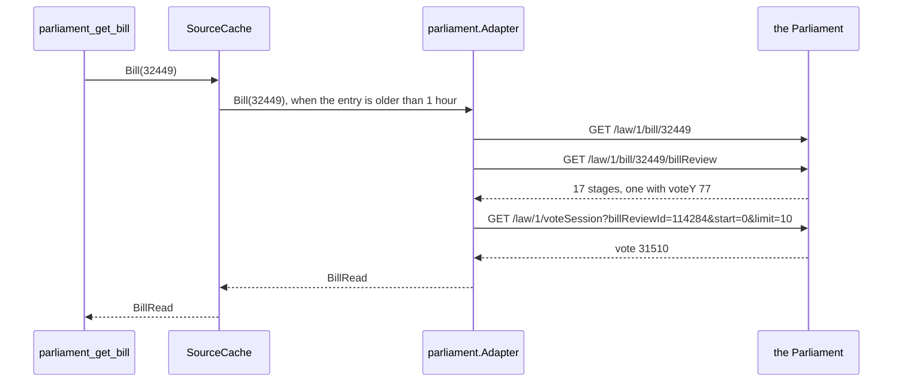

# Specification: The bills, votes, and questions of the Parliament of Georgia

## 1. Summary

This feature adds the vendor client `pkg/parliament` for the JSON methods of
`info.parliament.ge`, and the context `parliament` with five tools: search the bills,
get a bill with its review stages, list the votes, get a vote with the choice of each
member, and search the member questions. Every text stays Georgian. Closed sets are codes.
`spec-client.md` holds the client, the recorded answers, and the mapping of the adapter.
`spec-tools.md` holds the descriptions and the structs of the tools.

## 2. Coverage

| Requirement     | Where this specification realizes it                          |
| --------------- | ------------------------------------------------------------- |
| `PARL-FR-001`   | 4.3 `parliament_search_bills`. `PARL-DD-003`, `PARL-DD-004`    |
| `PARL-FR-002`   | 4.3 `parliament_search_bills`, `from`, `to`, `number`. 4.2 `BillFilter` |
| `PARL-FR-003`   | 4.3 `parliament_get_bill`. `PARL-DD-005`                       |
| `PARL-FR-004`   | 4.3 `parliament_list_votes`. `PARL-DD-003`                     |
| `PARL-FR-005`   | 4.3 `parliament_get_vote`. 4.2 `Tally`. `PARL-DD-006`          |
| `PARL-FR-006`   | 4.3 `parliament_search_questions`. `PARL-DD-003`               |
| `PARL-FR-007`   | 4.2 `QuestionStatusOn`. `PARL-DD-010`                          |
| `PARL-FR-008`   | `spec-tools.md`, `page`, `limit`, `total`. `PARL-DD-002`       |
| `PARL-FR-009`   | 4.2 `ReadingOf`, `OutcomeOf`, `ChoiceOf`. `PARL-DD-007`        |
| `PARL-FR-010`   | 4.2 `SearchText.HasGeorgian`. `spec-tools.md`, `notice`. `PARL-DD-008` |
| `PARL-FR-011`   | 4.2 `NewPeriod`, `ErrNoCriterion`. 4.5                         |
| `PARL-FR-012`   | `spec-client.md` 1 and 3. `PARL-DD-009`                        |
| `PARL-FR-013`   | 4.3 configuration                                             |
| `PARL-NFR-001`  | 4.3 cache. `PARL-SC-018`, `PARL-SC-019`                       |
| `PARL-NFR-002`  | 4.3 configuration. `PARL-DD-011`, `PARL-SC-020`               |
| `PARL-NFR-003`  | `PARL-DD-005`, `PARL-DD-011`. `PARL-SC-023`                    |
| `PARL-NFR-004`  | `spec-client.md` 1. `PARL-SC-001`                             |
| `PARL-INV-001`  | `spec-client.md` 3, the mapping. `PARL-SC-007`                |
| `PARL-INV-002`  | `spec-tools.md`, `url`. `spec-client.md` 3. `PARL-SC-014`     |

## 3. Guideline compliance

| Rule                   | How this specification obeys it                                              |
| ---------------------- | ---------------------------------------------------------------------------- |
| `ARC-004`, `CLT-001`   | `pkg/parliament` is a package of the server module.                          |
| `ARC-008`              | `parliament` imports no other context.                                       |
| `ARC-009`, `CFG-004`   | `bootstrap` builds the module from `Config.Parliament`.                      |
| `CLT-002` to `CLT-005` | Standard library and `pkg/vendorhttp` only. `Accept: application/json`.      |
| `CLT-007`              | A status that is not 200 is an `*APIError`.                                  |
| `CLT-008`, `RSL-002`   | No retry, no cache in the client or the adapter.                             |
| `CLT-009`              | The source is official. No key.                                              |
| `DOM-003`, `TST-009`   | `NewSearchText`, `NewID`, `NewPeriod` validate. Each has a fuzz test or a table. |
| `DOM-004`              | No aggregate. Read models only.                                              |
| `DOM-005`, `DOM-011`   | `adapter/parliament` converts each shape and wraps `kernel.ErrSourceUnavailable`. |
| `DOM-007`              | A date is a `kernel.Date`. The current day is `kernel.Today(now())`.         |
| `DOM-009`, `DOM-010`   | Three ports. Five use cases, one method each.                                |
| `MCP-002` to `MCP-009` | 4.3 tools. No `language` (`MCP-007`, second paragraph). `PARL-DD-001`.       |
| `RSL-001`, `RSL-008`   | `vendors.Config.ClientOptions` gives the timeout and the limit.              |
| `RSL-003` to `RSL-006` | `adapter/cache`. 4.3 cache.                                                  |
| `CFG-003`, `CFG-008`   | The prefix is `GEOMCP_PARLIAMENT_PARLIAMENT_`. The switch is on by default.  |
| `LOG-004`              | The logger of the module carries `context=parliament`.                       |
| `TST-006`              | `pkg/parliament/testdata/` holds the answers of 2026-11-15.                  |

## 4. Design

### 4.1 Components

Every path is new unless the table says "change". `P` is `internal/app/georgia-mcp/parliament`.

| Layer          | Path                      | Types and functions                                     |
| -------------- | ------------------------- | ------------------------------------------------------- |
| Vendor client  | `pkg/parliament/`         | `spec-client.md` 1.                                     |
| Domain         | `P/domain/`               | The values and read models of 4.2, the errors.          |
| Use case       | `P/app/`                  | The ports, the filters, the reads, the five use cases, the errors. |
| Driven adapter | `P/adapter/parliament/`   | `Adapter`, `NewAdapter`. `spec-client.md` 3.            |
| Cache          | `P/adapter/cache/`        | `SourceCache`, `NewSourceCache`.                        |
| Tool           | `P/adapter/tool/`         | `Register`, `UseCases`, the structs of `spec-tools.md`. |
| Module         | `P/doc.go`, `P/module.go`, `P/config.go` | `Module`, `New`, `Register`, `Close`, `Config`, `Defaults`. |
| Composition    | `internal/app/georgia-mcp/bootstrap/` (change) | `Config.Parliament` with `envPrefix:"PARLIAMENT_"`. `modules.go` builds `parliament.New` after `permits`. |
| Configuration  | `configs/.env.example` (change) | The variables of 4.3.                             |
| Documentation  | `README.md` (change)      | The five tools in the list of tools.                    |

### 4.2 Domain model

```go
// domain

var (
    ErrInvalidText   = errors.New("text: invalid")
    ErrInvalidID     = errors.New("identifier: invalid")
    ErrInvertedRange = errors.New("range: start after end")
)

// SearchText is a text of 1 to 128 characters, trimmed.
type SearchText struct{ text string }
func NewSearchText(text string) (SearchText, error)
func (t SearchText) String() string
func (t SearchText) IsZero() bool
// HasGeorgian reports whether the text holds a letter of Mkhedruli, Asomtavruli, or Mtavruli.
func (t SearchText) HasGeorgian() bool

// ID is the positive identifier of a bill or a vote at the Parliament.
type ID int
func NewID(value int) (ID, error)

// Period is a range of dates. Each end is optional.
type Period struct{ From, To *kernel.Date }
func NewPeriod(from, to *kernel.Date) (Period, error) // ErrInvertedRange when from is after to
func (p Period) IsZero() bool

// Page is a page of results: Number from 1, Size from 1 to MaxPageSize.
const MaxPageSize = 50
type Page struct{ Number, Size int }
func (p Page) Start() int // (Number-1)*Size

type Reading string // the codes of PARL 5.1
const (
    FirstReading Reading = "first_reading"; SecondReading = "second_reading"
    ThirdReading = "third_reading"; SingleReading = "single_reading"
    PlenaryDraft = "plenary_draft"; AlternativeProposal = "alternative_proposal"
    OtherReading = "other"
)
// ReadingOf returns the code of a name of PARL 5.1, and false for any other name.
// A vote takes OtherReading for false. A bill stage takes "": it is not a reading.
func ReadingOf(name string) (Reading, bool)

type Outcome string  // adopted, rejected, other
func OutcomeOf(name string) Outcome

type Choice string   // yes, no, absent, other
func ChoiceOf(name string) Choice

type QuestionStatus string // answered, pending, overdue
// QuestionStatusOn applies PARL-FR-007 on the day.
func QuestionStatusOn(responded, deadline *kernel.Date, today kernel.Date) QuestionStatus

// Coded is a code with the Georgian name of the source.
type Coded[C ~string] struct { Code C; Name string }

type Bill struct {
    ID                 ID
    Title              string
    Description        string
    Type               string
    RegistrationNumber string
    PackageName        string
    Initiator, Author  string
    Registered         kernel.Date
    NewestStage        string
    NewestReading      Reading // "" when the newest stage is not a reading
    URL                string  // the page of the bill
}

type Stage struct {
    Name                     string
    Reading                  Reading
    From, To                 *kernel.Date
    SessionDate, BureauDate  *kernel.Date
    SessionNumber, BureauNumber string
    Yes, No                  *int
    Votes                    []ID
}

type Vote struct {
    ID                 ID
    Date               kernel.Date
    BillID             ID
    BillTitle          string
    RegistrationNumber string
    Reading            Coded[Reading]
    Outcome            Coded[Outcome]
    Quorum             *int
    Yes, No, Absent    int
    URL                string // the page of the bill of the vote
}

type MemberChoice struct {
    Member  string
    Faction string // "" for a member of no faction
    Choice  Coded[Choice]
}

type Question struct {
    ID                 int
    Type               string
    RegistrationNumber string
    Registered         kernel.Date
    Request            string
    Member, Faction    string
    Addressee          string
    Deadline           *kernel.Date
    Responded          *kernel.Date
    URL                string // the page of the question
}

// FactionTally is the members of one faction in a vote and the count of each choice.
type FactionTally struct {
    Faction                 string
    Yes, No, Absent, Other  int
    Members                 []MemberChoice
}

// Tally groups the choices by faction (PARL-DD-006).
func Tally(choices []MemberChoice) []FactionTally
```

```go
// app

type BillFilter struct { Text domain.SearchText; Number string; Registered domain.Period }
type VoteFilter struct { BillTitle domain.SearchText; Voted domain.Period }
type QuestionFilter struct { Text domain.SearchText; Member domain.SearchText; Registered domain.Period }

type BillPage struct     { Bills []domain.Bill; Total int; ReadAt time.Time; Stale bool }
type BillRead struct     { Bill domain.Bill; Stages []domain.Stage; ReadAt time.Time; Stale bool }
type VotePage struct     { Votes []domain.Vote; Total int; ReadAt time.Time; Stale bool }
type VoteRead struct     { Vote domain.Vote; Choices []domain.MemberChoice; ReadAt time.Time; Stale bool }
type QuestionPage struct { Questions []domain.Question; Total int; ReadAt time.Time; Stale bool }

// BillSource gives the bills of the Parliament.
type BillSource interface {
    SearchBills(ctx context.Context, filter BillFilter, page domain.Page) (BillPage, error)
    // Bill returns the bill, its stages, and the votes of each stage, or ErrBillNotFound.
    Bill(ctx context.Context, id domain.ID) (BillRead, error)
}

// VoteSource gives the plenary votes.
type VoteSource interface {
    ListVotes(ctx context.Context, filter VoteFilter, page domain.Page) (VotePage, error)
    // Vote returns the vote and the choice of each member, or ErrVoteNotFound.
    Vote(ctx context.Context, id domain.ID) (VoteRead, error)
}

// QuestionSource gives the member questions.
type QuestionSource interface {
    SearchQuestions(ctx context.Context, filter QuestionFilter, page domain.Page) (QuestionPage, error)
}

var (
    ErrBillNotFound = errors.New("bill: not found")
    ErrVoteNotFound = errors.New("vote: not found")
    ErrNoCriterion  = errors.New("search: no criterion")
)
```

| Use case          | Method                                                              | Rule |
| ----------------- | ------------------------------------------------------------------- | ---- |
| `SearchBills`     | `Search(ctx, BillFilter, Page) (BillResult, error)`                | `ErrNoCriterion` for a zero filter. `Notice` per `PARL-DD-008`. |
| `GetBill`         | `Get(ctx, ID) (BillRead, error)`                                    | Passes through. |
| `ListVotes`       | `List(ctx, VoteFilter, Page) (VoteResult, error)`                   | `ErrNoCriterion` for a zero filter. `Notice` per `PARL-DD-008`. |
| `GetVote`         | `Get(ctx, ID) (VoteDetail, error)`                                  | Adds `domain.Tally(read.Choices)`. |
| `SearchQuestions` | `Search(ctx, QuestionFilter, Page) (QuestionResult, error)`         | `ErrNoCriterion` for a zero filter. Adds the status of each question on `kernel.Today(now())`. `Notice` per `PARL-DD-008`. |

Each result holds the read of the port and, for a search, `Notice string`.
`NewSearchQuestions` takes `now func() time.Time`. A use case calls no source for a
zero filter.

### 4.3 Declarations

**MCP tools.**

| Tool                          | Input                                      | Output             | Errors | Realizes |
| ----------------------------- | ------------------------------------------ | ------------------ | ------ | -------- |
| `parliament_search_bills`     | `query`, `number`, `from`, `to`, `page`, `limit` | `billsOutput`  | 4.5    | `PARL-FR-001`, `PARL-FR-002`, `PARL-FR-008` to `PARL-FR-012` |
| `parliament_get_bill`         | `id`                                       | `billOutput`       | 4.5    | `PARL-FR-003`, `PARL-FR-009`, `PARL-FR-012` |
| `parliament_list_votes`       | `query`, `from`, `to`, `page`, `limit`     | `votesOutput`      | 4.5    | `PARL-FR-004`, `PARL-FR-008` to `PARL-FR-012` |
| `parliament_get_vote`         | `id`                                       | `voteOutput`       | 4.5    | `PARL-FR-005`, `PARL-FR-009`, `PARL-FR-012` |
| `parliament_search_questions` | `query`, `member`, `from`, `to`, `page`, `limit` | `questionsOutput` | 4.5 | `PARL-FR-006` to `PARL-FR-008`, `PARL-FR-010` to `PARL-FR-012` |

`spec-tools.md` holds the titles, the descriptions, and the structs of the tools.

**Vendor endpoint.**

| Client           | Method and path                          | Key | Official | Realizes |
| ---------------- | ---------------------------------------- | --- | -------- | -------- |
| `pkg/parliament` | `GET /law/1/bill`                        | No  | Yes      | `PARL-FR-001`, `PARL-FR-002` |
| `pkg/parliament` | `GET /law/1/bill/{id}`                   | No  | Yes      | `PARL-FR-003` |
| `pkg/parliament` | `GET /law/1/bill/{id}/billReview`        | No  | Yes      | `PARL-FR-003` |
| `pkg/parliament` | `GET /law/1/voteSession`                 | No  | Yes      | `PARL-FR-003`, `PARL-FR-004` |
| `pkg/parliament` | `GET /law/1/voting/session/{id}`         | No  | Yes      | `PARL-FR-005` |
| `pkg/parliament` | `GET /law/1/voting?group=false`          | No  | Yes      | `PARL-FR-005` |
| `pkg/parliament` | `GET /mpQuestion/1/`                     | No  | Yes      | `PARL-FR-006` |

`spec-client.md` holds the recorded answers.

**Cache.** One store for each port method. The key is the normalized filter and the page.

| Port method                      | Time to live | Maximum stale | Entries | Realizes |
| -------------------------------- | ------------ | ------------- | ------- | -------- |
| `BillSource.SearchBills`         | 15 minutes   | 23 h 45 min   | 256     | `PARL-NFR-001` |
| `BillSource.Bill`                | 1 hour       | 23 hours      | 64      | `PARL-NFR-001` |
| `VoteSource.ListVotes`           | 15 minutes   | 23 h 45 min   | 256     | `PARL-NFR-001` |
| `VoteSource.Vote`                | 1 hour       | 23 hours      | 64      | `PARL-NFR-001` |
| `QuestionSource.SearchQuestions` | 15 minutes   | 23 h 45 min   | 256     | `PARL-NFR-001` |

The maximum stale counts after the time to live: a stale value is at most 24 hours old.

**Configuration.**

| Variable                                    | Type     | Default                      | Secret | Realizes |
| ------------------------------------------- | -------- | ---------------------------- | ------ | -------- |
| `GEOMCP_PARLIAMENT_PARLIAMENT_ENABLED`      | bool     | `true`                       | No     | `PARL-FR-013` |
| `GEOMCP_PARLIAMENT_PARLIAMENT_BASE_URL`     | URL      | `https://info.parliament.ge` | No     | `PARL-FR-001` |
| `GEOMCP_PARLIAMENT_PARLIAMENT_TIMEOUT`      | duration | `10s`                        | No     | `RSL-001` |
| `GEOMCP_PARLIAMENT_PARLIAMENT_RATE`         | float    | `5`                          | No     | `PARL-NFR-002` |
| `GEOMCP_PARLIAMENT_PARLIAMENT_BURST`        | int      | `5`                          | No     | `PARL-NFR-002` |

`parliament.Config` holds `Parliament vendors.Config` with `envPrefix:"PARLIAMENT_"`.
`parliament.Defaults` gives `vendors.Defaults(parliamentclient.DefaultBaseURL).WithLimit(5, 5)`.

### 4.4 Flow



### 4.5 Errors

| Condition                                   | Sentinel                      | Tool message |
| ------------------------------------------- | ----------------------------- | ------------ |
| A search or a list with no criterion        | `app.ErrNoCriterion`          | `Give at least one of query, number, from, or to.` The list names the inputs of the tool. |
| A text empty after the trim, or over 128    | `domain.ErrInvalidText`       | `query: use 1 to 128 characters.` The field is the input. |
| A date that does not parse                  | `kernel.ErrInvalidDate`       | `from: "2026-02-30" is not a date. Use YYYY-MM-DD.` |
| `from` after `to`                           | `domain.ErrInvertedRange`     | `from, to: 2026-11-12 is after 2026-11-10.` |
| A page below 1, a limit out of 1 to 50      | none, the tool checks it      | `limit: 60 is out of range. Use 1 to 50.` |
| An identifier below 1                       | `domain.ErrInvalidID`         | `id: 0 is not an identifier. Use a positive number.` |
| An unknown bill                             | `app.ErrBillNotFound`         | `The Parliament has no bill 99999999. Find a bill with parliament_search_bills.` |
| An unknown vote                             | `app.ErrVoteNotFound`         | `The Parliament has no vote 99999999. Find a vote with parliament_list_votes or parliament_get_bill.` |
| The Parliament fails, with no stale value   | `kernel.ErrSourceUnavailable` | `The Parliament of Georgia did not answer. Try again in a few minutes.` |
| Any other error                             | none                          | `The server failed to read the data of the Parliament of Georgia.` |

## 5. Design decisions

### `PARL-DD-001`

**Realizes:** `PARL-FR-001`, `PARL-FR-003` to `PARL-FR-006`
**Decision:** Five tools. A vote list is `list`, since a period bounds it and its text
filter is optional. The tools take no `language`.
**Rationale:** One tool for each question of section 1. `MCP-007` exempts a source that
publishes one language.
**Alternatives:** `parliament_search_votes`. The common question is "what did the
parliament vote on that day", which is a period.

### `PARL-DD-002`

**Realizes:** `PARL-FR-008`
**Decision:** `page` from 1 and `limit` from 1 to 50, default 10. The client sends
`start = (page - 1) * limit` and `limit`. `total` is the count of the source.
**Rationale:** The source has no page above 50 bills. 10 items keep an answer short.
`MATSNE` uses `page`.
**Alternatives:** An opaque cursor. The source pages by offset, so a cursor adds nothing.

### `PARL-DD-003`

**Realizes:** `PARL-FR-001`, `PARL-FR-004`, `PARL-FR-006`
**Decision:** The text filters are `billName` for a bill, `billRd` for a vote, and
`requestTitle` and `colleagueName` for a question. The server never sends `searchItem`.
**Rationale:** Each of these gives the newest first, which the requirements demand.
`searchItem` matches more fields but gives an order with no date: a bill of 2013 first.
**Alternatives:** `searchItem` and a sort in the server. The sort needs every page, up to
22 calls for "ბიუჯეტ".

### `PARL-DD-004`

**Realizes:** `PARL-FR-001`
**Decision:** The newest review stage is the last item of `billReviewTypes`.
**Rationale:** A search item holds no stage dates. The order of the list follows the
review: bill 32449 ends with "I მოსმენა", its last stage in `billReview`.
**Alternatives:** One call of `billReview` for each bill of the page. It costs 50 calls.

### `PARL-DD-005`

**Realizes:** `PARL-FR-003`, `PARL-NFR-003`
**Decision:** `Bill` reads the bill and its stages at the same time. Then it reads one
`voteSession` page with `billReviewId` and `limit` 10 for each stage whose `voteY` or
`voteN` is set, all at the same time. A stage with neither has no vote. The first error
ends the read. The cache keeps the whole `BillRead`.
**Rationale:** Only a stage with a vote has counts: bill 32449 has 1 of 17. A bill
through three readings sends 5 calls in two rounds. At 2.9 seconds a call, one after the
other takes 14.5 seconds and breaks `PARL-NFR-003`. Two rounds take 5.8 seconds.
**Alternatives:** Every call one after the other. It breaks `PARL-NFR-003`. One
`voteSession` call with the title of the bill. A title can match more than one bill.

### `PARL-DD-006`

**Realizes:** `PARL-FR-005`
**Decision:** `Tally` groups the members by faction. The factions come by count of
members, the largest first, then by name. The group of no faction comes last. The
members keep the order of the source, by family name. The owner chose it on 2026-11-15.
**Rationale:** The faction name appears once. The tally sits next to its members.
**Alternatives:** A flat list of members with a faction each, and a separate tally.

### `PARL-DD-007`

**Realizes:** `PARL-FR-009`
**Decision:** The names map to codes after a trim:

| Kind    | Name at the Parliament       | Code       |
| ------- | ---------------------------- | ---------- |
| Outcome | საკითხი მიღებულია            | `adopted`  |
| Outcome | საკითხი არ არის მიღებული     | `rejected` |
| Choice  | დიახ                         | `yes`      |
| Choice  | არა                          | `no`       |
| Choice  | არ ესწრება                   | `absent`   |

The readings follow `PARL` 5.1. A vote is always a plenary stage, so a name outside
5.1 is `other`. A bill stage with a name outside 5.1 is a committee stage or the
initiated version, and has no reading.
**Rationale:** The names of 2026 and of 2015 are equal. An unknown name keeps its text.
A bill has 15 committee stages, and `other` on each would hide the readings.
**Alternatives:** The library ids of the source. They are not published as stable.

### `PARL-DD-008`

**Realizes:** `PARL-FR-010`
**Decision:** A search or a list with a text that has no Georgian letter and a total of 0
sets `notice`: `The Parliament publishes Georgian text only. Search in Georgian, for
example ბიუჯეტი for budget.` A Georgian letter is in U+10A0 to U+10FF or U+1C90 to U+1CBF.
**Rationale:** An empty list with a notice is still a correct answer. An error would hide
the count.
**Alternatives:** A tool error. The model would read it as a failure of the source.

### `PARL-DD-009`

**Realizes:** `PARL-FR-012`
**Decision:** The adapter wraps `kernel.ErrSourceUnavailable` around a client error, a
body that does not decode as JSON (an HTML page, an empty body), a date that does not
parse, and a list item with no identifier. `[null]` from `Bill` or `VoteSession` is not
found. A vote with no choice is an outage.
**Rationale:** The source answers an error with 404 or 200 and HTML. A vote always has
the choices of the members.
**Alternatives:** Skip a broken item. The model then reads a page that looks complete.

### `PARL-DD-010`

**Realizes:** `PARL-FR-007`
**Decision:** `SearchQuestions` sets the status on `kernel.Today(now())`, after the cache.
**Rationale:** A cached question turns `overdue` at midnight in Tbilisi with no new read.
**Alternatives:** The status in the adapter. A cached value then keeps the status of its read.

### `PARL-DD-011`

**Realizes:** `PARL-NFR-002`, `PARL-NFR-003`
**Decision:** The limit is 5 calls each second with a burst of 5.
**Rationale:** A token bucket lets through at most 10 in one second. A bill sends at most
about 6 calls, so a single request never waits. `MATSNE-DD-012` uses the same figures.
**Alternatives:** 10 and 10. It lets 20 through in one second.

## 6. Scenarios

`pkg/parliament/testdata/` holds the real answers of 2026-11-15, with each name of a
private person in a question replaced. The tests of the use cases and the tools take
`now` as 2026-11-15T12:00:00+04:00.

| File                     | Content                                                     |
| ------------------------ | ----------------------------------------------------------- |
| `bills-budget.json`      | `billName=ბიუჯეტ`, the first 10 of 1088.                     |
| `bill-32449.json`        | The bill 32449.                                             |
| `bill-reviews-32449.json`| Its 17 stages.                                              |
| `vote-sessions-114284.json` | The votes of stage 114284: vote 31510.                   |
| `vote-sessions-week.json`| The votes from 2026-11-10 to 2026-11-12: 12.                |
| `vote-session-31507.json`| The vote 31507.                                             |
| `votings-31507.json`     | Its 101 choices: 79 yes, 10 no, 12 absent.                  |
| `questions-recent.json`  | The newest 3 questions.                                     |
| `null.json`              | `[null]`.                                                   |
| `empty-list.json`        | `{"total":0,"list":[]}`.                                    |
| `error.html`             | The page of the status 404.                                 |

| ID              | Verifies | Layer | Given, when, then |
| --------------- | -------- | ----- | ----------------- |
| `PARL-SC-001`   | `PARL-NFR-004` | unit | A server records each request. Each method sends its path, `start` and `limit`, `Accept: application/json`, and a User-Agent that holds `https://github.com/abgeo/georgia-mcp`. `Votings` sends `group=false`. An empty field of a query is not sent. |
| `PARL-SC-002`   | `PARL-FR-001` | unit | `Bills` with `bills-budget.json` gives `total` 1088 and the first `id` 32559. `Bill` with `null.json` gives nil and no error. |
| `PARL-SC-003`   | `PARL-FR-012` | unit | The status 404 with `error.html` gives an `*APIError`. `errors.Is(err, ErrUnexpectedStatus)` holds. An empty body of 200 gives an error. |
| `PARL-SC-004`   | `PARL-FR-011` | unit | `NewSearchText` trims. `""`, `"   "`, and 129 runes give `ErrInvalidText`. 128 Georgian runes pass. A fuzz test holds that a valid text is never empty. |
| `PARL-SC-005`   | `PARL-FR-010` | unit | `HasGeorgian` is true for `ბიუჯეტ` and for `budget ბ`. False for `budget` and `2026`. |
| `PARL-SC-006`   | `PARL-FR-009` | unit | A table of 4.2 `ReadingOf`: `I მოსმენა` gives `first_reading` and true, ` ერთი მოსმენა ` gives `single_reading` and true, `ინიციირებული ვარიანტი` gives false. The adapter turns false into `other` for a vote and into no reading for a stage. `OutcomeOf` and `ChoiceOf` for each row of `PARL-DD-007`, and `foo` gives `other`. |
| `PARL-SC-007`   | `PARL-INV-001`, `PARL-FR-003` | unit | The adapter with `bill-32449.json`, `bill-reviews-32449.json`, and `vote-sessions-114284.json` gives the title as published, 17 stages, and the last stage `first_reading` with yes 77, no 0, votes [31510]. It sends one `voteSession` call. |
| `PARL-SC-008`   | `PARL-FR-012` | unit | The adapter gives an error that wraps `kernel.ErrSourceUnavailable` for a client error, `error.html`, a date `2026-11-11`, and a vote with no choice. `null.json` gives `ErrBillNotFound` and `ErrVoteNotFound`. |
| `PARL-SC-009`   | `PARL-FR-007` | unit | `QuestionStatusOn` on 2026-11-15: a response date gives `answered`. No response and the deadline 2026-11-28 give `pending`. The deadline 2026-11-15 gives `pending`. The deadline 2026-11-14 gives `overdue`. No deadline gives `pending`. |
| `PARL-SC-010`   | `PARL-FR-005` | unit | `Tally` of `votings-31507.json` gives "ქართული ოცნება" first, the group of no faction last, and totals of 79, 10, and 12. Each member appears once. |
| `PARL-SC-011`   | `PARL-FR-011` | unit | Each search use case with a zero filter gives `ErrNoCriterion` and calls no source. `NewPeriod` with from 2026-11-12 and to 2026-11-10 gives `ErrInvertedRange`. One end alone passes. |
| `PARL-SC-012`   | `PARL-FR-002`, `PARL-FR-008` | unit | The adapter turns a `BillFilter` with from 2026-01-01, to 2026-11-15, number `372/2-XIმპ`, and the page 3 of 20 into `registrationDate1=01-01-2026`, `registrationDate2=15-11-2026`, `registrationNumber=372/2-XIმპ`, `start=40`, `limit=20`. |
| `PARL-SC-013`   | `PARL-FR-001`, `PARL-FR-008` | integration | `parliament_search_bills` with `ბიუჯეტ`: `source` is `Parliament of Georgia`, `as_of` has `+04:00`, `total` 1088, `page` 1, 10 bills, the first with `registered` `2026-11-11`. |
| `PARL-SC-014`   | `PARL-INV-002`, `PARL-FR-003` | integration | `parliament_get_bill` with 32449 gives the `url` `https://info.parliament.ge/#law-drafting/32449` and 17 stages. `parliament_list_votes` of the week gives 12 votes, each with the `url` of its bill. `parliament_search_questions` gives the `url` `https://info.parliament.ge/#mpqs/14583`. |
| `PARL-SC-015`   | `PARL-FR-004`, `PARL-FR-009` | integration | `parliament_list_votes` from 2026-11-10 to 2026-11-12 gives `total` 12. Vote 31510 has `reading` `{first_reading, I მოსმენა}`, `outcome` `{adopted, საკითხი მიღებულია}`, `absent` 24. |
| `PARL-SC-016`   | `PARL-FR-005` | integration | `parliament_get_vote` with 31507 gives `yes` 79, `no` 10, `absent` 12, and factions whose counts add up to the same. |
| `PARL-SC-017`   | `PARL-FR-006`, `PARL-FR-007` | integration | `parliament_search_questions` with `member` `ხორგუანი` gives question 14583 with `status` `pending` and `deadline` `2026-11-28`. |
| `PARL-SC-018`   | `PARL-NFR-001` | unit | In `synctest`, `SearchBills` again after 14 minutes 59 seconds sends no load. After 15 minutes it sends a second. `Bill` and `Vote` hold for 1 hour. Another page is another entry. |
| `PARL-SC-019`   | `PARL-NFR-001` | unit | In `synctest`, the source fails with `kernel.ErrSourceUnavailable` after one read. At 23 hours 59 minutes, each method returns the value with `Stale` true. After 24 hours and 1 second, it returns the error. |
| `PARL-SC-020`   | `PARL-NFR-002` | unit | In `bootstrap`, `LoadConfig` with no variable of the parliament gives the Parliament on, at `https://info.parliament.ge`, with a timeout of 10 seconds, the rate 5, and the burst 5. |
| `PARL-SC-021`   | `PARL-FR-013` | unit | `parliament.New` with `Enabled` false registers no tool. With `Enabled` true it registers the five tools. |
| `PARL-SC-022`   | `PARL-FR-010`, `PARL-FR-011` | integration | `parliament_search_bills` with `budget` and `empty-list.json` gives `total` 0 and the `notice`. With `zzqxვ`, a text with a Georgian letter, it gives no `notice`. Each input of 4.5 returns `IsError` with its message. The vendor answers 500 with an empty cache: `IsError` with the message of an outage. |
| `PARL-SC-023`   | `PARL-NFR-003` | integration | In `synctest`, a transport of the test serves the recorded answers of bill 32449 with three stages that carry a vote, each call after 2.9 seconds. `parliament_get_bill` answers in less than 10 seconds of the fake clock. No network. |
| `PARL-SC-024`   | `PARL-FR-001`, `PARL-FR-005` | live | Against `info.parliament.ge`: `Bills` with `ბიუჯეტ` gives more than 1000. `Votings` of 31507 gives 101 choices with the three names of `PARL-DD-007`. `Bills` with `limit` 50 gives 50. |

## 7. Build plan

| #   | Step                                                                         | Realizes                                   | Done |
| --- | ---------------------------------------------------------------------------- | ------------------------------------------ | ---- |
| 1   | `pkg/parliament`: client, types, recorded answers, README, example, live test. | `PARL-FR-012`, `PARL-NFR-004`            | [x]  |
| 2   | `domain`: the values, the codes, `QuestionStatusOn`, `Tally`, the fuzz test.  | `PARL-FR-005`, `PARL-FR-007`, `PARL-FR-009` to `PARL-FR-011` | [x]  |
| 3   | `app`: the ports, the filters, the five use cases, the errors.                | `PARL-FR-001` to `PARL-FR-011`             | [x]  |
| 4   | `adapter/parliament`.                                                         | `PARL-FR-001` to `PARL-FR-006`, `PARL-FR-012`, `PARL-INV-001` | [x]  |
| 5   | `adapter/cache`.                                                              | `PARL-NFR-001`                             | [x]  |
| 6   | `adapter/tool`.                                                               | `PARL-FR-001` to `PARL-FR-011`, `PARL-INV-002` | [x]  |
| 7   | `module.go`, `config.go`, `bootstrap`, `configs/.env.example`, `README.md`.   | `PARL-FR-013`, `PARL-NFR-002`              | [ ]  |

## 8. Out of scope for this specification

The page of the tools on the website (`website/src/content/`, `definitions.json`,
`recordings.json`, a hue and an icon of `BRD`) and the list of tools of
`build/openai-plugin/plugin.json`. A change of `WEBSITE` adds them after the tools exist.

## Retired identifiers

This file has no retired identifier.
