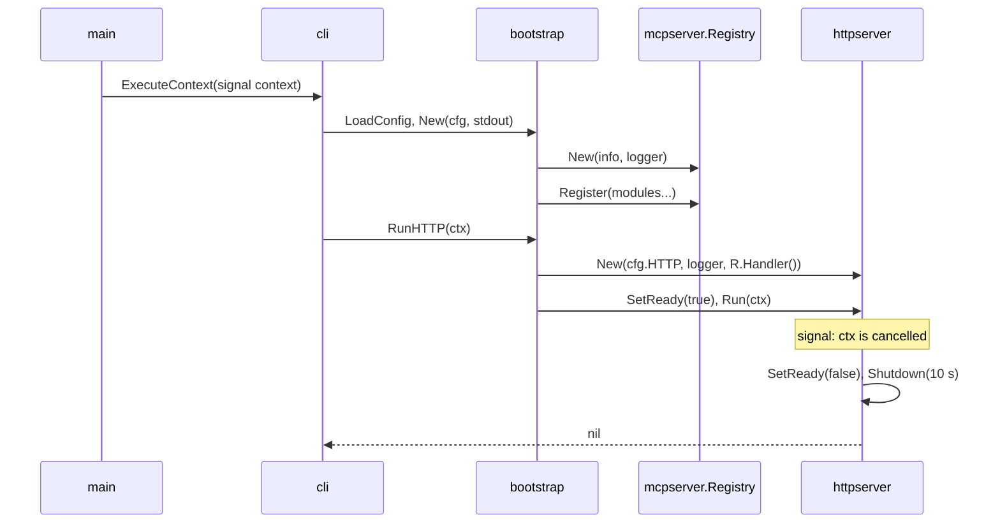

# Specification: The platform of the server

## 1. Summary

This feature builds the binary `georgia-mcp` with no bounded context: the command
tree, the configuration, the logger, the MCP server with its registry of tools, the
HTTP server, the cache, the limited HTTP client for a vendor, and the shared kernel.
It adds the container image, the local compose file, and the task file.
`spec-scenarios.md` holds the scenarios.

## 2. Coverage

| Requirement        | Where this specification realizes it                    |
| ------------------ | ------------------------------------------------------- |
| `PLATFORM-FR-001`  | 4.1 `httpserver`, `mcpserver`. 4.4. `PLATFORM-DD-003`   |
| `PLATFORM-FR-002`  | 4.1 `mcpserver.RunStdio`. 4.4                           |
| `PLATFORM-FR-003`  | 4.1 `mcpserver`. `PLATFORM-DD-002`                      |
| `PLATFORM-FR-004`  | 4.1 `mcpserver.New`, `buildinfo`                        |
| `PLATFORM-FR-005`  | 4.1 `mcpserver.Registry`. `PLATFORM-DD-001`             |
| `PLATFORM-FR-006`  | 4.3 HTTP routes                                         |
| `PLATFORM-FR-007`  | 4.3 HTTP routes. 4.4                                    |
| `PLATFORM-FR-008`  | 4.1 `httpserver`. `PLATFORM-DD-004`                     |
| `PLATFORM-FR-009`  | 4.1 `httpserver`. 4.3 configuration. `PLATFORM-DD-010`  |
| `PLATFORM-FR-010`  | 4.1 `config`. 4.3 configuration                         |
| `PLATFORM-FR-011`  | 4.1 `config`                                            |
| `PLATFORM-FR-012`  | 4.1 `config`. 4.5. `PLATFORM-DD-012`                    |
| `PLATFORM-FR-013`  | 4.3 CLI commands                                        |
| `PLATFORM-FR-014`  | 4.4. `PLATFORM-DD-005`                                  |
| `PLATFORM-FR-015`  | 4.1 `mcpserver` middleware                              |
| `PLATFORM-FR-016`  | 4.1 `httpserver` access log                             |
| `PLATFORM-FR-017`  | 4.1 `cache`. `PLATFORM-DD-006`                          |
| `PLATFORM-FR-018`  | 4.1 `cache`. `PLATFORM-DD-007`                          |
| `PLATFORM-FR-019`  | 4.1 `cache`. `PLATFORM-DD-006`                          |
| `PLATFORM-FR-020`  | 4.1 `cache`                                             |
| `PLATFORM-FR-021`  | 4.1 `httpclient`. `PLATFORM-DD-008`                     |
| `PLATFORM-FR-022`  | 4.1 `build/package/Dockerfile`                          |
| `PLATFORM-FR-023`  | 4.1 `deployments/compose.yaml`                          |
| `PLATFORM-FR-024`  | 4.1 `Taskfile.yml`. `PLATFORM-DD-009`                   |
| `PLATFORM-FR-025`  | 4.1 `vendors`. `PLATFORM-DD-011`                        |
| `PLATFORM-NFR-001` | 4.4. `PLATFORM-SC-029`                                  |
| `PLATFORM-NFR-002` | 4.4. `PLATFORM-SC-016`                                  |
| `PLATFORM-NFR-003` | 4.1 `build/package/Dockerfile`. `PLATFORM-SC-030`       |
| `PLATFORM-INV-001` | 3, `ARC-005`. `PLATFORM-SC-031`                         |
| `PLATFORM-INV-002` | 4.1 `cli`. `PLATFORM-SC-032`                            |
| `PLATFORM-INV-003` | 4.1 `mcpserver` middleware. `PLATFORM-SC-033`           |

## 3. Guideline compliance

| Rule                   | How this specification obeys it                                                     |
| ---------------------- | ----------------------------------------------------------------------------------- |
| `ARC-003`, `MCP-010`   | One `mcp.Server` inside `mcpserver.Registry` serves both transports.                |
| `ARC-005`              | The cache lives in memory. No component opens a file for write.                     |
| `ARC-007`, `ARC-008`   | `internal/pkg` imports `internal/pkg/kernel` and libraries only. 4.1.              |
| `ARC-009`, `PKG-003`   | `bootstrap.modules` is the one list of contexts. It is empty in this feature.       |
| `DOM-008`, `DOM-011`   | `kernel` holds `Language` and `ErrSourceUnavailable`.                               |
| `MCP-001`, `MCP-004`   | `mcpserver.AddTool` builds the server tool with the annotations of `MCP-004`.       |
| `MCP-006`              | `mcpserver.ToolError` carries the message for the model apart from the cause.       |
| `MCP-011`, `LOG-009`   | One receiving middleware writes the tool call record.                               |
| `API-001` to `API-007` | 4.1 `httpserver`, 4.3.                                                              |
| `CFG-001` to `CFG-007` | 4.1 `config`, 4.3, `configs/.env.example`.                                                  |
| `CLI-001` to `CLI-005` | 4.1 `cli`, 4.3.                                                                     |
| `LIF-001` to `LIF-006` | 4.4.                                                                                |
| `LOG-001` to `LOG-010` | 4.1 `logger`, `httpserver`, `mcpserver`. `stdio` gives `os.Stderr` to the logger.   |
| `RSL-001`, `RSL-008`   | `httpclient.New` sets the timeout and the vendor limit.                             |
| `RSL-003` to `RSL-007` | 4.1 `cache`.                                                                        |
| `GO-012`               | `cache.Cache[V]` has two instantiations in its tests. `config.Load[T]` has two.     |
| `BLD-002` to `BLD-007` | 4.1 `go.mod`, `build/package/Dockerfile`, `Taskfile.yml`.                                         |

This feature changes four guideline rules, in the same review, with no ADR, as the
owner decided:

| Rule      | Change                                                                                       |
| --------- | -------------------------------------------------------------------------------------------- |
| `PKG-003` | `Register` takes `*mcpserver.Registry` and returns an error. `PLATFORM-DD-001`.             |
| `ARC-007` | `adapter/tool` also imports `internal/pkg/mcpserver`.                                   |
| `PKG-005` | `httpclient` and `buildinfo` join the allowed names.                                         |
| `CFG-006` | "An address is a `url.URL`" becomes "A URL is a `url.URL`". A listen address is a string.    |

## 4. Design

### 4.1 Components

Every path is new. Each package with more than one file has `doc.go` (`PKG-006`).

**The entry and the commands.**

| Path                         | Types and functions                                                             |
| ---------------------------- | ------------------------------------------------------------------------------- |
| `cmd/georgia-mcp/main.go`    | `main`: `signal.NotifyContext` for `SIGINT`, `SIGTERM`. `cli.NewRoot().ExecuteContext`. `os.Exit(1)` on an error. |
| `internal/app/georgia-mcp/cli/root.go`       | `func NewRoot() *cobra.Command`. `SilenceUsage`, `SilenceErrors`. Adds the three commands. |
| `internal/app/georgia-mcp/cli/serve.go`      | `serve`: `bootstrap.LoadConfig`, `bootstrap.New(cfg, os.Stdout)`, `App.RunHTTP(ctx)`. |
| `internal/app/georgia-mcp/cli/stdio.go`      | `stdio`: the same, with `os.Stderr` for the log, then `App.RunStdio(ctx)`.      |
| `internal/app/georgia-mcp/cli/version.go`    | `version`: prints `buildinfo.Get()` to `cmd.OutOrStdout()`. Loads no configuration. |

**The composition root.**

| Path                            | Types and functions                                                         |
| ------------------------------- | --------------------------------------------------------------------------- |
| `internal/app/georgia-mcp/bootstrap/config.go`  | `type Config struct { Log logger.Config; HTTP httpserver.Config }` with the prefixes of `CFG-004`. `func LoadConfig() (Config, error)` calls `config.Load[Config]`. |
| `internal/app/georgia-mcp/bootstrap/app.go`     | `type App struct`. `func New(cfg Config, logOutput io.Writer) (*App, error)`. `func (a *App) RunHTTP(ctx context.Context) error`. `func (a *App) RunStdio(ctx context.Context) error`. |
| `internal/app/georgia-mcp/bootstrap/modules.go` | `func modules(cfg Config, logger *slog.Logger) ([]mcpserver.Module, error)`. Returns an empty slice in this feature. `NBGRATE` adds the first line. |

`New` follows `LIF-001`: logger, modules, `mcpserver.New`, `Registry.Register(modules...)`.

**The shared kernel.**

| Path                        | Types and functions                                                         |
| --------------------------- | --------------------------------------------------------------------------- |
| `internal/pkg/kernel/language.go` | `type Language string`. `LanguageGeorgian = "ka"`, `LanguageEnglish = "en"`. `func ParseLanguage(s string) (Language, error)`. The empty text gives `LanguageEnglish` (`MCP-007`). |
| `internal/pkg/kernel/errors.go` | `ErrSourceUnavailable = errors.New("source: unavailable")`. `ErrUnknownLanguage = errors.New("language: unknown code")`. |

**The platform.**

| Path                                  | Types and functions                                                   |
| ------------------------------------- | --------------------------------------------------------------------- |
| `internal/pkg/buildinfo/`        | `type Info struct { Version, Commit, GoVersion string }`. `func Get() Info` reads `debug.ReadBuildInfo`: the main module version, `vcs.revision`, and `runtime.Version()`. An absent value is `unknown`. |
| `internal/pkg/config/`           | `func Load[T any]() (T, error)`. Loads `.env` with `godotenv.Load`, ignores `fs.ErrNotExist`. Parses with `env.ParseAsWithOptions[T](env.Options{Prefix: "GEOMCP_"})`. Validates `T` with `go-playground/validator/v10` and its `validate` tags. Each failure becomes a `*FieldError{Variable, Problem}`. `PLATFORM-DD-012`. |
| `internal/pkg/logger/`           | `type Config struct { Level slog.Level; Format string }`. `Format` has `validate:"oneof=json text"`. `func New(cfg Config, output io.Writer) *slog.Logger`. `AddSource` when the level is debug (`LOG-003`). |
| `internal/pkg/mcpserver/`        | See below.                                                            |
| `internal/pkg/httpserver/`       | See below.                                                            |
| `internal/pkg/cache/`            | See below.                                                            |
| `internal/pkg/httpclient/`       | See below.                                                            |
| `internal/pkg/vendors/`          | See below.                                                            |

**`mcpserver`.**

```go
type Module interface{ Register(registry *Registry) error }

type Registry struct { /* server *mcp.Server; names map[string]struct{} */ }

func New(info buildinfo.Info, logger *slog.Logger) *Registry
func (r *Registry) Register(modules ...Module) error
func AddTool[In, Out any](r *Registry, tool *mcp.Tool, handler mcp.ToolHandlerFor[In, Out]) error
func (r *Registry) Handler() http.Handler
func (r *Registry) RunStdio(ctx context.Context, transport mcp.Transport) error

var ErrDuplicateTool = errors.New("mcp server: duplicate tool name")

type ToolError struct { Message string; Cause error }
func (e *ToolError) Error() string { return e.Message }
func (e *ToolError) Unwrap() error { return e.Cause }
```

- `New` builds `mcp.NewServer(&mcp.Implementation{Name: "georgia-mcp", Version: info.Version}, opts)`
  with `opts.Capabilities = &mcp.ServerCapabilities{Tools: &mcp.ToolCapabilities{}}`.
  It adds the log middleware with `AddReceivingMiddleware`.
- `AddTool` returns `ErrDuplicateTool`, wrapped with the name, when the name exists.
  It sets the annotations of `MCP-004` on the tool, then calls `mcp.AddTool`.
- `Handler` returns `mcp.NewStreamableHTTPHandler` with `Stateless: true`,
  `JSONResponse: true`, and `MaxRequestBodyBytes: 1 << 20`.
- `RunStdio` calls `server.Run(ctx, transport)`. `cli` passes `&mcp.StdioTransport{}`.
  A test passes `&mcp.IOTransport{}`.
- The log middleware acts on `tools/call` only. It writes the record of `LOG-009` at
  info level. It adds `mcp.tool.arguments` only at debug level (`LOG-008`).
  `error.type` is `tool_error` when `IsError` is set, else the `%T` of the error.

**`httpserver`.**

```go
type Config struct {
    Address        string        `env:"ADDRESS"         envDefault:":8080" validate:"hostname_port"`
    TrustedProxies []string      `env:"TRUSTED_PROXIES" envSeparator:","   validate:"dive,cidr"`
    AllowedOrigins []string      `env:"ALLOWED_ORIGINS" envSeparator:","`
    RateLimit      int           `env:"RATE_LIMIT"      envDefault:"60"    validate:"min=1"`
    RateWindow     time.Duration `env:"RATE_WINDOW"     envDefault:"1m"    validate:"gte=1s"`
}

type Server struct { /* http *http.Server; ready atomic.Bool */ }
func New(cfg Config, logger *slog.Logger, mcpHandler http.Handler) *Server
func (s *Server) SetReady(ready bool)
func (s *Server) Run(ctx context.Context) error
func (s *Server) Addr() net.Addr
func (s *Server) Handler() http.Handler
```

- The chi router applies `API-002`: `middleware.RequestID`, then
  `middleware.ClientIPFromXFF(cfg.TrustedProxies...)` when the list has a range, else
  `middleware.ClientIPFromRemoteAddr`, then `httplog.RequestLogger`, `middleware.Recoverer`.
  The group of `/mcp` adds `allowOrigins(cfg.AllowedOrigins)` and `httprate.LimitBy`
  with a key of `middleware.GetClientIP`. A request with no client address shares the
  key `unknown`. `PLATFORM-DD-010`.
- `httplog.Options`: `Schema: httplog.SchemaOTEL`, `RecoverPanics: false`,
  `Level: slog.LevelDebug`, `Skip`: a path of `/livez` or `/readyz` with status 200.
  No body option (`LOG-010`).
- `http.Server`: `ReadHeaderTimeout` 5 s, `IdleTimeout` 120 s, `MaxHeaderBytes` 64 KiB (`API-006`).
- `Run` listens, serves, and on `ctx.Done()` calls `SetReady(false)`, then `Shutdown`
  with the context of `LIF-004`. `Addr` gives the bound address to a test. `Handler`
  gives the router to a unit test.

**`cache`.**

```go
type Config struct { TTL, MaxStale time.Duration; MaxEntries int }

type Result[V any] struct { Value V; FetchedAt time.Time; Stale bool }

type Cache[V any] struct { /* store *otter.Cache[string, entry[V]]; group singleflight.Group */ }

func New[V any](cfg Config) (*Cache[V], error)
func (c *Cache[V]) Get(ctx context.Context, key string, load func(context.Context) (V, error)) (Result[V], error)
func (c *Cache[V]) Close()
```

- `Close` stops each goroutine of the store. The store of today runs none, because it
  has no expiry. The owner of a cache calls it at the shutdown.

- The store holds at most `MaxEntries` entries. It has no expiry of its own. `Get`
  ignores an entry older than `TTL + MaxStale`.
- `Get` returns a fresh entry. Else it calls `load` through `singleflight` with the key.
- When `load` fails with `kernel.ErrSourceUnavailable` and an entry exists, `Get`
  returns it with `Stale: true`. Any other error returns as it is.
- `TTL` 0 disables the cache: `Get` calls `load` each time.
- `Config` carries no `env` tag. A context declares its own variables and builds it.

**`httpclient`.**

```go
type Config struct {
    Timeout time.Duration `env:"TIMEOUT" envDefault:"10s" validate:"gt=0"`
    Rate    float64       `env:"RATE"    envDefault:"5"   validate:"gt=0"`
    Burst   int           `env:"BURST"   envDefault:"5"   validate:"min=1"`
}
func New(cfg Config) *http.Client
```

**`vendors`.**

```go
type Entry[T io.Closer] struct {
    Name     string // "Lukoil", for the log
    Enabled  bool
    Variable string // the switch: "GEOMCP_FUEL_LUKOIL_ENABLED"
    Build    func() (T, error)
}
func New[T io.Closer](logger *slog.Logger) *Registry[T]
func (r *Registry[T]) Add(entry Entry[T])
func (r *Registry[T]) Build() ([]T, error)
func CloseAll[T io.Closer](sources []T) error
```

`Build` calls `Build` of each entry that is on, in the order of `Add`, and returns the
results in that order. It logs each entry that is off at info level: `<Name> is off`,
with the attribute `variable`. When one `Build` fails, it closes each source that it
built, and returns the error wrapped with the name. `CloseAll` closes each source and
joins the errors.

`New` returns a client with `Timeout` and a transport that calls `rate.Limiter.Wait`
with the context of the request before the base transport. A failed wait returns
`fmt.Errorf("waiting for the vendor limit: %w", kernel.ErrSourceUnavailable)`.
A context passes the client to a vendor client with `WithHTTPClient` (`CLT-005`).

**The repository files.**

| Path               | Holds                                                                                     |
| ------------------ | ----------------------------------------------------------------------------------------- |
| `go.mod`           | The libraries of 4.1 at the versions of 4.6. `tool golang.org/x/vuln/cmd/govulncheck`.     |
| `configs/.env.example` | Every variable of 4.3 with its default.                                                |
| `build/package/Dockerfile` | Stage `build`: `golang:1.27.2`, `COPY . .`, `CGO_ENABLED=0 go build -trimpath -o /georgia-mcp ./cmd/georgia-mcp` with cache mounts for the module cache and the build cache (`NBGRATE-DD-010`). Stage final: `gcr.io/distroless/static-debian13:nonroot`, the labels of `BLD-005` from `ARG VERSION=dev` and `ARG REVISION=unknown`, `EXPOSE 8080`, `ENTRYPOINT ["/georgia-mcp"]`, `CMD ["serve"]`. |
| `build/package/Dockerfile.dockerignore` | `.env`, `bin/`, `dist/`, `docs/specs/`. It keeps `.git` (`BLD-005`). |
| `deployments/compose.yaml` | Service `georgia-mcp`: builds `..` with `build/package/Dockerfile`, `env_file: ../.env` with `required: false`, port `8080:8080`. |
| `Taskfile.yml`     | Tasks `lint`, `test`, `build`, `vuln`: take `MODULE`, default `.`, and run in that directory. `release-check`: the build with `GOWORK=off` and `vuln` (`BLD-003`). `run`: `go run ./cmd/georgia-mcp serve`. `compose-up`, `compose-start`, `compose-stop`, `compose-down`: the compose file. `build-image`: the image with its build arguments. |
| `test/e2e/`        | The tests that build and start the binary: `PLATFORM-SC-029`, `PLATFORM-SC-031`, `PLATFORM-SC-032`. |

### 4.2 Domain model

`kernel.Language` is a value object (`DOM-003`). Its zero value is not valid.
The platform holds no other domain type.

### 4.3 Declarations

**HTTP routes.**

| Method               | Path      | Access              | Realizes                             |
| -------------------- | --------- | ------------------- | ------------------------------------ |
| `POST`               | `/mcp`    | Public, origin, limit | `PLATFORM-FR-001`, `PLATFORM-FR-008`, `PLATFORM-FR-009` |
| `GET`, `DELETE`      | `/mcp`    | Public              | The SDK answers 405 in stateless mode. `PLATFORM-FR-001` |
| `GET`                | `/livez`  | Public              | `PLATFORM-FR-006`                    |
| `GET`                | `/readyz` | Public              | `PLATFORM-FR-007`                    |

`/livez` answers 200 with `ok`. `/readyz` answers 200 with `ready` or 503 with
`not ready`. Both are `text/plain`.

**CLI commands.**

| Command               | Does                                                           | Realizes                              |
| --------------------- | -------------------------------------------------------------- | ------------------------------------- |
| `georgia-mcp serve`   | Runs the HTTP transport until a signal.                        | `PLATFORM-FR-001`, `PLATFORM-FR-014`  |
| `georgia-mcp stdio`   | Runs the stdio transport until the end of the input or a signal. | `PLATFORM-FR-002`, `PLATFORM-INV-002` |
| `georgia-mcp version` | Prints `version <v>`, `commit <c>`, and `go <g>` on three lines. | `PLATFORM-FR-013`                     |

**Configuration.**

| Variable                      | Type            | Default | Secret | Realizes          |
| ----------------------------- | --------------- | ------- | ------ | ----------------- |
| `GEOMCP_LOG_LEVEL`            | `slog.Level`    | `info`  | No     | `PLATFORM-FR-010` |
| `GEOMCP_LOG_FORMAT`           | `json` or `text` | `json` | No     | `PLATFORM-FR-010` |
| `GEOMCP_HTTP_ADDRESS`         | `host:port`     | `:8080` | No     | `PLATFORM-FR-001` |
| `GEOMCP_HTTP_TRUSTED_PROXIES` | list of CIDR, `,` | empty | No     | `PLATFORM-FR-009` |
| `GEOMCP_HTTP_ALLOWED_ORIGINS` | list, `,`       | empty   | No     | `PLATFORM-FR-008` |
| `GEOMCP_HTTP_RATE_LIMIT`      | int, 1 or more  | `60`    | No     | `PLATFORM-FR-009` |
| `GEOMCP_HTTP_RATE_WINDOW`     | duration, 1 s or more | `1m` | No | `PLATFORM-FR-009` |

`httpclient.Config` gives `TIMEOUT`, `RATE`, and `BURST` to the prefix of each vendor.
`NBGRATE` declares the first ones, for example `GEOMCP_RATES_NBG_TIMEOUT`.

### 4.4 Flow



`RunStdio` does not build `httpserver`. It calls `Registry.RunStdio(ctx, &mcp.StdioTransport{})`.
The end of the input returns nil (`LIF-005`).

### 4.5 Errors

| Condition                          | Behavior                                  | Message on stderr                                     |
| ---------------------------------- | ----------------------------------------- | ----------------------------------------------------- |
| A variable fails to parse          | Exit 1 before the logger exists.          | `configuration: <the env error, which names the variable>` |
| A `validate` rule fails            | Exit 1.                                   | `configuration: GEOMCP_HTTP_ADDRESS: must be host:port` |
| Two tools share a name             | Exit 1.                                   | `registering the tools: mcp server: duplicate tool name: <name>` |
| The address is in use              | Exit 1.                                   | `serving http: listen tcp :8080: bind: address already in use` |
| An origin outside the list         | 403, `text/plain`, `forbidden origin`.    | One access record.                                    |
| The limit is full                  | 429 with `Retry-After`. httprate answers. | One access record.                                    |
| A body larger than 1 MiB           | 413. The SDK answers.                     | One access record.                                    |
| The shutdown passes 10 s           | Exit 1 after the log record.              | `shutting down http: context deadline exceeded`       |

### 4.6 Libraries

| Library                                   | Version  |
| ----------------------------------------- | -------- |
| `github.com/modelcontextprotocol/go-sdk`  | v1.8.0   |
| `github.com/go-chi/chi/v5`                | v5.5.0   |
| `github.com/go-chi/httplog/v3`            | v3.5.0   |
| `github.com/go-chi/httprate`              | v0.16.1  |
| `github.com/spf13/cobra`                  | v1.10.2  |
| `github.com/caarlos0/env/v11`             | v11.4.1  |
| `github.com/joho/godotenv`                | v1.5.1   |
| `github.com/go-playground/validator/v10`  | v10.30.5 |
| `github.com/maypok86/otter/v2`            | v2.3.0   |
| `golang.org/x/sync`                       | latest   |
| `golang.org/x/time`                       | v0.16.0  |
| `github.com/google/go-cmp`                | v0.7.0   |

## 5. Design decisions

### `PLATFORM-DD-001`

**Realizes:** `PLATFORM-FR-005`
**Decision:** A context registers through `mcpserver.Registry` and `mcpserver.AddTool`,
not through `*mcp.Server`. `Register` returns an error.
**Rationale:** `mcp.Server.AddTool` replaces a tool with the same name and reports
nothing. The SDK has no method that lists the tools. Only a registry in front of it
sees a duplicate. It also sets the annotations of `MCP-004` in one place.
**Alternatives:** `Register(*mcp.Server)` as `PKG-003` gave it. A duplicate replaces a
tool in silence.

### `PLATFORM-DD-002`

**Realizes:** `PLATFORM-FR-003`
**Decision:** The server declares the tools capability at construction.
**Rationale:** The SDK declares it only after the first tool. With no context, a client
then gets no tool list. The option also removes the default logging capability,
which protocol 2026-07-28 deprecates.
**Alternatives:** A placeholder tool. It is a tool that no requirement asks for.

### `PLATFORM-DD-003`

**Realizes:** `PLATFORM-FR-001`
**Decision:** The HTTP handler answers JSON, not a stream of events.
**Rationale:** Every tool is a single answer. JSON passes every proxy and is simpler
to test.
**Alternatives:** Server-sent events. No tool sends progress.

### `PLATFORM-DD-004`

**Realizes:** `PLATFORM-FR-008`
**Decision:** A middleware of `httpserver` rejects an `Origin` outside the list.
**Rationale:** `http.CrossOriginProtection` lets a same-origin request through and
checks no safe method. The requirement asks for an exact list. The middleware is
15 lines.
**Alternatives:** `http.CrossOriginProtection` with `AddTrustedOrigin`. Its rule differs
from `PLATFORM-FR-008`.

### `PLATFORM-DD-005`

**Realizes:** `PLATFORM-FR-014`, `PLATFORM-NFR-002`
**Decision:** `httpserver.Run` sets readiness to false, then calls `Shutdown` with 10 s.
**Rationale:** The orchestrator stops new traffic while the requests in progress end.
**Alternatives:** A fixed drain delay before `Shutdown`. It slows each stop with no requirement.

### `PLATFORM-DD-006`

**Realizes:** `PLATFORM-FR-017`, `PLATFORM-FR-019`, `PLATFORM-FR-020`
**Decision:** otter v2 bounds the store with `MaximumSize`, and has no expiry. `Cache`
decides freshness and the stale age from the fetch time in the entry.
**Rationale:** otter gives the size bound. Its expiry starts a goroutine that ticks each
second: a test of 37 days in `synctest` then wakes it 3 million times and takes 20
seconds. An entry past its stale age costs one slot until the size bound evicts it.
**Alternatives:** A map with an eviction list: about 150 more lines to test.

### `PLATFORM-DD-007`

**Realizes:** `PLATFORM-FR-018`
**Decision:** `singleflight` loads a key one time. The shared load runs with
`context.WithoutCancel` of the first caller.
**Rationale:** A first caller that leaves must not fail the others. The timeout of
the vendor client still ends the load (`RSL-001`).
**Alternatives:** The context of the first caller. Its cancel fails every waiting call.

### `PLATFORM-DD-008`

**Realizes:** `PLATFORM-FR-021`
**Decision:** The vendor limit is a `RoundTripper` that `httpclient.New` builds.
**Rationale:** The driven adapter and the vendor client do not know the limit.
`rate.Limiter.Wait` already fails before the deadline when no slot can free in time.
**Alternatives:** A limiter inside each driven adapter. Each adapter repeats it.

### `PLATFORM-DD-009`

**Realizes:** `PLATFORM-FR-024`
**Decision:** `Taskfile.yml` holds the commands of `BLD-001`.
**Rationale:** A task has a directory, so one task serves every module of `go.work`.
**Alternatives:** A Makefile, with a `cd` in each recipe.

### `PLATFORM-DD-010`

**Realizes:** `PLATFORM-FR-009`
**Decision:** The client address comes from the TCP peer, or from `X-Forwarded-For`
past the trusted proxy ranges. The rate limit keys on that address.
**Rationale:** chi v5.5.0 and httprate v0.16.1 deprecate `RealIP` and the `KeyBy*IP`
helpers, because a client forges the header and so picks its own bucket. A list of
ranges states the trust of the deployment.
**Alternatives:** `RealIP` behind a flag. A client then escapes the limit with one header.

### `PLATFORM-DD-011`

**Realizes:** `PLATFORM-FR-025`, `CFG-008`
**Decision:** `internal/pkg/vendors` holds a generic registry. A context adds each vendor
with its switch, whether it is on or off. `Build` returns the cached source of each
vendor that is on. The use case receives that list. The type parameter is the cache of
the port: rates, fuel, and offers each give one.
**Rationale:** Three contexts repeated the loop: the switch, the log, the build, and the
close after a failure. The offers context wrote it as one `if` for each bank.
**Alternatives:** A context adds a vendor only when it is on. Each context then writes
the log of a vendor that is off again.

### `PLATFORM-DD-012`

**Realizes:** `PLATFORM-FR-012`, `CFG-005`
**Decision:** `config.Load` validates the whole configuration with one validator. It reads
`url.URL` as its text, so `http_url` applies to it. It turns each failure into a
`*FieldError`, and joins them. The variable is the prefix, each `envPrefix` on the path
of the field, and its `env` key. The problem comes from a fixed table, one text for each
tag:

| Tag                  | Problem                                                          |
| -------------------- | ---------------------------------------------------------------- |
| `http_url`           | `must be an http or https URL`                                   |
| `gt`                 | `must be more than <param>`                                      |
| `min`, `gte`         | `must be <param> or more`                                        |
| `hostname_port`      | `must be host:port`                                              |
| `cidr`               | `<value> must be a CIDR range`                                   |
| `oneof`              | `must be one of: <params, with a comma>`                         |
| `required_if`        | `must be set while <switch> is true. Set it, or set <switch>=false` |
| any other            | `fails the rule <tag>`                                           |

`<switch>` is the variable of the field that `required_if` names, in the same struct.
**Rationale:** 40 `Validate` methods repeated four checks. The message of the validator
names the Go field, and the operator sets a variable.
**Alternatives:** The messages of the validator, with its translator. They name the Go
field, and need two more modules.

## 6. Scenarios

`spec-scenarios.md` holds `PLATFORM-SC-001` to `PLATFORM-SC-036`.

## 7. Build plan

| #   | Step                                                                           | Realizes                                        | Done |
| --- | ------------------------------------------------------------------------------ | ----------------------------------------------- | ---- |
| 1   | Correct `PKG-003`, `ARC-007`, `PKG-005`, `CFG-006` as section 3 gives.          | `PLATFORM-FR-005`                               | [x]  |
| 2   | `go.mod` libraries, `kernel`, `buildinfo`.                                     | `PLATFORM-FR-004`                               | [x]  |
| 3   | `config`, `logger`, `bootstrap.Config`, `configs/.env.example`.                | `PLATFORM-FR-010` to `PLATFORM-FR-012`          | [x]  |
| 4   | `mcpserver`: registry, `AddTool`, middleware, handler, stdio.                  | `PLATFORM-FR-002` to `PLATFORM-FR-005`, `PLATFORM-FR-015` | [x]  |
| 5   | `httpserver`: router, middleware, probes, origin, limit, shutdown.             | `PLATFORM-FR-001`, `PLATFORM-FR-006` to `PLATFORM-FR-009`, `PLATFORM-FR-014`, `PLATFORM-FR-016` | [x]  |
| 6   | `cache`.                                                                       | `PLATFORM-FR-017` to `PLATFORM-FR-020`          | [x]  |
| 7   | `httpclient`.                                                                  | `PLATFORM-FR-021`                               | [x]  |
| 8   | `bootstrap.App`, `cli`, `main`.                                                | `PLATFORM-FR-013`, `PLATFORM-NFR-001`, `PLATFORM-INV-002` | [x]  |
| 9   | `build/package/`, `deployments/compose.yaml`, `Taskfile.yml`.                  | `PLATFORM-FR-022` to `PLATFORM-FR-024`, `PLATFORM-NFR-003` | [x]  |
| 10  | `vendors`. The modules of rates, fuel, and offers build their vendors with it. | `PLATFORM-FR-025`                               | [x]  |
| 11  | `config` validates with tags. Every `Validate` method becomes a tag.           | `PLATFORM-FR-012`                               | [x]  |

## 8. Out of scope for this specification

Nothing that the requirements demand.

## Retired identifiers

This file has no retired identifier.
