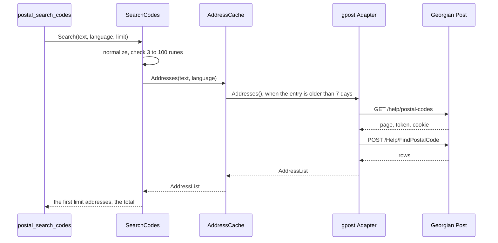

# Specification: The postal codes of Georgian Post

## 1. Summary

This feature adds the vendor client module `pkg/gpost`, which reads the search of postal
codes of the page of Georgian Post, and the context `postal` with one tool,
`postal_search_codes`. Each search that the cache does not hold visits the page for a
token, then sends the search. `ADR-0003` lets the client read a web page.

## 2. Coverage

| Requirement         | Where this specification realizes it                          |
| ------------------- | ------------------------------------------------------------- |
| `POSTCODE-FR-001`   | 4.1 `pkg/gpost`, `adapter/gpost`. 4.3 tool. `POSTCODE-DD-002` |
| `POSTCODE-FR-002`   | 4.2 `SearchCodes`. `POSTCODE-DD-006`                          |
| `POSTCODE-FR-003`   | 4.3 tool, `language`. `POSTCODE-DD-004`                       |
| `POSTCODE-FR-004`   | `POSTCODE-DD-004`, `POSTCODE-SC-005`                          |
| `POSTCODE-FR-005`   | 4.2 `SearchCodes`, `ErrInvalidQuery`. `POSTCODE-DD-005`       |
| `POSTCODE-FR-006`   | 4.3 tool, `limit`. `POSTCODE-DD-006`                          |
| `POSTCODE-FR-007`   | 4.3 tool, `total`. `POSTCODE-DD-006`                          |
| `POSTCODE-FR-008`   | 4.3 tool, `note`. `POSTCODE-DD-009`                           |
| `POSTCODE-FR-009`   | 4.5. `POSTCODE-DD-003`, `POSTCODE-DD-008`                     |
| `POSTCODE-FR-010`   | 4.3 configuration                                             |
| `POSTCODE-NFR-001`  | 4.3 cache. `POSTCODE-SC-016`                                  |
| `POSTCODE-NFR-002`  | 4.3 cache. `POSTCODE-SC-017`                                  |
| `POSTCODE-NFR-003`  | 4.3 cache. `POSTCODE-SC-018`                                  |
| `POSTCODE-NFR-004`  | `POSTCODE-DD-001`. `POSTCODE-SC-001`                          |
| `POSTCODE-NFR-005`  | 4.3 configuration. `POSTCODE-DD-007`, `POSTCODE-SC-019`       |
| `POSTCODE-NFR-006`  | 4.1 `pkg/gpost`. `POSTCODE-SC-001`                            |
| `POSTCODE-INV-001`  | 4.2 `PostalCode`. `POSTCODE-DD-008`                           |
| `POSTCODE-INV-002`  | 4.2 `Address`. `POSTCODE-DD-003`                              |

## 3. Guideline compliance

| Rule                   | How this specification obeys it                                                 |
| ---------------------- | ------------------------------------------------------------------------------- |
| `ARC-004`, `CLT-001`   | `pkg/gpost` is a module: `github.com/abgeo/georgia-mcp/pkg/gpost`, `go 1.26.0`. |
| `ARC-008`              | `postal` imports no other context.                                              |
| `ARC-009`, `CFG-004`   | `bootstrap` builds the module of `postal` from `Config.Postal`.                 |
| `CLT-002` to `CLT-005` | Under `ADR-0003`: `golang.org/x/net/html` `v0.61.0`, `Accept: text/html`. The search answer is HTML too. |
| `CLT-007`              | A status that is not 200 on either call is an `*APIError`.                      |
| `CLT-008`              | No retry, no cache. The token and the cookie live inside one call of `PostalCodes`. `POSTCODE-DD-001`. |
| `CLT-009`, `CLT-011`   | The package comment and the README say that the source is a web page, not an API. `v0`. |
| `DOM-003`              | `PostalCode` has the validating constructor `ParsePostalCode`.                  |
| `DOM-005`, `DOM-011`   | `adapter/gpost` checks each postal code and wraps `kernel.ErrSourceUnavailable`. |
| `DOM-009`, `DOM-010`   | One port, `PostalCodeSource`. One use case, `SearchCodes`.                      |
| `MCP-002` to `MCP-009` | 4.3 tool. `POSTCODE-DD-010`.                                                    |
| `RSL-001`, `RSL-008`   | `vendors.Config.ClientOptions` gives the timeout and the limit.                 |
| `RSL-003` to `RSL-006` | `adapter/cache.AddressCache`. 4.3 cache.                                        |
| `CFG-003`, `CFG-008`   | Each variable has the prefix `GEOMCP_POSTAL_GPOST_`. The switch is on by default. |
| `LOG-004`              | The logger of the module carries `context=postal`.                              |
| `TST-006`              | `pkg/gpost/testdata/` holds the answers of 2026-10-24. Each token is `test-token`. |
| `TST-009`              | `ParsePostalCode` has a fuzz test.                                              |

## 4. Design

### 4.1 Components

Every path is new unless the table says "change". `P` is `internal/app/georgia-mcp/postal`.

| Layer          | Path                                  | Types and functions                                            |
| -------------- | ------------------------------------- | -------------------------------------------------------------- |
| Vendor client  | `pkg/gpost/`                          | `Client`, `New`, `Option`, `PostalCodeRow`, `APIError`, `ErrUnexpectedStatus`, `ErrNoToken`, `ErrMalformedResult`. |
| Domain         | `P/domain/`                           | `PostalCode`, `ParsePostalCode`, `Address`, `ErrInvalidPostalCode`. |
| Use case       | `P/app/`                              | `PostalCodeSource`, `AddressList`, `SearchCodes`, `CodeQuery`, `Codes`, `ErrInvalidQuery`. |
| Driven adapter | `P/adapter/gpost/`                    | `Adapter`, `NewAdapter`.                                       |
| Cache          | `P/adapter/cache/`                    | `AddressCache`, `NewAddressCache`.                             |
| Tool           | `P/adapter/tool/`                     | `Register`, `UseCases`, the structs of 4.3.                    |
| Module         | `P/module.go`, `P/config.go`          | `Module`, `New`, `Register`, `Close`, `Config`, `Defaults`.    |
| Composition    | `internal/app/georgia-mcp/bootstrap/` (change) | `Config.Postal` with `envPrefix:"POSTAL_"`. `modules.go` builds `postal.New` after `offers`. |
| Configuration  | `configs/.env.example` (change)       | The variables of 4.3.                                          |
| Workspace      | `go.work` (change)                    | `use ./pkg/gpost`.                                             |
| Documentation  | `README.md` (change)                  | The tool in the list of tools.                                 |

**`pkg/gpost`.** The shape of `pkg/rompetrol`, with one method.

```go
const DefaultBaseURL = "https://www.gpost.ge"

var (
    ErrUnexpectedStatus = errors.New("gpost: unexpected status")
    ErrNoToken          = errors.New("gpost: no anti-forgery token")
    ErrMalformedResult  = errors.New("gpost: malformed search result")
)

type APIError = vendorhttp.StatusError

func New(opts ...Option) *Client // the options of vendorhttp

// PostalCodes visits the page of postal codes, then searches text. lang is ka or en.
func (c *Client) PostalCodes(ctx context.Context, text, lang string) ([]PostalCodeRow, error)

// PostalCodeRow is one address of the search answer, as the page shows it.
type PostalCodeRow struct {
    District string // "თბილისი", or "Tbilisi City"
    Code     string // "0186"
    Address  string // "ქალაქი თბილისი, ამბერკი ტაბიძის ქუჩა"
}
```

`PostalCodes` sends two calls with `vendorhttp.Client.Do`. `POSTCODE-DD-001` gives them.
The body limit is the default 1 MiB: the broadest answer of the probe is 50 KB. The
default User-Agent is `georgia-mcp-gpost/<version> (+https://github.com/abgeo/georgia-mcp)`.
The client reads the cookie with `http.ParseSetCookie` on each `Set-Cookie` value of
the first answer. `POSTCODE-DD-002` and `POSTCODE-DD-003` give the parse. The client does
not check a postal code (`CLT-003`).

**`adapter/gpost`.** `NewAdapter(client *gpostclient.Client, now func() time.Time)`.
`Addresses` calls `PostalCodes` with the language code and converts each row:

| Row             | Domain value                                         |
| --------------- | ---------------------------------------------------- |
| `Code`          | `domain.ParsePostalCode`. `POSTCODE-DD-008`.         |
| `Address`       | `Address.Text`.                                      |
| `District`      | `Address.District`.                                  |

`ReadAt` is `now()` in `kernel.TbilisiZone()` after the answer. Each failure returns an
error that wraps `kernel.ErrSourceUnavailable`: an error of the client, and a postal
code that `ParsePostalCode` refuses. An empty list is a valid answer.

**`module.go`.** The shape of `transit/module.go`. When `cfg.GPost.Enabled` is false,
`New` logs at info level `Georgian Post is off` with the attribute
`variable=GEOMCP_POSTAL_GPOST_ENABLED`, and `Register` adds no tool.

### 4.2 Domain model

```go
// domain
type PostalCode struct{ code string }

// ParsePostalCode returns the postal code of a text of exactly 4 ASCII digits.
func ParsePostalCode(text string) (PostalCode, error) // else ErrInvalidPostalCode
func (c PostalCode) String() string                   // "0186"

// Address is a read model: an address of Georgian Post with its postal code.
type Address struct {
    Text     string     // "ქალაქი თბილისი, ამბერკი ტაბიძის ქუჩა"
    District string     // "თბილისი"
    Code     PostalCode
}

var ErrInvalidPostalCode = errors.New("postal code: invalid")
```

```go
// app/port.go
type AddressList struct {
    Addresses []domain.Address // in the order of Georgian Post
    ReadAt    time.Time
    Stale     bool
}

type PostalCodeSource interface {
    Addresses(ctx context.Context, text string, language kernel.Language) (AddressList, error)
}

// app/codes.go
type CodeQuery struct {
    Text     string
    Language kernel.Language
    Limit    int // 1 to 100; the tool gives the default
}

type Codes struct {
    Addresses []domain.Address // the first Limit addresses
    Total     int              // the count of addresses that Georgian Post matched
    ReadAt    time.Time
    Stale     bool
}

func NewSearchCodes(source PostalCodeSource) *SearchCodes
func (s *SearchCodes) Search(ctx context.Context, query CodeQuery) (Codes, error)

// app/errors.go
var ErrInvalidQuery = errors.New("query: invalid")
```

`Search` normalizes the text (`POSTCODE-DD-005`). A text of fewer than 3 or more than
100 runes after it returns `ErrInvalidQuery` before a call. It reads the source, then
cuts the list to the limit (`POSTCODE-DD-006`).

### 4.3 Declarations

**MCP tool.**

| Tool                  | Input                                       | Output        | Errors | Realizes |
| --------------------- | ------------------------------------------- | ------------- | ------ | -------- |
| `postal_search_codes` | `query` (required), `language`, `limit`     | `codesOutput` | 4.5    | `POSTCODE-FR-001` to `POSTCODE-FR-008` |

Title: `Search the postal codes of Georgia`. Description:

> Finds the postal codes of Georgian Post for an address, a street, a town, or a village
> of Georgia, by text in Georgian or English. Returns each matching address with its
> 4-digit postal code and its district. Georgian Post gives a postal code for each street
> in Tbilisi, Batumi, and Kutaisi only. For another town or a village, search its name.
> Data from the web page of Georgian Post.

```go
type searchCodesInput struct {
    Query    string `json:"query"              jsonschema:"An address, a street, a town, or a village of Georgia, in Georgian or English. 3 to 100 characters."`
    Language string `json:"language,omitempty" jsonschema:"The language of the addresses: ka or en. The default is en."`
    Limit    int    `json:"limit,omitempty"    jsonschema:"The maximum count of addresses, 1 to 100. The default is 20."`
}

type codesOutput struct {
    Source    string          `json:"source"         jsonschema:"The source of the data: Georgian Post."`
    AsOf      string          `json:"as_of"          jsonschema:"The instant at which the server read the postal codes, RFC 3339."`
    Stale     bool            `json:"stale"          jsonschema:"True when Georgian Post did not answer and the server returns postal codes it read before."`
    Total     int             `json:"total"          jsonschema:"The count of addresses that Georgian Post matched. More than the count of addresses when the limit cut the list."`
    Addresses []addressOutput `json:"addresses"      jsonschema:"The matching addresses, in the order of Georgian Post."`
    Note      string          `json:"note,omitempty" jsonschema:"How to search again, when the list is empty."`
}

type addressOutput struct {
    PostalCode string `json:"postal_code" jsonschema:"The postal code: 4 digits as a string. It can start with 0."`
    Address    string `json:"address"     jsonschema:"The address as Georgian Post writes it: the settlement, then the street. A part in parentheses limits the postal code to some house numbers."`
    District   string `json:"district"    jsonschema:"The city or the municipality under which Georgian Post groups the address."`
}
```

`source` is `Georgian Post`. `as_of` is `ReadAt` in `kernel.TbilisiZone()`, written with
`time.RFC3339`. A `limit` of 0 asks the default.

**Vendor endpoint.** Every row: `pkg/gpost`, no key, no, a web page for people.

| Method and path              | Realizes                                         |
| ---------------------------- | ------------------------------------------------ |
| `GET /help/postal-codes`     | `POSTCODE-FR-009`, `POSTCODE-NFR-004`            |
| `POST /Help/FindPostalCode`  | `POSTCODE-FR-001` to `POSTCODE-FR-004`           |

Real answers, recorded on 2026-10-24, cut:

```
GET https://www.gpost.ge/help/postal-codes   Cookie: lang=ka
200 text/html (59489 bytes)
Set-Cookie: __RequestVerificationToken=<cookie token>; path=/; HttpOnly
<form action="/help/postal-codes" id="__AjaxAntiForgeryForm" method="post">
  <input name="__RequestVerificationToken" type="hidden" value="<form token>" /></form>

POST https://www.gpost.ge/Help/FindPostalCode
Cookie: __RequestVerificationToken=<cookie token>; lang=ka
__RequestVerificationToken=<form token>&regionTypeId=1&postalCodeSearchValue=რუსთავი
200 text/html (12 rows)
<div class="com-district com-cl-pal-02">
    რუსთავი
</div>
<div data-grid-type="postcode-list" data-grid-gap="2x" class="com-district-list">
  <div data-grid-cell="" class="com-cell-postcode">
    <div class="com-pad">
      <div class="com-postcode-name com-cl-pal-02">3700</div>
      <div class="com-location-name">ქალაქი რუსთავი</div>
  ...
  <div data-grid-cell="" data-card-visibility="gone" class="com-cell-postcode com-hide">

POST ... postalCodeSearchValue=ზზზზზქქ
200 text/html: a <p> with the rules of the search, and no row.
```

**Cache.**

| Port method                         | Key                                  | Time to live | Maximum stale | Entries | Realizes |
| ----------------------------------- | ------------------------------------ | ------------ | ------------- | ------- | -------- |
| `PostalCodeSource.Addresses`        | the normalized text and the language | 7 days       | 23 days       | 4096    | `POSTCODE-NFR-001` to `POSTCODE-NFR-003` |

The maximum stale counts after the time to live, so a stale list is at most 30 days old.

**Configuration.**

| Variable                        | Type     | Default                | Secret | Realizes           |
| ------------------------------- | -------- | ---------------------- | ------ | ------------------ |
| `GEOMCP_POSTAL_GPOST_ENABLED`   | bool     | `true`                 | No     | `POSTCODE-FR-010`  |
| `GEOMCP_POSTAL_GPOST_BASE_URL`  | URL      | `https://www.gpost.ge` | No     | `POSTCODE-FR-001`  |
| `GEOMCP_POSTAL_GPOST_TIMEOUT`   | duration | `10s`                  | No     | `RSL-001`          |
| `GEOMCP_POSTAL_GPOST_RATE`      | float    | `1`                    | No     | `POSTCODE-NFR-005` |
| `GEOMCP_POSTAL_GPOST_BURST`     | int      | `1`                    | No     | `POSTCODE-NFR-005` |

`postal.Config` holds `GPost vendors.Config` with `envPrefix:"GPOST_"`. `postal.Defaults`
gives `vendors.Defaults("https://www.gpost.ge").WithLimit(1, 1)` (`PLATFORM-DD-014`).

### 4.4 Flow



### 4.5 Errors

| Condition                              | Sentinel                      | Tool message |
| -------------------------------------- | ----------------------------- | ------------ |
| A language other than `ka` and `en`    | `kernel.ErrUnknownLanguage`   | `language: "ru" is not a language of this tool. Use ka or en.` |
| A short or long query                  | `app.ErrInvalidQuery`         | `query: give 3 to 100 characters.` |
| A limit out of range                   | none, the tool checks it      | `limit: 500 is out of range. Use 1 to 100.` |
| Georgian Post fails, with no stale list | `kernel.ErrSourceUnavailable` | `Georgian Post did not answer. Try again in a few minutes.` |
| Any other error                        | none                          | `The server failed to read the data of Georgian Post.` |

## 5. Design decisions

### `POSTCODE-DD-001`

**Realizes:** `POSTCODE-NFR-004`, `POSTCODE-NFR-006`
**Decision:** `PostalCodes` sends two calls, and keeps the token and the cookie in local
variables only:

1. `GET /help/postal-codes` with the header `Cookie: lang=<lang>`. The form token is the
   `value` of the `input` named `__RequestVerificationToken` inside the `form` with
   `id="__AjaxAntiForgeryForm"`. The cookie token is the `Set-Cookie` named
   `__RequestVerificationToken`.
2. `POST /Help/FindPostalCode` with the body
   `__RequestVerificationToken=<form token>&regionTypeId=1&postalCodeSearchValue=<text>`,
   and the headers `Content-Type: application/x-www-form-urlencoded`,
   `X-Requested-With: XMLHttpRequest`, `Referer: <base URL>/help/postal-codes`, and
   `Cookie: __RequestVerificationToken=<cookie token>; lang=<lang>`.

**Rationale:** The owner chose no state between two searches (requirements, question 2).
The client stays inside `CLT-008`, and needs no ADR. The page sends `regionTypeId=1` in
a hidden field with no other value. The form of the page sends the two headers.
**Alternatives:** A token that the adapter keeps and renews on a 500. It saves one call
of two, and needs a retry and an ADR.

### `POSTCODE-DD-002`

**Realizes:** `POSTCODE-FR-001`, `ADR-0003`
**Decision:** The client parses the answer with `html.Parse`, and walks the nodes in
the order of the document. An element whose `class` holds the token `com-district`
starts a district: its text. An element whose `class` holds the token
`com-cell-postcode` is a row: the text of its descendant with the class
`com-postcode-name` is the code, and the text of its descendant with the class
`com-location-name` is the address. The text of a node follows `ROMFUEL-DD-001`. A row
with the class `com-hide` is a row.
**Rationale:** The classes are the only marks of the answer. The page hides each row
after the sixth until a person clicks. The hidden rows are part of the answer.
**Alternatives:** The attribute `data-grid-cell`. The page uses it for other grids.

### `POSTCODE-DD-003`

**Realizes:** `POSTCODE-FR-009`, `POSTCODE-INV-002`
**Decision:** The client returns `ErrMalformedResult` for a row before any district, a
row with no code or no address, and an answer with no row and no `p` element. An answer
with no row and a `p` element is an empty list. The client returns `ErrNoToken` when the
page has no form token or the answer has no cookie token.
**Rationale:** An answer with no match holds the rules of the search in a `p`. An answer
with neither rows nor that `p` means a change of the page, and an empty list then hides
the failure.
**Alternatives:** A match on the text of the rules. The text differs in each language.

### `POSTCODE-DD-004`

**Realizes:** `POSTCODE-FR-003`, `POSTCODE-FR-004`
**Decision:** The client sends the language as the cookie `lang` on both calls. It
sends the text of the person unchanged in either language.
**Rationale:** The link of the site to English sets the cookie `lang=en`. On
2026-10-24, `Rustavi` and `რუსთავი` gave the same 12 rows in the same order.
**Alternatives:** The address `/language/index?lang=en` before each search. It adds a
third call.

### `POSTCODE-DD-005`

**Realizes:** `POSTCODE-FR-005`, `POSTCODE-NFR-003`
**Decision:** `Search` removes the spaces at the ends and writes each inner run of white
space as one space. It counts runes. The cache key is that text and the language. The
server does not change the case.
**Rationale:** A Georgian letter has no case. The probe did not test the case of an
English text, so a change of case can change the answer.
**Alternatives:** A lowercase key. It shares more entries, with an answer that can be
wrong.

### `POSTCODE-DD-006`

**Realizes:** `POSTCODE-FR-002`, `POSTCODE-FR-006`, `POSTCODE-FR-007`
**Decision:** The cache holds the full list of Georgian Post. `Search` keeps the order,
cuts the list to the limit, and sets `Total` to the length of the full list. The tool
writes `total` on each answer.
**Rationale:** One entry serves each limit. The broadest answer of the probe has 101
rows, so the full list is small.
**Alternatives:** `total` only when the limit cuts the list. A field that comes and goes
is harder for a model to read.

### `POSTCODE-DD-007`

**Realizes:** `POSTCODE-NFR-005`
**Decision:** The limit is 1 call each second with a burst of 1.
**Rationale:** A token bucket lets through at most its burst plus its rate in one second:
2 calls. One search then takes about 1 second.
**Alternatives:** 2 calls each second with a burst of 2. It lets 4 calls through in one
second.

### `POSTCODE-DD-008`

**Realizes:** `POSTCODE-FR-009`, `POSTCODE-INV-001`
**Decision:** The adapter parses each code with `ParsePostalCode`. One code that it
refuses fails the whole answer with `kernel.ErrSourceUnavailable`.
**Rationale:** A code that is not 4 digits means a change of the page. A partial list
can hide the address that the person asks for.
**Alternatives:** Leave out the bad row. The model then reads a list that looks
complete.

### `POSTCODE-DD-009`

**Realizes:** `POSTCODE-FR-008`
**Decision:** When the list is empty, the tool sets `note` to: `Georgian Post found no
address. In Tbilisi, Batumi, and Kutaisi, give a street. For another town or a village,
give only its name, for example Rustavi.`
**Rationale:** The text repeats the rules of the page, in English for the model.
**Alternatives:** The text of the page. It is in the language of the request, and holds
markup.

### `POSTCODE-DD-010`

**Realizes:** `POSTCODE-FR-001`
**Decision:** The tool name is `postal_search_codes`.
**Rationale:** `MCP-002` gives `search` for a list that a text filters. The context
`postal` already names the subject. `postal_search_postal_codes` repeats it (`PKG-005`).
**Alternatives:** `postal_search_postal_codes`.

## 6. Scenarios

`pkg/gpost/testdata/` holds the answers that the tests serve. Each token is `test-token`.

| File                        | Content                                                           |
| --------------------------- | ----------------------------------------------------------------- |
| `postal-codes.html`         | The real answer of `GET /help/postal-codes`, 2026-10-24.          |
| `postal-codes-no-form.html` | A copy with the form `__AjaxAntiForgeryForm` removed.             |
| `find-chavchavadze-ka.html` | The real answer for `ჭავჭავაძის` in `ka`: 63 rows, 3 districts.    |
| `find-rustavi-en.html`      | The real answer for `რუსთავი` in `en`: 12 rows, 3 districts.      |
| `find-none-ka.html`         | The real answer for `ზზზზზქქ` in `ka`: the `p`, no row.            |
| `find-malformed.html`       | A copy of `find-rustavi-en.html`. The first row has no code. A second copy holds a code `370`. |

An integration test serves the files from `httptest` and calls the tool through the
in-memory MCP transport.

| ID                | Verifies | Layer | Given, when, then |
| ----------------- | -------- | ----- | ----------------- |
| `POSTCODE-SC-001` | `POSTCODE-NFR-004`, `POSTCODE-NFR-006` | unit | A server records each request. `PostalCodes(ctx, "რუსთავი", "ka")` sends exactly `GET /help/postal-codes`, then `POST /Help/FindPostalCode`. Both carry a User-Agent that starts with `georgia-mcp-gpost/` and holds `https://github.com/abgeo/georgia-mcp`. |
| `POSTCODE-SC-002` | `POSTCODE-FR-001` | unit | The POST carries the form token in the body, `regionTypeId=1`, the text, and the cookie `__RequestVerificationToken=test-token; lang=ka`. |
| `POSTCODE-SC-003` | `POSTCODE-FR-001` | unit | `find-chavchavadze-ka.html` gives 63 rows. The first is `{"თბილისი", "0108", "ქალაქი თბილისი, ალექსანდრე ჭავჭავაძის I ჩიხი"}`. Rows 56 to 59 have the district `ბათუმი`. A hidden row is in the list. |
| `POSTCODE-SC-004` | `POSTCODE-FR-001` | unit | `find-none-ka.html` gives an empty list and no error. |
| `POSTCODE-SC-005` | `POSTCODE-FR-003`, `POSTCODE-FR-004` | unit | `PostalCodes(ctx, "Rustavi", "en")` sends the cookie `lang=en` on both calls. `find-rustavi-en.html` gives the first row `{"Rustavi City", "3700", "City Rustavi"}`. |
| `POSTCODE-SC-006` | `POSTCODE-FR-009` | unit | `postal-codes-no-form.html`, and a page with no `Set-Cookie`, each give `ErrNoToken` and send no POST. |
| `POSTCODE-SC-007` | `POSTCODE-FR-009` | unit | `find-malformed.html` gives `ErrMalformedResult`. A row before a district, and an answer with no row and no `p`, give it too. |
| `POSTCODE-SC-008` | `POSTCODE-FR-009` | unit | A 500 on the GET, and a 500 on the POST, give an `*APIError` with 500. `errors.Is(err, ErrUnexpectedStatus)` holds. |
| `POSTCODE-SC-009` | `POSTCODE-INV-001` | unit | `ParsePostalCode`: `0186` is valid and keeps `"0186"`. `186`, `01860`, `01a6`, `٠١٨٦`, and the empty text give `ErrInvalidPostalCode`. A fuzz test holds that each valid result has 4 ASCII digits. |
| `POSTCODE-SC-010` | `POSTCODE-FR-009` | unit | The adapter with the second copy of `find-malformed.html` (`370`) returns an error that wraps `kernel.ErrSourceUnavailable`. A client error wraps it too. |
| `POSTCODE-SC-011` | `POSTCODE-FR-005` | unit | `Search` with `ab`, `  ab  `, and 101 runes returns `ErrInvalidQuery` and calls no source. `ვაკე` calls the source with `ვაკე`. `"  ილია   ჭავჭავაძის "` calls it with `ილია ჭავჭავაძის`. |
| `POSTCODE-SC-012` | `POSTCODE-FR-002`, `POSTCODE-FR-006`, `POSTCODE-FR-007` | unit | A fake source with 63 addresses. The limit 20 gives the first 20 in order and `Total` 63. The limit 100 gives 63 and `Total` 63. |
| `POSTCODE-SC-013` | `POSTCODE-FR-006` | integration | The tool with `limit` 500, and with `limit` -1, returns `IsError` with `limit: 500 is out of range. Use 1 to 100.` No limit gives 20 addresses. |
| `POSTCODE-SC-014` | `POSTCODE-FR-001`, `POSTCODE-FR-003`, `POSTCODE-FR-008` | integration | The tool with `რუსთავი` and no language: `source` is `Georgian Post`, `as_of` has the offset `+04:00`, `total` is 12, the first address has `postal_code` `"3700"`. With `ზზზზზქქ`: `addresses` is `[]`, `total` is 0, `note` is the text of `POSTCODE-DD-009`. With `ru`: the message of 4.5. |
| `POSTCODE-SC-015` | `POSTCODE-FR-009` | integration | The vendor answers 500, with an empty cache. The tool returns `IsError` with `Georgian Post did not answer. Try again in a few minutes.` |
| `POSTCODE-SC-016` | `POSTCODE-NFR-001` | unit | In `synctest`, a search, then the same search after 6 days 23 hours, sends one load. After 7 days, it sends a second load. |
| `POSTCODE-SC-017` | `POSTCODE-NFR-002` | unit | In `synctest`, the source fails with `kernel.ErrSourceUnavailable` after one read. At 8 days, the cache returns the list with `Stale` true. At 30 days and 1 second, it returns the error. |
| `POSTCODE-SC-018` | `POSTCODE-NFR-003` | integration | Two tool calls with `რუსთავი` and `ka` send 2 calls to the vendor in total. A third call with `en` sends 2 more. |
| `POSTCODE-SC-019` | `POSTCODE-NFR-005` | unit | `postal.Defaults().GPost.HTTP` has the rate 1 and the burst 1. |
| `POSTCODE-SC-020` | `POSTCODE-FR-010` | unit | `postal.New` with `Enabled` false registers no tool. The default configuration registers `postal_search_codes`. |
| `POSTCODE-SC-021` | `POSTCODE-FR-001` | live | `PostalCodes(ctx, "ამბერკი", "ka")` against `www.gpost.ge` holds the row with `0186` and `ქალაქი თბილისი, ამბერკი ტაბიძის ქუჩა`. |

## 7. Build plan

| #   | Step                                                                          | Realizes                                | Done |
| --- | ----------------------------------------------------------------------------- | --------------------------------------- | ---- |
| 1   | `pkg/gpost` module, recorded answers, README, example, live test. `go.work`.  | `POSTCODE-FR-001`, `POSTCODE-FR-009`, `POSTCODE-NFR-004`, `POSTCODE-NFR-006` | [ ]  |
| 2   | `domain`: `PostalCode`, `Address`, errors, fuzz test.                         | `POSTCODE-INV-001`, `POSTCODE-INV-002`  | [ ]  |
| 3   | `app`: port, `SearchCodes`, errors.                                           | `POSTCODE-FR-002`, `POSTCODE-FR-005` to `POSTCODE-FR-007` | [ ]  |
| 4   | `adapter/gpost`.                                                              | `POSTCODE-FR-009`                       | [ ]  |
| 5   | `adapter/cache`.                                                              | `POSTCODE-NFR-001` to `POSTCODE-NFR-003` | [ ]  |
| 6   | `adapter/tool`.                                                               | `POSTCODE-FR-001` to `POSTCODE-FR-008`  | [ ]  |
| 7   | `module.go`, `config.go`, `bootstrap`, `configs/.env.example`, `README.md`.   | `POSTCODE-FR-010`, `POSTCODE-NFR-005`   | [ ]  |
| 8   | Move the terms of section 5 of the requirements to the glossary, in a section Postal. | `DOM-002`                       | [x]  |

## 8. Out of scope for this specification

The page of the tool on the website (`website/src/data/definitions.json`,
`recordings.json`) and the list of tools of `build/openai-plugin/plugin.json`. A change
of `WEBSITE` adds them after the tool exists.

## Retired identifiers

This file has no retired identifier.
