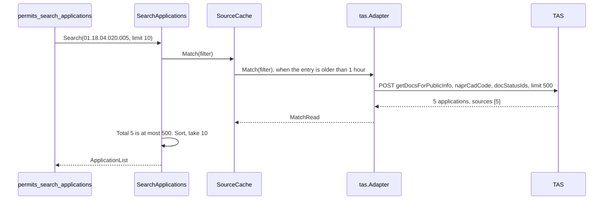

# Specification: The applications of the Tbilisi Architecture Service

## 1. Summary

This feature adds the vendor client `pkg/tas` for one DWR method of
`docs.tbilisi.gov.ge/architect`, the context `permits`, and two tools:
`permits_search_applications` and `permits_get_application`. `spec-client.md` holds the
client and the recorded answers. `spec-tools.md` holds the structs of the tools.

## 2. Coverage

| Requirement       | Where this specification realizes it                          |
| ----------------- | ------------------------------------------------------------- |
| `TASPERM-FR-001`  | 4.2 `SearchApplications`, `SortApplications`. 4.3 `permits_search_applications` |
| `TASPERM-FR-002`  | 4.2 `NewPeriod`. 4.1 `adapter/tas`, the bounds of a day        |
| `TASPERM-FR-003`  | 4.2 `SearchFilter`. 4.5                                       |
| `TASPERM-FR-004`  | 4.2 `TooManyMatchesError`. `TASPERM-DD-002`                   |
| `TASPERM-FR-005`  | 4.1 `adapter/tas`, the table of statuses. `TASPERM-DD-003`    |
| `TASPERM-FR-006`  | 4.2 `ParseApplicationNumber`, `GetApplication`. 4.3 `permits_get_application` |
| `TASPERM-FR-007`  | 4.2 `Application`. `spec-tools.md`, `applicationOutput`. `TASPERM-DD-004` |
| `TASPERM-FR-008`  | 4.2 `SearchApplications`. `spec-tools.md`, `limit` and `total` |
| `TASPERM-FR-009`  | `spec-tools.md`, the names of the statuses                    |
| `TASPERM-FR-010`  | 4.5. `TASPERM-SC-017`                                         |
| `TASPERM-FR-011`  | 4.3 configuration. `TASPERM-SC-022`                           |
| `TASPERM-NFR-001` | 4.3 cache. `TASPERM-SC-018`, `TASPERM-SC-019`                 |
| `TASPERM-NFR-002` | 4.4. `TASPERM-SC-020`                                         |
| `TASPERM-NFR-003` | 4.3 configuration. `TASPERM-DD-005`, `TASPERM-SC-021`         |
| `TASPERM-NFR-004` | 4.4. `TASPERM-SC-023`                                         |
| `TASPERM-NFR-005` | `spec-client.md`. `TASPERM-SC-001`                            |
| `TASPERM-INV-001` | `spec-client.md`, `Document`. `TASPERM-SC-009`                |
| `TASPERM-INV-002` | 4.1 `adapter/tas`. `TASPERM-SC-009`, `TASPERM-SC-010`         |

## 3. Guideline compliance

| Rule                   | How this specification obeys it                                             |
| ---------------------- | --------------------------------------------------------------------------- |
| `ARC-004`, `CLT-001`   | `pkg/tas` is a package of the server module.                                |
| `ARC-008`, `DOM-008`   | `permits` imports no other context. It has its own `CadastralCode`. `TASPERM-DD-001` |
| `ARC-009`, `CFG-004`   | `bootstrap` builds the module of `permits` from `Config.Permits`.           |
| `CLT-002` to `CLT-005` | Standard library and `pkg/vendorhttp` only. The adapter reads HTML with `x/net/html`. |
| `CLT-007`              | A status that is not 200 is an `*APIError`. A reply with no callback is `ErrInvalidReply`. |
| `CLT-008`, `RSL-002`   | No retry, no cache in the client or the adapter.                            |
| `CLT-009`              | The package comment and the README say that the method has no documentation. |
| `DOM-003`, `TST-009`   | `ParseCadastralCode`, `ParseApplicationNumber`, `NewPeriod`, the scanner, and the HTML reader have fuzz tests. |
| `DOM-005`, `DOM-011`   | `adapter/tas` converts each shape and wraps `kernel.ErrSourceUnavailable`.  |
| `DOM-009`, `DOM-010`   | One port. Two use cases, one method each.                                   |
| `MCP-002` to `MCP-009` | 4.3 tools.                                                                  |
| `RSL-001`, `RSL-008`   | `vendors.Config.ClientOptions` gives the timeout and the limit.             |
| `RSL-003` to `RSL-006` | `adapter/cache`. 4.3 cache.                                                 |
| `CFG-003`, `CFG-008`   | Each variable has the prefix `GEOMCP_PERMITS_TAS_`. The switch is on by default. |
| `LOG-004`              | The logger of the module carries `context=permits`.                         |
| `TST-006`              | `pkg/tas/testdata/` holds the answers of 2026-11-15. Each `userId` is `0`.  |

## 4. Design

### 4.1 Components

Every path is new unless the table says "change". `P` is `internal/app/georgia-mcp/permits`.

| Layer          | Path                     | Types and functions                                         |
| -------------- | ------------------------ | ----------------------------------------------------------- |
| Vendor client  | `pkg/tas/`               | `spec-client.md`.                                           |
| Domain         | `P/domain/`              | The types of 4.2, `domain`.                                 |
| Use case       | `P/app/`                 | The types of 4.2, `app`.                                    |
| Driven adapter | `P/adapter/tas/`         | `Adapter`, `NewAdapter`, the HTML reader.                   |
| Cache          | `P/adapter/cache/`       | `SourceCache`, `NewSourceCache`.                            |
| Tool           | `P/adapter/tool/`        | `Register`, `UseCases`, the structs of 4.3.                 |
| Module         | `P/doc.go`, `P/module.go`, `P/config.go` | `Module`, `New`, `Register`, `Close`, `Config`, `Defaults`. |
| Composition    | `internal/app/georgia-mcp/bootstrap/` (change) | `Config.Permits` with `envPrefix:"PERMITS_"`. `modules.go` builds `permits.New` after `parcels`. |
| Configuration  | `configs/.env.example` (change) | The variables of 4.3.                                |
| Documentation  | `README.md` (change)     | The two tools in the list of tools.                         |

**`adapter/tas`.** `NewAdapter(client *tasclient.Client, now func() time.Time)`.

The statuses of the page of TAS, `TASPERM-FR-005`:

| TAS `documentStatusId` | `domain.Status` |
| ---------------------- | --------------- |
| 1                      | `approved`      |
| 2                      | `refused`       |
| 7                      | `deficient`     |
| 12                     | `conditional`   |
| 11                     | `not_reviewed`  |
| 27                     | `revoked`       |
| 28                     | `completed`     |
| 25                     | `awaiting_payment` |
| 5, 6, 9, 20, 21, 26    | `in_review`     |

Each call sends these 14 codes as `StatusIDs`.

`Match(filter)`: one `SearchDocuments` with `Start` 0 and `Limit` `domain.MaxMatches`. A
code goes as `CadastralCode`. A period goes as `From`, midnight of its first day in
`kernel.TbilisiZone()`, and `To`, the last millisecond of its last day. `Total` is
`Page.Total`. Each document converts with no decision text.

`Application(number)`: one `SearchDocuments` with `DocumentNo` the number and `Limit` 50.
The number is a prefix at TAS, so the adapter keeps the document whose `DocumentNo` equals
the number. None gives `app.ErrApplicationNotFound`. It converts with the decision text.

Convert:

| Vendor field                     | Domain value                                                       |
| -------------------------------- | ------------------------------------------------------------------ |
| `DocumentNo`                     | `domain.ParseApplicationNumber`.                                   |
| `DocumentID`                     | `URL` `https://tas.ge/?p=publicpage&documentId=<id>`.              |
| `Address`                        | Trimmed, runs of spaces as one space. Words unchanged.             |
| `RegistrationDate`               | `kernel.Today` of the instant. Absent fails.                       |
| `DeadLineDate`                   | `kernel.Today` of the instant, or no deadline when absent.         |
| `DocumentStatusID`               | The table above. Another code fails.                               |
| `CategoryName`, `ParentCategoryName`, `ActionName`, `ExecutorName` | Trimmed, runs of spaces as one space. |
| `ClassName`                      | The first word: `IV კლასი` gives `IV`.                              |
| `Stadiums`                       | Trimmed. An empty stage is left out.                               |
| `ResponseText`                   | The HTML reader. `TASPERM-DD-004`                                  |

A text that is empty, `-`, or only quotation marks and spaces after the trim is absent.
`ReadAt` is `now()` in `kernel.TbilisiZone()` after the call. A client error, an
`ErrInvalidReply`, an `ErrRemote`, an invalid number, an absent date of registration, or
an unknown status gives an error that wraps `kernel.ErrSourceUnavailable`.

**HTML reader.** `plainText(html string) string` reads the tokens with `x/net/html`. A text
token passes, with its entities decoded. `p`, `br`, `div`, `li`, `tr`, and `h1` to `h6`
end a line. Each line is trimmed, with runs of spaces as one space. Empty lines go, and the
lines join with `\n`.

### 4.2 Domain model

```go
// domain

var (
    ErrInvalidCadastralCode     = errors.New("cadastral code: invalid")
    ErrInvalidApplicationNumber = errors.New("application number: invalid")
    ErrInvalidPeriod            = errors.New("period: the start is after the end")
    ErrPeriodTooLong            = errors.New("period: longer than 31 days")
)

// MaxMatches is the most applications that a search reads and sorts.
const MaxMatches = 500

// MaxPeriodDays is the longest period of a search, the first and the last day included.
const MaxPeriodDays = 31

// CadastralCode is the code of a parcel: 4 or 5 groups of 1 to 4 digits, with dots.
type CadastralCode struct{ value string }
func ParseCadastralCode(text string) (CadastralCode, error)
func (c CadastralCode) String() string
func (c CadastralCode) IsZero() bool

// ApplicationNumber is the number of an application: AR1 and 1 to 9 digits.
type ApplicationNumber struct{ value string }

// ParseApplicationNumber trims the text and takes upper case. Digits alone get AR1.
func ParseApplicationNumber(text string) (ApplicationNumber, error)
func (n ApplicationNumber) String() string

// Period is the days of registration of a search, both ends included.
type Period struct{ From, To kernel.Date }
func NewPeriod(from, to kernel.Date) (Period, error)
func (p Period) IsZero() bool

type Status string // the codes of TASPERM-FR-005

const (
    StatusApproved        Status = "approved"
    StatusRefused         Status = "refused"
    StatusDeficient       Status = "deficient"
    StatusConditional     Status = "conditional"
    StatusNotReviewed     Status = "not_reviewed"
    StatusRevoked         Status = "revoked"
    StatusCompleted       Status = "completed"
    StatusAwaitingPayment Status = "awaiting_payment"
    StatusInReview        Status = "in_review"
)

type Application struct {
    Number         ApplicationNumber
    URL            string
    Address        string
    Registered     kernel.Date
    Deadline       *kernel.Date
    Status         Status
    Category       string
    ParentCategory string
    Class          string
    Stages         []string
    Action         string
    Executor       string
    DecisionText   string // empty in a search
}

// SortApplications orders by the date of registration, newest first, then by number,
// highest first. It returns a new slice.
func SortApplications(applications []Application) []Application
```

A number compares by its digits as an integer, so `AR11168188` comes before `AR1506582`.

```go
// app

var (
    ErrApplicationNotFound = errors.New("application: not found")
    ErrNoFilter            = errors.New("search: no code and no period")
    ErrTooManyMatches      = errors.New("search: too many matches")
)

// TooManyMatchesError gives the count of the matches. It wraps ErrTooManyMatches.
type TooManyMatchesError struct{ Count int }

// SearchFilter holds a code, a period, or both. The zero value of each is absent.
type SearchFilter struct {
    Code   domain.CadastralCode
    Period domain.Period
}

type MatchRead struct {
    Applications []domain.Application // at most domain.MaxMatches, in the order of TAS
    Total        int                  // the count of all matches
    ReadAt       time.Time
    Stale        bool
}

type ApplicationRead struct { Application domain.Application; ReadAt time.Time; Stale bool }

// ApplicationSource gives the applications of TAS.
type ApplicationSource interface {
    Match(ctx context.Context, filter SearchFilter) (MatchRead, error)
    Application(ctx context.Context, number domain.ApplicationNumber) (ApplicationRead, error)
}

type SearchQuery struct { Filter SearchFilter; Limit int }
type ApplicationList struct {
    Applications []domain.Application
    Total        int
    ReadAt       time.Time
    Stale        bool
}
type SearchApplications struct{ /* source */ }
func NewSearchApplications(source ApplicationSource) *SearchApplications
func (u *SearchApplications) Search(ctx context.Context, query SearchQuery) (ApplicationList, error)

type GetApplication struct{ /* source */ }
func NewGetApplication(source ApplicationSource) *GetApplication
func (u *GetApplication) Get(ctx context.Context, number domain.ApplicationNumber) (ApplicationRead, error)
```

`Search` gives `ErrNoFilter` when both parts are absent, with no read. After the read,
`Total` above `domain.MaxMatches` gives a `*TooManyMatchesError`. Otherwise it sorts with
`SortApplications` and takes the first `Limit`.

### 4.3 Declarations

**MCP tools.**

| Tool                          | Input                                   | Output         | Errors | Realizes |
| ----------------------------- | --------------------------------------- | -------------- | ------ | -------- |
| `permits_search_applications` | `code`, `from`, `to`, `limit`, `language` | `searchOutput` | 4.5  | `TASPERM-FR-001` to `TASPERM-FR-005`, `TASPERM-FR-007` to `TASPERM-FR-010` |
| `permits_get_application`     | `number`, `language`                    | `getOutput`    | 4.5    | `TASPERM-FR-005` to `TASPERM-FR-007`, `TASPERM-FR-009`, `TASPERM-FR-010` |

`spec-tools.md` holds the titles, the descriptions, the structs, and the names of the
statuses. `from` alone gives a period of 7 days from it. `to` alone gives 7 days up to it.
`TASPERM-DD-006`

**Vendor endpoint.** `spec-client.md` holds the method and the recorded answers.

| Client    | Method and path                         | Key | Official | Realizes |
| --------- | --------------------------------------- | --- | -------- | -------- |
| `pkg/tas` | `POST /architect/dwr/call/plaincall/DocumentManager.getDocsForPublicInfo.dwr` | No | Yes, with no documentation | `TASPERM-FR-001`, `TASPERM-FR-002`, `TASPERM-FR-006` |

**Cache.**

| Port method                      | Key                               | Time to live | Maximum stale  | Entries | Realizes |
| -------------------------------- | --------------------------------- | ------------ | -------------- | ------- | -------- |
| `ApplicationSource.Match`        | the code, the first and last day  | 1 hour       | 24 hours less 1 hour | 200 | `TASPERM-NFR-001` |
| `ApplicationSource.Application`  | the number                        | 1 hour       | 24 hours less 1 hour | 1000 | `TASPERM-NFR-001` |

`ErrApplicationNotFound` is not kept. A `MatchRead` holds no decision text, so an entry of
500 applications holds about 1 MB at most.

**Configuration.**

| Variable                        | Type     | Default                       | Secret | Realizes          |
| ------------------------------- | -------- | ----------------------------- | ------ | ----------------- |
| `GEOMCP_PERMITS_TAS_ENABLED`    | bool     | `true`                        | No     | `TASPERM-FR-011`  |
| `GEOMCP_PERMITS_TAS_BASE_URL`   | URL      | `https://docs.tbilisi.gov.ge` | No     | `TASPERM-FR-001`  |
| `GEOMCP_PERMITS_TAS_TIMEOUT`    | duration | `10s`                         | No     | `RSL-001`         |
| `GEOMCP_PERMITS_TAS_RATE`       | float    | `1`                           | No     | `TASPERM-NFR-003` |
| `GEOMCP_PERMITS_TAS_BURST`      | int      | `1`                           | No     | `TASPERM-NFR-003` |

`permits.Config` holds `TAS vendors.Config` with `envPrefix:"TAS_"`.
`permits.Defaults` gives `vendors.Defaults(tasclient.DefaultBaseURL).WithLimit(1, 1)`.

### 4.4 Flow



Each tool call sends at most 1 call to TAS. A page of 500 applications answered in 1 second
on 2026-11-15.

### 4.5 Errors

| Condition                                 | Sentinel                          | Tool message |
| ----------------------------------------- | --------------------------------- | ------------ |
| A language other than `ka` and `en`       | `kernel.ErrUnknownLanguage`       | `language: "ru" is not a language of this tool. Use ka or en.` |
| A limit out of range                      | none, the tool checks it          | `limit: 60 is out of range. Use 1 to 50.` |
| A code that is not a cadastral code       | `domain.ErrInvalidCadastralCode`  | `code: "01.18" is not a cadastral code. Use 4 or 5 groups of digits with dots, as 01.18.04.020.005.` |
| A date that is not `YYYY-MM-DD`           | `kernel.ErrInvalidDate`           | `from: "4 Nov" is not a date. Use YYYY-MM-DD.` |
| A start after the end                     | `domain.ErrInvalidPeriod`         | `from, to: 2026-11-10 is after 2026-11-04. Give the earlier date as from.` |
| A period of more than 31 days             | `domain.ErrPeriodTooLong`         | `from, to: 2026-01-01 to 2026-03-01 is 60 days. Use at most 31 days.` |
| No code and no period                     | `app.ErrNoFilter`                 | `code, from, to: empty. Give a cadastral code, a period, or both.` |
| More than 500 matches                     | `*app.TooManyMatchesError`        | `TAS has 2128 applications for this search. The server sorts at most 500. Give a shorter period, or a cadastral code.` |
| A number that is not an application number | `domain.ErrInvalidApplicationNumber` | `number: "AR1116818X" is not an application number. Use AR1 and digits, as AR11168188.` |
| An unknown number                         | `app.ErrApplicationNotFound`      | `number: TAS has no application AR19999999. Find the number with permits_search_applications.` |
| TAS fails, with no stale value            | `kernel.ErrSourceUnavailable`     | `TAS did not answer. Try again in a few minutes.` |
| Any other error                           | none                              | `The server failed to read the data of TAS.` |

The period message counts the days with both ends included.

## 5. Design decisions

### `TASPERM-DD-001`

**Realizes:** `TASPERM-FR-001`
**Decision:** `permits/domain` has its own `CadastralCode`, with the rule of 4 or 5 groups.
**Rationale:** A context never imports another context (`ARC-008`). `NAPRPARC-DD-001` chose
a copy for the same reason. A code of a unit is not a filter of TAS, so the copy drops the
`UnitCodeError`.
**Alternatives:** Move the code to the shared kernel. It changes two contexts and needs an ADR.

### `TASPERM-DD-002`

**Realizes:** `TASPERM-FR-001`, `TASPERM-FR-004`, `TASPERM-NFR-002`
**Decision:** A search reads one page of 500 applications and sorts it in `app`. A total
above 500 is an error with the count. The owner chose 500 and 31 days on 2026-11-15.
**Rationale:** TAS gives no order and ignores a sort field. One page of 500 answered in
1 second. A larger total cannot give the newest with one call.
**Alternatives:** Read every page of a period. October 2026 alone has 2128 applications:
5 calls and 20 MB.

### `TASPERM-DD-003`

**Realizes:** `TASPERM-FR-005`
**Decision:** The adapter sends the 14 status codes of the page of TAS and maps them to 9
codes of the domain. Another code fails.
**Rationale:** The page sends the same codes for its option "all". A code outside the set
means a change of the source.
**Alternatives:** Skip an unknown code. The total of TAS then differs from the list.

### `TASPERM-DD-004`

**Realizes:** `TASPERM-FR-006`, `TASPERM-FR-007`, `TASPERM-INV-002`
**Decision:** The decision text reaches the domain only through `Application`. `Match`
drops it. The HTML reader keeps the words and the line breaks of blocks.
**Rationale:** The owner chose the decision text for the lookup only on 2026-11-15. A
page of 87 applications with texts is 950 KB, so the cache keeps no text of a search.
**Alternatives:** Keep the text in `MatchRead`. The cache then holds up to 5 MB an entry.

### `TASPERM-DD-005`

**Realizes:** `TASPERM-NFR-003`
**Decision:** The limit is 1 call each second with a burst of 1.
**Rationale:** A token bucket lets through at most its burst plus its rate in one second: 2.
**Alternatives:** 2 and 2. It lets 4 calls through in one second.

### `TASPERM-DD-006`

**Realizes:** `TASPERM-FR-002`, `TASPERM-FR-004`
**Decision:** One end alone gives a period of 7 days.
**Rationale:** TAS registers about 70 applications a working day. A default of 31 days
fails `TASPERM-FR-004` in most months.
**Alternatives:** Refuse one end alone. The model then guesses the other end.

## 6. Scenarios

The recorded answers of `spec-client.md` serve the tests. The tests of the adapter take
`now` as 2026-11-15T12:00:00+04:00.

| ID                | Verifies | Layer | Given, when, then |
| ----------------- | -------- | ----- | ----------------- |
| `TASPERM-SC-001`  | `TASPERM-NFR-005` | unit | A server records the request. `SearchDocuments` sends a User-Agent that starts with `georgia-mcp/` and holds `https://github.com/abgeo/georgia-mcp`, `Content-Type: text/plain`, and the body of `spec-client.md` for a code and two statuses, line for line. |
| `TASPERM-SC-002`  | `TASPERM-FR-002` | unit | `SearchDocuments` with `From` 2026-11-04T00:00:00+04:00 sends `c0-e4=Date:1793736000000` and `fromDate:reference:c0-e4`. A code `01.18;x` or a limit 0 gives `ErrInvalidFilter` and no call. |
| `TASPERM-SC-003`  | `TASPERM-FR-001` | unit | `search-code.js` gives `Total` 5 and 5 documents. The first has a `DocumentNo`, a `RegistrationDate`, and a `CachedInfo` with a category. `search-empty.js` gives 0 and none. |
| `TASPERM-SC-004`  | `TASPERM-FR-006` | unit | `search-number.js` gives `AR11168188`, `DocumentID` 1168188, status 1, the executor `ეკა მხეიძე`, and a `ResponseText` that starts with `<p>`. |
| `TASPERM-SC-005`  | `TASPERM-FR-010` | unit | `exception.js` gives an error that wraps `ErrRemote` and holds `IllegalArgumentException`. A body with no callback gives `ErrInvalidReply`. A status 500 gives an `*APIError`. `isSuccess:false` gives `ErrRemote`. |
| `TASPERM-SC-006`  | `TASPERM-FR-001` | unit | The scanner: `{a:1,b:"x\"y",c:new Date(5),d:[null,true]}` gives `{"a":1,"b":"x\"y","c":5,"d":[null,true]}`. `"a\u0000b"` gives `"ab"`. A fuzz test holds that it never panics. |
| `TASPERM-SC-007`  | `TASPERM-FR-001`, `TASPERM-FR-006` | unit | `ParseCadastralCode`: `01.18.04.020.005` and `53.20.41.012` parse. `01.18` and `` give `ErrInvalidCadastralCode`. `ParseApplicationNumber`: `AR11168188`, ` ar11168188 `, and `1168188` give `AR11168188`. `AR1116818X`, `AR2123`, and `` give `ErrInvalidApplicationNumber`. Fuzz tests hold that a valid value gives itself from `String`. |
| `TASPERM-SC-008`  | `TASPERM-FR-002` | unit | `NewPeriod(2026-11-01, 2026-12-01)` succeeds: 31 days. `NewPeriod(2026-11-01, 2026-12-02)` gives `ErrPeriodTooLong`. `NewPeriod(2026-11-10, 2026-11-04)` gives `ErrInvalidPeriod`. One day succeeds. |
| `TASPERM-SC-009`  | `TASPERM-FR-007`, `TASPERM-INV-001`, `TASPERM-INV-002` | unit | The adapter with `search-number.js` gives `AR11168188`, the URL `https://tas.ge/?p=publicpage&documentId=1168188`, registered 2026-11-04, a deadline, `approved`, the parent category `საჯარო ინფორმაციის გამოთხოვა`, no class, no stage, and a decision text with no `<`. No field of the result holds `userId`. |
| `TASPERM-SC-010`  | `TASPERM-FR-007`, `TASPERM-INV-002` | unit | The HTML reader: `<p>a&nbsp;b</p><p>&nbsp;</p><p>c<br/>d</p>` gives `a b\nc\nd`. A fuzz test holds that it never panics. `className` `IV კლასი` gives `IV`, and `" "` gives no class. |
| `TASPERM-SC-011`  | `TASPERM-FR-005` | unit | Each TAS code of the table gives its status. The code 8 gives an error that wraps `kernel.ErrSourceUnavailable`. |
| `TASPERM-SC-012`  | `TASPERM-FR-001`, `TASPERM-FR-008` | unit | `Search` of `search-code.js` with the limit 3 gives the 3 newest by registration, `Total` 5. `SortApplications` puts `AR11168188` before `AR1506582` on one day. |
| `TASPERM-SC-013`  | `TASPERM-FR-003`, `TASPERM-FR-004` | unit | `Search` with no filter gives `ErrNoFilter` and reads nothing. A source with `Total` 2128 gives a `*TooManyMatchesError` with 2128. `Total` 500 succeeds. |
| `TASPERM-SC-014`  | `TASPERM-FR-001`, `TASPERM-FR-009` | integration | `permits_search_applications` with `01.18.04.020.005`: `source` `TAS`, `as_of` with `+04:00`, `total` 5, applications newest first, no `decision_text`. With `ka`, a status `approved` is named `თანხმობა`. |
| `TASPERM-SC-015`  | `TASPERM-FR-006` | integration | `permits_get_application` with `1168188`: the number `AR11168188`, `status` `approved` named `Approved`, `url`, and a `decision_text`. |
| `TASPERM-SC-016`  | `TASPERM-FR-002`, `TASPERM-FR-003`, `TASPERM-FR-004`, `TASPERM-FR-006` | integration | Each input of 4.5 returns `IsError` with its message: `ru`, `limit` 60, `01.18`, `from` `4 Nov`, 2026-11-10 to 2026-11-04, 2026-01-01 to 2026-03-01, no filter, a period of 2128, `AR1116818X`, and `AR19999999`. |
| `TASPERM-SC-017`  | `TASPERM-FR-010` | integration | The vendor answers 500, with an empty cache. Each tool returns `IsError` with `TAS did not answer. Try again in a few minutes.` |
| `TASPERM-SC-018`  | `TASPERM-NFR-001` | unit | In `synctest`, `Match` and `Application` again after 59 minutes send no load. After 1 hour each sends one. |
| `TASPERM-SC-019`  | `TASPERM-NFR-001` | unit | In `synctest`, the source fails with `kernel.ErrSourceUnavailable` after one read. At 23 hours 59 minutes, each method gives its value with `Stale` true. At 24 hours and 1 second, each gives the error. |
| `TASPERM-SC-020`  | `TASPERM-NFR-002` | integration | A server counts the calls. `permits_search_applications` sends 1. `permits_get_application` sends 1. The same calls again send none. |
| `TASPERM-SC-021`  | `TASPERM-NFR-003` | unit | In `bootstrap`, `LoadConfig` with no variable of permits gives TAS on, at `https://docs.tbilisi.gov.ge`, with a timeout of 10 seconds, the rate 1, and the burst 1. |
| `TASPERM-SC-022`  | `TASPERM-FR-011` | unit | `permits.New` with `Enabled` false registers no tool and logs `TAS is off`. With `Enabled` true it registers the two tools. |
| `TASPERM-SC-023`  | `TASPERM-NFR-004` | integration | A server delays each answer by 4 seconds. Each tool answers in less than 10 seconds. |
| `TASPERM-SC-024`  | `TASPERM-FR-001`, `TASPERM-FR-006` | live | `SearchDocuments` with `01.18.04.020.005` and the statuses of the page gives at least 5 applications. With `AR11168188` it gives that application. |

## 7. Build plan

| #   | Step                                                                          | Realizes                                     | Done |
| --- | ----------------------------------------------------------------------------- | -------------------------------------------- | ---- |
| 1   | `pkg/tas`: client, scanner, types, recorded answers, README, example, live test. | `TASPERM-FR-010`, `TASPERM-NFR-005`, `TASPERM-INV-001` | [ ]  |
| 2   | `domain`: the types of 4.2, the fuzz tests.                                    | `TASPERM-FR-002`, `TASPERM-FR-006`, `TASPERM-FR-008` | [ ]  |
| 3   | `app`: the port, the two use cases, the errors.                                | `TASPERM-FR-001`, `TASPERM-FR-003`, `TASPERM-FR-004` | [ ]  |
| 4   | `adapter/tas`, the HTML reader.                                                | `TASPERM-FR-005`, `TASPERM-FR-007`, `TASPERM-INV-002` | [ ]  |
| 5   | `adapter/cache`.                                                               | `TASPERM-NFR-001`                            | [ ]  |
| 6   | `adapter/tool`.                                                                | `TASPERM-FR-001` to `TASPERM-FR-010`         | [ ]  |
| 7   | `module.go`, `config.go`, `bootstrap`, `configs/.env.example`, `README.md`.    | `TASPERM-FR-011`, `TASPERM-NFR-003`          | [ ]  |

## 8. Out of scope for this specification

The page of the tools on the website and the list of tools of
`build/openai-plugin/plugin.json`. A change of `WEBSITE` adds them after the tools exist.

## Retired identifiers

This file has no retired identifier.
