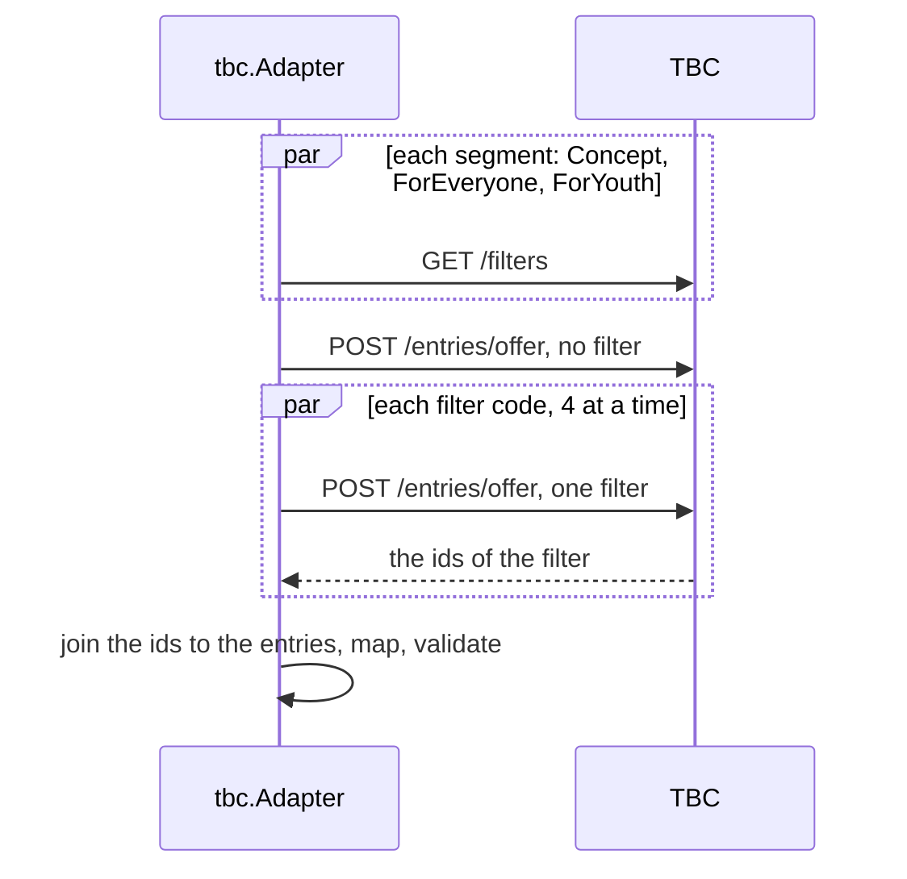

# Specification: The card offers of TBC Bank

## 1. Summary

This feature adds the vendor client module `pkg/tbcoffers` and the driven adapter
`adapter/tbc` of the context `offers`. The tools of `BOGOFFER` answer for TBC with no
change. A read of TBC builds the categories, the kinds, and the cards of each offer from
one list for each filter of TBC.

## 2. Coverage

| Requirement        | Where this specification realizes it            |
| ------------------ | ----------------------------------------------- |
| `TBCOFFER-FR-001`  | 4.1 `adapter/tbc`. `TBCOFFER-DD-001`            |
| `TBCOFFER-FR-002`  | `TBCOFFER-DD-002`                               |
| `TBCOFFER-FR-003`  | `TBCOFFER-DD-001`, `TBCOFFER-DD-002`            |
| `TBCOFFER-FR-004`  | `TBCOFFER-DD-001`, `TBCOFFER-DD-002`            |
| `TBCOFFER-FR-005`  | `TBCOFFER-DD-001`, `TBCOFFER-DD-002`            |
| `TBCOFFER-FR-006`  | 4.1 `adapter/tbc`                               |
| `TBCOFFER-FR-007`  | 4.1 `adapter/tbc`. `TBCOFFER-DD-003`            |
| `TBCOFFER-FR-008`  | 4.3 configuration                               |
| `TBCOFFER-NFR-001` | 4.3 configuration. `TBCOFFER-DD-004`. `TBCOFFER-SC-009` |

## 3. Guideline compliance

| Rule                 | How this specification obeys it                                                  |
| -------------------- | -------------------------------------------------------------------------------- |
| `CLT-001`            | `pkg/tbcoffers` is a module: `github.com/abgeo/georgia-mcp/pkg/tbcoffers`. `ADR-0004`. |
| `CLT-002`, `CLT-004` | `pkg/tbcoffers` uses `net/http`, `net/url`, and `encoding/json` only.            |
| `CLT-003`            | The client returns the tree of the terms as TBC sends it. The adapter makes the text. |
| `CLT-009`, `CLT-011` | The package comment and the README say that the API is unofficial. `v0`.         |
| `DOM-005`, `DOM-011` | `adapter/tbc` converts the vendor shape and wraps `kernel.ErrSourceUnavailable`. |
| `RSL-003`            | `module.go` wraps `adapter/tbc` in the `OfferCache` of `BOGOFFER`.               |
| `RSL-008`            | The configuration gives the limit of the calls.                                  |
| `CFG-003`, `CFG-005` | Each variable has the prefix `GEOMCP_OFFERS_TBC_` and a default in its tag.      |

## 4. Design

### 4.1 Components

`O` is `internal/app/georgia-mcp/offers`.

| Layer          | Path                          | Types and functions                                     |
| -------------- | ----------------------------- | ------------------------------------------------------- |
| Vendor client  | `pkg/tbcoffers/`              | `Client`, `New`, `Option`, `Filters`, `Offers`, `Offer`, `Filter`, `OffersRequest`, `OffersPage`, `Entry`, `Segment`, `Partner`, `Node`, `APIError`, `ErrUnexpectedStatus`. |
| Driven adapter | `O/adapter/tbc/`              | `Adapter`, `NewAdapter`, the tables of `TBCOFFER-DD-002`. |
| Module         | `O/module.go`, `O/config.go` (change) | `TBCConfig`, `TBCHTTPConfig`. The source of TBC.  |
| Configuration  | `configs/.env.example` (change) | The variables of 4.3.                                 |
| Workspace      | `go.work` (change)            | `use ./pkg/tbcoffers`.                                  |

**`pkg/tbcoffers`.**

```go
const DefaultBaseURL = "https://apigw.tbcbank.ge/api/v1/marketing"

var ErrUnexpectedStatus = errors.New("tbcoffers: unexpected status")

func New(opts ...Option) *Client // WithBaseURL, WithHTTPClient, WithUserAgent
func (c *Client) Filters(ctx context.Context, segment, locale string) ([]Filter, error)
func (c *Client) Offers(ctx context.Context, r OffersRequest) (OffersPage, error)
func (c *Client) Offer(ctx context.Context, slug, locale string) (Entry, error)

type Filter struct {
    Code      string   `json:"code"`
    Name      string   `json:"name"`
    ItemCount int      `json:"itemCount"`
    Childs    []Filter `json:"childs"`
}

type OffersRequest struct {
    Filter    []string `json:"filter"`            // "Category:Leisure"; empty: no filter
    Locale    string   `json:"locale"`            // "ka-GE" or "en-US"
    Segment   string   `json:"segment,omitempty"` // empty: every segment
    PageIndex int      `json:"pageIndex"`
    PageSize  int      `json:"pageSize"`
}

type OffersPage struct {
    PagingDetails struct {
        TotalCount  int  `json:"totalCount"`
        HasNextPage bool `json:"hasNextPage"`
    } `json:"pagingDetails"`
    List []Entry `json:"list"`
}

type Entry struct {
    ID          string    `json:"$id"`
    Title       string    `json:"title"`
    Description string    `json:"description"`
    Slug        string    `json:"slug"`
    StartDate   string    `json:"startDate"` // "2026-10-20T00:00", with no zone; empty when absent
    EndDate     string    `json:"endDate"`
    Segments    []Segment `json:"segments"`
    Partner     *Partner  `json:"partner"`
    Content     *Node     `json:"content"` // only in the answer of Offer
}

type Segment struct {
    ID       string `json:"$id"`
    Label    string `json:"label"`
    IsHidden bool   `json:"isHidden"`
}

type Partner struct {
    Title string `json:"title"`
}

type Node struct {
    NodeType string `json:"nodeType"` // document, paragraph, unordered-list, list-item, text
    Value    string `json:"value"`
    Content  []Node `json:"content"`
}
```

`Filters` sends `GET /filters?type=offer&locale=<l>&segment=<s>`. `Offers` sends
`POST /entries/offer` with the JSON body. `Offer` sends `GET /entries/offer/<slug>/<locale>`
with the slug escaped as a path segment. A status other than 200 returns an `*APIError`.
The body limit is 8 MiB. The User-Agent is `georgia-mcp-tbcoffers/<version> (+…)`.

**`adapter/tbc`.** `Bank` returns `{Code: "tbc", Name: "TBC Bank"}`. `Cards` returns the
cards of the tables of `TBCOFFER-DD-002`. `Offers` follows `TBCOFFER-DD-001`. The mapping
of an entry:

| Field of the vendor      | Domain value                                                          |
| ------------------------ | --------------------------------------------------------------------- |
| `$id`                    | `ID`.                                                                 |
| `title`                  | `Title`, trimmed.                                                     |
| `partner.title`          | `Partner`, trimmed. Absent or blank: empty.                           |
| `description`            | `Benefit`, trimmed.                                                   |
| `startDate`, `endDate`   | `Period`: the first 10 characters through `kernel.ParseDate`. Empty: a zero date. |
| `segments[].$id`         | `Tiers`, with the table of `TBCOFFER-DD-002`.                         |
| the filters that list it | `Categories`, `BankCategories`, `Kinds`, `Cards`. `TBCOFFER-DD-001`.  |
| `slug`                   | `URL`. Tiers `[premium]`: `https://tbcconcept.ge/<ge or en>/offers/<slug>`. Else `https://tbcbank.ge/<ka or en>/offers/all-offers/<slug>`. |

The adapter leaves `Terms` empty. `Terms` takes the slug from the last path segment of
`offer.URL`, calls `Offer`, and makes the text of `TBCOFFER-DD-003`. A failure wraps
`kernel.ErrSourceUnavailable`.

### 4.2 Domain model

No change. `TBCOFFER` uses the model of `BOGOFFER` 4.2.

### 4.3 Declarations

**Vendor endpoint.**

| Client           | Method and path                          | Key  | Official              | Realizes                             |
| ---------------- | ---------------------------------------- | ---- | --------------------- | ------------------------------------ |
| `pkg/tbcoffers`  | `GET /filters?type=offer`                | None | No, an unofficial API | `TBCOFFER-FR-003` to `TBCOFFER-FR-005` |
| `pkg/tbcoffers`  | `POST /entries/offer`                    | None | No, an unofficial API | `TBCOFFER-FR-001` to `TBCOFFER-FR-005` |
| `pkg/tbcoffers`  | `GET /entries/offer/<slug>/<locale>`     | None | No, an unofficial API | `TBCOFFER-FR-007`                    |

A real answer, recorded on 2026-10-20, cut to one entry:

```
POST https://apigw.tbcbank.ge/api/v1/marketing/entries/offer
{"filter":[],"locale":"en-US","pageIndex":0,"pageSize":1000}
200 application/json
{"pagingDetails":{"pageIndex":0,"pageSize":1000,"totalCount":518,"hasNextPage":false},
 "list":[{"$id":"7tD3DL0YuO2V6f1Efr4sSV","title":"Oktopus",
  "description":"As part of the TBC Concept offer, on October 20 and 21, purchase a 6-month membership ...",
  "startDate":"2026-10-20T00:00","endDate":"2026-10-21T23:59","slug":"oktopusi-qeshbeqi",
  "segments":[{"$id":"6WK1EC8bbUzUG02i51urvP","label":"Expats","isHidden":true},
              {"$id":"5I27EbKG2HykRaU760nvck","label":"Concept","isHidden":false}],
  "partner":{"title":"Oktopus Fitness Club"}}]}
```

**Cache.** The `OfferCache` of `BOGOFFER` 4.3, with the same keys and durations.

**Configuration.**

| Variable                        | Type     | Default                                      | Secret | Realizes           |
| ------------------------------- | -------- | -------------------------------------------- | ------ | ------------------ |
| `GEOMCP_OFFERS_TBC_ENABLED`     | bool     | `true`                                       | No     | `TBCOFFER-FR-008`  |
| `GEOMCP_OFFERS_TBC_BASE_URL`    | URL      | `https://apigw.tbcbank.ge/api/v1/marketing`  | No     | `TBCOFFER-FR-001`  |
| `GEOMCP_OFFERS_TBC_TIMEOUT`     | duration | `10s`                                        | No     | `TBCOFFER-NFR-001` |
| `GEOMCP_OFFERS_TBC_RATE`        | float    | `5`                                          | No     | `TBCOFFER-NFR-001` |
| `GEOMCP_OFFERS_TBC_BURST`       | int      | `5`                                          | No     | `TBCOFFER-NFR-001` |

### 4.4 Flow



## 5. Design decisions

### `TBCOFFER-DD-001`

**Realizes:** `TBCOFFER-FR-001`, `TBCOFFER-FR-003` to `TBCOFFER-FR-005`
**Decision:** A read of TBC in one locale:

1. `Filters` for `Concept`, `ForEveryone`, and `ForYouth`. The adapter joins the first
   level of children of the groups `Category`, `ProductType`, `OfferType`, and `CardType`
   by code. It ignores the level `SubCategory`.
2. `Offers` with no filter and no segment, with the size 1000, from page 0 while
   `hasNextPage` is true, and at most 5 pages.
3. `Offers` for each code as `<group>:<code>`, with no segment and the size 1000. The
   adapter keeps the ids of the answer. At most 4 calls run at once.
4. Each entry of step 2 gets the values of each filter that lists its id.

Any failed call fails the read.
**Rationale:** The list holds no category, kind, or card. One call for each filter costs
about 40 calls on 2026-10-20. One detail call for each offer costs 518.
**Alternatives:** The detail of each offer, which holds its filters. 518 calls in each hour.

### `TBCOFFER-DD-002`

**Realizes:** `TBCOFFER-FR-002` to `TBCOFFER-FR-005`
**Decision:** Fixed tables. A code that is not in a table gives the value of the last
row, and a warning one time for each code.

| Segment id               | Tier       |
| ------------------------ | ---------- |
| `64mvOqr0aBsBrvFAbtHoz9` | `standard` |
| `5I27EbKG2HykRaU760nvck` | `premium`  |
| `1opQpNUWlkhEPLDyVjeGm5` | `youth`    |
| other                    | none       |

| `Category` code                                                       | Category        |
| --------------------------------------------------------------------- | --------------- |
| `CafeandRestaurant`                                                   | `dining`        |
| `Leisure`                                                             | `leisure`       |
| `Travel`                                                              | `travel`        |
| `Beauty&Health`, `Perfume`                                            | `health_beauty` |
| `Auto`                                                                | `auto`          |
| `Transport`                                                           | `transport`     |
| `Shopping`, `Clothes`, `Accessories`, `OnlinePartners`, `Groceries`, `Flowers` | `shopping` |
| `Electronics`                                                         | `electronics`   |
| `Home`                                                                | `home`          |
| `Education`                                                           | `education`     |
| `ForKids`                                                             | `kids`          |
| `Entertainment`                                                       | `entertainment` |
| `Developers`                                                          | `real_estate`   |
| `Other`, `Expats`, other                                              | `other`         |

| `OfferType` code   | Kind       |
| ------------------ | ---------- |
| `Discount`         | `discount` |
| `Cashback`         | `cashback` |
| `PartnerOffers`, other | none   |

| Group and code               | Card code      | Name               |
| ---------------------------- | -------------- | ------------------ |
| `ProductType:TBCCard`        | `tbc_card`     | TBC Card           |
| `ProductType:TBCConceptCard` | `concept_card` | TBC Concept Card   |
| `ProductType:CreditCard`     | `credit_card`  | Credit Card        |
| `ProductType:TravelCard`     | `travel_card`  | Travel Card        |
| `ProductType:PayLater`       | `pay_later`    | Pay Later          |
| `ProductType:Installment`    | `installment`  | Installment        |
| `ProductType:Crypto`         | `crypto`       | Crypto             |
| `ProductType:Pupil'sCard`    | `pupil_card`   | Pupil's Card       |
| `CardType:CreditCard`        | `visa`         | Visa               |
| `CardType:MasterCard`        | `mastercard`   | Mastercard         |
| other                        | `CardCodeOf(code)` | the name of the filter |

The bank category is the name of the filter in the locale. An offer with no kind gets
`other`. An offer with no category gets `other`, with no bank category.
**Rationale:** The id of a segment and the code of a filter do not change with the locale.
`CardType:CreditCard` has the name "Visa" on the site.
**Alternatives:** A match on the label. It changes with the locale.

### `TBCOFFER-DD-003`

**Realizes:** `TBCOFFER-FR-007`, `BOGOFFER-INV-002`
**Decision:** The adapter makes the text of a tree: each `paragraph` and each `list-item`
ends a line, a `list-item` starts with "- ", each `text` adds its value. It drops a line
that is blank after trim.
**Rationale:** On 2026-10-20 the trees held `paragraph`, `unordered-list`, `list-item`, and
`text` only. A node of another type gives the text of its children.
**Alternatives:** The `description` as the terms. It omits every condition.

### `TBCOFFER-DD-004`

**Realizes:** `TBCOFFER-NFR-001`, `BOGOFFER-NFR-002`
**Decision:** The rate is 5 calls each second, with a burst of 5.
**Rationale:** About 40 calls take about 8 seconds at this rate, inside 30 seconds. The
cache sends one read each hour for each language.
**Alternatives:** 1 call each second. About 40 seconds, more than the limit.

## 6. Scenarios

`pkg/tbcoffers/testdata/` holds, recorded on 2026-10-20 in `en-US`: `offers.json` (518
entries), `filters-concept.json`, `filters-foreveryone.json`, `filters-foryouth.json`,
`filter-category-leisure.json`, `filter-offertype-cashback.json`,
`filter-cardtype-creditcard.json`, `offer-oktopusi-qeshbeqi.json`. A test serves an empty
list for every other filter.

### `TBCOFFER-SC-001`

**Verifies:** `TBCOFFER-FR-001`
**Layer:** unit

**Given** `httptest` that records the request and serves `offers.json`.
**When** `Offers` runs with no filter, the locale `en-US`, and the size 1000.
**Then** the body has no `segment`, and the page holds 518 entries.

### `TBCOFFER-SC-002`

**Verifies:** `TBCOFFER-FR-007`
**Layer:** unit

**Given** `httptest` serves `offer-oktopusi-qeshbeqi.json`.
**When** `Offer` runs for `oktopusi-qeshbeqi` and `en-US`.
**Then** the path is `/entries/offer/oktopusi-qeshbeqi/en-US`, and `Content` has the type `document`.

### `TBCOFFER-SC-003`

**Verifies:** `TBCOFFER-FR-001`
**Layer:** live

**Given** the real TBC.
**When** `Offers` runs with no filter.
**Then** the page holds one entry or more, each with an id and a title.

### `TBCOFFER-SC-004`

**Verifies:** `TBCOFFER-FR-001`, `TBCOFFER-FR-002`, `TBCOFFER-FR-006`, `BOGOFFER-FR-007`
**Layer:** integration

**Given** `httptest` serves the files of this section.
**When** `Search` runs with `tbc` and no other filter on 2026-10-20.
**Then** "Oktopus" has the tiers `[premium]`, the partner "Oktopus Fitness Club", the
period 2026-10-20 to 2026-10-21, and an address on `tbcconcept.ge/en/offers/`. No offer
ends before 2026-10-20. The two offers of Emigrants and Installment are absent.

### `TBCOFFER-SC-005`

**Verifies:** `TBCOFFER-FR-003`, `TBCOFFER-FR-004`, `TBCOFFER-FR-005`
**Layer:** integration

**Given** the same files.
**When** the adapter reads the offers.
**Then** each of the 27 offers of `filter-category-leisure.json` has `leisure` and the bank
category "Leisure". "Oktopus" has the kind `cashback`. Each offer of
`filter-cardtype-creditcard.json` has the card `{visa, Visa}`. An offer in no filter has
the category `[other]` and the kind `[other]`.

### `TBCOFFER-SC-006`

**Verifies:** `TBCOFFER-FR-002`, `TBCOFFER-FR-003`
**Layer:** unit

**Given** an entry with a new segment id only, and a filter `Category:Pets`.
**When** the adapter reads the offers.
**Then** the entry is absent. Each offer of `Pets` has `other`. The log holds one warning
for each code.

### `TBCOFFER-SC-007`

**Verifies:** `TBCOFFER-FR-007`
**Layer:** integration

**Given** `httptest` serves the files.
**When** a client calls `offers_get_offer` with `tbc`, `7tD3DL0YuO2V6f1Efr4sSV`, `en`.
**Then** the terms hold the line "- The offer applies only to 6-month memberships." and no
blank line.

### `TBCOFFER-SC-008`

**Verifies:** `BOGOFFER-FR-017`
**Layer:** unit

**Given** `httptest` answers 500 for `filter-offertype-cashback`.
**When** the adapter reads the offers.
**Then** the error wraps `kernel.ErrSourceUnavailable`.

### `TBCOFFER-SC-009`

**Verifies:** `TBCOFFER-NFR-001`
**Layer:** live

**Given** the real TBC and an empty cache.
**When** a search runs for `tbc`.
**Then** the answer arrives in less than 30 seconds.

### `TBCOFFER-SC-010`

**Verifies:** `TBCOFFER-FR-008`
**Layer:** unit

**Given** `GEOMCP_OFFERS_TBC_ENABLED=false` and BOG on.
**When** a client calls the search with `banks: ["tbc"]`.
**Then** the tool returns `IsError` with `banks: "tbc" is not a bank of this server. Use one of: bog.`

## 7. Build plan

| #   | Step                                                                  | Realizes                                | Done |
| --- | --------------------------------------------------------------------- | --------------------------------------- | ---- |
| 1   | `pkg/tbcoffers` module, recorded answers, README, example. `go.work`. | `TBCOFFER-FR-001`, `TBCOFFER-FR-007`    | [ ]  |
| 2   | `adapter/tbc`: the read of `TBCOFFER-DD-001`, the tables, the terms.  | `TBCOFFER-FR-001` to `TBCOFFER-FR-007`  | [ ]  |
| 3   | `config.go`, `module.go`, `configs/.env.example`.                     | `TBCOFFER-FR-008`, `TBCOFFER-NFR-001`   | [ ]  |
| 4   | Move the terms of requirements 5 to the glossary.                     | `DOM-002`                               | [ ]  |

## 8. Out of scope for this specification

Nothing that the requirements demand.

## Retired identifiers

This file has no retired identifier.
