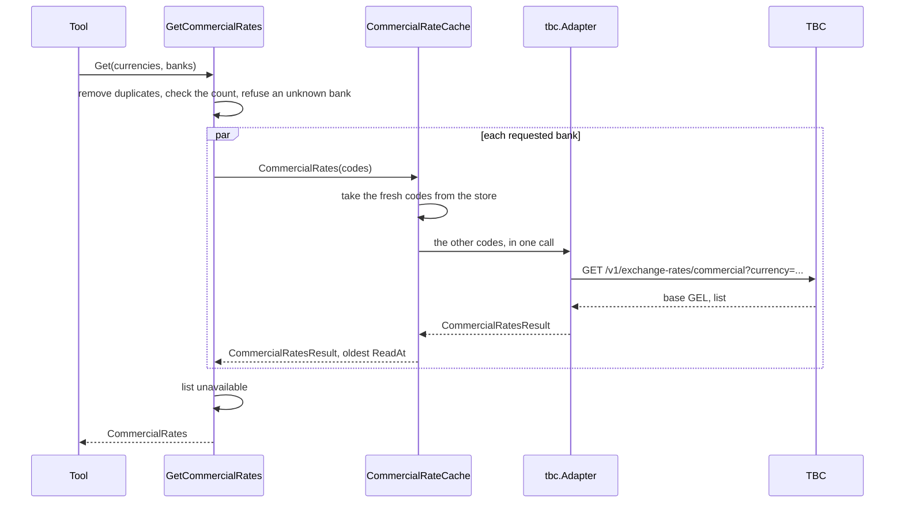

# Specification: The commercial exchange rates of TBC Bank

## 1. Summary

This feature adds the vendor client module `pkg/tbc`, the commercial rates to the
`rates` context, and the tool `rates_get_commercial_rates`. The tool answers for every
bank that the server can read. TBC is the first. The server asks a bank for the
requested currencies only, and caches each currency. `spec-scenarios.md` holds the
scenarios.

## 2. Coverage

| Requirement       | Where this specification realizes it                    |
| ----------------- | ------------------------------------------------------- |
| `TBCRATE-FR-001`  | 4.2 `CommercialRate`. 4.3 tool. `TBCRATE-DD-002`        |
| `TBCRATE-FR-002`  | 4.2 `GetCommercialRates`. 4.4                           |
| `TBCRATE-FR-003`  | 4.2 `UnknownBankError`. 4.5                             |
| `TBCRATE-FR-004`  | 4.2 `CommercialRatesResult.Missing`                     |
| `TBCRATE-FR-005`  | `TBCRATE-DD-008`                                        |
| `TBCRATE-FR-006`  | 4.3 tool, `meaning` and the description                 |
| `TBCRATE-FR-007`  | 4.2 `CommercialRatesResult.ReadAt`. `TBCRATE-DD-011`    |
| `TBCRATE-FR-008`  | 4.2 `CommercialRates.Unavailable`. 4.4                  |
| `TBCRATE-FR-009`  | 4.3 cache. `TBCRATE-DD-012`                             |
| `TBCRATE-FR-010`  | 4.1 `module.go`. `TBCRATE-DD-005`                       |
| `TBCRATE-FR-011`  | 4.2 `MaxCommercialCurrencies`. 4.5                      |
| `TBCRATE-NFR-001` | 4.3 cache. `TBCRATE-SC-016`                             |
| `TBCRATE-NFR-002` | 4.3 cache. `TBCRATE-DD-009`, `TBCRATE-DD-010`           |
| `TBCRATE-INV-001` | `TBCRATE-DD-006`, `TBCRATE-SC-019`                      |
| `TBCRATE-INV-002` | 4.3 tool. `TBCRATE-DD-011`                              |
| `TBCRATE-INV-003` | `TBCRATE-DD-007`                                        |

## 3. Guideline compliance

| Rule                   | How this specification obeys it                                                  |
| ---------------------- | -------------------------------------------------------------------------------- |
| `ARC-004`, `CLT-001`   | `pkg/tbc` is a module: `github.com/abgeo/georgia-mcp/pkg/tbc`, `go 1.26.0`.      |
| `CLT-002`, `CLT-004`   | `pkg/tbc` uses `net/http`, `net/url`, and `encoding/json` only.                  |
| `CLT-009`              | The caller passes the key with `WithAPIKey`. The module holds no key.            |
| `DOM-001`, `DOM-009`   | `rates` gains the port `CommercialRateSource`. A bank is an adapter of it.       |
| `DOM-005`, `DOM-011`   | `adapter/tbc` converts the vendor shape and wraps `kernel.ErrSourceUnavailable`. |
| `DOM-006`, `MCP-009`   | Every rate is a `decimal.Decimal`, and a string in the output.                   |
| `MCP-002` to `MCP-008` | 4.3 tool.                                                                        |
| `RSL-003` to `RSL-006` | `adapter/cache.CommercialRateCache` on `cache.Cache[commercialQuote]`.           |
| `CFG-005`, `CFG-007`   | The key is optional and secret. `configs/.env.example` holds an empty value.     |
| `LOG-008`              | No record holds the key. `TBCRATE-DD-006`.                                       |

This feature changes one rule, in the same review, with no ADR, as the owner decided:

| Rule      | Change                                                                                     |
| --------- | ------------------------------------------------------------------------------------------ |
| `MCP-005` | An output that joins several sources carries `source` and `as_of` for each source.          |

## 4. Design

### 4.1 Components

Every path is new unless the table says "change". `R` is `internal/app/georgia-mcp/rates`.

| Layer          | Path                            | Types and functions                                                   |
| -------------- | ------------------------------- | --------------------------------------------------------------------- |
| Vendor client  | `pkg/tbc/`                      | `Client`, `New`, `Option`, `CommercialRates`, `CommercialRate`, `APIError`, `ErrUnexpectedStatus`. |
| Domain         | `R/domain/` (change)            | `BankCode`, `Bank`, `CommercialRate`. 4.2.                            |
| Use case       | `R/app/` (change)               | `CommercialRateSource`, `GetCommercialRates`. 4.2.                    |
| Driven adapter | `R/adapter/tbc/`                | `Adapter`, `NewAdapter`.                                              |
| Cache          | `R/adapter/cache/` (change)     | `CommercialRateCache`, `NewCommercial`.                               |
| Shared cache   | `internal/pkg/cache/` (change)  | `Cache.GetMany`. `TBCRATE-DD-010`.                                    |
| Tool           | `R/adapter/tool/` (change)      | `RegisterCommercial`, the structs of 4.3.                             |
| Module         | `R/module.go`, `R/config.go` (change) | `Config.TBC`, the commercial sources, `Register`, `Close`.      |
| Workspace      | `go.work` (change)              | `use ./pkg/tbc`.                                                      |

**`pkg/tbc`.** A minimal client: the commercial rates only (`TBCRATE-DD-001`).

```go
const DefaultBaseURL = "https://api.tbcbank.ge"

func New(opts ...Option) *Client // WithBaseURL, WithHTTPClient, WithUserAgent, WithAPIKey
func (c *Client) CommercialRates(ctx context.Context, currencies []string) (*CommercialRates, error)

type CommercialRates struct {
    Base                string           `json:"base"`
    CommercialRatesList []CommercialRate `json:"commercialRatesList"`
}

type CommercialRate struct {
    Currency string      `json:"currency"`
    Buy      json.Number `json:"buy"`
    Sell     json.Number `json:"sell"`
}

type APIError struct { // the problem JSON of TBC
    StatusCode int
    Type, Title, Detail, SystemCode, TraceID string
}
```

`CommercialRates` sends `GET /v1/exchange-rates/commercial` with the header `apikey`. An
empty list sends no `currency`. A list goes joined with commas. The documentation
comment says that TBC answers at most 10 currencies, and leaves out a code that it does
not quote. `APIError` wraps `ErrUnexpectedStatus` and decodes the problem body. Its
`Error` text holds the status, the title, and the system code. The client has the shape
of `pkg/nbg`: options that set the fields of `Client`, one `get` with a body limit of 1 MiB.

**`cache.GetMany` (change).** A second method of `cache.Cache[V]`:

```go
func (c *Cache[V]) GetMany(
    ctx context.Context,
    keys []string,
    load func(ctx context.Context, keys []string) (map[string]V, error),
) (map[string]Result[V], error)
```

`GetMany` returns each fresh key from the store. It loads the other keys in one call of
`load`. Concurrent calls for the same set of keys share one load: the singleflight key is
the sorted keys joined with commas. `load` returns a value for each key it gets. When
`load` fails with `kernel.ErrSourceUnavailable`, `GetMany` returns the stale value of each
key it loaded, if every one of them is inside the maximum stale age. Else it returns the
error (`TBCRATE-DD-012`).

**`module.go` (change).** `newModule` builds the TBC source only when `cfg.TBC.APIKey` is
not empty. Else it logs a warning with the attribute `variable=GEOMCP_RATES_TBC_API_KEY`.
`Register` adds the commercial tool only when one source or more exists. `Close` closes
each cache.

### 4.2 Domain model

```go
// domain
type BankCode string                         // lowercase letters, 2 to 16
func ParseBankCode(s string) (BankCode, error)

type Bank struct {
    Code BankCode
    Name string // "TBC Bank"
}

type CommercialRate struct {
    Currency CurrencyCode
    Buy      decimal.Decimal // what the bank pays for one unit
    Sell     decimal.Decimal // what the bank asks for one unit
}
func NewCommercialRate(code CurrencyCode, buy, sell decimal.Decimal) (CommercialRate, error) // both > 0
```

Errors in `domain/errors.go`: `ErrInvalidBankCode`, `ErrInvalidCommercialRate`.

```go
// app
const MaxCommercialCurrencies = 10

type CommercialRatesResult struct {
    Rates   []domain.CommercialRate // the requested codes that the bank quotes, sorted
    Missing []domain.CurrencyCode   // the requested codes that the bank does not quote, sorted
    ReadAt  time.Time               // the oldest read instant of the requested codes
    Stale   bool                    // true when one code or more is stale
}

type CommercialRateSource interface {
    Bank() domain.Bank
    // CommercialRates takes 1 to MaxCommercialCurrencies distinct codes.
    CommercialRates(ctx context.Context, codes []domain.CurrencyCode) (CommercialRatesResult, error)
}

type CommercialRatesQuery struct {
    Currencies []domain.CurrencyCode // 1 to MaxCommercialCurrencies after duplicates go
    Banks      []domain.BankCode     // empty: every bank
}

type BankRates struct {
    Bank domain.Bank
    CommercialRatesResult
}

type CommercialRates struct {
    Banks       []BankRates   // sorted by bank code
    Unavailable []domain.Bank // the banks that failed, with no rates held
}

func NewGetCommercialRates(sources []CommercialRateSource) *GetCommercialRates
func (u *GetCommercialRates) Get(ctx context.Context, q CommercialRatesQuery) (CommercialRates, error)
func (u *GetCommercialRates) Banks() []domain.Bank
```

`Get` removes a code named twice, then checks the count. Errors in `app/errors.go`:
`ErrCurrencyCount` with the type `*CurrencyCountError{Count}`, and `ErrUnknownBank` with
the type `*UnknownBankError{Code, Known}`.

### 4.3 Declarations

**MCP tool.**

| Tool                         | Input                   | Output                    | Errors (4.5)                              | Realizes |
| ---------------------------- | ----------------------- | ------------------------- | ----------------------------------------- | -------- |
| `rates_get_commercial_rates` | `currencies`, `banks`   | `commercialRatesOutput`   | code, count, bank, every bank unavailable | `TBCRATE-FR-001` to `TBCRATE-FR-011` |

```go
type getCommercialRatesInput struct {
    Currencies []string `json:"currencies"        jsonschema:"1 to 10 ISO 4217 codes, for example USD and EUR."`
    Banks      []string `json:"banks,omitempty"   jsonschema:"Bank codes. Empty asks every bank. The description of the tool lists the codes."`
}

type commercialRatesOutput struct {
    Meaning     string             `json:"meaning"     jsonschema:"How to read buy and sell."`
    Banks       []bankRatesOutput  `json:"banks"       jsonschema:"The rates of each bank that answered, sorted by bank code."`
    Unavailable []bankOutput       `json:"unavailable,omitempty" jsonschema:"The banks that did not answer."`
}

type bankRatesOutput struct {
    Bank    string                 `json:"bank"    jsonschema:"The bank code."`
    Source  string                 `json:"source"  jsonschema:"The name of the bank."`
    AsOf    string                 `json:"as_of"   jsonschema:"The oldest instant at which the server read a rate of this bank, RFC 3339. The bank publishes no instant."`
    Stale   bool                   `json:"stale"   jsonschema:"True when the bank did not answer and the server returns rates it read before."`
    Rates   []commercialRateOutput `json:"rates"   jsonschema:"The commercial rates, sorted by currency."`
    Missing []string               `json:"missing,omitempty" jsonschema:"The requested codes that the bank does not quote."`
}

type commercialRateOutput struct {
    Currency string `json:"currency" jsonschema:"The ISO 4217 code."`
    Buy      string `json:"buy"      jsonschema:"The price in GEL that the bank pays for one unit, as a decimal string."`
    Sell     string `json:"sell"     jsonschema:"The price in GEL that the bank asks for one unit, as a decimal string."`
}

type bankOutput struct {
    Bank   string `json:"bank"   jsonschema:"The bank code."`
    Source string `json:"source" jsonschema:"The name of the bank."`
}
```

`meaning` is the constant `buy: the price in GEL that the bank pays when you sell it one
unit. sell: the price in GEL that the bank asks when you buy one unit from it.` The tool
description repeats it, lists the bank codes that `GetCommercialRates.Banks` gives, and
says that the rates are of today, with no history.

**Vendor endpoint.**

| Client    | Method and path                                       | Key             | Official            | Realizes                    |
| --------- | ----------------------------------------------------- | --------------- | ------------------- | --------------------------- |
| `pkg/tbc` | `GET /v1/exchange-rates/commercial?currency=USD,EUR`  | Header `apikey` | Yes, documented     | `TBCRATE-FR-001`            |

**Cache.** One store for each bank. One key for each currency code. The value is
`commercialQuote{Rate domain.CommercialRate; Quoted bool}`: a code that the bank does
not quote is an entry too, with `Quoted` false.

| Port method                         | Key           | Time to live | Maximum stale | Entries | Realizes                              |
| ----------------------------------- | ------------- | ------------ | ------------- | ------- | ------------------------------------- |
| `CommercialRates` of each bank      | currency code | 5 minutes    | 55 minutes    | 256     | `TBCRATE-NFR-001`, `TBCRATE-NFR-002`, `TBCRATE-FR-009` |

A stale value is younger than the time to live and the maximum stale: 1 hour.
`CommercialRateCache` builds `CommercialRatesResult` from the entries: `ReadAt` is the
oldest `FetchedAt`, and `Stale` is true when one entry or more is stale.

**Configuration.**

| Variable                      | Type     | Default                  | Secret | Realizes          |
| ----------------------------- | -------- | ------------------------ | ------ | ----------------- |
| `GEOMCP_RATES_TBC_API_KEY`    | string   | empty: TBC is off        | Yes    | `TBCRATE-FR-010`  |
| `GEOMCP_RATES_TBC_BASE_URL`   | URL      | `https://api.tbcbank.ge` | No     | `TBCRATE-FR-001`  |
| `GEOMCP_RATES_TBC_TIMEOUT`    | duration | `10s`                    | No     | `TBCRATE-FR-008`  |
| `GEOMCP_RATES_TBC_RATE`       | float    | `1`                      | No     | `TBCRATE-NFR-002` |
| `GEOMCP_RATES_TBC_BURST`      | int      | `1`                      | No     | `TBCRATE-NFR-002` |

`rates.Config` gains `TBC TBCConfig` with `envPrefix:"TBC_"`. `TBCConfig` holds `APIKey`,
`BaseURL url.URL`, and `HTTP httpclient.Config`, as `NBGConfig` does.

### 4.4 Flow



`GetCommercialRates.Get` asks each requested bank at once and waits for all. A bank that
fails joins `Unavailable`. When every requested bank fails, `Get` returns an error that
wraps `kernel.ErrSourceUnavailable` and names the banks.

`tbc.Adapter` sends the codes it gets in one call. It checks that the base is `GEL`, maps
each rate of a requested code, and puts each requested code that the answer lacks in
`Missing`. It ignores a code that it did not request. `ReadAt` is the instant of the answer.

### 4.5 Errors

| Condition                             | Sentinel                        | Tool message                                                                |
| ------------------------------------- | ------------------------------- | --------------------------------------------------------------------------- |
| A code that is not three letters      | `domain.ErrInvalidCurrencyCode` | `currencies: "US" is not a currency code. Use three letters, for example USD.` |
| No code                               | `app.ErrCurrencyCount`          | `currencies: name at least one code, for example USD.`                      |
| More than 10 codes                    | `app.ErrCurrencyCount`          | `currencies: 11 codes. Ask for 10 or fewer.`                                |
| A bank code that the server lacks     | `app.ErrUnknownBank`            | `banks: "bog" is not a bank of this server. Use one of: tbc.`               |
| Every requested bank fails            | `kernel.ErrSourceUnavailable`   | `TBC Bank did not answer. Try again in a few minutes.`                      |

When several banks fail, the message joins their names: `TBC Bank and Bank of Georgia did not answer. …`

## 5. Design decisions

### `TBCRATE-DD-001`

**Realizes:** `TBCRATE-FR-001`, `CLT-001`
**Decision:** `pkg/tbc` covers the commercial rates only.
**Rationale:** The owner limited the client to the rates. The converter and the official
rates of TBC wait for a requirement. `NBGRATE-DD-013` covers a whole API for `pkg/nbg`;
this client grows endpoint by endpoint.
**Alternatives:** The whole API now: four endpoints, two with no user in the server.

### `TBCRATE-DD-002`

**Realizes:** `TBCRATE-FR-001`, `TBCRATE-FR-011`
**Decision:** The server asks a bank for the requested codes only, with the `currency`
filter. The cache keeps one entry for each currency.
**Rationale:** TBC answers at most 10 currencies in one call. With no filter it answers
10 of them, and which 10 changes over time, so no call reads the full set. The filter
needs no list of codes to maintain.
**Alternatives:** A fixed list of the 21 codes that TBC quoted on 2026-10-18, asked in
groups of 10. A new currency waits for a change of the code. Every ISO 4217 code: about
16 calls for each refresh.

### `TBCRATE-DD-003`

**Realizes:** `TBCRATE-FR-002`, `TBCRATE-FR-008`
**Decision:** The use case asks the requested banks at once with a `sync.WaitGroup`. A
failure does not cancel the other banks.
**Rationale:** An answer of one bank is still useful when another bank fails. `errgroup`
cancels on the first error.
**Alternatives:** `errgroup`. One slow or failing bank removes the others.

### `TBCRATE-DD-004`

**Realizes:** `TBCRATE-FR-002`, `TBCRATE-FR-003`
**Decision:** The tool takes bank codes, and lists the codes of the configured banks in
its description at registration.
**Rationale:** A model reads the description before the call. A fixed enumeration in the
schema would list a bank with no key.
**Alternatives:** A `jsonschema` enum. It needs the set at compile time.

### `TBCRATE-DD-005`

**Realizes:** `TBCRATE-FR-010`
**Decision:** An empty key leaves TBC out of the sources. With no source, the module adds
no commercial tool. A warning names the variable.
**Rationale:** A tool that can only fail confuses the model. The warning tells the operator.
**Alternatives:** A tool that answers "no bank configured". A model calls it for nothing.

### `TBCRATE-DD-006`

**Realizes:** `TBCRATE-INV-001`, `LOG-008`
**Decision:** The key travels in the header `apikey` only. No error text, no log record,
and no `Error` of `APIError` holds a header. The configuration logs no value.
**Rationale:** An error of `net/http` holds the address, so the key must stay out of it.
A header is not part of the address.
**Alternatives:** The key in the query. It would appear in every error and access log.

### `TBCRATE-DD-007`

**Realizes:** `TBCRATE-INV-003`
**Decision:** `pkg/tbc` decodes `buy` and `sell` as `json.Number`. The adapter parses the
text with `decimal.NewFromString`. The tool writes `StringFixed(-Exponent())`.
**Rationale:** `json.Number` keeps the digits of the answer as TBC writes them. TBC
writes JSON numbers with no trailing zero: `1.35`.
**Alternatives:** `float64`. It rounds a value with many digits.

### `TBCRATE-DD-008`

**Realizes:** `TBCRATE-FR-005`
**Decision:** The adapter reads each TBC rate as the price of one unit.
**Rationale:** Open question 1. A live answer on 2026-10-18 priced JPY at 0.0157 and
AMD at 0.0065, the prices of one unit.
**Alternatives:** None. The answer holds no quantity.

### `TBCRATE-DD-009`

**Realizes:** `TBCRATE-NFR-002`
**Decision:** The vendor limit of the client defaults to 1 call each second with a burst
of 1. A call waits for a free slot, inside the timeout.
**Rationale:** TBC allows 60 calls in a minute for each key. The cache bounds the calls
for each currency, not the total: a client can ask for new codes in each request. The
limit bounds the total.
**Alternatives:** The defaults of `httpclient.Config`, 5 each second. They allow 300 calls
in a minute, over the vendor limit.

### `TBCRATE-DD-010`

**Realizes:** `TBCRATE-NFR-002`
**Decision:** `cache.Cache` gains `GetMany`. It loads the keys that are not fresh in one
call, and shares the load between concurrent calls for the same set of keys.
**Rationale:** One request asks a bank for up to 10 codes. One call for the codes that
the cache lacks keeps one call for each request. `Get` loads one key in each call.
**Alternatives:** `Get` for each code: up to 10 calls for one request. A shared load for
each code: two requests that overlap wait on each other, with more code for a rare case.

### `TBCRATE-DD-011`

**Realizes:** `TBCRATE-FR-007`, `TBCRATE-INV-002`
**Decision:** The `as_of` of a bank is the oldest read instant of its rates in the answer.
**Rationale:** The output keeps one instant for each source, as `MCP-005` asks. The
oldest instant is true for every rate of the bank.
**Alternatives:** An `as_of` on each rate. It is exact, and repeats one instant in most
answers.

### `TBCRATE-DD-012`

**Realizes:** `TBCRATE-FR-008`, `TBCRATE-FR-009`
**Decision:** When the bank fails, it answers only if the cache holds every requested
code inside the stale age. Else the bank is unavailable.
**Rationale:** A bank that answers holds every requested code, either with a rate or in
`Missing`. A code the server could not read is neither.
**Alternatives:** The held codes, and a third list of codes that the bank did not answer.
One more field for the model to read, for a short outage.

## 6. Scenarios

`spec-scenarios.md` holds `TBCRATE-SC-001` to `TBCRATE-SC-024`.

## 7. Build plan

| #   | Step                                                                         | Realizes                                       | Done |
| --- | ---------------------------------------------------------------------------- | ---------------------------------------------- | ---- |
| 1   | Correct `MCP-005` as section 3 gives.                                        | `TBCRATE-FR-007`                               | [x]  |
| 2   | `pkg/tbc` module, recorded answers, README, example. `go.work`.             | `TBCRATE-FR-001`, `TBCRATE-INV-001`            | [x]  |
| 3   | `domain`: `BankCode`, `Bank`, `CommercialRate`.                              | `TBCRATE-FR-001`, `TBCRATE-INV-003`            | [x]  |
| 4   | `app`: port, `GetCommercialRates`.                                           | `TBCRATE-FR-002` to `TBCRATE-FR-004`, `TBCRATE-FR-008`, `TBCRATE-FR-011` | [x]  |
| 5   | `adapter/tbc`.                                                               | `TBCRATE-FR-004`, `TBCRATE-FR-005`, `TBCRATE-INV-003` | [ ]  |
| 6   | `internal/pkg/cache`: `GetMany`.                                             | `TBCRATE-NFR-002`                              | [ ]  |
| 7   | `adapter/cache`: `CommercialRateCache`.                                      | `TBCRATE-FR-009`, `TBCRATE-NFR-001`, `TBCRATE-NFR-002` | [ ]  |
| 8   | `adapter/tool`: `RegisterCommercial`.                                        | `TBCRATE-FR-006`, `TBCRATE-FR-007`             | [ ]  |
| 9   | `module.go`, `config.go`, `configs/.env.example`.                            | `TBCRATE-FR-010`                               | [ ]  |

## 8. Out of scope for this specification

Nothing that the requirements demand.

## Retired identifiers

This file has no retired identifier.
