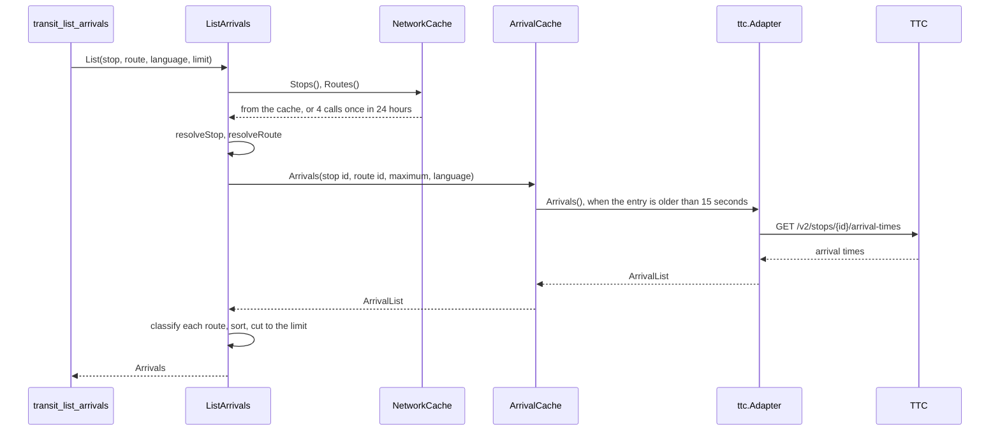

# Specification: The public transport of Tbilisi

## 1. Summary

This feature adds the context `transit`, the vendor client module `pkg/ttc`, and eight
tools. Five ports name the capabilities of the TTC. One driven adapter implements all
five. The list of stops and the list of routes live in the cache for 24 hours, so a
search, a nearby query, and the resolution of a stop or a route send no call.
`spec-tools.md` holds the tool structs. `spec-scenarios.md` holds the scenarios.

## 2. Coverage

| Requirement        | Where this specification realizes it                                  |
| ------------------ | --------------------------------------------------------------------- |
| `TTCTRANS-FR-001`  | 4.2 `SearchStops`. `TTCTRANS-DD-003`. Tools, `transit_search_stops`    |
| `TTCTRANS-FR-002`  | 4.2 `ListNearbyStops`, `Point.MetresTo`. Tools, `transit_list_nearby_stops` |
| `TTCTRANS-FR-003`  | 4.2 `ParseStopKind`. 4.5                                              |
| `TTCTRANS-FR-004`  | 4.2 `ListArrivals`, `resolveStop`. 4.4. 4.5                           |
| `TTCTRANS-FR-005`  | 4.2 `Arrival`. Tools, `arrivalOutput`                                 |
| `TTCTRANS-FR-006`  | 4.1 `adapter/ttc`, arrivals. `TTCTRANS-DD-005`                        |
| `TTCTRANS-FR-007`  | 4.2 `ArrivalRequest.Route`. `TTCTRANS-DD-006`                         |
| `TTCTRANS-FR-008`  | 4.2 `SearchRoutes`. Tools, `transit_search_routes`                    |
| `TTCTRANS-FR-009`  | `TTCTRANS-DD-004`                                                     |
| `TTCTRANS-FR-010`  | 4.2 `GetRoute`, `resolveRoute`. 4.5                                   |
| `TTCTRANS-FR-011`  | 4.2 `GetTimetable`. `TTCTRANS-DD-007`, `TTCTRANS-DD-008`              |
| `TTCTRANS-FR-012`  | 4.2 `DateOutsideTimetableError`. 4.5                                  |
| `TTCTRANS-FR-013`  | 4.2 `PlanTrip`. `TTCTRANS-DD-010`                                     |
| `TTCTRANS-FR-014`  | 4.2 `Itinerary`. Tools, `itineraryOutput`                             |
| `TTCTRANS-FR-015`  | 4.2 `Leg`. `TTCTRANS-DD-009`                                          |
| `TTCTRANS-FR-016`  | 4.2 `Timing`, `TripQuery`                                             |
| `TTCTRANS-FR-017`  | 4.2 `ParseTripKinds`. `TTCTRANS-DD-011`                               |
| `TTCTRANS-FR-018`  | 4.2 `Preference`                                                      |
| `TTCTRANS-FR-019`  | 4.2 `SearchPlaces`. 4.1 `adapter/ttc`, places                         |
| `TTCTRANS-FR-020`  | 4.2 `Name.In`. `TTCTRANS-DD-002`                                      |
| `TTCTRANS-FR-021`  | 4.3 configuration. 4.1 `module.go`                                    |
| `TTCTRANS-FR-022`  | 4.3 configuration, the `validate` tag of `TTCConfig.APIKey`           |
| `TTCTRANS-FR-023`  | 4.1 `adapter/ttc`. `TTCTRANS-DD-012`                                  |
| `TTCTRANS-NFR-001` | 4.3 cache. `TTCTRANS-SC-040`                                          |
| `TTCTRANS-NFR-002` | 4.3 cache. `TTCTRANS-SC-041`                                          |
| `TTCTRANS-NFR-003` | 4.3 cache. `TTCTRANS-SC-042`                                          |
| `TTCTRANS-NFR-004` | 4.3 configuration. `TTCTRANS-SC-043`                                  |
| `TTCTRANS-INV-001` | 4.2 `Stop.ID`, `LegEnd.Stop`. `TTCTRANS-DD-009`                       |
| `TTCTRANS-INV-002` | 4.2 `Route`. `TTCTRANS-DD-004`                                        |
| `TTCTRANS-INV-003` | Tools, the limit of each input                                        |

## 3. Guideline compliance

| Rule                   | How this specification obeys it                                                   |
| ---------------------- | --------------------------------------------------------------------------------- |
| `ARC-004`, `CLT-001`   | `pkg/ttc` is a module: `github.com/abgeo/georgia-mcp/pkg/ttc`, `go 1.26.0`.        |
| `ARC-008`              | `transit` imports no other context. It defines its own `Name`.                     |
| `ARC-009`, `CFG-004`   | `bootstrap` builds the module of `transit` from `Config.Transit`.                  |
| `CLT-002`, `CLT-004`   | `pkg/ttc` uses `net/http`, `net/url`, and `encoding/json` only.                    |
| `CLT-005`, `CLT-009`   | `WithAPIKey` sets the header `X-api-key`. The source holds no key.                 |
| `CLT-009`, `CLT-011`   | The package comment and the README say that the API is unofficial. `v0`.          |
| `DOM-003`              | `Kind`, `Point`, `ClockTime`, `Timing`, `Preference` have a validating constructor. |
| `DOM-005`, `DOM-011`   | `adapter/ttc` converts each shape and wraps `kernel.ErrSourceUnavailable`.         |
| `DOM-007`, `MCP-009`   | Each instant is in `kernel.TbilisiZone`. Each date is a `kernel.Date`.             |
| `DOM-009`              | `NetworkSource`, `RouteSource`, `ArrivalSource`, `TripPlanner`, `PlaceFinder`.     |
| `DOM-010`              | One use case for each tool, with one method.                                       |
| `MCP-002` to `MCP-008` | `spec-tools.md`.                                                                   |
| `RSL-001`, `RSL-008`   | `httpclient.New` gives the timeout and the limit.                                  |
| `RSL-003` to `RSL-006` | `adapter/cache` holds one decorator for each cached port. 4.3 cache.               |
| `CFG-003`, `CFG-005`   | Each variable has the prefix `GEOMCP_TRANSIT_TTC_`. `required_if` refuses no key. |
| `LOG-004`, `LOG-008`   | The logger carries `context=transit`. No record holds the key.                     |

## 4. Design

### 4.1 Components

Every path is new unless the table says "change". `T` is `internal/app/georgia-mcp/transit`.

| Layer          | Path                              | Types and functions                                                   |
| -------------- | --------------------------------- | --------------------------------------------------------------------- |
| Vendor client  | `pkg/ttc/`                        | `Client`, `New`, `Option`, the types below, `APIError`, `ErrUnexpectedStatus`. |
| Domain         | `T/domain/`                       | 4.2.                                                                  |
| Use case       | `T/app/`                          | The five ports, the eight use cases, `errors.go`. 4.2.                |
| Driven adapter | `T/adapter/ttc/`                  | `Adapter`, `NewAdapter`. It implements the five ports.                |
| Cache          | `T/adapter/cache/`                | `NetworkCache`, `RouteCache`, `ArrivalCache`, `PlaceCache`.           |
| Tool           | `T/adapter/tool/`                 | `Register`, the structs of `spec-tools.md`.                           |
| Module         | `T/module.go`, `T/config.go`      | `Module`, `New`, `Register`, `Close`, `Config`, `TTCConfig`.          |
| Composition    | `internal/app/georgia-mcp/bootstrap/` (change) | `Config.Transit` with `envPrefix:"TRANSIT_"`. `modules.go` builds `transit.New`. |
| Configuration  | `configs/.env.example` (change)   | The variables of 4.3. The compose file reads `.env` and needs no change. |
| Tests          | `bootstrap/config_test.go`, `test/e2e/serve_test.go` (change) | Each test that loads the configuration sets `GEOMCP_TRANSIT_TTC_API_KEY`. |
| Workspace      | `go.work` (change)                | `use ./pkg/ttc`.                                                      |

**`pkg/ttc`.** The client sends the header `X-api-key` on every call, and the query
`locale` where the method takes a locale. It escapes each identifier with
`url.PathEscape`, which keeps the `:` of `1:1000`. The TTC accepts `1:1000` and `1%3A1000`. The body limit is 4 MiB: the list of stops
is 325 KB. The default User-Agent is `georgia-mcp-ttc/<version> (+https://github.com/abgeo/georgia-mcp)`.
The gateway accepts it. It refuses the User-Agent of Python with 403.

```go
const DefaultBaseURL = "https://transit.ttc.com.ge/pis-gateway/api"

func New(opts ...Option) *Client // the options of vendorhttp, and WithAPIKey
func (c *Client) Stops(ctx context.Context, locale string) ([]Stop, error)                          // GET /v2/stops
func (c *Client) Routes(ctx context.Context, locale string) ([]Route, error)                        // GET /v3/routes?modes=BUS,SUBWAY,GONDOLA
func (c *Client) Route(ctx context.Context, id, locale string) (RouteDetail, error)                 // GET /v3/routes/{id}
func (c *Client) PatternStops(ctx context.Context, id, pattern, locale string) ([]Stop, error)      // GET /v3/routes/{id}/stops?patternSuffix=
func (c *Client) Schedule(ctx context.Context, id, pattern, locale string) ([]ScheduleGroup, error) // GET /v3/routes/{id}/schedule?patternSuffix=
func (c *Client) ArrivalTimes(ctx context.Context, stopID string, q ArrivalTimesQuery) ([]ArrivalTime, error) // GET /v2/stops/{id}/arrival-times
func (c *Client) Plan(ctx context.Context, q PlanQuery) (Plan, error)                                // GET /v2/plan
func (c *Client) Geocode(ctx context.Context, q GeocodeQuery) (FeatureCollection, error)            // GET /v2/geocode

type Stop struct {
    ID          string   `json:"id"`
    Code        *string  `json:"code"` // null for a station of metro or cable car
    Name        string   `json:"name"`
    Lat         float64  `json:"lat"`
    Lon         float64  `json:"lon"`
    VehicleMode string   `json:"vehicleMode"` // BUS, SUBWAY, GONDOLA
}
type Route struct {
    ID, ShortName, LongName, Color, Mode string // json: id, shortName, longName, color, mode
}
type RouteDetail struct {
    ID, ShortName, Color, Mode string
    Patterns             []Pattern `json:"patterns"`
    DefaultPatternSuffix string    `json:"defaultPatternSuffix"`
}
type Pattern struct {
    PatternSuffix string  `json:"patternSuffix"`
    DirectionID   int     `json:"directionId"`
    FirstStop     StopRef `json:"firstStop"`
    LastStop      StopRef `json:"lastStop"`
    Headsign      string  `json:"headsign"`
}
type StopRef struct{ ID, Name string }
type ScheduleGroup struct {
    FromDay      string         `json:"fromDay"` // MONDAY
    ToDay        string         `json:"toDay"`
    ServiceDates []string       `json:"serviceDates"` // YYYY-MM-DD
    Stops        []ScheduleStop `json:"stops"`
}
type ScheduleStop struct {
    Name, ID     string
    Position     int    `json:"position"`
    ArrivalTimes string `json:"arrivalTimes"` // "6:45,6:55"
}
type ArrivalTimesQuery struct {
    Locale  string
    RouteID string // empty: the next arrival of each route
    Max     int    // 0: the default of the TTC
}
type ArrivalTime struct {
    ShortName, Color, Headsign, PatternSuffix, VehicleMode string
    Realtime                bool `json:"realtime"`
    RealtimeArrivalMinutes  int  `json:"realtimeArrivalMinutes"`
    ScheduledArrivalMinutes int  `json:"scheduledArrivalMinutes"`
}
type PlanQuery struct {
    FromLat, FromLon, ToLat, ToLon float64
    DepartMode string // leaveNow, departAt, arriveBy
    Date       string // YYYY-MM-DD, with departAt and arriveBy
    Time       string // HH:MM, with departAt and arriveBy
    Modes      []string // WALK, BUS, SUBWAY, GONDOLA
    Optimize   string   // quick, lessWalking, fewerTransfers
    Locale     string
}
type Plan struct{ Itineraries []Itinerary }
type Itinerary struct {
    StartTime, EndTime string  // RFC 3339, in UTC
    Duration     int           `json:"duration"` // seconds
    WalkTime     int           `json:"walkTime"`
    WalkDistance float64       `json:"walkDistance"` // metres
    Legs         []Leg         `json:"legs"`
}
type Leg struct {
    From, To          Place
    StartTime, EndTime string
    Duration          int        `json:"duration"`
    Mode              string     `json:"mode"` // WALK, BUS, SUBWAY, GONDOLA
    Distance          float64    `json:"distance"`
    Route             *LegRoute  `json:"route"`
    IntermediateStops []Stop     `json:"intermediateStops"`
    RealTime          bool       `json:"realTime"`
}
type Place struct{ Lat, Lon float64; Name string }
type LegRoute struct{ ShortName, LongName, Color string }
type GeocodeQuery struct{ Query, Locale, BBox string }
type FeatureCollection struct{ Features []Feature }
type Feature struct {
    Geometry   struct{ Coordinates []float64 } // [lon, lat]
    Properties FeatureProperties
}
type FeatureProperties struct {
    Name, Street, HouseNumber, District, Locality, City string // json housenumber for HouseNumber
}
```

The struct tags of a multi-field line follow the vendor names: `shortName`, `longName`,
`startTime`, `housenumber`. The client ignores `legPolyline`, `steps`, and every other
field. A status other than 200 returns an `*APIError` that wraps `ErrUnexpectedStatus`.

**`adapter/ttc`.** `NewAdapter(client *ttcclient.Client, now func() time.Time, logger *slog.Logger) *Adapter`.

| Port method  | Calls                                                             | Conversion |
| ------------ | ----------------------------------------------------------------- | ---------- |
| `Stops`      | `Stops` with `ka`, then with `en`                                 | Join by `id` into `Name{Georgian, English}`. A stop in one list only keeps the one name. Mode `BUS` gives `bus`, `SUBWAY` gives `metro`, `GONDOLA` gives `cable_car`. An unknown mode fails the answer. |
| `Routes`     | `Routes` with `ka`, then with `en`                                | As `Stops`. `TTCTRANS-DD-004` gives the kind. |
| `Directions` | `Route` with `ka` and `en`, then `PatternStops` with `en` for each pattern | One `Direction` for each pattern: `ID` is `directionId`, `Headsign` joins both languages, `Stops` is the ordered list of stop identifiers. |
| `Timetable`  | `Route` with `en`, then `Schedule` with `en` for the pattern of the direction | `TTCTRANS-DD-007`, `TTCTRANS-DD-008`. An unknown direction returns `app.ErrUnknownDirection`. |
| `Arrivals`   | `ArrivalTimes` with the stop, the route, and the maximum          | `TTCTRANS-DD-005`. |
| `Plan`       | `Plan`                                                            | `TTCTRANS-DD-009`, `TTCTRANS-DD-010`. |
| `Places`     | `Geocode` with the bounding box of `TTCTRANS-DD-001`              | Leave out a feature with no 2 coordinates, or outside Tbilisi. `Name` falls back to the street and the house number. `District` falls back to `Locality`. |

Every failure wraps `kernel.ErrSourceUnavailable`, except the 400 of `Plan`
(`TTCTRANS-DD-010`). `ReadAt` is `now()` after the last call of the method.

**`module.go`.** `New(cfg Config, logger *slog.Logger) (*Module, error)`. When
`cfg.TTC.Enabled` is false, `New` logs at info level `TTC is off` with
`variable=GEOMCP_TRANSIT_TTC_ENABLED`, and `Register` adds no tool. Else `New` builds the
client with `WithAPIKey`, one adapter, the four caches, and the eight use cases.
`Register` adds the eight tools. `Close` closes each cache.

### 4.2 Domain model

```go
// domain
type Kind string
const (
    KindBus      Kind = "bus"
    KindMinibus  Kind = "minibus"
    KindMetro    Kind = "metro"
    KindCableCar Kind = "cable_car"
    KindWalk     Kind = "walk" // a leg only; no constructor accepts it
)
func ParseStopKind(s string) (Kind, error)       // bus, metro, cable_car
func ParseRouteKind(s string) (Kind, error)      // bus, minibus, metro, cable_car
func ParseTripKinds(s []string) ([]Kind, error)  // route kinds, no duplicate; TTCTRANS-DD-011
func StopKinds() []Kind
func RouteKinds() []Kind
func (k Kind) StopKind() Kind // KindMinibus gives KindBus; any other kind gives itself

type Name struct{ Georgian, English string }
func (n Name) In(language kernel.Language) string // the other language when the requested one is empty

type Point struct{ Lat, Lon float64 }
func NewPoint(lat, lon float64) (Point, error) // refuses NaN, a latitude outside -90 to 90, a longitude outside -180 to 180
func (p Point) InTbilisi() bool                 // TTCTRANS-DD-001
func (p Point) MetresTo(q Point) float64        // haversine, earth radius 6,371,008.8 m

type Box struct{ West, North, East, South float64 }
func TbilisiBox() Box                           // TTCTRANS-DD-001, for the place search

type StopID string
type RouteID string

type Stop struct {
    ID       StopID
    Code     string // empty for a station of metro or cable car
    Name     Name
    Kind     Kind   // a stop kind
    Location Point
}
type Route struct {
    ID     RouteID
    Number string
    Name   Name
    Kind   Kind // a route kind
}
type Direction struct {
    ID       int // the direction of the TTC: 0 or 1
    Headsign Name
    Stops    []StopID // in the order of travel
}
type Arrival struct {
    RouteNumber string
    Kind        Kind
    Headsign    string // in the language of the request
    Minutes     int    // 0 or more, from the read instant
    Live        bool
    Expected    time.Time
}

type ClockTime struct{ minutes int }      // minutes after the start of the service date
func ParseClockTime(s string) (ClockTime, error) // H:MM or HH:MM, hour 0 to 47, minute 0 to 59
func (c ClockTime) String() string               // HH:MM; 24:05 is 00:05 of the next date
func (c ClockTime) Minutes() int
type StopTimes struct {
    Stop     StopID
    Position int // 1 for the first stop of the direction
    Times    []ClockTime
}
type TimetableDay struct {
    Date  kernel.Date
    Stops []StopTimes // in the order of Position
}
type Timetable struct{ Days []TimetableDay } // sorted by date
func (t Timetable) Span() (kernel.Date, kernel.Date) // the first and the last date
func (t Timetable) HasDate(date kernel.Date) bool
func (t Timetable) Times(date kernel.Date, stop StopID) ([]ClockTime, bool) // TTCTRANS-DD-008

type Timing string
const (TimingLeaveNow Timing = "leave_now"; TimingDepartAt Timing = "depart_at"; TimingArriveBy Timing = "arrive_by")
func ParseTiming(s string) (Timing, error) // empty gives TimingLeaveNow

type Preference string
const (PreferenceFastest Preference = "fastest"; PreferenceLessWalking Preference = "less_walking"; PreferenceFewerTransfers Preference = "fewer_transfers")
func ParsePreference(s string) (Preference, error) // empty gives PreferenceFastest

type LegEnd struct {
    Name     string
    Stop     StopID // empty when the end is not a stop
    Location Point
}
type Leg struct {
    Kind        Kind // KindWalk or a route kind
    From, To    LegEnd
    Start, End  time.Time
    Metres      float64
    RouteNumber string // empty for a walk
    RouteName   string
    Stops       int    // the stops of a ride after the first: len(intermediate) + 1
}
type Itinerary struct {
    Start, End time.Time
    WalkMetres float64
    Legs       []Leg
}
func (i Itinerary) Duration() time.Duration
func (i Itinerary) Transfers() int // rides minus 1, never below 0

type Place struct {
    Name, Street, HouseNumber, District string
    Location Point
}
```

Errors in `domain/errors.go`: `ErrInvalidKind`, `ErrInvalidPoint`, `ErrInvalidClockTime`,
`ErrInvalidTiming`, `ErrInvalidPreference`, `ErrInvalidTripKinds`.

```go
// app: the ports
type StopList struct { Stops []domain.Stop; ReadAt time.Time; Stale bool }
type RouteList struct { Routes []domain.Route; ReadAt time.Time; Stale bool }
type DirectionList struct { Directions []domain.Direction; ReadAt time.Time; Stale bool }
type TimetableRead struct { Timetable domain.Timetable; ReadAt time.Time; Stale bool }
type ArrivalList struct { Arrivals []domain.Arrival; ReadAt time.Time }
type TripPlan struct { Itineraries []domain.Itinerary; ReadAt time.Time }
type PlaceList struct { Places []domain.Place; ReadAt time.Time; Stale bool }

type ArrivalRequest struct {
    Stop     domain.StopID
    Route    domain.RouteID // empty: the next arrival of each route
    Max      int
    Language kernel.Language
}
type TripRequest struct {
    From, To   domain.Point
    Timing     domain.Timing
    At         time.Time // zero with TimingLeaveNow
    Kinds      []domain.Kind
    Preference domain.Preference
    Language   kernel.Language
}

type NetworkSource interface {
    Stops(ctx context.Context) (StopList, error)
    Routes(ctx context.Context) (RouteList, error)
}
type RouteSource interface {
    Directions(ctx context.Context, route domain.RouteID) (DirectionList, error)
    Timetable(ctx context.Context, route domain.RouteID, direction int) (TimetableRead, error)
}
type ArrivalSource interface {
    Arrivals(ctx context.Context, request ArrivalRequest) (ArrivalList, error)
}
type TripPlanner interface {
    Plan(ctx context.Context, request TripRequest) (TripPlan, error)
}
type PlaceFinder interface {
    Places(ctx context.Context, text string, language kernel.Language) (PlaceList, error)
}
```

| Use case          | Method and query                                                                 | Result |
| ----------------- | -------------------------------------------------------------------------------- | ------ |
| `SearchStops`     | `Search(ctx, StopSearch{Text, Kind, Language, Limit})`                           | `StopMatches{Stops, ReadAt, Stale}` |
| `ListNearbyStops` | `List(ctx, NearbyQuery{Point, Radius, Kind, Limit})`                             | `NearbyStops{Stops []NearbyStop{Stop, Metres int}, ReadAt, Stale}` |
| `ListArrivals`    | `List(ctx, ArrivalQuery{Stop, Route, Language, Limit})`                          | `Arrivals{Stop, Route *domain.Route, Arrivals, ReadAt}` |
| `SearchRoutes`    | `Search(ctx, RouteSearch{Text, Kind, Language, Limit})`                          | `RouteMatches{Routes, ReadAt, Stale}` |
| `GetRoute`        | `Get(ctx, RouteQuery{Route, Kind})`                                              | `RouteView{Route, Directions []DirectionView{ID, Headsign, Stops []domain.Stop}, ReadAt, Stale}` |
| `GetTimetable`    | `Get(ctx, TimetableQuery{Route, Kind, Direction *int, Stop, Date})`              | `TimetableView{Route, Direction, Stop, Date, Times, ReadAt, Stale}` |
| `PlanTrip`        | `Plan(ctx, TripQuery{TripRequest})`                                              | `Trip{Itineraries, ReadAt}` |
| `SearchPlaces`    | `Search(ctx, PlaceQuery{Text, Language, Limit})`                                 | `Places{Places, ReadAt, Stale}` |

`Kind` in a query is empty for any kind. `Kind` in `RouteQuery` and `TimetableQuery`
chooses between routes that share a number. Each constructor takes its ports:
`NewSearchStops(network NetworkSource)`, `NewListArrivals(network NetworkSource, arrivals ArrivalSource)`,
and the same form for the others. Each use case that returns stops or routes reads them
through `NetworkSource`.

The use cases share three functions in `app/resolve.go`:

| Function        | Rule |
| --------------- | ---- |
| `resolveStop`   | An exact identifier wins. Else an exact stop code. Else `*UnknownStopError`. |
| `resolveRoute`  | An exact identifier wins. Else the routes with the number, of the kind when the query gives one. None gives `*UnknownRouteError`. Two or more give `*AmbiguousRouteError` with each route. |
| `classify`      | The route number and the stop kind of a vendor answer give the route kind: `TTCTRANS-DD-004`. |

Errors in `app/errors.go`, each a sentinel with a type that carries the facts of the message:

| Sentinel                     | Type                                                       |
| ---------------------------- | ---------------------------------------------------------- |
| `ErrEmptyQuery`              | none. `SearchStops` and `SearchPlaces` refuse a text of spaces before a read. |
| `ErrUnknownStop`             | `*UnknownStopError{Text}`                                  |
| `ErrUnknownRoute`            | `*UnknownRouteError{Text}`                                 |
| `ErrAmbiguousRoute`          | `*AmbiguousRouteError{Text, Routes []domain.Route}`        |
| `ErrUnknownDirection`        | `*DirectionError{Route domain.Route, Directions []domain.Direction}` |
| `ErrStopNotOnDirection`      | `*StopNotOnDirectionError{Stop, Route, Direction}`         |
| `ErrDateOutsideTimetable`    | `*DateOutsideTimetableError{Date, First, Last kernel.Date}` |
| `ErrOutsideTbilisi`          | `*OutsideTbilisiError{Field string, Point domain.Point}`   |
| `ErrTripNotFound`            | none                                                       |

### 4.3 Declarations

`spec-tools.md` holds the table of the MCP tools and their structs.

**Vendor endpoint.** Every row: `pkg/ttc`, the header `X-api-key`, no, an unofficial API.

| Method and path                                   | Realizes                                         |
| ------------------------------------------------- | ------------------------------------------------ |
| `GET /v2/stops?locale=`                           | `TTCTRANS-FR-001` to `TTCTRANS-FR-004`           |
| `GET /v3/routes?modes=BUS,SUBWAY,GONDOLA&locale=` | `TTCTRANS-FR-008`, `TTCTRANS-FR-009`             |
| `GET /v3/routes/{id}?locale=`                     | `TTCTRANS-FR-010`, `TTCTRANS-FR-011`             |
| `GET /v3/routes/{id}/stops?patternSuffix=&locale=` | `TTCTRANS-FR-010`                               |
| `GET /v3/routes/{id}/schedule?patternSuffix=&locale=` | `TTCTRANS-FR-011`, `TTCTRANS-FR-012`         |
| `GET /v2/stops/{id}/arrival-times?locale=&routeId=&maxNumberOfArrivalTimes=&ignoreScheduledArrivalTimes=false` | `TTCTRANS-FR-004` to `TTCTRANS-FR-007` |
| `GET /v2/plan?fromPlace=&toPlace=&departMode=&date=&time=&modes=&optimize=&locale=` | `TTCTRANS-FR-013` to `TTCTRANS-FR-018` |
| `GET /v2/geocode?query=&locale=&bbox=`            | `TTCTRANS-FR-019`                                |

Real answers, recorded on 2026-10-19:

```
GET /v2/stops/1:1000/arrival-times?locale=en&ignoreScheduledArrivalTimes=false
200 [{"shortName":"385","color":"00B38B","headsign":"Vake - Saburtalo","patternSuffix":"1:01",
      "vehicleMode":"BUS","realtime":true,"realtimeArrivalMinutes":2,"scheduledArrivalMinutes":9},
     {"shortName":"310","color":"00B38B","headsign":"Varketili IV M/D","patternSuffix":"0:01",
      "vehicleMode":"BUS","realtime":true,"realtimeArrivalMinutes":3,"scheduledArrivalMinutes":-131}]
GET /v3/routes/1:R29925?locale=en
200 {"id":"1:R29925","shortName":"385","color":"00B38B","mode":"BUS","patterns":[{"patternSuffix":"1:01",
     "directionId":1,"firstStop":{"id":"1:1001","name":"Tandzia Street"},"lastStop":{"id":"1:1001",
     "name":"Tandzia Street"},"headsign":"Vake - Saburtalo"}],"defaultPatternSuffix":"1:01"}
GET /v2/stops/1:1000?locale=en   (with a wrong key)
401 Unauthorized
```

**Cache.** Each decorator holds one `cache.Cache` for each port method.

| Port method                | Key                                         | Time to live | Maximum stale | Entries | Realizes |
| -------------------------- | ------------------------------------------- | ------------ | ------------- | ------- | -------- |
| `NetworkSource.Stops`      | `stops`                                     | 24 hours     | 24 hours      | 1       | `TTCTRANS-NFR-001`, `TTCTRANS-NFR-003` |
| `NetworkSource.Routes`     | `routes`                                    | 24 hours     | 24 hours      | 1       | `TTCTRANS-NFR-001`, `TTCTRANS-NFR-003` |
| `RouteSource.Directions`   | the route identifier                        | 24 hours     | 24 hours      | 512     | `TTCTRANS-FR-010` |
| `RouteSource.Timetable`    | route, direction, and the date in Tbilisi   | 6 hours      | 18 hours      | 512     | `TTCTRANS-FR-011`, `TTCTRANS-DD-007` |
| `ArrivalSource.Arrivals`   | stop, route, maximum, language              | 15 seconds   | none          | 1024    | `TTCTRANS-NFR-002` |
| `PlaceFinder.Places`       | the lowercase text and the language         | 1 hour       | 23 hours      | 512     | `TTCTRANS-FR-019` |

`TripPlanner.Plan` has no cache: a plan depends on the instant of the request.

**Configuration.**

| Variable                         | Type     | Default                                         | Secret | Realizes          |
| -------------------------------- | -------- | ----------------------------------------------- | ------ | ----------------- |
| `GEOMCP_TRANSIT_TTC_ENABLED`     | bool     | `true`                                          | No     | `TTCTRANS-FR-021` |
| `GEOMCP_TRANSIT_TTC_API_KEY`     | string   | empty                                           | Yes    | `TTCTRANS-FR-022` |
| `GEOMCP_TRANSIT_TTC_BASE_URL`    | URL      | `https://transit.ttc.com.ge/pis-gateway/api`    | No     | `TTCTRANS-FR-001` |
| `GEOMCP_TRANSIT_TTC_TIMEOUT`     | duration | `10s`                                           | No     | `RSL-001`         |
| `GEOMCP_TRANSIT_TTC_RATE`        | float    | `4`                                             | No     | `TTCTRANS-NFR-004`, `TTCTRANS-DD-013` |
| `GEOMCP_TRANSIT_TTC_BURST`       | int      | `1`                                             | No     | `TTCTRANS-NFR-004`, `TTCTRANS-DD-013` |

`transit.Config` holds `TTC TTCConfig` with `envPrefix:"TTC_"`. `TTCConfig` holds
`Enabled bool`, `APIKey string`, `BaseURL url.URL`, and `HTTP TTCHTTPConfig`. `TTCHTTPConfig`
has the fields of `httpclient.Config` with the defaults of this table, as `rates.BOGHTTPConfig` does.
`APIKey` has `validate:"required_if=Enabled true"`, so `config.Load` fails with
`GEOMCP_TRANSIT_TTC_API_KEY: must be set while GEOMCP_TRANSIT_TTC_ENABLED is true. Set it,
or set GEOMCP_TRANSIT_TTC_ENABLED=false` when `Enabled` is true and `APIKey` is empty
(`PLATFORM-DD-012`). `BaseURL` has `validate:"http_url"`.

### 4.4 Flow



The other use cases follow the same order: the lists from `NetworkSource`, the
resolution, the one port call, then the conversion.

### 4.5 Errors

`spec-tools.md` maps each sentinel to the message of the tool.

## 5. Design decisions

### `TTCTRANS-DD-001`

**Realizes:** `TTCTRANS-FR-002`, `TTCTRANS-FR-013`, `TTCTRANS-FR-019`
**Decision:** "Tbilisi" is the bounding box of the web application of the TTC: latitude
41.59149226 to 41.84319686, longitude 44.66221063 to 45.050854455.
**Rationale:** The TTC sends the same box to its place search. Every stop of the list is
inside it.
**Alternatives:** The city border as a polygon. The TTC plans outside it, and it costs a
data file.

### `TTCTRANS-DD-002`

**Realizes:** `TTCTRANS-FR-001`, `TTCTRANS-FR-020`
**Decision:** The adapter reads the stops and the routes in `ka` and in `en`, and joins
them by identifier. Any other answer is in the language of the request.
**Rationale:** A search must match a name in either language. Two calls once in 24 hours
cost less than a second list on each search.
**Alternatives:** One language for each cache entry. A Georgian text then misses an
English list.

### `TTCTRANS-DD-003`

**Realizes:** `TTCTRANS-FR-001`, `TTCTRANS-FR-008`
**Decision:** A text matches when, in lowercase with each run of spaces as one space, it
equals the stop code or the route number, or it is inside the name in either language.
The order: an equal code or number, then a name that starts with the text, then any other
match. A tie sorts by the name in the language of the request, then by identifier. A
search of routes with no text sorts by kind, in the order of `RouteKinds`, then by number
as an integer.
**Rationale:** A stop code is exact. A name is not.
**Alternatives:** A fuzzy match. It ranks a wrong stop first, and costs a library.

### `TTCTRANS-DD-004`

**Realizes:** `TTCTRANS-FR-009`, `TTCTRANS-INV-002`
**Decision:** A route of mode `BUS` whose identifier starts with `1:minibus` has the kind
`minibus`. An arrival and a leg carry no route identifier, so `classify` finds the route
with the same number and stop kind in the list of routes. No match gives `bus`.
**Rationale:** On 2026-10-19 each of the 166 such identifiers had the color `0033B4`, and
no other route had it. The identifier names the vehicle. A color can change with a design.
Each bus number is unique across buses and minibuses.
**Alternatives:** The color. It is a style, not a fact.

### `TTCTRANS-DD-005`

**Realizes:** `TTCTRANS-FR-006`
**Decision:** A live arrival takes `realtimeArrivalMinutes`. Another arrival takes
`scheduledArrivalMinutes`. The adapter leaves out an arrival with negative minutes.
`Expected` is `ReadAt` plus the minutes. The use case sorts by minutes, then by route
number.
**Rationale:** The requirement. A negative count is a vehicle that left.
**Alternatives:** None.

### `TTCTRANS-DD-006`

**Realizes:** `TTCTRANS-FR-007`
**Decision:** With a route, the use case resolves it among the routes of the kind of the
stop, and sends `routeId` and `maxNumberOfArrivalTimes` equal to the limit. With no route,
the TTC returns the next arrival of each route, and the use case cuts the list to the limit.
An empty list gives the output a `note`.
**Rationale:** With `routeId`, the TTC returns several arrivals of one route. Without it,
one arrival for each route.
**Alternatives:** A filter of the answer with no route. It holds one arrival of the route.

### `TTCTRANS-DD-007`

**Realizes:** `TTCTRANS-FR-011`, `TTCTRANS-FR-012`
**Decision:** The adapter expands each group of the schedule into one `TimetableDay` for
each date of `serviceDates`. The cache key holds the date in Tbilisi of the read.
**Rationale:** The TTC publishes the current week. On Monday the key changes, so the
cache cannot serve the week before.
**Alternatives:** A time to live that ends at midnight. It needs a second clock in the cache.

### `TTCTRANS-DD-008`

**Realizes:** `TTCTRANS-FR-011`
**Decision:** The times of a stop come from its first position on the direction. A time
keeps the clock of the service date: `24:05` is 00:05 of the next date. The tool writes
each time as `HH:MM`, in the order of the TTC.
**Rationale:** 137 routes are loops, and their first stop is also their last. A person
asks when a vehicle leaves. On 2026-10-19 the times of three routes reached `24:`.
**Alternatives:** The next date for each time after midnight. It moves the time out of
the date the person asked for.

### `TTCTRANS-DD-009`

**Realizes:** `TTCTRANS-FR-015`, `TTCTRANS-INV-001`
**Decision:** A leg end carries the identifier of the stop at the same coordinates within
2 metres. The use case finds it in the list of stops. Each instant converts from UTC to
`kernel.TbilisiZone`. The count of stops of a ride is the count of intermediate stops
plus 1.
**Rationale:** The TTC gives a leg end coordinates and a name only. On 2026-10-19 each end
of a ride had the exact coordinates of a stop.
**Alternatives:** The name. 787 names repeat.

### `TTCTRANS-DD-010`

**Realizes:** `TTCTRANS-FR-013`
**Decision:** The use case refuses a point outside Tbilisi before the call. A 400 of the
plan then returns `app.ErrTripNotFound`. An answer with no itinerary returns an empty list
and a `note`.
**Rationale:** The TTC answers 400 for a point that it cannot plan. That is not an outage.
**Alternatives:** The 400 as an outage. The model then tells the person to try later.

### `TTCTRANS-DD-011`

**Realizes:** `TTCTRANS-FR-017`
**Decision:** `ParseTripKinds` refuses `bus` without `minibus`, and `minibus` without
`bus`. An empty list asks every kind. `bus` and `minibus` give the mode `BUS`, `metro`
gives `SUBWAY`, `cable_car` gives `GONDOLA`. `WALK` is always in the modes.
**Rationale:** The owner chose a pair on 2026-10-19. The TTC plans both with one mode.
**Alternatives:** The banned routes of the TTC: a query of 2.6 KB.

### `TTCTRANS-DD-012`

**Realizes:** `TTCTRANS-FR-023`
**Decision:** On a 401, the adapter logs at error level `the TTC refused the key` with
`variable=GEOMCP_TRANSIT_TTC_API_KEY`, then returns the error with
`kernel.ErrSourceUnavailable`.
**Rationale:** The model reports an outage. The operator reads the cause. The rate limit
bounds the count of records.
**Alternatives:** A log once for each process. A key that the operator corrects and
breaks again stays silent.

### `TTCTRANS-DD-013`

**Realizes:** `TTCTRANS-NFR-004`
**Decision:** The limit of the calls to the TTC is 4 calls each second with a burst of 1.
**Rationale:** A token bucket lets through its burst plus its rate in one second. The
first draft gave 5 and 5: 10 calls in one second. `TTCTRANS-SC-043` failed with it.
**Alternatives:** 3 each second with a burst of 2. A cold read of a route sends 4 calls,
and the burst of 2 saves no time on 4 calls in a row.

## 6. Scenarios

`spec-scenarios.md` holds `TTCTRANS-SC-001` to `TTCTRANS-SC-044`.

## 7. Build plan

| #   | Step                                                                      | Realizes                                   | Done |
| --- | ------------------------------------------------------------------------- | ------------------------------------------ | ---- |
| 1   | `pkg/ttc` module, recorded answers, README, example, live test. `go.work`. | `TTCTRANS-FR-001` to `TTCTRANS-FR-019`     | [x]  |
| 2   | `domain`: kinds, names, points, stops, routes, timetables, trips, places. | `TTCTRANS-FR-003`, `TTCTRANS-FR-016` to `TTCTRANS-FR-018` | [x]  |
| 3   | `app`: ports, errors, `resolve.go`, the eight use cases.                  | `TTCTRANS-FR-001` to `TTCTRANS-FR-020`     | [x]  |
| 4   | `adapter/ttc`.                                                            | `TTCTRANS-FR-006`, `TTCTRANS-FR-009`, `TTCTRANS-FR-023` | [x]  |
| 5   | `adapter/cache`.                                                          | `TTCTRANS-NFR-001` to `TTCTRANS-NFR-003`   | [x]  |
| 6   | `adapter/tool`: the eight tools.                                          | `TTCTRANS-INV-001` to `TTCTRANS-INV-003`   | [x]  |
| 7   | `config.go`, `module.go`, `bootstrap`, `.env.example`, the tests that load the configuration. | `TTCTRANS-FR-021`, `TTCTRANS-FR-022`, `TTCTRANS-NFR-004` | [x]  |

## 8. Out of scope for this specification

Nothing that the requirements demand.

## Retired identifiers

This file has no retired identifier.
