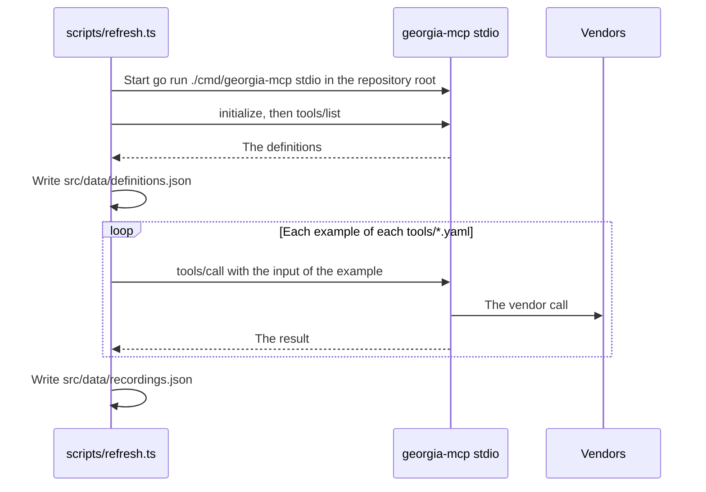

# Specification: The website

## 1. Summary

A static Astro site in `website/`, in English at `/` and in Georgian at `/ka/`. It
has one home page and one tool page for each tool, in each language. The data of
the tools lives in four files in the repository. One command refreshes two of them
from the server.

## 2. Coverage

| Requirement       | Where this specification realizes it                    |
| ----------------- | ------------------------------------------------------- |
| `WEBSITE-FR-001`  | 4.3 Pages, `WEBSITE-DD-001`, `WEBSITE-SC-001`           |
| `WEBSITE-FR-002`  | 4.3 Pages, `WEBSITE-DD-001`, `WEBSITE-SC-002`           |
| `WEBSITE-FR-003`  | `WEBSITE-DD-001`, `WEBSITE-SC-003`                      |
| `WEBSITE-FR-004`  | 4.3 Pages, `WEBSITE-SC-004`                             |
| `WEBSITE-FR-005`  | 4.3 Data files, `WEBSITE-SC-005`                        |
| `WEBSITE-FR-006`  | `WEBSITE-DD-004`, `WEBSITE-SC-006`                      |
| `WEBSITE-FR-007`  | 4.4 Install guides, `WEBSITE-SC-007`                    |
| `WEBSITE-FR-008`  | 4.4, `WEBSITE-DD-008`, `WEBSITE-SC-008`, `WEBSITE-SC-009` |
| `WEBSITE-FR-009`  | 4.4 Install guides, `WEBSITE-SC-007`                    |
| `WEBSITE-FR-010`  | 4.3 Pages, `WEBSITE-SC-010`                             |
| `WEBSITE-FR-011`  | 4.3 Pages, `WEBSITE-SC-011`                             |
| `WEBSITE-FR-012`  | 4.3 Pages, `WEBSITE-SC-012`                             |
| `WEBSITE-FR-013`  | `WEBSITE-DD-005`, `WEBSITE-SC-013`, `WEBSITE-SC-014`    |
| `WEBSITE-FR-014`  | 4.3 Data files, `WEBSITE-SC-015`                        |
| `WEBSITE-FR-015`  | `WEBSITE-DD-005`, `WEBSITE-SC-016`                      |
| `WEBSITE-FR-017`  | `WEBSITE-DD-004`, `WEBSITE-SC-017` to `WEBSITE-SC-021`  |
| `WEBSITE-FR-018`  | 4.3 Commands, `WEBSITE-DD-003`, `WEBSITE-SC-022`        |
| `WEBSITE-FR-019`  | 4.3 Pages, `WEBSITE-SC-023`                             |
| `WEBSITE-FR-020`  | `WEBSITE-DD-009`, `WEBSITE-SC-024`, `WEBSITE-SC-025`    |
| `WEBSITE-FR-021`  | 4.3 Pages, `WEBSITE-SC-026`                             |
| `WEBSITE-FR-022`  | 4.3 Pages, `WEBSITE-DD-010`, `WEBSITE-SC-027`           |
| `WEBSITE-FR-023`  | 4.3 Data files, `WEBSITE-DD-002`, `WEBSITE-SC-022`      |
| `WEBSITE-NFR-001` | `WEBSITE-DD-008`, `WEBSITE-SC-028`                      |
| `WEBSITE-NFR-002` | `WEBSITE-DD-007`, `WEBSITE-SC-029`                      |
| `WEBSITE-NFR-003` | `WEBSITE-DD-006`, `WEBSITE-SC-030`                      |
| `WEBSITE-NFR-004` | `WEBSITE-SC-031`, `WEBSITE-SC-032`                      |
| `WEBSITE-INV-001` | `WEBSITE-DD-004`, `WEBSITE-SC-012`                      |
| `WEBSITE-INV-002` | `WEBSITE-DD-001`, `WEBSITE-SC-001`                      |
| `WEBSITE-INV-003` | `WEBSITE-DD-004`, `WEBSITE-SC-021`                      |

`WEBSITE-FR-017` and `WEBSITE-INV-001` say "the tools that the server registers".
`WEBSITE-FR-023` makes `definitions.json` the record of that set on the site.

## 3. Guideline compliance

| Rule                   | Guideline | How this specification obeys it                                       |
| ---------------------- | --------- | --------------------------------------------------------------------- |
| `BRD-004`              | Brand     | The name is the constant `SITE_NAME` in `src/site.ts`, in both languages. |
| `BRD-005`, `BRD-006`   | Brand     | `src/assets/mark.svg` holds the mark as one outlined path. `WEBSITE-DD-011`. |
| `BRD-007`, `BRD-008`   | Brand     | `src/styles/tokens.css` holds every token of `BRD-007`. A component reads a token only. |
| `BRD-009`              | Brand     | `WEBSITE-DD-006`.                                                     |
| `BRD-010`, `BRD-011`   | Brand     | The components `Echo`, `Band`, `Stamp`, `Ticket`, and `Footer`.       |
| `BRD-012`, `BRD-013`   | Brand     | `src/styles/global.css`. Every animation sits inside `@media (prefers-reduced-motion: no-preference)`. |
| `BRD-014`, `BRD-015`   | Brand     | `src/i18n/en.ts` and `src/i18n/ka.ts` hold the copy. Both satisfy one type. |
| `MCP-005`              | MCP tools | `WEBSITE-DD-004` refuses an output with no `source` or no `as_of`.    |
| `BLD-001`              | Build     | `npm run lint`, `npm test`, `npm run build`. 4.3 Commands.            |
| `GIT-004`              | Git       | A commit of this feature has the scope `website`.                     |
| `LNG-006`, `LNG-007`   | Language  | The test of `WEBSITE-SC-033` refuses an em dash in the copy.          |

`TST` does not govern `website/`. `WEBSITE-DD-012` gives the tests of this feature.

## 4. Design

### 4.1 Components

Every path is under `website/`. Every file is new.

| Part         | Path                                     | Holds                                                         |
| ------------ | ---------------------------------------- | ------------------------------------------------------------- |
| Project      | `package.json`, `.nvmrc`, `astro.config.mjs`, `tsconfig.json`, `.oxlintrc.json` | The dependencies, Node 24, the i18n routing, the fonts. |
| Tests        | `vitest.config.ts`, `playwright.config.ts`, `tests/unit/`, `tests/build/`, `tests/browser/` | `WEBSITE-DD-012`. |
| Refresh      | `scripts/refresh.ts`                     | The command of `WEBSITE-FR-018`.                              |
| Preview card | `scripts/og.ts`, `scripts/og-card.html`  | The command of `WEBSITE-DD-010`.                              |
| Collections  | `src/content.config.ts`                  | The collections `definitions`, `recordings`, `tools`, `contexts`. |
| Data         | `src/data/definitions.json`, `src/data/recordings.json` | Written by `scripts/refresh.ts`. Never by hand.  |
| Content      | `src/content/tools/<tool name>.yaml`, `src/content/contexts.yaml` | Written by hand.                         |
| Catalog      | `src/lib/catalog.ts`                     | `buildCatalog`, `CatalogError`, `getCatalog`. `WEBSITE-DD-004`. |
| Inputs       | `src/lib/inputs.ts`                      | `inputRows`. `WEBSITE-DD-005`.                                |
| Language     | `src/i18n/index.ts`, `src/i18n/en.ts`, `src/i18n/ka.ts` | `Lang`, `Dictionary`, `t`, `localize`, `alternate`. |
| Constants    | `src/site.ts`                            | `SITE_NAME`, `SITE_URL`, `SERVER_URL`, `REPO_URL`, `AUTHOR_URL`. |
| Layout       | `src/layouts/Base.astro`                 | The head, the theme script, the header, the footer.          |
| Views        | `src/views/Home.astro`, `src/views/Tool.astro` | One view for both languages. A page passes `lang`.      |
| Components   | `src/components/*.astro`                 | `Mark`, `Echo`, `Band`, `Stamp`, `Ticket`, `ContextCard`, `ToolList`, `InputTable`, `InstallGuides`, `CopyField`, `ThemeToggle`, `LangSwitch`. |
| Pages        | `src/pages/`                             | 4.3 Pages.                                                    |
| Styles       | `src/styles/tokens.css`, `src/styles/global.css` | `BRD-007`, `BRD-012`.                                 |
| Static       | `public/favicon.svg`, `public/og/en.png`, `public/og/ka.png` | The favicon and the preview images.       |

`src/site.ts`:

```ts
export const SITE_NAME = "Georgia MCP"
export const SITE_URL = "https://geo-mcp.abgeo.cloud"
export const SERVER_URL = "https://geo-mcp.abgeo.cloud/mcp"
export const REPO_URL = "https://github.com/abgeo/georgia-mcp"
export const AUTHOR_URL = "https://www.abgeo.dev"
```

### 4.2 Data model

```ts
type Lang = "en" | "ka"
type Localized = Record<Lang, string>

// definitions.json: an object keyed by the tool name. The fields of tools/list.
type Definition = {
  name: string
  title: string
  description: string
  inputSchema: JSONSchema
  outputSchema: JSONSchema
  annotations: Record<string, unknown>
}

// recordings.json: an object keyed by "<tool name>.<example id>".
type Recording = {
  tool: string
  example: string
  recordedAt: string // RFC 3339, the instant of the call
  output: unknown    // the structured content of the result
}

// tools/<tool name>.yaml. The file name is the tool name.
type ToolContent = {
  context: "rates" | "fuel" | "transit" | "offers"
  featured: boolean // the tool of the context on the home page
  summary: Localized
  examples: Array<{ id: string; question: Localized; input: Record<string, unknown> }>
}

// contexts.yaml: an object keyed by the context name.
type ContextContent = {
  order: number
  hue: "butter" | "peach" | "sky" | "lilac"
  icon: string // a Lucide icon name
  name: Localized
  vendors: Localized[]
}

// The result of buildCatalog. Every page reads this, never a collection.
type Catalog = {
  contexts: Array<ContextContent & { key: string; tools: CatalogTool[] }>
  tools: CatalogTool[] // sorted by context order, then by name
}
type CatalogTool = Definition & ToolContent & {
  examples: Array<ToolContent["examples"][number] & { recordedAt: string; output: unknown }>
}

class CatalogError extends Error {
  problems: string[] // one line for each failed check, with the tool name
}
```

Each collection in `src/content.config.ts` has a zod schema of the type above.
The `file` loader reads `definitions.json`, `recordings.json`, and `contexts.yaml`.
The `glob` loader reads `tools/*.yaml`.

### 4.3 Declarations

**Pages.** `trailingSlash` is `always`. Every page exists in both columns.

| English              | Georgian                 | Source file                                         | Realizes                         |
| -------------------- | ------------------------ | --------------------------------------------------- | -------------------------------- |
| `/`                  | `/ka/`                   | `src/pages/index.astro`, `src/pages/ka/index.astro` | `WEBSITE-FR-001`, `FR-004` to `FR-009`, `FR-011` |
| `/tools/<name>/`     | `/ka/tools/<name>/`      | `src/pages/tools/[name].astro`, `src/pages/ka/tools/[name].astro` | `WEBSITE-FR-012` to `FR-015` |
| `/404.html`          | The same file            | `src/pages/404.astro`                               | `WEBSITE-FR-021`                 |

- Each page links to its pair with `LangSwitch` and with `<link rel="alternate" hreflang>`. `WEBSITE-FR-002`.
- No file exists under `src/pages/mcp`. `WEBSITE-FR-010`.
- The home page holds the sections of `WEBSITE-FR-004` in order, each a `<section>` with an `id`: `intro`, `contexts`, `examples`, `install`, `tools`, `author`.
- `Base.astro` ends each page with `Footer`: the byline of `BRD-011`, and `REPO_URL`. `WEBSITE-FR-019`.
- `Base.astro` writes `<title>`, `<meta name="description">`, `og:title`, `og:description`, `og:image`, `og:locale`, and `twitter:card` from the dictionary of the page. `WEBSITE-FR-022`.

**Data files.**

| File                               | Written by            | Holds                                              | Realizes                         |
| ---------------------------------- | --------------------- | -------------------------------------------------- | -------------------------------- |
| `src/data/definitions.json`        | `npm run refresh`     | `Definition` of each tool that the server lists    | `WEBSITE-FR-023`, `FR-013`       |
| `src/data/recordings.json`         | `npm run refresh`     | `Recording` of each tool example                   | `WEBSITE-FR-014`, `FR-018`       |
| `src/content/tools/<name>.yaml`    | The owner             | `ToolContent`                                      | `WEBSITE-FR-011`, `FR-015`       |
| `src/content/contexts.yaml`        | The owner             | `ContextContent`                                   | `WEBSITE-FR-005`                 |

**Commands.** Each is a script of `package.json`, run in `website/`.

| Command            | Does                                                                         | Realizes                  |
| ------------------ | ---------------------------------------------------------------------------- | ------------------------- |
| `npm run dev`      | Serves the site with reload.                                                 | None. A tool of the work. |
| `npm run build`    | `astro build` to `dist/`. Fails on a `CatalogError`.                         | `WEBSITE-FR-017`          |
| `npm run lint`     | `astro check`, then `oxlint`.                                                | `BLD-001`                 |
| `npm test`         | `vitest run`, then `playwright test`. The build tests read `dist/`.          | `WEBSITE-DD-012`          |
| `npm run refresh`  | Writes both data files from the server. `WEBSITE-DD-003`.                    | `WEBSITE-FR-018`, `FR-023` |
| `npm run og`       | Writes `public/og/en.png` and `public/og/ka.png`. `WEBSITE-DD-010`.          | `WEBSITE-FR-022`          |

**Configuration.** The refresh reads the `.env` file of the repository root, because
the server starts in that directory. The site reads no variable.

| Variable                     | Type   | Default | Secret | Realizes         |
| ---------------------------- | ------ | ------- | ------ | ---------------- |
| `GEOMCP_RATES_TBC_API_KEY`   | string | none    | Yes    | `WEBSITE-FR-018` |
| `GEOMCP_TRANSIT_TTC_API_KEY` | string | none    | Yes    | `WEBSITE-FR-018` |

### 4.4 Install guides

`InstallGuides` renders one panel for each guide, in this order. `{url}` is `SERVER_URL`.
Each panel of a remote server holds a `CopyField` with `{url}`. `WEBSITE-FR-008`.

| Guide          | Steps                                                                                       | Realizes         |
| -------------- | ------------------------------------------------------------------------------------------- | ---------------- |
| Claude         | Settings, Connectors, Add custom connector. Name `Georgia MCP`, URL `{url}`. Web and desktop. | `WEBSITE-FR-007` |
| Claude Code    | `claude mcp add --transport http georgia-mcp {url}`                                         | `WEBSITE-FR-007` |
| ChatGPT        | Settings, Apps and connectors, Advanced, turn on developer mode. Create a connector with `{url}`, no authentication. | `WEBSITE-FR-007` |
| Cursor         | `~/.cursor/mcp.json`: `{"mcpServers": {"georgia-mcp": {"url": "{url}"}}}`                   | `WEBSITE-FR-007` |
| VS Code        | `.vscode/mcp.json`: `{"servers": {"georgia-mcp": {"type": "http", "url": "{url}"}}}`        | `WEBSITE-FR-007` |
| Binary         | Download from `{REPO_URL}/releases/latest`, or `go install github.com/abgeo/georgia-mcp/cmd/georgia-mcp@latest`. Then `claude mcp add georgia-mcp -- georgia-mcp stdio`. | `WEBSITE-FR-009` |
| Docker         | `docker run -p 8080:8080 -e GEOMCP_TRANSIT_TTC_API_KEY=... ghcr.io/abgeo/georgia-mcp`. Address `http://localhost:8080/mcp`, with a `CopyField`. | `WEBSITE-FR-009` |

The two local guides state the settings of the keys:

- `GEOMCP_TRANSIT_TTC_API_KEY` is required. `GEOMCP_TRANSIT_TTC_ENABLED=false` starts the server without the transit tools.
- `GEOMCP_RATES_TBC_API_KEY` is optional. Without it, the commercial rates leave out TBC Bank.

### 4.5 Flow of the refresh



### 4.6 Errors

| Condition                                       | Where                | Message                                                         |
| ----------------------------------------------- | -------------------- | --------------------------------------------------------------- |
| A check of `WEBSITE-DD-004` fails               | `npm run build`      | `CatalogError`, one line for each problem, for example `transit_list_vehicles: no tool content`. |
| The server does not start                       | `npm run refresh`    | The stderr of the server, and exit code 1. No file changes.     |
| A tool call returns a result with `isError`     | `npm run refresh`    | `<tool>.<example>: <the text of the result>`, and exit code 1. No file changes. |
| The browser refuses the clipboard               | `CopyField`          | The field selects the address. The label says "Press Ctrl+C to copy". |

## 5. Design decisions

### `WEBSITE-DD-001`

**Realizes:** `WEBSITE-FR-001` to `FR-003`, `WEBSITE-INV-002`
**Decision:** Astro 7, `output: "static"`. `i18n` with `locales: ["en", "ka"]`, `defaultLocale: "en"`, `routing: { prefixDefaultLocale: false, redirectToDefaultLocale: false }`. A Georgian page file imports the view of the English page file and passes `lang="ka"`. `localize(path, lang)` and `alternate(path)` in `src/i18n/index.ts` compute every link. `ka.ts` satisfies the type `Dictionary` of `en.ts`, so a missing Georgian text fails `astro check`.
**Rationale:** The i18n routing of Astro gives the prefix and no redirect with no code. One view for two languages keeps the two page sets equal.
**Alternatives:** One dynamic route `[...lang]`. It hides the page set in a function and makes `WEBSITE-INV-002` harder to read.

### `WEBSITE-DD-002`

**Realizes:** `WEBSITE-FR-023`
**Decision:** The site reads the tool definitions from `src/data/definitions.json` in the repository. The build starts no server.
**Rationale:** The owner chose this. The build needs Node only.
**Alternatives:** A content loader that starts the server at each build. Exact, but the build needs Go and the keys.

### `WEBSITE-DD-003`

**Realizes:** `WEBSITE-FR-018`, `WEBSITE-FR-023`
**Decision:** `scripts/refresh.ts` runs with `node --experimental-strip-types`. It uses `Client` and `StdioClientTransport` of `@modelcontextprotocol/sdk`. The transport starts `go run ./cmd/georgia-mcp stdio` with `cwd` at the repository root. The script calls `tools/list`, then `tools/call` for each example of each `tools/*.yaml`, in sequence. It writes both files only after every call succeeds. Each file is sorted by key and ends with a newline.
**Rationale:** The server is the only source of a definition and an output. A sequence of calls stays under the rate limits of the vendors. A sorted file gives a small diff.
**Alternatives:** A Go command in the server that writes the files. It adds a command to `CLI` for the site alone.

### `WEBSITE-DD-004`

**Realizes:** `WEBSITE-FR-006`, `WEBSITE-FR-017`, `WEBSITE-INV-001`, `WEBSITE-INV-003`
**Decision:** `buildCatalog(definitions, recordings, tools, contexts)` is a pure function. It runs every check below, collects every problem, and throws one `CatalogError`. `getCatalog()` reads the four collections, calls `buildCatalog` once, and keeps the result. Each page calls `getCatalog()`, so a problem fails the build.

| Check                                                                          | Requirement      |
| ------------------------------------------------------------------------------ | ---------------- |
| Each definition has a tool content file.                                       | `WEBSITE-FR-017` |
| Each tool content file names a definition.                                     | `WEBSITE-FR-017` |
| Each tool has one example at least, and a summary in `en` and in `ka`.         | `WEBSITE-FR-017` |
| Each example has a recording.                                                  | `WEBSITE-FR-017` |
| Each recording output is valid against the `outputSchema` of its tool. Ajv 2020. | `WEBSITE-FR-017` |
| Each recording output holds a `source` key and an `as_of` key, at any depth.   | `WEBSITE-INV-003` |
| Each context of a tool exists in `contexts.yaml`.                              | `WEBSITE-FR-017` |
| Each context has one `featured` tool, exactly.                                 | `WEBSITE-FR-006` |

**Rationale:** A pure function has a unit test for each check, with no build. One error with every problem saves a build for each problem.
**Alternatives:** A check inside each loader. A loader sees one collection only.

### `WEBSITE-DD-005`

**Realizes:** `WEBSITE-FR-013`, `WEBSITE-FR-015`
**Decision:** `inputRows(inputSchema)` returns one row for each property: name, type, description, required, default. A type is the `type` of the property, `<item type>[]` for an array, and the values joined by ` | ` for an `enum`. A schema with no property gives no row, and `InputTable` shows the dictionary text "This tool takes no input." The Georgian tool page shows the `summary.ka` and the `question.ka`. The definition and the output stay in English, inside `lang="en"`.
**Rationale:** The model reads the English definition. `lang="en"` tells a screen reader the language of the block.
**Alternatives:** A translation of each description. The owner refused it.

### `WEBSITE-DD-006`

**Realizes:** `WEBSITE-NFR-003`, `BRD-009`
**Decision:** The Fonts API of Astro, with `fontProviders.fontsource()`, serves the four families from the site. Fraunces: weight 600, axes `opsz` and `SOFT`, subset `latin`. Geist: weights 400 to 700, subsets `latin` and `latin-ext`. JetBrains Mono: weights 400 to 600, subset `latin`. Noto Sans Georgian: weights 400 to 700, subset `georgian`. The page preloads Geist and Fraunces on an English page, and Noto Sans Georgian and Geist on a Georgian page.
**Rationale:** A file from the site sends no data to a third party. A subset and a preload for each language keep the first view under 500 KB.
**Alternatives:** Google Fonts. It sends the address of each reader to Google.

### `WEBSITE-DD-007`

**Realizes:** `WEBSITE-NFR-002`
**Decision:** No UI framework. Three scripts: the theme script inline in the head, and the scripts of `CopyField` and `InstallGuides`. `ThemeToggle` adds a fourth, of fewer than 1 KB.
**Rationale:** The interactive parts are three small controls. The owner chose plain scripts.
**Alternatives:** React islands. React alone costs about 45 KB compressed.

### `WEBSITE-DD-008`

**Realizes:** `WEBSITE-FR-008`, `WEBSITE-NFR-001`
**Decision:** The HTML of `InstallGuides` holds every panel, visible. The script adds the role `tablist`, hides the panels but one, and moves the focus with the arrow keys. `CopyField` is a read-only `<input>` with the address and a `<button>`. The button calls `navigator.clipboard.writeText`. On a rejection, it selects the input and shows the fallback label of 4.6.
**Rationale:** With scripts off, the reader sees every guide. With scripts on, the reader sees one.
**Alternatives:** Tabs in CSS only, with radio inputs. They break the keyboard pattern of a tab list.

### `WEBSITE-DD-009`

**Realizes:** `WEBSITE-FR-020`, `BRD-007`
**Decision:** The key `theme` in `localStorage` holds `light` or `dark`. No key means the system theme. An inline script in the head sets `data-theme` on `<html>` before the first paint. `ThemeToggle` cycles system, light, dark, and writes or removes the key. Each access to `localStorage` sits in a `try` block.
**Rationale:** The key lives in the origin, so every page reads it. The script in the head stops a flash of the wrong theme.
**Alternatives:** A cookie. It goes to the server with each request, and the site has no server.

### `WEBSITE-DD-010`

**Realizes:** `WEBSITE-FR-022`
**Decision:** Two preview images, 1200 by 630 px: `public/og/en.png` and `public/og/ka.png`, committed. `npm run og` opens `scripts/og-card.html` in Playwright with each language and takes a screenshot. Every page of a language uses the image of that language.
**Rationale:** The requirement asks for an image in the language of the page. One image for each language meets it. Playwright is already a dependency of the tests.
**Alternatives:** One image for each page, drawn at build. It adds a renderer and a font pipeline for 30 images.

### `WEBSITE-DD-011`

**Realizes:** `BRD-005`
**Decision:** `src/assets/mark.svg` holds mani as one filled path, outlined from the strokes of the brand sample: top bar, stem, bowl, arm, stroke 3.5, on a viewBox of 24. `Mark.astro` inlines it with `fill="currentColor"`. `public/favicon.svg` draws it in the wine text tone on the wine fill, with a dark variant under `prefers-color-scheme: dark`.
**Rationale:** A filled path renders the same in every browser and at 16 px. A stroke depends on the renderer.
**Alternatives:** A stroked path. It thins at small sizes in some renderers.

### `WEBSITE-DD-012`

**Realizes:** `WEBSITE-NFR-001` to `NFR-004`, and each scenario
**Decision:** Three test layers. A test cites its scenario in a comment, as `TST-001` asks of Go.

| Layer     | Runs                                                        | Tool                         |
| --------- | ----------------------------------------------------------- | ---------------------------- |
| `unit`    | One module of `src/lib` or `src/i18n`, with data in the test. | Vitest                       |
| `build`   | The files in `dist/` after `npm run build`.                 | Vitest                       |
| `browser` | The site from `astro preview`, in Chromium.                 | Playwright, `@axe-core/playwright` |
| `manual`  | The owner, by hand.                                         | None                         |

**Rationale:** The checks of the data need no browser. The checks of the scripts and of the transfer need one.
**Alternatives:** Build checks only. The owner chose the browser tests.

### `WEBSITE-DD-013`

**Realizes:** `BLD-001`
**Decision:** `npm run lint` runs `astro check`, then `oxlint`. The versions: Node 24, `astro` 7.4.1, `@astrojs/check` 0.9.11, `@astrojs/sitemap` 3.7.4, `@modelcontextprotocol/sdk` 1.32.1, `ajv` 8.20.0, `vitest` 5.0.5, `@playwright/test` 1.64.1, `@axe-core/playwright` 4.14.0, `oxlint` 1.89.0, `typescript` 7.0.2, `yaml` 2.9.1. `@astrojs/sitemap` writes the sitemap with the `hreflang` pairs.
**Rationale:** `astro check` reads the types of `.astro` files. Astro 7 needs Node 22.22 at least.
**Alternatives:** ESLint. Slower, with more configuration.

## 6. Scenarios

### `WEBSITE-SC-001`

**Verifies:** `WEBSITE-FR-001`, `WEBSITE-INV-002`
**Layer:** build

**Given** a build of the site.
**When** the test lists each `index.html` in `dist/`.
**Then** each path `P` outside `ka/` has the pair `ka/P`, and each path under `ka/` has its pair outside. `dist/en/` does not exist.

### `WEBSITE-SC-002`

**Verifies:** `WEBSITE-FR-002`
**Layer:** build

**Given** each built page.
**When** the test reads its `LangSwitch` link and its `hreflang` links.
**Then** the link points to the pair of `WEBSITE-SC-001`.

### `WEBSITE-SC-003`

**Verifies:** `WEBSITE-FR-003`
**Layer:** browser

**Given** a browser with the language `ka-GE`.
**When** it opens `/`.
**Then** the page is the English home page, and the address stays `/`.

### `WEBSITE-SC-004`

**Verifies:** `WEBSITE-FR-004`
**Layer:** build

**Given** `dist/index.html` and `dist/ka/index.html`.
**When** the test reads the `id` of each `<section>` in `<main>`.
**Then** the list is `intro`, `contexts`, `examples`, `install`, `tools`, `author`.

### `WEBSITE-SC-005`

**Verifies:** `WEBSITE-FR-005`
**Layer:** unit

**Given** a context `fuel` with three vendors and one tool, and a context with one vendor.
**When** `buildCatalog` runs.
**Then** the `fuel` entry holds three vendors and one tool, and the other holds one vendor.

### `WEBSITE-SC-006`

**Verifies:** `WEBSITE-FR-006`
**Layer:** unit

**Given** a context with two `featured` tools, and a context with none.
**When** `buildCatalog` runs.
**Then** `CatalogError` names both contexts.

### `WEBSITE-SC-007`

**Verifies:** `WEBSITE-FR-007`, `WEBSITE-FR-009`
**Layer:** build

**Given** both home pages.
**When** the test reads the panels of `#install`.
**Then** there are seven panels in the order of 4.4, and the Docker panel holds `GEOMCP_TRANSIT_TTC_ENABLED`.

### `WEBSITE-SC-008`

**Verifies:** `WEBSITE-FR-008`
**Layer:** browser

**Given** the home page, with the clipboard permission granted.
**When** the reader presses the copy button of the Claude Code panel.
**Then** the clipboard holds `https://geo-mcp.abgeo.cloud/mcp`.

### `WEBSITE-SC-009`

**Verifies:** `WEBSITE-FR-008`
**Layer:** browser

**Given** the home page, with a `navigator.clipboard.writeText` that rejects.
**When** the reader presses the copy button.
**Then** the input holds the selection of the full address, and the fallback label shows.

### `WEBSITE-SC-010`

**Verifies:** `WEBSITE-FR-010`
**Layer:** build

**Given** a build of the site.
**When** the test looks for `dist/mcp` and `dist/ka/mcp`.
**Then** neither exists.

### `WEBSITE-SC-011`

**Verifies:** `WEBSITE-FR-011`
**Layer:** build

**Given** both home pages.
**When** the test reads `#tools`.
**Then** it holds one group for each context, and each tool of `definitions.json` once, with its summary in the language of the page.

### `WEBSITE-SC-012`

**Verifies:** `WEBSITE-FR-012`, `WEBSITE-INV-001`
**Layer:** build

**Given** `definitions.json` with 14 tools.
**When** the test lists `dist/tools/*/index.html` and `dist/ka/tools/*/index.html`.
**Then** each list holds 14 names, equal to the keys of `definitions.json`.

### `WEBSITE-SC-013`

**Verifies:** `WEBSITE-FR-013`
**Layer:** unit

**Given** the input schema of `rates_get_official_rates`, and a schema with no property.
**When** `inputRows` runs on each.
**Then** the first gives the rows `currencies` and `date`, with type, description, required, and default. The second gives no row.

### `WEBSITE-SC-014`

**Verifies:** `WEBSITE-FR-013`
**Layer:** unit

**Given** a property with `"type": "array"` of strings, and a property with an `enum` of `wissol` and `socar`.
**When** `inputRows` runs.
**Then** the types are `string[]` and `wissol | socar`.

### `WEBSITE-SC-015`

**Verifies:** `WEBSITE-FR-014`
**Layer:** build

**Given** the tool page of `fuel_get_prices` in both languages.
**When** the test reads each `Ticket`.
**Then** each shows the question, the input, the output, and the `recordedAt` date of its recording.

### `WEBSITE-SC-016`

**Verifies:** `WEBSITE-FR-015`
**Layer:** build

**Given** `/ka/tools/fuel_get_prices/`.
**When** the test reads the page.
**Then** it holds `summary.ka` and each `question.ka`, and the description of the definition inside an element with `lang="en"`.

### `WEBSITE-SC-017`

**Verifies:** `WEBSITE-FR-017`
**Layer:** unit

**Given** a definition `transit_list_vehicles` with no tool content file.
**When** `buildCatalog` runs.
**Then** `CatalogError` holds `transit_list_vehicles: no tool content`.

### `WEBSITE-SC-018`

**Verifies:** `WEBSITE-FR-017`
**Layer:** unit

**Given** a tool content file `fuel_get_price` that names no definition.
**When** `buildCatalog` runs.
**Then** `CatalogError` holds `fuel_get_price: no definition`.

### `WEBSITE-SC-019`

**Verifies:** `WEBSITE-FR-017`
**Layer:** unit

**Given** a tool with no `summary.ka`, and a tool with an example that has no recording.
**When** `buildCatalog` runs.
**Then** `CatalogError` holds one problem for each tool.

### `WEBSITE-SC-020`

**Verifies:** `WEBSITE-FR-017`
**Layer:** unit

**Given** a recording whose output has a number where the output schema demands a string.
**When** `buildCatalog` runs.
**Then** `CatalogError` names the tool, the example, and the path of the value.

### `WEBSITE-SC-021`

**Verifies:** `WEBSITE-INV-003`
**Layer:** unit

**Given** an output with `source` and `as_of` inside each item of a list, and an output with no `as_of`.
**When** `buildCatalog` runs.
**Then** the first passes. `CatalogError` names the second.

### `WEBSITE-SC-022`

**Verifies:** `WEBSITE-FR-018`, `WEBSITE-FR-023`
**Layer:** manual

**Given** a `.env` with both keys, and Go.
**When** the owner runs `npm run refresh`, then `npm run build`.
**Then** both data files change only where the server changed, and the build passes.

### `WEBSITE-SC-023`

**Verifies:** `WEBSITE-FR-019`
**Layer:** build

**Given** each built page.
**When** the test reads the `<footer>`.
**Then** it holds "Made with :3 in Georgia by ABGEO", a link to `https://www.abgeo.dev`, and a link to `REPO_URL`.

### `WEBSITE-SC-024`

**Verifies:** `WEBSITE-FR-020`
**Layer:** browser

**Given** the home page with the system theme light.
**When** the reader selects dark, then opens a tool page.
**Then** `<html>` of the tool page has `data-theme="dark"` before the first paint.

### `WEBSITE-SC-025`

**Verifies:** `WEBSITE-FR-020`
**Layer:** browser

**Given** a page whose `localStorage` throws on each access, and the system theme dark.
**When** the page opens.
**Then** the page shows the dark theme, and the console holds no error.

### `WEBSITE-SC-026`

**Verifies:** `WEBSITE-FR-021`
**Layer:** browser

**Given** `astro preview`.
**When** the browser opens `/no-such-page/`.
**Then** the answer is 404, and the page holds a link to `/` and a link to `/ka/`.

### `WEBSITE-SC-027`

**Verifies:** `WEBSITE-FR-022`
**Layer:** build

**Given** each built page.
**When** the test reads the head.
**Then** it holds a title, a description, and `og:image` with the image of its language, as an absolute address under `SITE_URL`.

### `WEBSITE-SC-028`

**Verifies:** `WEBSITE-NFR-001`
**Layer:** build

**Given** both home pages and one tool page, before a browser runs them.
**When** the test reads the text of the HTML file.
**Then** it holds the heading of each section, every panel of `#install`, and the output of each `Ticket`.

### `WEBSITE-SC-029`

**Verifies:** `WEBSITE-NFR-002`
**Layer:** build

**Given** the build.
**When** the test sums the gzip size of each script that `dist/index.html` loads, and of each inline script.
**Then** the sum is 60 KB at most. For `dist/tools/fuel_get_prices/index.html`, 30 KB at most.

### `WEBSITE-SC-030`

**Verifies:** `WEBSITE-NFR-003`
**Layer:** browser

**Given** a new browser context with a width of 390 px and an empty cache.
**When** it opens `/` and `/ka/`, and the network goes idle.
**Then** the sum of the encoded body sizes of the responses is 500 KB at most for each page.

### `WEBSITE-SC-031`

**Verifies:** `WEBSITE-NFR-004`
**Layer:** browser

**Given** `/`, `/ka/`, one tool page in each language, and the 404 page, in each theme.
**When** axe checks the page with the tags `wcag2a`, `wcag2aa`, `wcag21aa`, `wcag22aa`.
**Then** axe reports no violation.

### `WEBSITE-SC-032`

**Verifies:** `WEBSITE-NFR-004`
**Layer:** browser

**Given** the home page.
**When** the reader uses the keyboard alone: Tab to the guides, the arrow keys, Enter on a copy button, Tab to the theme toggle.
**Then** each control takes the focus with a visible ring, and each acts.

### `WEBSITE-SC-033`

**Verifies:** `BRD-014`
**Layer:** unit

**Given** `en.ts`, `ka.ts`, and each `tools/*.yaml`.
**When** the test reads every string.
**Then** no string holds an em dash.

## 7. Build plan

| #   | Step                                                                                       | Realizes                       | Done |
| --- | ------------------------------------------------------------------------------------------ | ------------------------------ | ---- |
| 1   | Create the project: `package.json`, `.nvmrc`, `astro.config.mjs`, lint, test configuration. | `WEBSITE-DD-001`, `DD-012`, `DD-013` | [ ] |
| 2   | Write `src/site.ts`, the types and the collections of 4.2.                                  | `WEBSITE-FR-023`               | [ ]  |
| 3   | Write the unit tests of `buildCatalog` and `inputRows`. Run them. They fail.               | `WEBSITE-SC-005`, `SC-006`, `SC-013`, `SC-014`, `SC-017` to `SC-021` | [ ] |
| 4   | Write `src/lib/catalog.ts` and `src/lib/inputs.ts` until the tests pass.                   | `WEBSITE-DD-004`, `DD-005`     | [ ]  |
| 5   | Write `scripts/refresh.ts`. Write `contexts.yaml` and a `tools/*.yaml` for each tool. Run the refresh. | `WEBSITE-DD-003`, `FR-018` | [ ] |
| 6   | Write `tokens.css`, `global.css`, `mark.svg`, the favicon, and the components of `BRD`.    | `WEBSITE-DD-006`, `DD-011`     | [ ]  |
| 7   | Write `src/i18n`, with the English copy and a Georgian draft for the owner.                | `WEBSITE-DD-001`, `SC-033`     | [ ]  |
| 8   | Write `Base.astro`, the two views, and the pages of 4.3.                                   | `WEBSITE-FR-001` to `FR-022`   | [ ]  |
| 9   | Write the scripts of `ThemeToggle`, `CopyField`, `InstallGuides`.                           | `WEBSITE-DD-007` to `DD-009`   | [ ]  |
| 10  | Write `scripts/og.ts` and the card. Run it.                                                 | `WEBSITE-DD-010`               | [ ]  |
| 11  | Write the build and the browser tests. Run lint, test, build until they pass.              | `WEBSITE-SC-001` to `SC-033`   | [ ]  |

## 8. Out of scope for this specification

- The deployment, and the route of `/mcp` to the server. The owner decides them outside this feature.
- The release of the binary and of `ghcr.io/abgeo/georgia-mcp`. Until it exists, the binary guide and the Docker guide name an address that does not answer.
- A check that `definitions.json` equals the server. `WEBSITE-FR-023` accepts a stale file until the next refresh.

## Retired identifiers

This file has no retired identifier.
