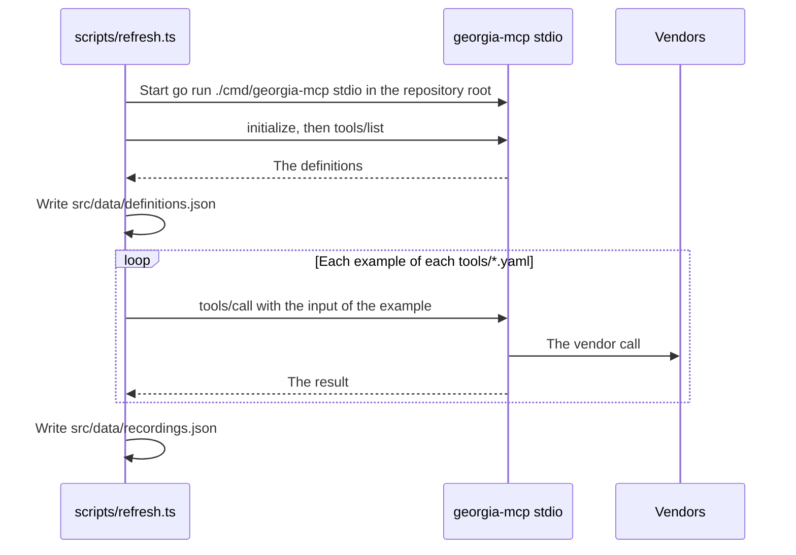

# Specification: The website

## 1. Summary

A static Astro site in `website/`, in English at `/` and in Georgian at `/ka/`. It
has one home page, one tool page for each tool, and two legal pages, in each language. The data of
the tools lives in four files in the repository. One command refreshes two of them
from the server.

## 2. Coverage

| Requirement       | Where this specification realizes it                    |
| ----------------- | ------------------------------------------------------- |
| `WEBSITE-FR-001`  | 4.3 Pages, `WEBSITE-DD-001`, `WEBSITE-SC-001`           |
| `WEBSITE-FR-002`  | 4.3 Pages, `WEBSITE-DD-001`, `WEBSITE-SC-002`           |
| `WEBSITE-FR-003`  | `WEBSITE-DD-001`, `WEBSITE-SC-003`                      |
| `WEBSITE-FR-005`  | 4.3 Data files, `WEBSITE-DD-020`, `WEBSITE-SC-005`, `WEBSITE-SC-046` |
| `WEBSITE-FR-007`  | 4.4 Install guides, `WEBSITE-SC-007`, `WEBSITE-SC-051`  |
| `WEBSITE-FR-008`  | 4.4, `WEBSITE-DD-008`, `WEBSITE-SC-008`, `WEBSITE-SC-009` |
| `WEBSITE-FR-009`  | 4.4 Install guides, `WEBSITE-SC-007`                    |
| `WEBSITE-FR-010`  | 4.3 Pages, `WEBSITE-SC-010`                             |
| `WEBSITE-FR-011`  | 4.3 Pages, `WEBSITE-DD-014`, `WEBSITE-SC-011`, `WEBSITE-SC-036` |
| `WEBSITE-FR-012`  | 4.3 Pages, `WEBSITE-SC-012`                             |
| `WEBSITE-FR-013`  | `WEBSITE-DD-005`, `WEBSITE-SC-013`, `WEBSITE-SC-014`    |
| `WEBSITE-FR-015`  | `WEBSITE-DD-005`, `WEBSITE-SC-016`                      |
| `WEBSITE-FR-017`  | `WEBSITE-DD-004`, `WEBSITE-SC-017` to `WEBSITE-SC-021`  |
| `WEBSITE-FR-018`  | 4.3 Commands, `WEBSITE-DD-003`, `WEBSITE-SC-022`        |
| `WEBSITE-FR-019`  | 4.3 Pages, `WEBSITE-SC-023`                             |
| `WEBSITE-FR-020`  | `WEBSITE-DD-009`, `WEBSITE-SC-024`, `WEBSITE-SC-025`    |
| `WEBSITE-FR-021`  | 4.3 Pages, `WEBSITE-SC-026`                             |
| `WEBSITE-FR-022`  | 4.3 Pages, `WEBSITE-DD-010`, `WEBSITE-SC-027`           |
| `WEBSITE-FR-023`  | 4.3 Data files, `WEBSITE-DD-002`, `WEBSITE-SC-022`      |
| `WEBSITE-FR-024`  | 4.1 `Ticket`, `WEBSITE-SC-015`                          |
| `WEBSITE-FR-028`  | `WEBSITE-DD-015`, `WEBSITE-SC-035`, `WEBSITE-SC-037`, `WEBSITE-SC-039` |
| `WEBSITE-FR-030`  | 4.3 Pages, `WEBSITE-SC-004`                             |
| `WEBSITE-FR-032`  | `WEBSITE-DD-016`, `WEBSITE-SC-040`, `WEBSITE-SC-041`    |
| `WEBSITE-FR-033`  | 4.2 `vendors`, `WEBSITE-DD-018`, `WEBSITE-DD-019`, `WEBSITE-SC-043`, `WEBSITE-SC-045` |
| `WEBSITE-FR-027`  | `WEBSITE-DD-004`, `WEBSITE-SC-034`                      |
| `WEBSITE-FR-034`  | 4.3 Pages, `WEBSITE-DD-022`, `WEBSITE-SC-047`           |
| `WEBSITE-FR-035`  | `WEBSITE-DD-022`, `WEBSITE-DD-023`, `WEBSITE-SC-048`    |
| `WEBSITE-FR-036`  | 4.3 Pages, `WEBSITE-DD-022`, `WEBSITE-SC-047`           |
| `WEBSITE-FR-037`  | 4.3 Pages, `WEBSITE-SC-049`                             |
| `WEBSITE-FR-038`  | 4.1 Static, `WEBSITE-DD-024`, `WEBSITE-SC-050`          |
| `WEBSITE-NFR-001` | `WEBSITE-DD-008`, `WEBSITE-SC-028`                      |
| `WEBSITE-NFR-002` | `WEBSITE-DD-007`, `WEBSITE-SC-029`                      |
| `WEBSITE-NFR-003` | `WEBSITE-DD-006`, `WEBSITE-SC-030`                      |
| `WEBSITE-NFR-005` | `WEBSITE-SC-031`, `WEBSITE-SC-032`, `WEBSITE-SC-039`    |
| `WEBSITE-INV-001` | `WEBSITE-DD-004`, `WEBSITE-SC-012`                      |
| `WEBSITE-INV-002` | `WEBSITE-DD-001`, `WEBSITE-SC-001`                      |
| `WEBSITE-INV-003` | `WEBSITE-DD-004`, `WEBSITE-SC-021`                      |
| `WEBSITE-INV-004` | `WEBSITE-DD-004`, `WEBSITE-DD-018`, `WEBSITE-SC-044`    |

`WEBSITE-FR-017` and `WEBSITE-INV-001` say "the tools that the server registers".
`WEBSITE-FR-023` makes `definitions.json` the record of that set on the site.

## 3. Guideline compliance

| Rule                   | Guideline | How this specification obeys it                                       |
| ---------------------- | --------- | --------------------------------------------------------------------- |
| `BRD-004`              | Brand     | The name is the constant `SITE_NAME` in `src/site.ts`, in both languages. |
| `BRD-005`, `BRD-006`   | Brand     | `src/assets/mark.svg` holds the mark as one outlined path. `WEBSITE-DD-011`. |
| `BRD-007`, `BRD-008`   | Brand     | `src/styles/tokens.css` holds every token of `BRD-007`. A component reads a token only. |
| `BRD-009`              | Brand     | `WEBSITE-DD-006`.                                                     |
| `BRD-010`, `BRD-011`   | Brand     | The components `Mark`, `Band`, `Stamp`, `Ticket`, and `Footer`.       |
| `BRD-012`, `BRD-013`   | Brand     | `src/styles/global.css`. Every animation sits inside `@media (prefers-reduced-motion: no-preference)`. |
| `BRD-014`, `BRD-015`   | Brand     | `src/i18n/en.ts` and `src/i18n/ka.ts` hold the copy. Both satisfy one type. |
| `MCP-005`              | MCP tools | `WEBSITE-DD-004` refuses an output with no `source` or no `as_of`.    |
| `BLD-001`              | Build     | `pnpm lint`, `pnpm test`, `pnpm build`. 4.3 Commands.            |
| `GIT-004`              | Git       | A commit of this feature has the scope `website`.                     |
| `LNG-006`, `LNG-007`   | Language  | The test of `WEBSITE-SC-033` refuses an em dash in the copy.          |
| `LOG-008` to `LOG-010` | Logging   | `WEBSITE-DD-023` names the records of these rules, and no other.      |

`TST` does not govern `website/`. `WEBSITE-DD-012` gives the tests of this feature.

## 4. Design

### 4.1 Components

Every path is under `website/`. Every file is new.

| Part         | Path                                     | Holds                                                         |
| ------------ | ---------------------------------------- | ------------------------------------------------------------- |
| Project      | `package.json`, `.nvmrc`, `astro.config.mjs`, `tsconfig.json`, `.oxlintrc.json` | The dependencies, Node 24, the i18n routing, the fonts. |
| Tests        | `vitest.config.ts`, `playwright.config.ts`, `tests/unit/`, `tests/build/`, `tests/browser/` | `WEBSITE-DD-012`. |
| Refresh      | `scripts/refresh.ts`                     | The command of `WEBSITE-FR-018`.                              |
| Preview card | `scripts/og.ts`, `scripts/og-card.html`  | The command of `WEBSITE-DD-010`.                              |
| Collections  | `src/content.config.ts`                  | The collections `definitions`, `recordings`, `tools`, `contexts`. |
| Data         | `src/data/definitions.json`, `src/data/recordings.json` | Written by `scripts/refresh.ts`. Never by hand.  |
| Content      | `src/content/tools/<tool name>.yaml`, `src/content/contexts.yaml` | Written by hand.                         |
| Catalog      | `src/lib/catalog.ts`                     | `buildCatalog`, `CatalogError`, `getCatalog`. `WEBSITE-DD-004`. |
| Inputs       | `src/lib/inputs.ts`                      | `inputRows`. `WEBSITE-DD-005`.                                |
| Tabs         | `src/lib/tabs.ts`                        | `enhanceTabs`. `WEBSITE-DD-021`.                              |
| Language     | `src/i18n/index.ts`, `src/i18n/en.ts`, `src/i18n/ka.ts` | `Lang`, `Dictionary`, `t`, `localize`, `alternate`. |
| Constants    | `src/site.ts`                            | `SITE_NAME`, `SITE_URL`, `SERVER_URL`, `REPO_URL`, `AUTHOR_URL`, `CLAUDE_DIRECTORY_URL`. |
| Layout       | `src/layouts/Base.astro`                 | The head, the theme script, the header, the footer.          |
| Views        | `src/views/Home.astro`, `src/views/Tool.astro`, `src/views/Legal.astro` | One view for both languages. A page passes `lang`. |
| Components   | `src/components/*.astro`                 | `Mark`, `Band`, `Stamp`, `Ticket`, `ChatPlayer`, `HowItWorks`, `ContextIcon`, `ContextCard`, `ToolList`, `InputTable`, `InstallGuides`, `CopyField`, `ThemeToggle`, `LangSwitch`. |
| Pages        | `src/pages/`                             | 4.3 Pages.                                                    |
| Styles       | `src/styles/tokens.css`, `src/styles/global.css` | `BRD-007`, `BRD-012`.                                 |
| Static       | `public/favicon.svg`, `public/apple-touch-icon.png`, `public/og/en.png`, `public/og/ka.png`, `public/robots.txt`, `public/.well-known/openai-apps-challenge` | The icons, the preview images, the robots file that names the sitemap, and the token of `WEBSITE-FR-038`. |
| Image        | `.docker/Dockerfile`, `.docker/Dockerfile.dockerignore`, `.docker/nginx.conf` | The container image of the site. `WEBSITE-DD-017`. |

`src/site.ts`:

```ts
export const SITE_NAME = "Georgia MCP"
export const SITE_URL = "https://geo-mcp.abgeo.cloud"
export const SERVER_URL = "https://geo-mcp.abgeo.cloud/mcp"
export const REPO_URL = "https://github.com/abgeo/georgia-mcp"
export const AUTHOR_URL = "https://www.abgeo.dev"
export const CLAUDE_DIRECTORY_URL = "https://claude.ai/directory/georgia-mcp"
```

### 4.2 Data model

```ts
type Lang = "en" | "ka"
type Localized = Record<Lang, string>

// definitions.json: an object keyed by the tool name. The fields of tools/list.
type Definition = {
  name: string
  title: string
  description: string
  inputSchema: JSONSchema
  outputSchema: JSONSchema
  annotations: Record<string, unknown>
}

// recordings.json: an object keyed by "<tool name>.<example id>".
type Recording = {
  tool: string
  example: string
  recordedAt: string // RFC 3339, the instant of the call
  output: unknown    // the structured content of the result
}

// tools/<tool name>.yaml. The file name is the tool name.
type ToolContent = {
  context: "rates" | "fuel" | "transit" | "offers" | "postal"
  summary: Localized
  vendors: string[] // the codes of the vendors that the tool reads, each a vendor of its context. WEBSITE-DD-018.
  // The answer is written by hand from the recording of the example. It is the chat example of the home page.
  examples: Array<{ id: string; question: Localized; answer: Localized; input: Record<string, unknown> }>
}

// contexts.yaml: an object keyed by the context name.
type ContextContent = {
  order: number
  hue: "butter" | "peach" | "sky" | "lilac" | "sage"
  icon: string // a Lucide icon name
  name: Localized
  vendors: Array<Localized & { code: string }> // code: the code of the server, "tbc"; or a short name, "nbg"
}

// The result of buildCatalog. Every page reads this, never a collection.
type Catalog = {
  contexts: Array<ContextContent & { key: string; tools: CatalogTool[] }>
  tools: CatalogTool[] // sorted by context order, then by name
}
type CatalogTool = Definition & Omit<ToolContent, "vendors"> & {
  examples: Array<ToolContent["examples"][number] & { recordedAt: string; output: unknown }>
  vendors: Array<Localized & { code: string }> // in the order of the tool file
  takesVendorCode: boolean                      // WEBSITE-DD-019
}

class CatalogError extends Error {
  problems: string[] // one line for each failed check, with the tool name
}
```

Each collection in `src/content.config.ts` has a zod schema of the type above.
The `file` loader reads `definitions.json`, `recordings.json`, and `contexts.yaml`.
The `glob` loader reads `tools/*.yaml`.

### 4.3 Declarations

**Pages.** Every link on the site ends with a slash. `trailingSlash` is `ignore`, so the dev and preview servers answer an unknown address with or without a slash with the page of `WEBSITE-FR-021`. Every page exists in both columns.

| English              | Georgian                 | Source file                                         | Realizes                         |
| -------------------- | ------------------------ | --------------------------------------------------- | -------------------------------- |
| `/`                  | `/ka/`                   | `src/pages/index.astro`, `src/pages/ka/index.astro` | `WEBSITE-FR-001`, `FR-005`, `FR-007` to `FR-009`, `FR-011`, `FR-028`, `FR-030` |
| `/tools/<name>/`     | `/ka/tools/<name>/`      | `src/pages/tools/[name].astro`, `src/pages/ka/tools/[name].astro` | `WEBSITE-FR-012` to `FR-015`, `FR-033` |
| `/privacy/`          | `/ka/privacy/`           | `src/pages/privacy.astro`, `src/pages/ka/privacy.astro` | `WEBSITE-FR-034`, `FR-035`   |
| `/terms/`            | `/ka/terms/`             | `src/pages/terms.astro`, `src/pages/ka/terms.astro` | `WEBSITE-FR-036`                 |
| `/404.html`          | The same file            | `src/pages/404.astro`                               | `WEBSITE-FR-021`                 |

- Each page links to its pair with `LangSwitch` and with `<link rel="alternate" hreflang>`. `WEBSITE-FR-002`.
- No file exists under `src/pages/mcp`. `WEBSITE-FR-010`.
- The home page holds the sections of `WEBSITE-FR-030` in order, each a `<section>` with an `id`: `intro`, `examples`, `contexts`, `install`, `tools`.
- `Base.astro` ends each page with `Footer`: the byline of `BRD-011`, `REPO_URL`, and the links to the two legal pages in the language of the page. `WEBSITE-FR-019`, `FR-037`.
- `Base.astro` writes `<title>`, `<meta name="description">`, `og:title`, `og:description`, `og:image`, `og:locale`, and `twitter:card` from the dictionary of the page. `WEBSITE-FR-022`.

**Data files.**

| File                               | Written by            | Holds                                              | Realizes                         |
| ---------------------------------- | --------------------- | -------------------------------------------------- | -------------------------------- |
| `src/data/definitions.json`        | `pnpm refresh`     | `Definition` of each tool that the server lists    | `WEBSITE-FR-023`, `FR-013`       |
| `src/data/recordings.json`         | `pnpm refresh`     | `Recording` of each tool example                   | `WEBSITE-FR-024`, `FR-018`       |
| `src/content/tools/<name>.yaml`    | The owner             | `ToolContent`                                      | `WEBSITE-FR-011`, `FR-015`       |
| `src/content/contexts.yaml`        | The owner             | `ContextContent`                                   | `WEBSITE-FR-005`                 |

**Commands.** Each is a script of `package.json`, run in `website/`.

| Command            | Does                                                                         | Realizes                  |
| ------------------ | ---------------------------------------------------------------------------- | ------------------------- |
| `pnpm dev`      | Serves the site with reload.                                                 | None. A tool of the work. |
| `pnpm build`    | `astro build` to `dist/`. Fails on a `CatalogError`.                         | `WEBSITE-FR-017`          |
| `pnpm lint`     | `astro check`, then `oxlint`.                                                | `BLD-001`                 |
| `pnpm test`         | `vitest run`, then `playwright test`. The build tests read `dist/`.          | `WEBSITE-DD-012`          |
| `pnpm refresh`  | Writes both data files from the server. `WEBSITE-DD-003`.                    | `WEBSITE-FR-018`, `FR-023` |
| `pnpm og`       | Builds the site, then writes `public/og/en.png` and `public/og/ka.png`. `WEBSITE-DD-010`. | `WEBSITE-FR-022`          |

**Configuration.** The refresh reads the `.env` file of the repository root, because
the server starts in that directory. The site reads no variable.

| Variable                     | Type   | Default | Secret | Realizes         |
| ---------------------------- | ------ | ------- | ------ | ---------------- |
| `GEOMCP_RATES_TBC_API_KEY`   | string | none    | Yes    | `WEBSITE-FR-018` |
| `GEOMCP_RATES_CREDO_API_KEY` | string | none    | Yes    | `WEBSITE-FR-018` |
| `GEOMCP_TRANSIT_TTC_API_KEY` | string | none    | Yes    | `WEBSITE-FR-018` |

### 4.4 Install guides

`InstallGuides` renders one panel for each guide, in this order. `{url}` is `SERVER_URL`.
Each panel of a remote server holds a `CopyField` with `{url}`, except the panel of Claude Desktop and mobile, which points to the panel of claude.ai. `WEBSITE-FR-008`. The group of the local guides is named "Prefer to run it yourself?".

| Guide          | Steps                                                                                       | Realizes         |
| -------------- | ------------------------------------------------------------------------------------------- | ---------------- |
| claude.ai      | Open `CLAUDE_DIRECTORY_URL`, select Connect. The first step links to `CLAUDE_DIRECTORY_URL`. The `CopyField` adds it as a custom connector instead. | `WEBSITE-FR-007` |
| Claude Desktop and mobile | No steps. The connector of claude.ai appears in the desktop and mobile apps of the same account. Points to the local guides. | `WEBSITE-FR-007` |
| Claude Code    | The connector of claude.ai appears in Claude Code under the same account, listed in `/mcp` as `claude.ai Georgia MCP`. To add it yourself: `claude mcp add --transport http georgia-mcp {url}` | `WEBSITE-FR-007` |
| ChatGPT        | Plugins, the plus button, Add custom MCP server. Name `Georgia MCP`, URL `{url}`, authentication None, accept the warning. A paid plan. | `WEBSITE-FR-007` |
| Cursor         | `~/.cursor/mcp.json`: `{"mcpServers": {"georgia-mcp": {"url": "{url}"}}}`                   | `WEBSITE-FR-007` |
| VS Code        | `.vscode/mcp.json`: `{"servers": {"georgia-mcp": {"type": "http", "url": "{url}"}}}`        | `WEBSITE-FR-007` |
| Binary         | Download from `{REPO_URL}/releases/latest`, or `go install github.com/abgeo/georgia-mcp/cmd/georgia-mcp@latest`. Then `claude mcp add georgia-mcp -- georgia-mcp stdio`. | `WEBSITE-FR-009` |
| Docker         | `docker run -p 8080:8080 -e GEOMCP_TRANSIT_TTC_API_KEY=... -e GEOMCP_RATES_TBC_API_KEY=... -e GEOMCP_RATES_CREDO_API_KEY=... ghcr.io/abgeo/georgia-mcp`. Address `http://localhost:8080/mcp`, with a `CopyField`. | `WEBSITE-FR-009` |

The two local guides state the settings of the keys:

- `GEOMCP_TRANSIT_TTC_API_KEY` is required. `GEOMCP_TRANSIT_TTC_ENABLED=false` starts the server without the transit tools.
- `GEOMCP_RATES_TBC_API_KEY` is required. `GEOMCP_RATES_TBC_ENABLED=false` starts the server without TBC Bank in the commercial rates.
- `GEOMCP_RATES_CREDO_API_KEY` is required. `GEOMCP_RATES_CREDO_ENABLED=false` starts the server without Credo Bank in the commercial rates.

### 4.5 Flow of the refresh



### 4.6 Errors

| Condition                                       | Where                | Message                                                         |
| ----------------------------------------------- | -------------------- | --------------------------------------------------------------- |
| A check of `WEBSITE-DD-004` fails               | `pnpm build`      | `CatalogError`, one line for each problem, for example `transit_list_vehicles: no tool content`. |
| The server does not start                       | `pnpm refresh`    | The stderr of the server, and exit code 1. No file changes.     |
| A tool call returns a result with `isError`     | `pnpm refresh`    | `<tool>.<example>: <the text of the result>`, and exit code 1. No file changes. |
| The browser refuses the clipboard               | `CopyField`          | The field selects the address. The label says "Press Ctrl+C to copy". |

## 5. Design decisions

### `WEBSITE-DD-001`

**Realizes:** `WEBSITE-FR-001` to `FR-003`, `WEBSITE-INV-002`
**Decision:** Astro 7, `output: "static"`. `i18n` with `locales: ["en", "ka"]`, `defaultLocale: "en"`, `routing: { prefixDefaultLocale: false, redirectToDefaultLocale: false }`. A Georgian page file imports the view of the English page file and passes `lang="ka"`. `localize(path, lang)` and `alternate(path)` in `src/i18n/index.ts` compute every link. `ka.ts` satisfies the type `Dictionary` of `en.ts`, so a missing Georgian text fails `astro check`.
**Rationale:** The i18n routing of Astro gives the prefix and no redirect with no code. One view for two languages keeps the two page sets equal.
**Alternatives:** One dynamic route `[...lang]`. It hides the page set in a function and makes `WEBSITE-INV-002` harder to read.

### `WEBSITE-DD-002`

**Realizes:** `WEBSITE-FR-023`
**Decision:** The site reads the tool definitions from `src/data/definitions.json` in the repository. The build starts no server.
**Rationale:** The owner chose this. The build needs Node only.
**Alternatives:** A content loader that starts the server at each build. Exact, but the build needs Go and the keys.

### `WEBSITE-DD-003`

**Realizes:** `WEBSITE-FR-018`, `WEBSITE-FR-023`
**Decision:** `scripts/refresh.ts` runs with `node --experimental-strip-types`. It uses `Client` and `StdioClientTransport` of `@modelcontextprotocol/sdk`. The transport starts `go run ./cmd/georgia-mcp stdio` with `cwd` at the repository root. The script calls `tools/list`, then `tools/call` for each example of each `tools/*.yaml`, in sequence. It writes both files only after every call succeeds. Each file is sorted by key and ends with a newline.
**Rationale:** The server is the only source of a definition and an output. A sequence of calls stays under the rate limits of the vendors. A sorted file gives a small diff.
**Alternatives:** A Go command in the server that writes the files. It adds a command to `CLI` for the site alone.

### `WEBSITE-DD-004`

**Realizes:** `WEBSITE-FR-017`, `WEBSITE-FR-027`, `WEBSITE-INV-001`, `WEBSITE-INV-003`, `WEBSITE-INV-004`
**Decision:** `buildCatalog(definitions, recordings, tools, contexts)` is a pure function. It runs every check below, collects every problem, and throws one `CatalogError`. `getCatalog()` reads the four collections, calls `buildCatalog` once, and keeps the result. Each page calls `getCatalog()`, so a problem fails the build.

| Check                                                                          | Requirement      |
| ------------------------------------------------------------------------------ | ---------------- |
| Each definition has a tool content file.                                       | `WEBSITE-FR-017` |
| Each tool content file names a definition.                                     | `WEBSITE-FR-017` |
| Each tool has one example at least, and a summary in `en` and in `ka`.         | `WEBSITE-FR-017` |
| Each example has a recording.                                                  | `WEBSITE-FR-017` |
| Each recording output is valid against the `outputSchema` of its tool. Ajv 2020. | `WEBSITE-FR-017` |
| Each recording output holds a `source` key and an `as_of` key, at any depth.   | `WEBSITE-INV-003` |
| Each context of a tool exists in `contexts.yaml`.                              | `WEBSITE-FR-017` |
| Each example has an answer in `en` and in `ka`.                                | `WEBSITE-FR-027` |
| Each context has one tool at least.                                            | `WEBSITE-FR-027` |
| Each vendor code of a tool is a vendor of its context. Each tool names one at least. | `WEBSITE-FR-033` |
| When the description lists the vendors of the server, they equal the vendors of the tool. `WEBSITE-DD-018`. | `WEBSITE-INV-004` |

**Rationale:** A pure function has a unit test for each check, with no build. One error with every problem saves a build for each problem.
**Alternatives:** A check inside each loader. A loader sees one collection only.

### `WEBSITE-DD-005`

**Realizes:** `WEBSITE-FR-013`, `WEBSITE-FR-015`
**Decision:** `inputRows(inputSchema)` returns one row for each property: name, type, description, required, default. A type is the `type` of the property, `<item type>[]` for an array, and the values joined by ` | ` for an `enum`. The table drops `null` from a list of types, so `["null", "array"]` of strings is `string[]`. A schema with no property gives no row, and `InputTable` shows the dictionary text "This tool takes no input." The Georgian tool page shows the `summary.ka` and the `question.ka`. The definition and the output stay in English, inside `lang="en"`.
**Rationale:** The model reads the English definition. `lang="en"` tells a screen reader the language of the block.
**Alternatives:** A translation of each description. The owner refused it.

### `WEBSITE-DD-006`

**Realizes:** `WEBSITE-NFR-003`, `BRD-009`
**Decision:** The Fonts API of Astro, with `fontProviders.fontsource()`, serves the four families from the site. Fraunces: weight 600, axes `opsz` and `SOFT`, subset `latin`. Geist: weights 400 to 700, subsets `latin` and `latin-ext`. JetBrains Mono: weights 400 to 600, subset `latin`. Noto Sans Georgian: weights 400 to 700, subset `georgian`. The page preloads Geist and Fraunces on an English page, and Noto Sans Georgian and Geist on a Georgian page.
**Rationale:** A file from the site sends no data to a third party. A subset and a preload for each language keep the first view under 500 KB.
**Alternatives:** Google Fonts. It sends the address of each reader to Google.

### `WEBSITE-DD-007`

**Realizes:** `WEBSITE-NFR-002`
**Decision:** No UI framework. Three scripts: the theme script inline in the head, and the scripts of `CopyField` and `InstallGuides`. `ThemeToggle` adds a fourth, of fewer than 1 KB.
**Rationale:** The interactive parts are three small controls. The owner chose plain scripts.
**Alternatives:** React islands. React alone costs about 45 KB compressed.

### `WEBSITE-DD-008`

**Realizes:** `WEBSITE-FR-008`, `WEBSITE-NFR-001`
**Decision:** The HTML of `InstallGuides` holds every panel, visible. The script adds the role `tablist`, hides the panels but one, and moves the focus with the arrow keys. `CopyField` is a read-only `<input>` with the address and a `<button>`. The button calls `navigator.clipboard.writeText`. On a rejection, it selects the input and shows the fallback label of 4.6.
**Rationale:** With scripts off, the reader sees every guide. With scripts on, the reader sees one.
**Alternatives:** Tabs in CSS only, with radio inputs. They break the keyboard pattern of a tab list.

### `WEBSITE-DD-009`

**Realizes:** `WEBSITE-FR-020`, `BRD-007`
**Decision:** The key `theme` in `localStorage` holds `light` or `dark`. No key means the system theme. An inline script in the head sets `data-theme` on `<html>` before the first paint. `ThemeToggle` cycles system, light, dark, and writes or removes the key. Each access to `localStorage` sits in a `try` block.
**Rationale:** The key lives in the origin, so every page reads it. The script in the head stops a flash of the wrong theme.
**Alternatives:** A cookie. It goes to the server with each request, and the site has no server.

### `WEBSITE-DD-010`

**Realizes:** `WEBSITE-FR-022`
**Decision:** Two preview images, 1200 by 630 px: `public/og/en.png` and `public/og/ka.png`, committed. `pnpm og` builds the site, opens `scripts/og-card.html` in Playwright with the hero text and the font rules of each built home page, and takes a screenshot. Every page of a language uses the image of that language.
**Rationale:** The requirement asks for an image in the language of the page. One image for each language meets it. Playwright is already a dependency of the tests.
**Alternatives:** One image for each page, drawn at build. It adds a renderer and a font pipeline for 30 images.

### `WEBSITE-DD-011`

**Realizes:** `BRD-005`
**Decision:** `src/assets/mark.svg` holds mani as one filled path, outlined from the strokes of the brand sample: top bar, stem, bowl, arm, stroke 3.5, on a viewBox of 24. `Mark.astro` inlines it with `fill="currentColor"`. `public/favicon.svg` draws it in the wine text tone on the wine fill, with a dark variant under `prefers-color-scheme: dark`.
**Rationale:** A filled path renders the same in every browser and at 16 px. A stroke depends on the renderer.
**Alternatives:** A stroked path. It thins at small sizes in some renderers.

### `WEBSITE-DD-012`

**Realizes:** `WEBSITE-NFR-001` to `NFR-003`, `WEBSITE-NFR-005`, and each scenario
**Decision:** Three test layers. A test cites its scenario in a comment, as `TST-001` asks of Go.

| Layer     | Runs                                                        | Tool                         |
| --------- | ----------------------------------------------------------- | ---------------------------- |
| `unit`    | One module of `src/lib` or `src/i18n`, with data in the test. | Vitest                       |
| `build`   | The files in `dist/` after `pnpm build`.                 | Vitest                       |
| `browser` | The site from `astro preview`, in Chromium.                 | Playwright, `@axe-core/playwright` |
| `manual`  | The owner, by hand.                                         | None                         |

**Rationale:** The checks of the data need no browser. The checks of the scripts and of the transfer need one.
**Alternatives:** Build checks only. The owner chose the browser tests.

### `WEBSITE-DD-013`

**Realizes:** `BLD-001`
**Decision:** `pnpm lint` runs `astro check`, then `oxlint`. The versions: Node 24, `pnpm` 11.25.0 through Corepack, `astro` 7.4.1, `@astrojs/check` 0.9.11, `@astrojs/sitemap` 3.7.4, `@modelcontextprotocol/sdk` 1.32.1, `ajv` 8.20.0, `vitest` 5.0.5, `@playwright/test` 1.64.1, `@axe-core/playwright` 4.14.0, `node-html-parser` 9.0.4 for the build tests, `@lucide/astro` 1.60.0 for the icons, `oxlint` 1.89.0, `typescript` 6.0.3, `yaml` 2.9.1. `@astrojs/sitemap` writes the sitemap with the `hreflang` pairs.
**Rationale:** `astro check` reads the types of `.astro` files. Astro 7 needs Node 22.22 at least. `@astrojs/check` 0.9.11 accepts TypeScript 5 or 6 only.
**Alternatives:** ESLint. Slower, with more configuration.

### `WEBSITE-DD-014`

**Realizes:** `WEBSITE-FR-011`, `WEBSITE-NFR-001`
**Decision:** `ToolList` renders one panel for each context, every panel visible. The script adds a vertical tab list beside the panels: one tab for each context, with its icon, its name, and its count of tools. It shows the panel of the selected tab only, and moves the selection with the up and down arrow keys. Below 760 px, the tab list sits above the panels.
**Rationale:** A list of 14 tools is long. One context at a time is short. With scripts off, the reader sees every tool.
**Alternatives:** Horizontal tabs, as in `InstallGuides`. Four long names in Georgian do not fit on one line.

### `WEBSITE-DD-015`

**Realizes:** `WEBSITE-FR-028`, `WEBSITE-NFR-001`, `WEBSITE-NFR-005`
**Decision:** `ChatPlayer` renders a list of every example of every tool: the context, the question, and the answer. The script turns the list into one chat window that grows as one conversation. Each exchange adds itself below the last one:

| State     | The window shows                                                         | Time                       |
| --------- | ------------------------------------------------------------------------ | -------------------------- |
| Question  | The question types out, one character each 28 ms.                         | The length of the question |
| Tool call | The name of the tool, as text, with three dots.                           | 1200 ms                    |
| Answer    | The answer types out, one character each 12 ms.                           | The length of the answer   |
| Hold      | The full exchange, before the next one joins.                             | 6000 ms                    |

The first exchange is a random example. The order is a shuffle of all examples, and two examples of one context never follow each other. The top of the window fades only when older exchanges scroll under it. The window keeps the last three exchanges and removes the oldest. The player has no control. It stops while the page is hidden or the window is out of the view. The window has `aria-hidden="true"`. A screen reader reads the list, which the script hides from view and takes out of the tab order. With `prefers-reduced-motion: reduce`, the window shows one random example in full, with no control and no change.
**Rationale:** The list carries the text for a crawler, a screen reader, and a reader with scripts off. The window adds the motion only.
**Alternatives:** A live region that announces each answer. It interrupts a screen reader every few seconds.

### `WEBSITE-DD-016`

**Realizes:** `WEBSITE-FR-032`
**Decision:** `#examples` has two columns from 960 px: `ChatPlayer` on 7 of 12 columns, and `HowItWorks` on 5. Below 960 px, `HowItWorks` sits under the player. `HowItWorks` holds three steps, `ask`, `call`, and `answer`, and three counts that `buildCatalog` gives: the tools, the contexts, and the distinct names of the vendors in English. The player writes its state to `data-phase` on its root: `question`, `calling`, `answer`, or `hold`. The step of the state takes the fill of `wine`. With `prefers-reduced-motion: reduce`, the player writes no state, and no step takes the fill.
**Rationale:** The steps name what the reader sees in the chat at the same moment. A count from the catalog stays true when a tool or a vendor changes.
**Alternatives:** A static list of more questions. It repeats the chat.

### `WEBSITE-DD-017`

**Realizes:** `WEBSITE-FR-021`, `WEBSITE-NFR-003`
**Decision:** `website/.docker/Dockerfile` builds the site, with `website/` as the build context, in `node:24.15.0-alpine` with `pnpm install --frozen-lockfile` and `pnpm build`. The build stage runs on `$BUILDPLATFORM`, so the static files build once for both platforms. The final stage carries the OpenContainers labels of `BLD-005`. `BLD-008` publishes the image as `ghcr.io/abgeo/georgia-mcp-website`. The image runs `nginxinc/nginx-unprivileged:1.30.6-alpine` as a user that is not root, on port 8080. `.docker/nginx.conf` serves `dist/`, answers an unknown address with `404.html` and the status 404, compresses text with gzip, and gives each file in `/_astro/` the header `Cache-Control: public, max-age=31536000, immutable`. A redirect is relative (`absolute_redirect off`), so the proxy in front keeps its own host name.
**Rationale:** The owner asked for a build in Node and a server in nginx. Astro gives each file in `/_astro/` a hash in its name, so a long cache never serves an old file.
**Alternatives:** The official `nginx` image. It starts as root.

### `WEBSITE-DD-018`

**Realizes:** `WEBSITE-FR-033`, `WEBSITE-INV-004`
**Decision:** Each vendor of `contexts.yaml` has a `code`. Each tool file lists the codes of its vendors under `vendors`. `buildCatalog` gives each tool the vendors of its context with those codes, in the order of the tool file. A description that holds the phrase `of this server:` lists the vendors of the server as `<code> (<name>)`, up to the next `. `. The check reads the codes of that list, and fails on a code that the tool file lacks, or on a code of the tool file that the list lacks.

| Context   | Codes                                                         |
| --------- | ------------------------------------------------------------- |
| `rates`   | `nbg`, `tbc`, `bog`, `liberty`, `terabank`, `halyk`, `basisbank`, `credo`, `rico`, `scapp`, `mjc`, `inteli`, `mbc`, `crystal`, `kursi` |
| `fuel`    | `wissol`, `rompetrol`, `socar`, `connect`, `lukoil`, `neogas`, `portal` |
| `transit` | `ttc`                                                         |
| `offers`  | `tbc`, `bog`, `liberty`                                       |
| `postal`  | `gpost`                                                       |

**Rationale:** The owner chose a list by hand, checked against the server. The names in Georgian come from the site, and the refresh catches a vendor that the site lacks.
**Alternatives:** The list from the description alone. It gives no Georgian name, and a tool with no such sentence gives no list.

### `WEBSITE-DD-019`

**Realizes:** `WEBSITE-FR-033`
**Decision:** `takesVendorCode` is true when the description lists the vendors of the server (`WEBSITE-DD-018`). The section `#vendors` of a tool page sits after the summary of the head, and lists each vendor: the name in the language of the page, then the code in `<code>` when `takesVendorCode` is true. The heading is the label of the list of `ContextCard`, `contexts.sources`: "Sources", "წყაროები".
**Rationale:** A code that no input takes, `nbg`, misleads a reader. One list of vendors has one label on the whole site (`LNG-002`).
**Alternatives:** The code on every vendor. The NBG and the TTC take no code.

### `WEBSITE-DD-020`

**Realizes:** `WEBSITE-FR-005`
**Decision:** `ContextCard` lists the first three vendors of the context, in the order of `contexts.yaml`. When the context has more, a last item `li.more` gives the count of the rest: `contexts.more`, "+N more", "+N სხვა".
**Rationale:** The fuel reads seven vendors and the transit reads one. A full list makes one card tall and the grid uneven. The tool page lists every vendor (`WEBSITE-DD-019`).
**Alternatives:** A list in one line that wraps. Its height still depends on the count. A control that expands the list. The tool page already holds it.


### `WEBSITE-DD-021`

**Realizes:** `WEBSITE-FR-008`, `WEBSITE-DD-008`, `WEBSITE-DD-014`
**Decision:** `enhanceTabs(root, panelSelector, orientation)` in `src/lib/tabs.ts` turns the
tab list and the panels of a root into tabs: the roles, one visible panel, a roving tab
index, Home, End, and the arrow keys. `vertical` moves with up and down. `both` also
moves with left and right. `ToolList` passes `vertical`, and `InstallGuides` passes `both`.
**Rationale:** The two components held the same script of 35 lines. One function keeps
the keyboard pattern of a tab list in one place.
**Alternatives:** A web component. It moves the markup into a custom element for a
behavior of 30 lines.

### `WEBSITE-DD-022`

**Realizes:** `WEBSITE-FR-034`, `WEBSITE-FR-035`, `WEBSITE-FR-036`
**Decision:** The dictionary of each language holds `legal.privacy` and `legal.terms`. Each has a `title`, a `description`, an `effective` date, and a list of `sections`, each with a `heading` and a list of `paragraphs`. `Legal.astro` renders one of them: an `<h1>`, the effective date in a `<time>`, then each section as an `<h2>` and its paragraphs, in one column of 68 characters at most. The text covers Georgia MCP alone: the operator, the hosted server, the site, the records, the public sources, a server on the computer of the reader, and the contact `me@abgeo.dev`. The effective date of both is 2026-10-24. Until the owner gives a Georgian text, `ka.legal` is `en.legal`, and the `<article>` of a Georgian legal page carries `lang="en"`.
**Rationale:** The dictionaries already satisfy one type, so a section that one language lacks fails `astro check`. The test of `WEBSITE-SC-033` reads them. A directory of apps needs one address for each document, and the two directories share it.
**Alternatives:** A Markdown collection. It adds a second place for the copy, and no type joins the two languages.

### `WEBSITE-DD-023`

**Realizes:** `WEBSITE-FR-035`, `LOG-008` to `LOG-010`
**Decision:** The privacy policy names three records, and no other:

| Record                    | Writer                 | Fields                                                                       |
| ------------------------- | ---------------------- | ---------------------------------------------------------------------------- |
| Access log of the server  | The server, `LOG-010`  | The time, the method, the path, the status, the duration, the IP address, the user agent. |
| Record of a tool call     | The server, `LOG-009`  | The name of the tool, the duration, the type of an error.                    |
| Access log of the site    | nginx, `WEBSITE-DD-017` | The time, the method, the path, the status, the size, the IP address, the user agent, the referrer. |

It says that the server keeps no input of a tool call (`LOG-008`) and no body of a request or of a response, that the site sets no cookie and runs no analytics, and that the theme of `WEBSITE-DD-009` stays in the browser. It says that the server sends the public sources only the input that a call needs. It keeps the records "only as long as needed to run and protect the service", until the owner gives a period (requirements, question 6).
**Rationale:** The policy says what the code writes. A change to a rule of `LOG` changes this table.
**Alternatives:** A general sentence on "technical data". The reviewer of a directory asks for the fields.

### `WEBSITE-DD-024`

**Realizes:** `WEBSITE-FR-038`
**Decision:** `public/.well-known/openai-apps-challenge` holds the token, with no line break at the end. The build copies it to `dist/`. `.docker/nginx.conf` serves `/.well-known/` with the type `text/plain`.
**Rationale:** The proxy sends every address but `/mcp` to the site, so a static file answers at the root of the host. The token is public: it proves control of the host and grants nothing.
**Alternatives:** A handler in the server. It puts a fact of one directory into the server, and the proxy sends the address to the site.

## 6. Scenarios

### `WEBSITE-SC-001`

**Verifies:** `WEBSITE-FR-001`, `WEBSITE-INV-002`
**Layer:** build

**Given** a build of the site.
**When** the test lists each `index.html` in `dist/`.
**Then** each path `P` outside `ka/` has the pair `ka/P`, and each path under `ka/` has its pair outside. `dist/en/` does not exist.

### `WEBSITE-SC-002`

**Verifies:** `WEBSITE-FR-002`
**Layer:** build

**Given** each built page.
**When** the test reads its `LangSwitch` link and its `hreflang` links.
**Then** the link points to the pair of `WEBSITE-SC-001`.

### `WEBSITE-SC-003`

**Verifies:** `WEBSITE-FR-003`
**Layer:** browser

**Given** a browser with the language `ka-GE`.
**When** it opens `/`.
**Then** the page is the English home page, and the address stays `/`.

### `WEBSITE-SC-004`

**Verifies:** `WEBSITE-FR-030`
**Layer:** build

**Given** `dist/index.html` and `dist/ka/index.html`.
**When** the test reads the `id` of each `<section>` in `<main>`.
**Then** the list is `intro`, `examples`, `contexts`, `install`, `tools`.

### `WEBSITE-SC-005`

**Verifies:** `WEBSITE-FR-005`
**Layer:** unit

**Given** a context `fuel` with three vendors and one tool, and a context with one vendor.
**When** `buildCatalog` runs.
**Then** the `fuel` entry holds three vendors and one tool, and the other holds one vendor.

### `WEBSITE-SC-007`

**Verifies:** `WEBSITE-FR-007`, `WEBSITE-FR-009`
**Layer:** build

**Given** both home pages.
**When** the test reads the panels of `#install`.
**Then** there are eight panels in the order of 4.4, and the Docker panel holds `GEOMCP_TRANSIT_TTC_ENABLED` and `GEOMCP_RATES_TBC_ENABLED`.

### `WEBSITE-SC-008`

**Verifies:** `WEBSITE-FR-008`
**Layer:** browser

**Given** the home page, with the clipboard permission granted.
**When** the reader presses the copy button of the Claude Code panel.
**Then** the clipboard holds `https://geo-mcp.abgeo.cloud/mcp`.

### `WEBSITE-SC-009`

**Verifies:** `WEBSITE-FR-008`
**Layer:** browser

**Given** the home page, with a `navigator.clipboard.writeText` that rejects.
**When** the reader presses the copy button.
**Then** the input holds the selection of the full address, and the fallback label shows.

### `WEBSITE-SC-010`

**Verifies:** `WEBSITE-FR-010`
**Layer:** build

**Given** a build of the site.
**When** the test looks for `dist/mcp` and `dist/ka/mcp`.
**Then** neither exists.

### `WEBSITE-SC-011`

**Verifies:** `WEBSITE-FR-011`
**Layer:** build

**Given** both home pages.
**When** the test reads `#tools`.
**Then** it holds one group for each context, and each tool of `definitions.json` once, with its summary in the language of the page.

### `WEBSITE-SC-012`

**Verifies:** `WEBSITE-FR-012`, `WEBSITE-INV-001`
**Layer:** build

**Given** `definitions.json` with one tool or more.
**When** the test lists `dist/tools/*/index.html` and `dist/ka/tools/*/index.html`.
**Then** each list equals the keys of `definitions.json`.

### `WEBSITE-SC-013`

**Verifies:** `WEBSITE-FR-013`
**Layer:** unit

**Given** the input schema of `rates_get_official_rates`, and a schema with no property.
**When** `inputRows` runs on each.
**Then** the first gives the rows `currencies` and `date`, with type, description, required, and default. The second gives no row.

### `WEBSITE-SC-014`

**Verifies:** `WEBSITE-FR-013`
**Layer:** unit

**Given** a property with `"type": "array"` of strings, and a property with an `enum` of `wissol` and `socar`.
**When** `inputRows` runs.
**Then** the types are `string[]` and `wissol | socar`.

### `WEBSITE-SC-015`

**Verifies:** `WEBSITE-FR-024`
**Layer:** build

**Given** the tool page of `fuel_get_prices` in both languages.
**When** the test reads each `Ticket`.
**Then** each shows the question, the input, and the output, and no date of the record. The stub shows the name of the context.

### `WEBSITE-SC-016`

**Verifies:** `WEBSITE-FR-015`
**Layer:** build

**Given** `/ka/tools/fuel_get_prices/`.
**When** the test reads the page.
**Then** it holds `summary.ka` and each `question.ka`, and the description of the definition inside an element with `lang="en"`.

### `WEBSITE-SC-017`

**Verifies:** `WEBSITE-FR-017`
**Layer:** unit

**Given** a definition `transit_list_vehicles` with no tool content file.
**When** `buildCatalog` runs.
**Then** `CatalogError` holds `transit_list_vehicles: no tool content`.

### `WEBSITE-SC-018`

**Verifies:** `WEBSITE-FR-017`
**Layer:** unit

**Given** a tool content file `fuel_get_price` that names no definition.
**When** `buildCatalog` runs.
**Then** `CatalogError` holds `fuel_get_price: no definition`.

### `WEBSITE-SC-019`

**Verifies:** `WEBSITE-FR-017`
**Layer:** unit

**Given** a tool with no `summary.ka`, and a tool with an example that has no recording.
**When** `buildCatalog` runs.
**Then** `CatalogError` holds one problem for each tool.

### `WEBSITE-SC-020`

**Verifies:** `WEBSITE-FR-017`
**Layer:** unit

**Given** a recording whose output has a number where the output schema demands a string.
**When** `buildCatalog` runs.
**Then** `CatalogError` names the tool, the example, and the path of the value.

### `WEBSITE-SC-021`

**Verifies:** `WEBSITE-INV-003`
**Layer:** unit

**Given** an output with `source` and `as_of` inside each item of a list, and an output with no `as_of`.
**When** `buildCatalog` runs.
**Then** the first passes. `CatalogError` names the second.

### `WEBSITE-SC-022`

**Verifies:** `WEBSITE-FR-018`, `WEBSITE-FR-023`
**Layer:** manual

**Given** a `.env` with both keys, and Go.
**When** the owner runs `pnpm refresh`, then `pnpm build`.
**Then** both data files change only where the server changed, and the build passes.

### `WEBSITE-SC-023`

**Verifies:** `WEBSITE-FR-019`
**Layer:** build

**Given** each built page.
**When** the test reads the `<footer>`.
**Then** it holds "Made with ❤️ in Georgia by ABGEO", a link to `https://www.abgeo.dev`, and a link to `REPO_URL`.

### `WEBSITE-SC-024`

**Verifies:** `WEBSITE-FR-020`
**Layer:** browser

**Given** the home page with the system theme light.
**When** the reader selects dark, then opens a tool page.
**Then** `<html>` of the tool page has `data-theme="dark"` before the first paint.

### `WEBSITE-SC-025`

**Verifies:** `WEBSITE-FR-020`
**Layer:** browser

**Given** a page whose `localStorage` throws on each access, and the system theme dark.
**When** the page opens.
**Then** the page shows the dark theme, and the console holds no error.

### `WEBSITE-SC-026`

**Verifies:** `WEBSITE-FR-021`
**Layer:** browser

**Given** `astro preview`.
**When** the browser opens `/no-such-page/`, then `/no-such-page`.
**Then** each answer is 404 with the page of `WEBSITE-FR-021`, in English only. The page holds a link to `/` and no text in Georgian, its language switch points to `/ka/`, and it carries `<meta name="robots" content="noindex">` and no canonical link.

### `WEBSITE-SC-027`

**Verifies:** `WEBSITE-FR-022`
**Layer:** build

**Given** each built page.
**When** the test reads the head.
**Then** it holds a title, a description, and `og:image` with the image of its language, as an absolute address under `SITE_URL`.

### `WEBSITE-SC-028`

**Verifies:** `WEBSITE-NFR-001`
**Layer:** build

**Given** both home pages and one tool page, before a browser runs them.
**When** the test reads the text of the HTML file.
**Then** it holds the heading of each section, every panel of `#install`, the answer of each chat example on a home page, and the output of each `Ticket` on a tool page.

### `WEBSITE-SC-029`

**Verifies:** `WEBSITE-NFR-002`
**Layer:** build

**Given** the build.
**When** the test sums the gzip size of each script that `dist/index.html` loads, and of each inline script.
**Then** the sum is 60 KB at most. For `dist/tools/fuel_get_prices/index.html`, 30 KB at most.

### `WEBSITE-SC-030`

**Verifies:** `WEBSITE-NFR-003`
**Layer:** browser

**Given** a new browser context with a width of 390 px and an empty cache.
**When** it opens `/` and `/ka/`, and the network goes idle.
**Then** the sum of the encoded body sizes of the responses is 500 KB at most for each page.

### `WEBSITE-SC-031`

**Verifies:** `WEBSITE-NFR-005`
**Layer:** browser

**Given** `/`, `/ka/`, one tool page in each language, and the 404 page, in each theme.
**When** axe checks the page with the tags `wcag2a`, `wcag2aa`, `wcag21aa`, `wcag22aa`.
**Then** axe reports no violation.

### `WEBSITE-SC-032`

**Verifies:** `WEBSITE-NFR-005`
**Layer:** browser

**Given** the home page.
**When** the reader uses the keyboard alone: Tab to the guides, the arrow keys, Enter on a copy button, Tab to the theme toggle.
**Then** each control takes the focus with a visible ring, and each acts.

### `WEBSITE-SC-033`

**Verifies:** `BRD-014`
**Layer:** unit

**Given** `en.ts`, `ka.ts`, and each `tools/*.yaml`.
**When** the test reads every string.
**Then** no string holds an em dash.

### `WEBSITE-SC-036`

**Verifies:** `WEBSITE-FR-011`
**Layer:** browser

**Given** the home page.
**When** the reader selects the tab of the context `transit`, then presses the down arrow key.
**Then** the panel of `transit` shows its 8 tools and the other panels are hidden. After the key, the tab of `offers` has the focus and its panel shows.

### `WEBSITE-SC-040`

**Verifies:** `WEBSITE-FR-032`
**Layer:** build

**Given** both home pages.
**When** the test reads `#examples`.
**Then** it holds the steps `ask`, `call`, and `answer` in this order, and the counts of the catalog: the tools of `definitions.json`, the contexts of `contexts.yaml`, and its vendors counted one time each by name, since a bank serves more than one context.

### `WEBSITE-SC-041`

**Verifies:** `WEBSITE-FR-032`
**Layer:** browser

**Given** the home page, with motion allowed.
**When** the player shows the tool call.
**Then** the player has `data-phase="calling"`, and the step `call` has the fill of `wine` while the steps `ask` and `answer` do not.

### `WEBSITE-SC-042`

**Verifies:** `WEBSITE-FR-021`, `WEBSITE-NFR-003`
**Layer:** manual

**Given** the image from `docker build -f website/.docker/Dockerfile -t georgia-mcp-website website`.
**When** the owner runs it with `-p 8080:8080` and requests `/`, `/ka/`, a tool page, `/no-such-page/`, and a file of `/_astro/`.
**Then** each page answers 200, the unknown address answers 404 with the page of `WEBSITE-FR-021`, the file of `/_astro/` carries the immutable `Cache-Control` and `Content-Encoding: gzip`, and the process runs as a user that is not root.

### `WEBSITE-SC-043`

**Verifies:** `WEBSITE-FR-033`
**Layer:** unit

**Given** a context with the vendors `tbc` and `bog`, a tool that names `bog` and `tbc`, and a description that lists `bog (Bank of Georgia), tbc (TBC Bank)`.
**When** `buildCatalog` runs.
**Then** the tool holds `bog`, then `tbc`, with their names, and `takesVendorCode` is true. A tool with the same vendors and no such description has `takesVendorCode` false.

### `WEBSITE-SC-044`

**Verifies:** `WEBSITE-INV-004`, `WEBSITE-FR-033`
**Layer:** unit

| Case                                                              | Problem of the `CatalogError`          |
| ----------------------------------------------------------------- | -------------------------------------- |
| The description lists `terabank`. The tool file lacks it.         | `<tool>: the server lists terabank`    |
| The tool file names `kursi`. The description lacks it.            | `<tool>: the server does not list kursi` |
| The tool file names `hydro`. Its context lacks it.                | `<tool>: unknown vendor hydro`         |
| The tool file names no vendor.                                    | `<tool>: no vendor`                    |

### `WEBSITE-SC-045`

**Verifies:** `WEBSITE-FR-033`
**Layer:** build

**Given** the pages of `rates_get_commercial_rates`, `fuel_get_prices`, and `rates_get_official_rates`, in each language.
**When** the test reads `#vendors`.
**Then** the commercial rates list the banks of their tool file with their codes, the first `tbc`. The fuel prices list the companies of their tool file with their codes, in its order. The official rates list the National Bank of Georgia, "საქართველოს ეროვნული ბანკი" in Georgian, with no code.

### `WEBSITE-SC-046`

**Verifies:** `WEBSITE-FR-005`
**Layer:** build

**Given** both home pages, and the context `fuel` with more than three vendors in `contexts.yaml`.
**When** the page is built.
**Then** the card of `fuel` lists three vendor names, then "+N more" or "+N სხვა", where N is the count of the other vendors. No card lists more than three names.

### `WEBSITE-SC-034`

**Verifies:** `WEBSITE-FR-027`
**Layer:** unit

**Given** an example with no Georgian answer, an example with no English answer, and a context with no tool.
**When** `buildCatalog` runs.
**Then** `CatalogError` holds one problem for each.

### `WEBSITE-SC-035`

**Verifies:** `WEBSITE-FR-028`, `WEBSITE-NFR-001`
**Layer:** build

**Given** both home pages.
**When** the test reads `#examples`.
**Then** its list holds one chat example for each example of each tool, with the question and the answer in the language of the page, and no link and no `<pre>`.

### `WEBSITE-SC-037`

**Verifies:** `WEBSITE-FR-028`
**Layer:** browser

**Given** the home page, with motion allowed.
**When** the player starts.
**Then** the question types out, then the tool name shows, then the answer types out. Within 30 seconds, an exchange of a second tool joins below the first, and the first stays. The window holds no link.

### `WEBSITE-SC-039`

**Verifies:** `WEBSITE-FR-028`, `WEBSITE-NFR-005`
**Layer:** browser

**Given** the home page, with `prefers-reduced-motion: reduce`.
**When** the page loads and 8 seconds pass.
**Then** one chat example shows in full, it does not change, and the player has no control.

### `WEBSITE-SC-047`

**Verifies:** `WEBSITE-FR-034`, `WEBSITE-FR-036`
**Layer:** build

**Given** `/privacy/`, `/ka/privacy/`, `/terms/`, and `/ka/terms/`.
**When** the test reads each page.
**Then** each page has an `<h1>`, a `<time datetime="2026-10-24">`, and at least one `<h2>`. Each names Georgia MCP, `SERVER_URL`, and `me@abgeo.dev`.

### `WEBSITE-SC-048`

**Verifies:** `WEBSITE-FR-035`
**Layer:** build

**Given** `/privacy/`.
**When** the test reads the text of the page.
**Then** it names the IP address, the user agent, and the name of the tool. It says that the server keeps no input of a tool call.

### `WEBSITE-SC-049`

**Verifies:** `WEBSITE-FR-037`
**Layer:** build

**Given** each built page and `/404.html`.
**When** the test reads the links of the footer.
**Then** a Georgian page links to `/ka/privacy/` and `/ka/terms/`. Any other page links to `/privacy/` and `/terms/`.

### `WEBSITE-SC-050`

**Verifies:** `WEBSITE-FR-038`
**Layer:** build

**Given** a build of the site.
**When** the test reads `dist/.well-known/openai-apps-challenge`.
**Then** the file holds one line of 43 characters from the alphabet of base64url, and nothing else.

### `WEBSITE-SC-051`

**Verifies:** `WEBSITE-FR-007`
**Layer:** build

**Given** both home pages.
**When** the test reads the panel of claude.ai.
**Then** it links to `CLAUDE_DIRECTORY_URL`, holds a `CopyField` with `SERVER_URL`, and does not name the limit of the Free plan.

## 7. Build plan

| #   | Step                                                                                       | Realizes                       | Done |
| --- | ------------------------------------------------------------------------------------------ | ------------------------------ | ---- |
| 1   | Create the project: `package.json`, `.nvmrc`, `astro.config.mjs`, lint, test configuration. | `WEBSITE-DD-001`, `DD-012`, `DD-013` | [x] |
| 2   | Write `src/site.ts`, the types and the collections of 4.2.                                  | `WEBSITE-FR-023`               | [x]  |
| 3   | Write the unit tests of `buildCatalog` and `inputRows`. Run them. They fail.               | `WEBSITE-SC-005`, `SC-013`, `SC-014`, `SC-017` to `SC-021` | [x] |
| 4   | Write `src/lib/catalog.ts` and `src/lib/inputs.ts` until the tests pass.                   | `WEBSITE-DD-004`, `DD-005`     | [x]  |
| 5   | Write `scripts/refresh.ts`. Write `contexts.yaml` and a `tools/*.yaml` for each tool. Run the refresh. | `WEBSITE-DD-003`, `FR-018` | [x] |
| 6   | Write `tokens.css`, `global.css`, `mark.svg`, the favicon, and the components of `BRD`.    | `WEBSITE-DD-006`, `DD-011`     | [x]  |
| 7   | Write `src/i18n`, with the English copy and a Georgian draft for the owner.                | `WEBSITE-DD-001`, `SC-033`     | [x]  |
| 8   | Write `Base.astro`, the two views, and the pages of 4.3.                                   | `WEBSITE-FR-001` to `FR-022`   | [x]  |
| 9   | Write the scripts of `ThemeToggle`, `CopyField`, `InstallGuides`.                           | `WEBSITE-DD-007` to `DD-009`   | [x]  |
| 10  | Write `scripts/og.ts` and the card. Run it.                                                 | `WEBSITE-DD-010`               | [x]  |
| 11  | Write the build and the browser tests. Run lint, test, build until they pass.              | `WEBSITE-SC-001` to `SC-033`   | [x]  |
| 12  | Write the tests of the chat examples. Write `Chat` and the `chat` of `contexts.yaml`. Remove `featured`. | `WEBSITE-SC-034`, `SC-035` | [x] |
| 14  | Write the tests of the player. Move each answer to its example. Write `ChatPlayer`. Move `#examples` after `#intro`. | `WEBSITE-DD-015`, `SC-004`, `SC-034` to `SC-039` | [x] |
| 15  | Make the player one growing conversation. Remove Next and the links to the tools.         | `WEBSITE-DD-015`, `SC-035`, `SC-037` to `SC-039` | [x] |
| 16  | Remove the pause control of the player.                                                    | `WEBSITE-DD-015`, `SC-037`, `SC-039` | [x] |
| 17  | Write the tests of `HowItWorks`. Write it and the two columns of `#examples`.             | `WEBSITE-DD-016`, `SC-040`, `SC-041` | [x] |
| 18  | Write `.docker/Dockerfile`, its ignore file, and `.docker/nginx.conf`. Build the image and run it. | `WEBSITE-DD-017`, `SC-042`     | [x] |
| 13  | Write the test of the tool tabs. Add the vertical tabs to `ToolList`.                       | `WEBSITE-DD-014`, `SC-036`     | [x] |
| 19  | Write the tests of the vendors. Add the codes to `contexts.yaml` and the tool files, the checks to `buildCatalog`, and `#vendors` to `Tool.astro`. Run the refresh. Rewrite each answer from its new recording. | `WEBSITE-DD-018`, `DD-019`, `SC-043` to `SC-045` | [x] |
| 20  | Write the test of the vendors of a card. Cap the list of `ContextCard` at three, with the count of the rest. | `WEBSITE-DD-020`, `SC-046` | [x] |
| 21  | Derive the counts of the build tests from the data. Move the tab script of `ToolList` and `InstallGuides` to `src/lib/tabs.ts`. | `WEBSITE-DD-021`, `SC-012`, `SC-040`, `SC-045`, `SC-046` | [x] |
| 22  | Write the tests of the legal pages and the footer. Write `legal` in both dictionaries, `Legal.astro`, the four pages, and the footer links. Add the legal pages to the check of `WEBSITE-SC-031`. | `WEBSITE-DD-022`, `DD-023`, `SC-047` to `SC-049` | [x] |
| 23  | Write the test of the token. Add the token file and the `text/plain` type of `/.well-known/` to `nginx.conf`. | `WEBSITE-DD-024`, `SC-050` | [x] |
| 24  | Write the test of the guide of claude.ai. Add `CLAUDE_DIRECTORY_URL`, the link of the directory, and its copy. | `WEBSITE-FR-007`, `SC-051` | [x] |
| 25  | Add the key of Credo Bank to the local guides. Add `halyk`, `basisbank`, `credo`, and `scapp` to `contexts.yaml` and the tool file of the commercial rates. Run the refresh. Rewrite each answer of the commercial rates from its new recording. | `WEBSITE-FR-009`, `FR-018`, `DD-018` | [x] |

## 8. Out of scope for this specification

- The deployment, and the route of `/mcp` to the server. The owner decides them outside this feature.
- The release of the binary. Until it exists, the binary guide names an address that does not answer. `BLD-008` publishes `ghcr.io/abgeo/georgia-mcp`.
- A check that `definitions.json` equals the server. `WEBSITE-FR-023` accepts a stale file until the next refresh.

## Retired identifiers

| ID             | Retired    | Reason                                                              |
| -------------- | ---------- | ------------------------------------------------------------------- |
| WEBSITE-SC-006 | 2026-10-20 | `WEBSITE-FR-006` is retired. `WEBSITE-SC-034` checks the chat examples. |
| WEBSITE-SC-038 | 2026-10-21 | `WEBSITE-FR-031` is retired. The player has no pause control.         |
