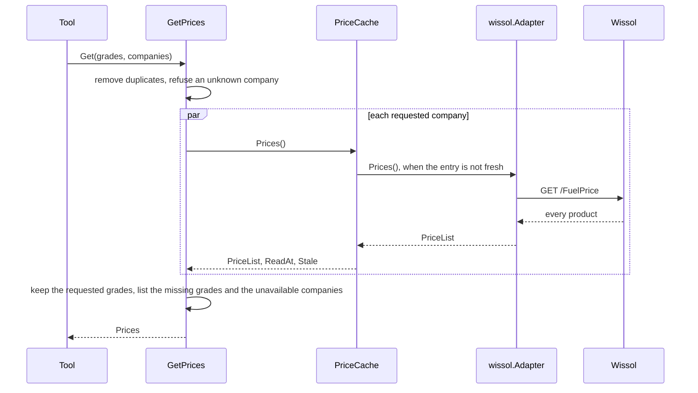

# Specification: The fuel prices of Wissol

## 1. Summary

This feature adds the context `fuel`, the vendor client module `pkg/wissol`, and the
tool `fuel_get_prices`. The tool answers for every fuel company that the server can
read. Wissol is the first. One call returns every product of a company, so the cache
keeps one entry for each company. `spec-scenarios.md` holds the scenarios.

## 2. Coverage

| Requirement       | Where this specification realizes it                    |
| ----------------- | ------------------------------------------------------- |
| `WISFUEL-FR-001`  | 4.2 `ProductPrice`. 4.3 tool. `WISFUEL-DD-004`          |
| `WISFUEL-FR-002`  | 4.2 `ProductPrice.SelfService`. `WISFUEL-DD-005`        |
| `WISFUEL-FR-003`  | 4.2 `Grade`. `WISFUEL-DD-002`                           |
| `WISFUEL-FR-004`  | 4.2 `Grade.Unit`. 4.3 tool                              |
| `WISFUEL-FR-005`  | 4.2 `ProductPrice.EffectiveDate`. `WISFUEL-DD-006`      |
| `WISFUEL-FR-006`  | 4.2 `GetPrices`. 4.4                                    |
| `WISFUEL-FR-007`  | 4.2 `UnknownCompanyError`. 4.5                          |
| `WISFUEL-FR-008`  | 4.2 `PricesQuery.Grades`. 4.5                           |
| `WISFUEL-FR-009`  | 4.2 `CompanyPrices.Missing`                             |
| `WISFUEL-FR-010`  | 4.1 `adapter/wissol`                                    |
| `WISFUEL-FR-011`  | 4.2 `ProductName`. 4.3 tool                             |
| `WISFUEL-FR-012`  | 4.3 tool, `meaning` and the description                 |
| `WISFUEL-FR-013`  | 4.2 `PriceList.ReadAt`                                  |
| `WISFUEL-FR-014`  | 4.2 `Prices.Unavailable`. 4.4                           |
| `WISFUEL-FR-015`  | 4.3 cache                                               |
| `WISFUEL-FR-016`  | 4.3 configuration. `WISFUEL-DD-007`                     |
| `WISFUEL-NFR-001` | 4.3 cache. `WISFUEL-SC-014`                             |
| `WISFUEL-NFR-002` | 4.3 cache, 4.3 configuration. `WISFUEL-SC-015`          |
| `WISFUEL-INV-001` | `WISFUEL-DD-004`                                        |
| `WISFUEL-INV-003` | 4.3 tool                                                |

## 3. Guideline compliance

| Rule                   | How this specification obeys it                                                 |
| ---------------------- | ------------------------------------------------------------------------------- |
| `ARC-004`, `CLT-001`   | `pkg/wissol` is a module: `github.com/abgeo/georgia-mcp/pkg/wissol`, `go 1.26.0`. |
| `ARC-008`              | `fuel` imports no other context. The civil date comes from the kernel. `ADR-0002`. |
| `ARC-009`, `CFG-004`   | `bootstrap` builds the module of `fuel` from `Config.Fuel`.                     |
| `CLT-002`, `CLT-004`   | `pkg/wissol` uses `net/http`, `net/url`, and `encoding/json` only.              |
| `CLT-005`              | No `WithAPIKey`: the vendor needs no key.                                       |
| `CLT-009`, `CLT-011`   | The package comment and the README say that the API is unofficial. The module stays at `v0`. |
| `DOM-001`, `DOM-009`   | The port `PriceSource` names a capability. A fuel company is an adapter of it.  |
| `DOM-005`, `DOM-011`   | `adapter/wissol` converts the vendor shape and wraps `kernel.ErrSourceUnavailable`. |
| `DOM-006`, `MCP-009`   | Every price is a `decimal.Decimal`, and a string in the output.                 |
| `DOM-007`              | The effective date is a `kernel.Date`.                                          |
| `MCP-002` to `MCP-007` | 4.3 tool.                                                                       |
| `RSL-003` to `RSL-006` | `adapter/cache.PriceCache` on `cache.Cache[app.PriceList]`.                     |
| `RSL-008`              | The configuration gives the limit of the calls.                                 |
| `CFG-003`, `CFG-005`   | Each variable has the prefix `GEOMCP_FUEL_WISSOL_` and a default in its tag.    |

## 4. Design

### 4.1 Components

Every path is new unless the table says "change". `F` is `internal/app/georgia-mcp/fuel`.

| Layer          | Path                                       | Types and functions                                          |
| -------------- | ------------------------------------------ | ------------------------------------------------------------ |
| Shared kernel  | `internal/pkg/kernel/` (change)            | `Date`, `ParseDate`, `Today`, `TbilisiZone`, `ErrInvalidDate`. `ADR-0002`. |
| Vendor client  | `pkg/wissol/`                              | `Client`, `New`, `Option`, `FuelPrices`, `FuelPrice`, `APIError`, `ErrUnexpectedStatus`. |
| Domain         | `F/domain/`                                | `CompanyCode`, `Company`, `Grade`, `Unit`, `ProductName`, `ProductPrice`. 4.2. |
| Use case       | `F/app/`                                   | `PriceSource`, `PriceList`, `GetPrices`. 4.2.                |
| Driven adapter | `F/adapter/wissol/`                        | `Adapter`, `NewAdapter`.                                     |
| Cache          | `F/adapter/cache/`                         | `PriceCache`, `New`.                                         |
| Tool           | `F/adapter/tool/`                          | `Register`, the structs of 4.3.                              |
| Module         | `F/module.go`, `F/config.go`               | `Module`, `New`, `Config`, `WissolConfig`, `WissolHTTPConfig`. |
| Composition    | `internal/app/georgia-mcp/bootstrap/` (change) | `Config.Fuel` with `envPrefix:"FUEL_"`. `modules.go` builds `fuel.New`. |
| Configuration  | `configs/.env.example` (change)            | The variables of 4.3.                                        |
| Workspace      | `go.work` (change)                         | `use ./pkg/wissol`.                                          |

**`pkg/wissol`.** A minimal client: the current prices only (`WISFUEL-DD-001`). It has
the shape of `pkg/bog`.

```go
const DefaultBaseURL = "https://api.wissol.ge"

var ErrUnexpectedStatus = errors.New("wissol: unexpected status")

func New(opts ...Option) *Client // WithBaseURL, WithHTTPClient, WithUserAgent
func (c *Client) FuelPrices(ctx context.Context) ([]FuelPrice, error)

type FuelPrice struct {
    ID               int         `json:"id"`
    ProductCode      string      `json:"productCode"`
    FuelType         string      `json:"fuelType"`    // the Georgian name
    FuelTypeEng      string      `json:"fuelTypeEng"`
    FuelTypeRus      string      `json:"fuelTypeRus"`
    IsActive         bool        `json:"isActive"`
    IsEco            bool        `json:"isEco"`
    Price            json.Number `json:"price"`
    PriceSelfService json.Number `json:"priceSelfService"` // empty when absent
    AdditionalInfo   string      `json:"additionalInfo"`
    Date             string      `json:"date"` // "2026-10-08T00:00:00", with no zone
    OrderID          int         `json:"orderId"`
}

type APIError struct {
    StatusCode int
    Body       string // the first 1 KiB
}
```

`FuelPrices` sends `GET /FuelPrice` with `Accept: application/json`. Any status other
than 200 returns an `*APIError` that wraps `ErrUnexpectedStatus`. The client ignores
`fuelPriceHistories`. The default User-Agent is
`georgia-mcp-wissol/<version> (+https://github.com/abgeo/georgia-mcp)`. The body limit
is 1 MiB.

**`adapter/wissol`.** `Company` returns `{Code: "wissol", Name: "Wissol"}`. `Prices`
sends one call, leaves out each product with `isActive` false, and maps each other
product. `ReadAt` is the instant of the answer. The mapping of a product:

| Field of the vendor              | Domain value                                                   |
| -------------------------------- | -------------------------------------------------------------- |
| `productCode`                    | `ProductPrice.Code`, and the grade of `WISFUEL-DD-002`.        |
| `fuelType`, `fuelTypeEng`        | `ProductName{Georgian, English}`.                              |
| `price`                          | `Standard`. Not a number, or not more than zero: the answer fails. |
| `priceSelfService`               | `SelfService`. Absent, `null`, or zero: no price (`WISFUEL-DD-005`). Not a number, or less than zero: the answer fails. |
| `date`                           | `EffectiveDate`: the first 10 characters, through `kernel.ParseDate` (`WISFUEL-DD-006`). |

A failure of the answer returns an error that wraps `kernel.ErrSourceUnavailable`.

**`module.go`.** `New(cfg Config, logger *slog.Logger) (*Module, error)` builds the source
of Wissol when `cfg.Wissol.Enabled` is true. Else it logs at info level `Wissol is off`
with the attribute `variable=GEOMCP_FUEL_WISSOL_ENABLED`. `Register` adds the tool only
when one source or more exists (`WISFUEL-DD-007`). `Close` closes each cache.

### 4.2 Domain model

```go
// domain
type CompanyCode string // lowercase letters, 2 to 16
func ParseCompanyCode(s string) (CompanyCode, error)

type Company struct {
    Code CompanyCode
    Name string // "Wissol"
}

type Grade string // one of the values of requirements 5.1
const (
    GradeRegular  Grade = "regular"
    GradePremium  Grade = "premium"
    GradeSuper    Grade = "super"
    GradeSuper100 Grade = "super_100"
    GradeDiesel   Grade = "diesel"
    GradeCNG      Grade = "cng"
    GradeOther    Grade = "other"
)
func ParseGrade(s string) (Grade, error) // exact lowercase match
func Grades() []Grade                    // the order of the table above
func (g Grade) Unit() Unit               // UnitCubicMetre for GradeCNG, UnitLitre for every other grade

type Unit string
const (
    UnitLitre      Unit = "litre"
    UnitCubicMetre Unit = "cubic_metre"
)

type ProductName struct {
    Georgian string
    English  string
}
func (n ProductName) In(language kernel.Language) string // English when the Georgian name is empty, and the reverse

type ProductPrice struct {
    Code          string              // the product code of the company
    Name          ProductName
    Grade         Grade
    Standard      decimal.Decimal     // more than zero
    SelfService   decimal.NullDecimal // Valid only when the company publishes it, and then more than zero
    EffectiveDate kernel.Date
}
func NewProductPrice(code string, name ProductName, grade Grade,
    standard decimal.Decimal, selfService decimal.NullDecimal,
    effective kernel.Date) (ProductPrice, error)
```

`NewProductPrice` refuses an empty code, a name with no text, a grade that `ParseGrade`
refuses, a standard price that is not more than zero, and a valid self-service price that
is not more than zero. It accepts a zero date: the company publishes none (`ROMFUEL-DD-006`). Errors in `domain/errors.go`:
`ErrInvalidCompanyCode`, `ErrInvalidGrade`, `ErrInvalidProductPrice`.

```go
// app
type PriceList struct {
    Prices []domain.ProductPrice // every active product, sorted by grade, then by code
    ReadAt time.Time             // the instant the server read the list from the company
    Stale  bool                  // true when the list was read before an outage of the company
}

type PriceSource interface {
    Company() domain.Company
    Prices(ctx context.Context) (PriceList, error)
}

type PricesQuery struct {
    Grades    []domain.Grade       // empty: every grade
    Companies []domain.CompanyCode // empty: every company
}

type CompanyPrices struct {
    Company domain.Company
    PriceList                    // only the prices of the requested grades
    Missing []domain.Grade        // the requested grades that the company does not sell, in the order of Grades
}

type Prices struct {
    Companies   []CompanyPrices  // sorted by company code
    Unavailable []domain.Company // the companies that failed, with no prices held
}

func NewGetPrices(sources []PriceSource) *GetPrices
func (u *GetPrices) Get(ctx context.Context, q PricesQuery) (Prices, error)
func (u *GetPrices) Companies() []domain.Company
```

`Get` removes a grade or a company named twice. Errors in `app/errors.go`:
`ErrUnknownCompany` with the type `*UnknownCompanyError{Code, Known}`.

### 4.3 Declarations

**MCP tool.**

| Tool              | Input                              | Output         | Errors (4.5)                                    | Realizes |
| ----------------- | ---------------------------------- | -------------- | ----------------------------------------------- | -------- |
| `fuel_get_prices` | `grades`, `companies`, `language`  | `pricesOutput` | grade, company code, unknown company, language, every company unavailable | `WISFUEL-FR-001` to `WISFUEL-FR-016` |

```go
type getPricesInput struct {
    Grades    []string `json:"grades,omitempty"    jsonschema:"Grades: regular, premium, super, super_100, diesel, cng, other. Empty asks every grade."`
    Companies []string `json:"companies,omitempty" jsonschema:"Fuel company codes. Empty asks every company. The description of the tool lists the codes."`
    Language  string   `json:"language,omitempty"  jsonschema:"The language of the product names: ka or en. The default is en."`
}

type pricesOutput struct {
    Meaning     string                `json:"meaning"               jsonschema:"How to read price and self_service_price."`
    Companies   []companyPricesOutput `json:"companies"             jsonschema:"The prices of each fuel company that answered, sorted by company code."`
    Unavailable []companyOutput       `json:"unavailable,omitempty" jsonschema:"The fuel companies that did not answer."`
}

type companyPricesOutput struct {
    Company string        `json:"company"           jsonschema:"The company code."`
    Source  string        `json:"source"            jsonschema:"The name of the fuel company."`
    AsOf    string        `json:"as_of"             jsonschema:"The instant at which the server read the prices, RFC 3339. The company publishes no instant."`
    Stale   bool          `json:"stale"             jsonschema:"True when the company did not answer and the server returns prices it read before."`
    Prices  []priceOutput `json:"prices"            jsonschema:"The prices of the products, sorted by grade."`
    Missing []string      `json:"missing,omitempty" jsonschema:"The requested grades that the company does not sell."`
}

type priceOutput struct {
    Product          string `json:"product"                      jsonschema:"The name of the product at the company."`
    Grade            string `json:"grade"                        jsonschema:"The grade of the product, the same for every company."`
    Unit             string `json:"unit"                         jsonschema:"The unit of each price: litre, or cubic_metre for cng."`
    Price            string `json:"price"                        jsonschema:"The standard price in GEL of one unit, as a decimal string."`
    SelfServicePrice string `json:"self_service_price,omitempty" jsonschema:"The price in GEL of one unit at a self-service station of the company, as a decimal string. Absent when the company publishes none."`
    EffectiveDate    string `json:"effective_date"               jsonschema:"The date from which the company applies the prices, YYYY-MM-DD."`
}

type companyOutput struct {
    Company string `json:"company" jsonschema:"The company code."`
    Source  string `json:"source"  jsonschema:"The name of the fuel company."`
}
```

`meaning` is the constant `price: the price in GEL of one unit at a station with an
attendant. self_service_price: the price in GEL of one unit at a self-service station of
the same company. A product with no self_service_price has none.` The tool title is
`Fuel prices of Georgian fuel companies`. The description repeats `meaning`, lists the
grades and their units, lists the company codes that `GetPrices.Companies` gives, and
says that the prices are of today, with no history.

**Vendor endpoint.**

| Client       | Method and path   | Key  | Official              | Realizes          |
| ------------ | ----------------- | ---- | --------------------- | ----------------- |
| `pkg/wissol` | `GET /FuelPrice`  | None | No, an unofficial API | `WISFUEL-FR-001`  |

A real answer, recorded on 2026-10-19, cut to two products:

```
GET https://api.wissol.ge/FuelPrice
200 application/json; charset=utf-8
[{"id":5,"productCode":"05","fuelType":"ევრო რეგულარი","fuelTypeEng":"Euro Regular",
  "fuelTypeRus":"Евро Регулар","isActive":true,"isEco":false,"price":4.08,
  "priceSelfService":3.93,"additionalInfo":"…","date":"2026-10-08T00:00:00",
  "orderId":3,"fuelPriceHistories":[]},
 {"id":8,"productCode":"07","fuelType":"A1 სუპერი 100","fuelTypeEng":"A1 SUPER 100",
  "fuelTypeRus":"A1 SUPER 100","isActive":true,"isEco":false,"price":4.79,
  "additionalInfo":"100 ოქტანი","date":"2026-10-17T00:00:00","orderId":8,
  "fuelPriceHistories":[]}]
```

**Cache.** One store for each fuel company, with one key: `prices`. The value is the
`PriceList` of every active product. `ReadAt` is the read instant that the source gave, as
`TBCRATE` 4.3 does. `Stale` comes from the cache.

| Port method               | Key      | Time to live | Maximum stale | Entries | Realizes                                                    |
| ------------------------- | -------- | ------------ | ------------- | ------- | ----------------------------------------------------------- |
| `Prices` of each company  | `prices` | 30 minutes   | 11.5 hours    | 1       | `WISFUEL-NFR-001`, `WISFUEL-NFR-002`, `WISFUEL-FR-015`      |

A stale value is younger than the time to live and the maximum stale: 12 hours.

**Configuration.**

| Variable                         | Type     | Default                 | Secret | Realizes          |
| -------------------------------- | -------- | ----------------------- | ------ | ----------------- |
| `GEOMCP_FUEL_WISSOL_ENABLED`     | bool     | `true`                  | No     | `WISFUEL-FR-016`  |
| `GEOMCP_FUEL_WISSOL_BASE_URL`    | URL      | `https://api.wissol.ge` | No     | `WISFUEL-FR-001`  |
| `GEOMCP_FUEL_WISSOL_TIMEOUT`     | duration | `10s`                   | No     | `WISFUEL-FR-014`  |
| `GEOMCP_FUEL_WISSOL_RATE`        | float    | `1`                     | No     | `WISFUEL-NFR-002` |
| `GEOMCP_FUEL_WISSOL_BURST`       | int      | `1`                     | No     | `WISFUEL-NFR-002` |

`fuel.Config` holds `Wissol WissolConfig` with `envPrefix:"WISSOL_"`. `WissolConfig`
holds `Enabled bool`, `BaseURL url.URL`, and `HTTP WissolHTTPConfig`.
`WissolHTTPConfig` has the fields of `httpclient.Config` with the defaults of this
table, as `rates.BOGHTTPConfig` does.

### 4.4 Flow



`GetPrices.Get` asks each requested company at once with a `sync.WaitGroup`, and waits
for all, as `TBCRATE-DD-003` does. A company that fails joins `Unavailable`. When every
requested company fails, `Get` returns an error that wraps `kernel.ErrSourceUnavailable`
and names the companies.

### 4.5 Errors

| Condition                                  | Sentinel                        | Tool message                                                                          |
| ------------------------------------------ | ------------------------------- | ------------------------------------------------------------------------------------- |
| A grade that is not in requirements 5.1    | `domain.ErrInvalidGrade`        | `grades: "kerosene" is not a grade. Use one of: regular, premium, super, super_100, diesel, cng, lpg, other.` |
| A text that is not a company code          | `domain.ErrInvalidCompanyCode`  | `companies: "Wissol" is not a company code. Use one of: wissol.`                      |
| A company code that the server lacks       | `app.ErrUnknownCompany`         | `companies: "gulf" is not a fuel company of this server. Use one of: wissol.`         |
| A language other than `ka` and `en`        | `kernel.ErrUnknownLanguage`     | `language: "ru" is not a language of this tool. Use ka or en.`                        |
| Every requested company fails              | `kernel.ErrSourceUnavailable`   | `Wissol did not answer. Try again in a few minutes.`                                  |

When several companies fail, the message joins their names, as `TBCRATE` 4.5 does.

## 5. Design decisions

### `WISFUEL-DD-001`

**Realizes:** `WISFUEL-FR-001`, `CLT-001`
**Decision:** `pkg/wissol` covers `GET /FuelPrice` only.
**Rationale:** The requirements leave the history out. `/fuelpricehistory` waits for a
requirement.
**Alternatives:** The history method now. One method with no user in the server.

### `WISFUEL-DD-002`

**Realizes:** `WISFUEL-FR-003`
**Decision:** The adapter maps the product code of Wissol to a grade with a fixed table.
A code that is not in the table gets `other`, and the adapter logs a warning with the
code and the English name, one time for each code.

| Code | Product (2026-10-19) | Grade       |
| ---- | -------------------- | ----------- |
| `05` | Euro Regular         | `regular`   |
| `02` | Eko Premium          | `premium`   |
| `01` | Eko Super            | `super`     |
| `07` | A1 SUPER 100         | `super_100` |
| `03` | Eko Diesel           | `diesel`    |
| `08` | Euro Diesel          | `diesel`    |
| `06` | Diesel Energy        | `diesel`    |
| `09` | Wissol Gas           | `cng`       |

**Rationale:** The code is stable. A name changes with a campaign: "A1 SUPER 100" has no
fixed form. The warning tells the operator to extend the table. The product stays in
the answer, so no price disappears.
**Alternatives:** A match on the English name. A new name breaks it with no warning. A
product with an unknown code left out: a price disappears in silence.

### `WISFUEL-DD-003`

**Realizes:** `WISFUEL-NFR-002`
**Decision:** The cache keeps one entry for each company, with the list of every active
product. The use case filters the grades after the cache.
**Rationale:** One call returns every product. An entry for each grade costs a call for
each grade.
**Alternatives:** An entry for each grade. More calls, and the same answer.

### `WISFUEL-DD-004`

**Realizes:** `WISFUEL-FR-001`, `WISFUEL-INV-001`
**Decision:** `pkg/wissol` decodes the prices as `json.Number`. The adapter parses the
text with `decimal.NewFromString`. The tool writes `StringFixed(-Exponent())`.
**Rationale:** `TBCRATE-DD-007`. The digits stay as Wissol writes them.
**Alternatives:** `float64`. `DOM-006` forbids it.

### `WISFUEL-DD-005`

**Realizes:** `WISFUEL-FR-002`
**Decision:** An absent field, a `null`, and a zero give no self-service price. A
negative value fails the answer.
**Rationale:** On 2026-10-19 two products had no field. A zero is no price that a
station applies. A negative value tells that the vendor changed its shape.
**Alternatives:** A zero as a price. The model would offer free fuel.

### `WISFUEL-DD-006`

**Realizes:** `WISFUEL-FR-005`, `DOM-007`
**Decision:** The adapter reads the first 10 characters of `date` as a `kernel.Date`.
It ignores the time of day.
**Rationale:** Every date on 2026-10-19 had the time `00:00:00` and no zone. The value is
a civil date of Wissol, in Tbilisi.
**Alternatives:** A parse as an instant in UTC. The day moves by 4 hours of offset.

### `WISFUEL-DD-007`

**Realizes:** `WISFUEL-FR-016`
**Decision:** `GEOMCP_FUEL_WISSOL_ENABLED` turns Wissol off. With no source, the module
adds no tool.
**Rationale:** `BOGRATE-DD-006` and `TBCRATE-DD-013`. A tool that can only fail confuses
the model.
**Alternatives:** A tool that answers "no fuel company configured".

### `WISFUEL-DD-008`

**Realizes:** `WISFUEL-FR-011`
**Decision:** The cache keeps both names of a product. The tool picks the name in the
requested language. The language is not part of the cache key.
**Rationale:** One call returns both names. A key for each language doubles the calls.
**Alternatives:** The language in the port, as `NBGRATE` does. The NBG answers one
language in each call. Wissol answers both.

## 6. Scenarios

`spec-scenarios.md` holds `WISFUEL-SC-001` to `WISFUEL-SC-020`.

## 7. Build plan

| #   | Step                                                                          | Realizes                                         | Done |
| --- | ----------------------------------------------------------------------------- | ------------------------------------------------ | ---- |
| 1   | `ADR-0002`: move `Date` to the kernel. Change `DOM-008`.                      | `WISFUEL-FR-005`                                 | [x]  |
| 2   | `pkg/wissol` module, recorded answer, README, example. `go.work`.             | `WISFUEL-FR-001`                                 | [x]  |
| 3   | `domain`: `CompanyCode`, `Company`, `Grade`, `Unit`, `ProductName`, `ProductPrice`. | `WISFUEL-FR-001` to `WISFUEL-FR-005`, `WISFUEL-INV-001` | [x]  |
| 4   | `app`: port, `GetPrices`.                                                     | `WISFUEL-FR-006` to `WISFUEL-FR-009`, `WISFUEL-FR-014` | [x]  |
| 5   | `adapter/wissol`.                                                             | `WISFUEL-FR-002`, `WISFUEL-FR-003`, `WISFUEL-FR-010` | [x]  |
| 6   | `adapter/cache`: `PriceCache`.                                                | `WISFUEL-FR-015`, `WISFUEL-NFR-001`, `WISFUEL-NFR-002` | [x]  |
| 7   | `adapter/tool`: `Register`.                                                   | `WISFUEL-FR-011` to `WISFUEL-FR-013`, `WISFUEL-INV-003` | [x]  |
| 8   | `module.go`, `config.go`, `bootstrap`, `configs/.env.example`.                | `WISFUEL-FR-016`                                 | [x]  |
| 9   | Move the terms of requirements 5 to the glossary.                             | `DOM-002`                                        | [x]  |

## 8. Out of scope for this specification

Nothing that the requirements demand.

## Retired identifiers

This file has no retired identifier.
