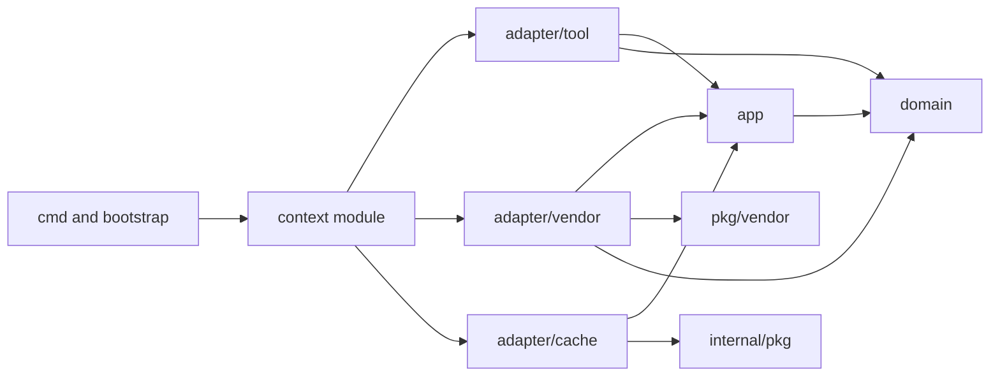

# Architecture

This guideline holds the shape of the system and the technology of each layer.
`ADR-0001` gives the reasons. A change to a rule in this file needs an ADR.

## ARC-001

Georgia MCP is one Go process. It serves a set of MCP tools about Georgian
public services. One binary holds every tool.

## ARC-002

The language is Go. `go.work` holds the Go version.

## ARC-003

The binary serves the tools over two transports: streamable HTTP and stdio.
Both transports serve the same set of tools. See `MCP-010`.

**Why:** A hosted server reaches a remote client. A local binary reaches a desktop
client with no network setup.

## ARC-004

The repository holds two kinds of Go module. `go.work` lists every module.

| Path               | Kind          | Module path                                    |
| ------------------ | ------------- | ---------------------------------------------- |
| `.`                | Server        | `github.com/abgeo/georgia-mcp`                 |
| `pkg/<vendor>`     | Vendor client | `github.com/abgeo/georgia-mcp/pkg/<vendor>`     |

`BLD-002` gives the Go version of each module.

**Why:** A vendor client is useful to another project. Its own module gives it its
own version and its own dependencies. See `CLT-001`.

## ARC-005

The server keeps no durable state. It has no database.
A value that the server keeps lives in memory and has a time to live. See `RSL-003`.
A database needs an ADR.

**Why:** Every source publishes public data. The server repeats the source and
owns no record. A process with no state starts in one step and scales by copy.

## ARC-006

The server holds bounded contexts. One context covers one subject of Georgian
public life, for example the exchange rates or the public transport. `DOM` gives
the rules of a context.

A context uses ports and adapters. A tool is the driving adapter. A vendor client
sits behind a driven adapter.

## ARC-007

A dependency points inward. An arrow means "imports".

| Layer               | Imports                                                         |
| ------------------- | --------------------------------------------------------------- |
| `domain`            | The standard library and `internal/pkg/kernel`.                 |
| `app`               | `domain`, `internal/pkg/kernel`.                                |
| `adapter/tool`      | `app`, `domain`, the MCP SDK, `internal/pkg/mcpserver`.         |
| `adapter/<vendor>`  | `app`, `domain`, `pkg/<vendor>`.                                |
| `adapter/cache`     | `app`, `domain`, `internal/pkg/cache`.                          |
| Context module      | Every layer of its own context, `internal/pkg`.                 |
| `internal/pkg`      | The standard library, external libraries, `internal/pkg/kernel`. |
| `bootstrap`         | Every context module, `internal/pkg`.                           |

`internal/pkg` never imports `internal/app`.

**Why:** The domain changes when Georgia changes. An adapter changes when a vendor
or a protocol changes. The direction keeps each change in its own layer.

## ARC-008

A context does not import another context.
A type that two contexts need moves to `internal/pkg/kernel`. See `DOM-008`.

## ARC-009

`internal/app/georgia-mcp/bootstrap` is the composition root. It is the only package that knows
every context. It builds each context module and registers its tools.

## ARC-010

The server has no plugin mechanism. A new context is a change to the source and
a new build.

**Why:** One owner builds every tool. A plugin contract costs a version scheme and
a loader, and buys nothing that a build does not give.

## ARC-011

The deployment unit is a container image. A local user installs the binary with
`go install`. See `BLD-005`.

## Retired identifiers

This file has no retired identifier.
