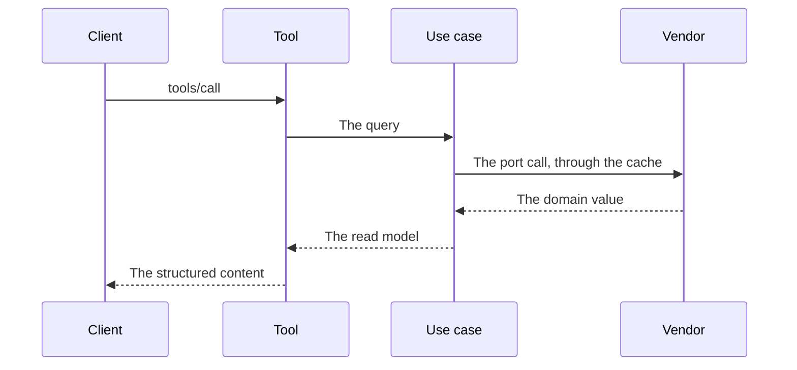

# Specification: The name of the feature

Copy this file to `docs/specs/features/<key>/spec.md`.
Set every field in the frontmatter. See `TRC-008`.
This document holds every technical decision that the code generation needs.

## 1. Summary

Two or three sentences. What does this feature build?

## 2. Coverage

| Requirement     | Where this specification realizes it |
| --------------- | ------------------------------------ |
| `<KEY>-FR-001`  | Section 4.3, MCP tool                |
| `<KEY>-NFR-001` | Section 4.3, cache, `<KEY>-SC-003`   |
| `<KEY>-INV-001` | Section 4.2, `<KEY>-DD-002`          |

A requirement with no row is a defect in this document.

## 3. Guideline compliance

| Rule      | Guideline | How this specification obeys it |
| --------- | --------- | ------------------------------- |
| `DOM-###` | Domain    |                                 |
| `MCP-###` | MCP tools |                                 |

## 4. Design

### 4.1 Components

Name each module, package, file, and type to create or to change. Give the path.

| Layer          | Path                                   | Types |
| -------------- | -------------------------------------- | ----- |
| Vendor client  | `pkg/<vendor>/`                        |       |
| Domain         | `internal/app/georgia-mcp/<context>/domain/`           |       |
| Use case       | `internal/app/georgia-mcp/<context>/app/`              |       |
| Driven adapter | `internal/app/georgia-mcp/<context>/adapter/<vendor>/` |       |
| Tool           | `internal/app/georgia-mcp/<context>/adapter/tool/`     |       |

### 4.2 Domain model

Each value object and read model, with its fields, its constructor, and its
validation. Each domain error. Each port, with its Go signature.

### 4.3 Declarations

One table for each surface that this feature adds. `SPC-003` gives the columns.

**MCP tool.** Give the Go structs of the input and the output after the table. `SPC-005`.

| Tool                         | Input | Output | Errors | Realizes       |
| ---------------------------- | ----- | ------ | ------ | -------------- |
| `<context>_<verb>_<object>`  |       |        |        | `<KEY>-FR-001` |

**Vendor endpoint.**

| Client | Method and path | Key | Official | Realizes |
| ------ | --------------- | --- | -------- | -------- |

**Cache.**

| Port method | Time to live | Maximum stale | Realizes |
| ----------- | ------------ | ------------- | -------- |

**Configuration.**

| Variable | Type | Default | Secret | Realizes |
| -------- | ---- | ------- | ------ | -------- |

### 4.4 Flow

### 4.5 Errors

| Condition | Sentinel | Tool message |
| --------- | -------- | ------------ |
|           |          |              |

## 5. Design decisions

### `<KEY>-DD-001`

**Realizes:** `<KEY>-FR-001`
**Decision:**
**Rationale:**
**Alternatives:**

## 6. Scenarios

### `<KEY>-SC-001`

**Verifies:** `<KEY>-FR-001`
**Layer:** unit, integration, live, or manual

**Given**
**When**
**Then**

## 7. Build plan

| #   | Step | Realizes | Done |
| --- | ---- | -------- | ---- |
| 1   |      |          | [ ]  |

## 8. Out of scope for this specification

What the requirements demand but this specification postpones, with the reason.

## Retired identifiers

This file has no retired identifier.
